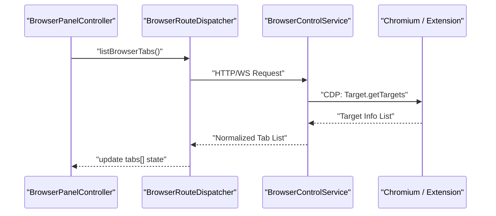

# Browser Automation

<details>
<summary>Relevant source files</summary>

The following files were used as context for generating this wiki page:

- [.github/workflows/crabbox-hydrate.yml](.github/workflows/crabbox-hydrate.yml)
- [.github/workflows/windows-testbox-probe.yml](.github/workflows/windows-testbox-probe.yml)
- [docs/cli/browser.md](docs/cli/browser.md)
- [docs/tools/chrome-extension.md](docs/tools/chrome-extension.md)
- [extensions/browser/chrome-extension/background.test.ts](extensions/browser/chrome-extension/background.test.ts)
- [extensions/browser/chrome-extension/bootstrap.chromium.test.ts](extensions/browser/chrome-extension/bootstrap.chromium.test.ts)
- [extensions/browser/chrome-extension/modules/relay-core.d.ts](extensions/browser/chrome-extension/modules/relay-core.d.ts)
- [extensions/browser/chrome-extension/modules/relay-core.js](extensions/browser/chrome-extension/modules/relay-core.js)
- [extensions/browser/chrome-extension/modules/relay-core.test.ts](extensions/browser/chrome-extension/modules/relay-core.test.ts)
- [extensions/browser/native-host-entry.ts](extensions/browser/native-host-entry.ts)
- [extensions/browser/src/browser-node-proxy.test.ts](extensions/browser/src/browser-node-proxy.test.ts)
- [extensions/browser/src/browser-node-proxy.ts](extensions/browser/src/browser-node-proxy.ts)
- [extensions/browser/src/browser-proxy-envelope.test.ts](extensions/browser/src/browser-proxy-envelope.test.ts)
- [extensions/browser/src/browser-proxy-envelope.ts](extensions/browser/src/browser-proxy-envelope.ts)
- [extensions/browser/src/browser-runtime.ts](extensions/browser/src/browser-runtime.ts)
- [extensions/browser/src/browser/act-policy.test.ts](extensions/browser/src/browser/act-policy.test.ts)
- [extensions/browser/src/browser/act-policy.ts](extensions/browser/src/browser/act-policy.ts)
- [extensions/browser/src/browser/client-fetch.error-body-boundary.test.ts](extensions/browser/src/browser/client-fetch.error-body-boundary.test.ts)
- [extensions/browser/src/browser/client-fetch.ts](extensions/browser/src/browser/client-fetch.ts)
- [extensions/browser/src/browser/errors.test.ts](extensions/browser/src/browser/errors.test.ts)
- [extensions/browser/src/browser/errors.ts](extensions/browser/src/browser/errors.ts)
- [extensions/browser/src/browser/extension-install-layout.test.ts](extensions/browser/src/browser/extension-install-layout.test.ts)
- [extensions/browser/src/browser/extension-install-layout.ts](extensions/browser/src/browser/extension-install-layout.ts)
- [extensions/browser/src/browser/extension-install.native-host.e2e.test.ts](extensions/browser/src/browser/extension-install.native-host.e2e.test.ts)
- [extensions/browser/src/browser/extension-install.test-support.ts](extensions/browser/src/browser/extension-install.test-support.ts)
- [extensions/browser/src/browser/extension-install.test.ts](extensions/browser/src/browser/extension-install.test.ts)
- [extensions/browser/src/browser/extension-install.ts](extensions/browser/src/browser/extension-install.ts)
- [extensions/browser/src/browser/extension-native-host.runtime.ts](extensions/browser/src/browser/extension-native-host.runtime.ts)
- [extensions/browser/src/browser/extension-native-host.test.ts](extensions/browser/src/browser/extension-native-host.test.ts)
- [extensions/browser/src/browser/extension-pairing.ts](extensions/browser/src/browser/extension-pairing.ts)
- [extensions/browser/src/browser/extension-relay/preauth-websocket-guard.test.ts](extensions/browser/src/browser/extension-relay/preauth-websocket-guard.test.ts)
- [extensions/browser/src/browser/form-fields.test.ts](extensions/browser/src/browser/form-fields.test.ts)
- [extensions/browser/src/browser/form-fields.ts](extensions/browser/src/browser/form-fields.ts)
- [extensions/browser/src/browser/routes/agent.act.errors.ts](extensions/browser/src/browser/routes/agent.act.errors.ts)
- [extensions/browser/src/browser/routes/agent.act.normalize.test.ts](extensions/browser/src/browser/routes/agent.act.normalize.test.ts)
- [extensions/browser/src/browser/routes/agent.act.normalize.ts](extensions/browser/src/browser/routes/agent.act.normalize.ts)
- [extensions/browser/src/browser/routes/agent.existing-session.test.ts](extensions/browser/src/browser/routes/agent.existing-session.test.ts)
- [extensions/browser/src/browser/server.agent-contract-form-layout-act-commands.test.ts](extensions/browser/src/browser/server.agent-contract-form-layout-act-commands.test.ts)
- [extensions/browser/src/cli/browser-cli-actions-input/register.batch.test.ts](extensions/browser/src/cli/browser-cli-actions-input/register.batch.test.ts)
- [extensions/browser/src/cli/browser-cli-actions-input/register.batch.ts](extensions/browser/src/cli/browser-cli-actions-input/register.batch.ts)
- [extensions/browser/src/cli/browser-cli-actions-input/register.element.test.ts](extensions/browser/src/cli/browser-cli-actions-input/register.element.test.ts)
- [extensions/browser/src/cli/browser-cli-actions-input/register.element.ts](extensions/browser/src/cli/browser-cli-actions-input/register.element.ts)
- [extensions/browser/src/cli/browser-cli-actions-input/register.files-downloads.test.ts](extensions/browser/src/cli/browser-cli-actions-input/register.files-downloads.test.ts)
- [extensions/browser/src/cli/browser-cli-actions-input/register.files-downloads.ts](extensions/browser/src/cli/browser-cli-actions-input/register.files-downloads.ts)
- [extensions/browser/src/cli/browser-cli-actions-input/register.form-wait-eval.test.ts](extensions/browser/src/cli/browser-cli-actions-input/register.form-wait-eval.test.ts)
- [extensions/browser/src/cli/browser-cli-actions-input/register.form-wait-eval.ts](extensions/browser/src/cli/browser-cli-actions-input/register.form-wait-eval.ts)
- [extensions/browser/src/cli/browser-cli-actions-input/shared.ts](extensions/browser/src/cli/browser-cli-actions-input/shared.ts)
- [extensions/browser/src/cli/browser-cli-cookie-sync.test.ts](extensions/browser/src/cli/browser-cli-cookie-sync.test.ts)
- [extensions/browser/src/cli/browser-cli-extension.test.ts](extensions/browser/src/cli/browser-cli-extension.test.ts)
- [extensions/browser/src/cli/browser-cli-extension.ts](extensions/browser/src/cli/browser-cli-extension.ts)
- [extensions/browser/src/cli/browser-cli-inspect.test.ts](extensions/browser/src/cli/browser-cli-inspect.test.ts)
- [extensions/browser/src/cli/browser-cli-inspect.ts](extensions/browser/src/cli/browser-cli-inspect.ts)
- [extensions/browser/src/cli/browser-cli-manage.test-helpers.ts](extensions/browser/src/cli/browser-cli-manage.test-helpers.ts)
- [extensions/browser/src/cli/browser-cli-manage.ts](extensions/browser/src/cli/browser-cli-manage.ts)
- [extensions/browser/src/cli/browser-cli-shared.ts](extensions/browser/src/cli/browser-cli-shared.ts)
- [extensions/browser/src/cli/browser-cli-state.cookies-storage.ts](extensions/browser/src/cli/browser-cli-state.cookies-storage.ts)
- [extensions/browser/src/cli/browser-cli-state.option-collisions.test.ts](extensions/browser/src/cli/browser-cli-state.option-collisions.test.ts)
- [extensions/browser/src/cli/browser-cli.lazy.test.ts](extensions/browser/src/cli/browser-cli.lazy.test.ts)
- [extensions/browser/src/core-api.ts](extensions/browser/src/core-api.ts)
- [extensions/browser/src/doctor-browser.test.ts](extensions/browser/src/doctor-browser.test.ts)
- [extensions/browser/src/doctor-browser.ts](extensions/browser/src/doctor-browser.ts)
- [extensions/browser/src/gateway/browser-request.profile-from-body.test.ts](extensions/browser/src/gateway/browser-request.profile-from-body.test.ts)
- [scripts/check-no-random-messaging-tmp.mts](scripts/check-no-random-messaging-tmp.mts)
- [scripts/crabbox-wrapper.mjs](scripts/crabbox-wrapper.mjs)
- [scripts/crabbox-wrapper.mts](scripts/crabbox-wrapper.mts)
- [test/scripts/check-no-random-messaging-tmp.test.ts](test/scripts/check-no-random-messaging-tmp.test.ts)
- [test/scripts/crabbox-wrapper.test.ts](test/scripts/crabbox-wrapper.test.ts)
- [ui/src/components/browser/browser-annotation.ts](ui/src/components/browser/browser-annotation.ts)
- [ui/src/components/browser/browser-client.ts](ui/src/components/browser/browser-client.ts)
- [ui/src/components/browser/browser-panel-controller-input.test.ts](ui/src/components/browser/browser-panel-controller-input.test.ts)
- [ui/src/components/browser/browser-panel-controller-input.ts](ui/src/components/browser/browser-panel-controller-input.ts)
- [ui/src/components/browser/browser-panel-controller-test-support.ts](ui/src/components/browser/browser-panel-controller-test-support.ts)
- [ui/src/components/browser/browser-panel-controller-viewport-sync.test.ts](ui/src/components/browser/browser-panel-controller-viewport-sync.test.ts)
- [ui/src/components/browser/browser-panel-controller.test.ts](ui/src/components/browser/browser-panel-controller.test.ts)
- [ui/src/components/browser/browser-panel-controller.ts](ui/src/components/browser/browser-panel-controller.ts)
- [ui/src/components/browser/browser-panel-operation-ownership.test.ts](ui/src/components/browser/browser-panel-operation-ownership.test.ts)
- [ui/src/components/browser/browser-panel-operation-ownership.ts](ui/src/components/browser/browser-panel-operation-ownership.ts)
- [ui/src/components/browser/browser-panel-pending-input.ts](ui/src/components/browser/browser-panel-pending-input.ts)
- [ui/src/components/browser/browser-panel-render.ts](ui/src/components/browser/browser-panel-render.ts)
- [ui/src/components/browser/browser-panel-surface.test.ts](ui/src/components/browser/browser-panel-surface.test.ts)
- [ui/src/components/browser/browser-panel-surface.ts](ui/src/components/browser/browser-panel-surface.ts)
- [ui/src/components/browser/browser-panel-tabs.ts](ui/src/components/browser/browser-panel-tabs.ts)
- [ui/src/components/browser/browser-panel.test.ts](ui/src/components/browser/browser-panel.test.ts)
- [ui/src/components/browser/browser-panel.ts](ui/src/components/browser/browser-panel.ts)
- [ui/src/components/panel-tab-strip.browser.test.ts](ui/src/components/panel-tab-strip.browser.test.ts)
- [ui/src/components/panel-tab-strip.test.ts](ui/src/components/panel-tab-strip.test.ts)
- [ui/src/components/panel-tab-strip.ts](ui/src/components/panel-tab-strip.ts)
- [ui/src/pages/chat/browser-annotation-admission.ts](ui/src/pages/chat/browser-annotation-admission.ts)
- [ui/src/pages/chat/browser-annotation-removal.test.ts](ui/src/pages/chat/browser-annotation-removal.test.ts)
- [ui/src/pages/chat/browser-annotation-removal.ts](ui/src/pages/chat/browser-annotation-removal.ts)

</details>


This section documents OpenClaw’s integrated **Browser Automation** subsystem, which enables agent-driven control of Chromium-based browsers (Chrome, Brave, Edge). It covers the architecture of the browser control service, the management of isolated browser profiles, CDP (Chrome DevTools Protocol) based tab control, and the integration with the agent tool surface via the Chrome extension relay.

---

## 1. Purpose and Scope

OpenClaw embeds a dedicated browser control service to allow agent automation within isolated Chromium browser sessions. This system handles JS-heavy sites and authenticated sessions that lightweight HTTP tools like `web_fetch` cannot process. It provides agents with the ability to perform user-like actions such as clicking, typing, and capturing snapshots while maintaining strict security boundaries.

The subsystem supports three primary modes:
- **Managed:** A dedicated, isolated Chrome/Brave profile managed by OpenClaw.
- **Existing Session (MCP):** Attaching to a user's running browser via Chrome DevTools Protocol.
- **Extension Relay:** Driving the browser through the OpenClaw Chrome Extension relay bridge, which uses `chrome.debugger` to bypass remote-debugging prompts [docs/tools/chrome-extension.md:12-14]().

---

## 2. Architecture Overview

### 2.1 Browser Control Service
The browser subsystem is managed via a lazy-loaded control service [docs/tools/chrome-extension.md:113-115](). It handles profile lifecycle, browser process management, and the CDP routing layer.
- **Profile Management:** Supports `openclaw` (isolated), `user` (MCP-based), and custom CDP endpoints [docs/cli/browser.md:96-99]().
- **System Profile Import:** On macOS, the system can decrypt cookies from existing Chrome/Brave profiles and inject them into managed OpenClaw profiles [docs/cli/browser.md:114-119]().
- **Graphics Diagnostics:** The service collects hardware acceleration and driver details from the browser to assist in troubleshooting rendering issues [docs/cli/browser.md:68-71]().

### 2.2 Chrome Extension Relay
The OpenClaw Chrome extension acts as a thin transport between the OpenClaw extension relay (loopback WebSocket) and `chrome.debugger`.
- **Relay Bridge:** All CDP target synthesis lives server-side in the relay bridge. The extension connects to the Gateway's `/browser/extension` route [docs/tools/chrome-extension.md:113-115]().
- **Native Bootstrap:** On macOS and Linux, the extension supports automatic native bootstrap to pre-register the native host, allowing pairing without manual token entry [docs/tools/chrome-extension.md:35-43]().
- **Standalone Relay:** A direct-loopback relay can be spawned by the native host as a detached process (`relay-daemon-entry.js`) to support operation without a full Gateway instance [docs/tools/chrome-extension.md:125-132]().

### 2.3 Security and SSRF Protection
Browser automation enforces strict boundaries to prevent Server Side Request Forgery (SSRF) and unauthorized local access.
- **Navigation Guard:** The system blocks navigation to internal pages like `chrome://` or `chrome-extension://` [docs/tools/chrome-extension.md:135-136]().
- **SSRF Policy:** If `navigate` or `open` fails while the control plane is healthy, it is typically a result of a navigation SSRF policy block [docs/cli/browser.md:42-43]().
- **Native Host Ownership:** Existing native-host files are not overwritten unless they are verifiably OpenClaw-owned, preventing hijacking of the native messaging bridge [docs/tools/chrome-extension.md:78-79]().

Sources:
- `docs/tools/chrome-extension.md` [10-153]()
- `docs/cli/browser.md` [9-130]()
- `extensions/browser/src/browser/extension-install.ts` [11-17]()

---

## 3. Key Components and Implementation

### 3.1 Browser Panel Controller
The UI interaction layer is managed by `BrowserPanelController`, a Reactive Controller that synchronizes the browser state with the Control UI [ui/src/components/browser/browser-panel-controller.ts:47-71]().
- **State Management:** Tracks running status, tab lists, active target IDs, and viewport dimensions [ui/src/components/browser/browser-panel-controller.ts:48-62]().
- **Snapshot Lifecycle:** Coordinates snapshot requests via `listBrowserTabs` and handles tab selection logic [ui/src/components/browser/browser-panel-controller.ts:163-184]().
- **Input Handling:** Delegates interaction logic to `BrowserPanelInputController` [ui/src/components/browser/browser-panel-controller-input.ts:1-20]().

### 3.2 Extension Installation and Verification
The `installChromeExtensionBootstrap` function handles the complex task of registering the extension for native messaging [extensions/browser/src/browser/extension-install.ts:58-69]().
- **Identity Prediction:** Predicts the extension ID based on the installation path to pre-register `allowed_origins` [extensions/browser/src/browser/extension-install.ts:87-88]().
- **Preference Inspection:** Verifies the installation by inspecting Chrome's `Preferences` and `Secure Preferences` files [docs/tools/chrome-extension.md:48-52]().
- **Platform Support:** Provides automatic setup for macOS/Linux while maintaining manual pairing for Windows [docs/tools/chrome-extension.md:26-31]().

### 3.3 Tab Strip and Navigation
The UI utilizes a specialized tab strip for browser tab management [ui/src/components/panel-tab-strip.ts:8-20]().
- **Overflow Handling:** Includes logic for detecting label overflow and managing scroll edges to ensure the active tab remains visible [ui/src/components/panel-tab-strip.ts:66-86]().
- **Focus Recovery:** Implements `focusNeedsRecovery` to maintain keyboard accessibility when tabs are reordered or closed [ui/src/components/panel-tab-strip.ts:57-64]().

Sources:
- `ui/src/components/browser/browser-panel-controller.ts` [47-184]()
- `extensions/browser/src/browser/extension-install.ts` [58-169]()
- `ui/src/components/panel-tab-strip.ts` [8-175]()
- `docs/tools/chrome-extension.md` [35-79]()

---

## 4. Entity Mapping and Data Flow

### Browser Automation Entity Mapping
This diagram bridges the functional concepts of browser control to the specific code entities in the UI and Extension subsystems.

Title: "Browser Automation Entity Mapping"
```mermaid
flowchart LR
  subgraph "Natural_Language_Space"
    "UI_Controller"["UI Controller"]
    "Extension_Installer"["Extension Installer"]
    "Native_Relay"["Native Relay"]
    "Tab_Management"["Tab Management"]
  end

  subgraph "Code_Entity_Space"
    direction TB
    "BPC"["ui/src/components/browser/browser-panel-controller.ts"]
    "EXI"["extensions/browser/src/browser/extension-install.ts"]
    "REL"["extensions/browser/chrome-extension/modules/relay-core.js"]
    "PTS"["ui/src/components/panel-tab-strip.ts"]
  end

  "UI_Controller" --> "BPC"
  "Extension_Installer" --> "EXI"
  "Native_Relay" --> "REL"
  "Tab_Management" --> "PTS"
```

Sources:
- `ui/src/components/browser/browser-panel-controller.ts` [47-71]()
- `extensions/browser/src/browser/extension-install.ts` [1-100]()
- `ui/src/components/panel-tab-strip.ts` [1-50]()

### Browser Request Dispatch Flow
The following diagram illustrates how a browser command flows from the CLI or UI through the request dispatcher to the target browser.

Title: "Browser Request Dispatch Flow"


Sources:
- `ui/src/components/browser/browser-panel-controller.ts` [163-184]()
- `ui/src/components/browser/browser-client.ts` [11-24]()
- `extensions/browser/src/browser/routes/dispatcher.js` [21-22]()

---

## 5. Troubleshooting

| Symptom | Resolution / Code Pointer |
| :--- | :--- |
| **"Not reachable after start"** | Troubleshoot CDP readiness. Verify the browser process launched correctly. [docs/cli/browser.md:42-43](). |
| **"Navigation blocked"** | Likely an SSRF policy violation or attempt to access restricted internal URLs. [ui/src/components/browser/browser-panel-controller.ts:157-159](). |
| **"Manual setup required"** | Native host pre-registration failed or Chrome user-data directory was not found. [extensions/browser/src/browser/extension-install.ts:71-74](). |
| **"Evaluate unavailable"** | The current page or browser configuration prevents JS execution (e.g., CSP or restricted pages). [ui/src/components/browser/browser-panel-controller.ts:153](). |
| **"Relay port collision"** | An existing listener is holding the relay port. The daemon will not overwrite active listeners. [docs/tools/chrome-extension.md:149-150](). |

Sources:
- `docs/cli/browser.md` [42-53]()
- `ui/src/components/browser/browser-panel-controller.ts` [102-162]()
- `extensions/browser/src/browser/extension-install.ts` [55-75]()
- `docs/tools/chrome-extension.md` [149-153]()