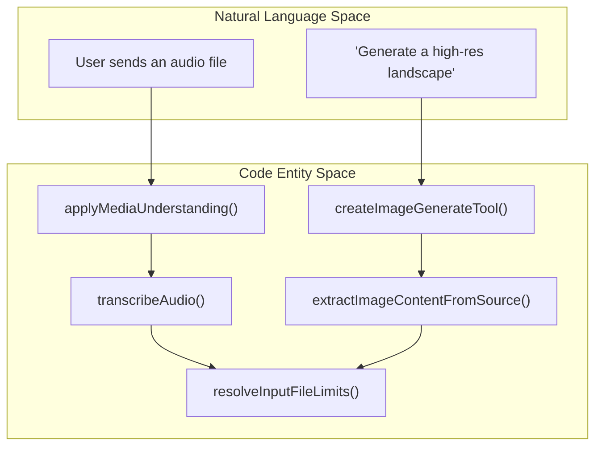
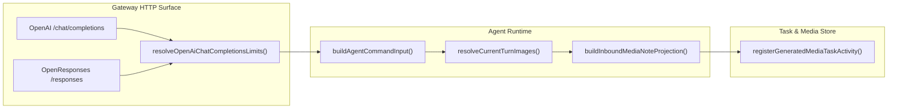

# Image & Media Tools

Relevant source files

The following files were used as context for generating this wiki page:

- [docs/concepts/queue.md](docs/concepts/queue.md)
- [docs/gateway/openai-http-api.md](docs/gateway/openai-http-api.md)
- [docs/gateway/openresponses-http-api.md](docs/gateway/openresponses-http-api.md)
- [docs/nodes/media-understanding.md](docs/nodes/media-understanding.md)
- [extensions/active-memory/transcript-watch.ts](extensions/active-memory/transcript-watch.ts)
- [extensions/discord/src/voice/audio.lifecycle.test.ts](extensions/discord/src/voice/audio.lifecycle.test.ts)
- [extensions/discord/src/voice/audio.test.ts](extensions/discord/src/voice/audio.test.ts)
- [extensions/discord/src/voice/audio.ts](extensions/discord/src/voice/audio.ts)
- [extensions/discord/src/voice/capture-state.test.ts](extensions/discord/src/voice/capture-state.test.ts)
- [extensions/discord/src/voice/capture-state.ts](extensions/discord/src/voice/capture-state.ts)
- [extensions/discord/src/voice/voice-session.startup.test.ts](extensions/discord/src/voice/voice-session.startup.test.ts)
- [extensions/qa-lab/src/suite-runtime-agent-process.ts](extensions/qa-lab/src/suite-runtime-agent-process.ts)
- [packages/media-core/src/attachment-classify.test.ts](packages/media-core/src/attachment-classify.test.ts)
- [packages/media-core/src/attachment-classify.ts](packages/media-core/src/attachment-classify.ts)
- [packages/media-core/src/base64.test.ts](packages/media-core/src/base64.test.ts)
- [packages/media-core/src/base64.ts](packages/media-core/src/base64.ts)
- [packages/media-core/src/inbound-path-policy.test.ts](packages/media-core/src/inbound-path-policy.test.ts)
- [packages/media-core/src/mime.test.ts](packages/media-core/src/mime.test.ts)
- [packages/media-core/src/mime.ts](packages/media-core/src/mime.ts)
- [packages/memory-host-sdk/src/host/embedding-chunk-limits.test.ts](packages/memory-host-sdk/src/host/embedding-chunk-limits.test.ts)
- [packages/memory-host-sdk/src/host/embeddings.types.ts](packages/memory-host-sdk/src/host/embeddings.types.ts)
- [qa/scenarios/memory/active-memory-cold-first-turn-trigger-recall.yaml](qa/scenarios/memory/active-memory-cold-first-turn-trigger-recall.yaml)
- [qa/scenarios/memory/active-memory-preprompt-recall.yaml](qa/scenarios/memory/active-memory-preprompt-recall.yaml)
- [qa/scenarios/scheduling/heartbeat-inbound-metadata.yaml](qa/scenarios/scheduling/heartbeat-inbound-metadata.yaml)
- [src/agents/command/attempt-execution.cli.test.ts](src/agents/command/attempt-execution.cli.test.ts)
- [src/agents/command/attempt-execution.ts](src/agents/command/attempt-execution.ts)
- [src/agents/command/compaction-accounting.ts](src/agents/command/compaction-accounting.ts)
- [src/agents/command/run-embedded-attempt.ts](src/agents/command/run-embedded-attempt.ts)
- [src/agents/delegation-capability.test.ts](src/agents/delegation-capability.test.ts)
- [src/agents/delegation-capability.ts](src/agents/delegation-capability.ts)
- [src/agents/embedded-agent-runner/run.overflow-compaction.loop.test.ts](src/agents/embedded-agent-runner/run.overflow-compaction.loop.test.ts)
- [src/agents/embedded-agent-runner/run.recovery-cancellation.test-support.ts](src/agents/embedded-agent-runner/run.recovery-cancellation.test-support.ts)
- [src/agents/embedded-agent-runner/run/internal-params.ts](src/agents/embedded-agent-runner/run/internal-params.ts)
- [src/agents/embedded-agent-runner/run/params.ts](src/agents/embedded-agent-runner/run/params.ts)
- [src/agents/embedded-agent-runner/run/run-attempt-dispatch.ts](src/agents/embedded-agent-runner/run/run-attempt-dispatch.ts)
- [src/agents/embedded-agent-runner/run/runtime-preparation.ts](src/agents/embedded-agent-runner/run/runtime-preparation.ts)
- [src/agents/embedded-agent-subscribe.handlers.messages.update-commentary.test.ts](src/agents/embedded-agent-subscribe.handlers.messages.update-commentary.test.ts)
- [src/agents/harness/user-input-bridge.ts](src/agents/harness/user-input-bridge.ts)
- [src/agents/session-placement-admission.test.ts](src/agents/session-placement-admission.test.ts)
- [src/agents/session-placement-admission.ts](src/agents/session-placement-admission.ts)
- [src/agents/subagents/registry/subagent-registry-cleanup.test.ts](src/agents/subagents/registry/subagent-registry-cleanup.test.ts)
- [src/agents/subagents/registry/subagent-registry-cleanup.ts](src/agents/subagents/registry/subagent-registry-cleanup.ts)
- [src/auto-reply/model.ts](src/auto-reply/model.ts)
- [src/auto-reply/reply.directive.parse.test.ts](src/auto-reply/reply.directive.parse.test.ts)
- [src/auto-reply/reply/agent-runner-cli-candidate.ts](src/auto-reply/reply/agent-runner-cli-candidate.ts)
- [src/auto-reply/reply/agent-runner-compaction-accounting.ts](src/auto-reply/reply/agent-runner-compaction-accounting.ts)
- [src/auto-reply/reply/agent-runner-embedded-candidate.ts](src/auto-reply/reply/agent-runner-embedded-candidate.ts)
- [src/auto-reply/reply/agent-runner-execution-cli-admission.test.ts](src/auto-reply/reply/agent-runner-execution-cli-admission.test.ts)
- [src/auto-reply/reply/agent-runner-execution-cli-delegation.test.ts](src/auto-reply/reply/agent-runner-execution-cli-delegation.test.ts)
- [src/auto-reply/reply/agent-runner-execution-cli-sessions.test.ts](src/auto-reply/reply/agent-runner-execution-cli-sessions.test.ts)
- [src/auto-reply/reply/agent-runner-execution-lifecycle.test.ts](src/auto-reply/reply/agent-runner-execution-lifecycle.test.ts)
- [src/auto-reply/reply/agent-runner-execution-message-tools.test.ts](src/auto-reply/reply/agent-runner-execution-message-tools.test.ts)
- [src/auto-reply/reply/agent-runner-fallback-candidate.ts](src/auto-reply/reply/agent-runner-fallback-candidate.ts)
- [src/auto-reply/reply/agent-runner-fallback-cycle.types.ts](src/auto-reply/reply/agent-runner-fallback-cycle.types.ts)
- [src/auto-reply/reply/agent-runner-run-params.ts](src/auto-reply/reply/agent-runner-run-params.ts)
- [src/auto-reply/reply/agent-runner-utils.test.ts](src/auto-reply/reply/agent-runner-utils.test.ts)
- [src/auto-reply/reply/directive-handling.parse.ts](src/auto-reply/reply/directive-handling.parse.ts)
- [src/auto-reply/reply/directive-parsing.ts](src/auto-reply/reply/directive-parsing.ts)
- [src/auto-reply/reply/directives.ts](src/auto-reply/reply/directives.ts)
- [src/auto-reply/reply/dispatch-from-config.send-policy-routing.test-utils.ts](src/auto-reply/reply/dispatch-from-config.send-policy-routing.test-utils.ts)
- [src/auto-reply/reply/exec/directive.ts](src/auto-reply/reply/exec/directive.ts)
- [src/auto-reply/reply/get-reply-native-slash-fast-path.ts](src/auto-reply/reply/get-reply-native-slash-fast-path.ts)
- [src/auto-reply/reply/get-reply-run-context.ts](src/auto-reply/reply/get-reply-run-context.ts)
- [src/auto-reply/reply/get-reply-run-execute.ts](src/auto-reply/reply/get-reply-run-execute.ts)
- [src/auto-reply/reply/get-reply-run-helpers.ts](src/auto-reply/reply/get-reply-run-helpers.ts)
- [src/auto-reply/reply/get-reply-run.media-only.test.ts](src/auto-reply/reply/get-reply-run.media-only.test.ts)
- [src/auto-reply/reply/get-reply.message-hooks.test.ts](src/auto-reply/reply/get-reply.message-hooks.test.ts)
- [src/auto-reply/reply/get-reply.ts](src/auto-reply/reply/get-reply.ts)
- [src/auto-reply/reply/get-reply.types.ts](src/auto-reply/reply/get-reply.types.ts)
- [src/auto-reply/reply/queue.collect.test.ts](src/auto-reply/reply/queue.collect.test.ts)
- [src/auto-reply/reply/queue/directive.ts](src/auto-reply/reply/queue/directive.ts)
- [src/auto-reply/reply/queue/drain.ts](src/auto-reply/reply/queue/drain.ts)
- [src/auto-reply/reply/queue/types.ts](src/auto-reply/reply/queue/types.ts)
- [src/auto-reply/reply/source-reply-delivery-runtime.ts](src/auto-reply/reply/source-reply-delivery-runtime.ts)
- [src/cron/isolated-agent/run-executor.ts](src/cron/isolated-agent/run-executor.ts)
- [src/gateway/agent-prompt.ts](src/gateway/agent-prompt.ts)
- [src/gateway/embeddings-http.test.ts](src/gateway/embeddings-http.test.ts)
- [src/gateway/embeddings-http.ts](src/gateway/embeddings-http.ts)
- [src/gateway/open-responses.schema.ts](src/gateway/open-responses.schema.ts)
- [src/gateway/openai-compat-errors.ts](src/gateway/openai-compat-errors.ts)
- [src/gateway/openai-http.test.ts](src/gateway/openai-http.test.ts)
- [src/gateway/openai-http.ts](src/gateway/openai-http.ts)
- [src/gateway/openresponses-http.server.file-only.test.ts](src/gateway/openresponses-http.server.file-only.test.ts)
- [src/gateway/openresponses-http.test.ts](src/gateway/openresponses-http.test.ts)
- [src/gateway/openresponses-http.ts](src/gateway/openresponses-http.ts)
- [src/gateway/openresponses-parity.test.ts](src/gateway/openresponses-parity.test.ts)
- [src/gateway/openresponses-prompt.ts](src/gateway/openresponses-prompt.ts)
- [src/gateway/server-methods/chat-send-late-followup.test.ts](src/gateway/server-methods/chat-send-late-followup.test.ts)
- [src/gateway/server-methods/chat-send-late-followup.ts](src/gateway/server-methods/chat-send-late-followup.ts)
- [src/media-understanding/apply.test.ts](src/media-understanding/apply.test.ts)
- [src/media-understanding/apply.ts](src/media-understanding/apply.ts)
- [src/media-understanding/attachments.cache.test.ts](src/media-understanding/attachments.cache.test.ts)
- [src/media-understanding/attachments.cache.ts](src/media-understanding/attachments.cache.ts)
- [src/media-understanding/file-attachment-outcomes.test.ts](src/media-understanding/file-attachment-outcomes.test.ts)
- [src/media-understanding/file-attachment-outcomes.ts](src/media-understanding/file-attachment-outcomes.ts)
- [src/media-understanding/image-input-normalize.ts](src/media-understanding/image-input-normalize.ts)
- [src/media-understanding/media-understanding-misc.test.ts](src/media-understanding/media-understanding-misc.test.ts)
- [src/media-understanding/runtime.local-input.test.ts](src/media-understanding/runtime.local-input.test.ts)
- [src/media-understanding/runtime.test.ts](src/media-understanding/runtime.test.ts)
- [src/media-understanding/runtime.ts](src/media-understanding/runtime.ts)
- [src/media/input-files.extract.test.ts](src/media/input-files.extract.test.ts)
- [src/media/input-files.fetch-guard.test.ts](src/media/input-files.fetch-guard.test.ts)
- [src/media/input-files.ts](src/media/input-files.ts)
- [src/media/playback-transcode.test-support.ts](src/media/playback-transcode.test-support.ts)
- [src/media/playback-transcode.test.ts](src/media/playback-transcode.test.ts)
- [src/media/playback-transcode.ts](src/media/playback-transcode.ts)
- [test/transcripts-tool.discord-lifecycle.integration.test.ts](test/transcripts-tool.discord-lifecycle.integration.test.ts)

This section documents the image and media tools implemented within OpenClaw. It covers the infrastructure for image generation, media understanding pipelines (audio/video/image), PDF processing, and the transcode/playback systems used to bridge local media assets with AI agents and gateway clients.

---

## 1. Purpose and Scope

OpenClaw provides a comprehensive system to handle media inputs and outputs within AI agent workflows. The purpose of these tools is to:

- **Generate Media**: Create images, video, and music from natural language prompts using various providers via tools like `image_generate`, `video_generate`, and `music_generate` [src/agents/openclaw-tools.ts:61-87]().
- **Understand Content**: Extract information from images, audio, and PDF files via vision-capable models or specialized tools like `pdf_tool` and `image_tool` [src/agents/openclaw-tools.ts:62-69]().
- **Media Pipeline**: Manage the transcription, description, and local binary probing of media attachments before they reach the agent [src/media-understanding/apply.ts:1-50]().
- **Transcoding & Playback**: Handle audio/video format conversion via FFmpeg to ensure compatibility between source media and gateway clients [src/media/playback-transcode.ts:1-40]().
- **Sanitization**: Enforce limits on image inputs (dimensions, file size) to prevent context overflow or security issues [src/media/input-files.ts:27-39]().

**Sources:** [src/agents/openclaw-tools.ts:61-87](), [src/media-understanding/apply.ts:1-50](), [src/media/playback-transcode.ts:1-40](), [src/media/input-files.ts:27-39]()

---

## 2. Image & Media Pipeline

### 2.1 Media Understanding Pipeline
The media understanding system processes inbound attachments before an agent run begins. It uses `applyMediaUnderstanding` to mutate the message context with transcripts or descriptions [src/media-understanding/apply.ts:36-36]().

- **Audio Transcription**: Uses providers like Groq or Deepgram to convert audio attachments into text markers [src/media-understanding/apply.test.ts:82-89]().
- **Image/Video Description**: For models without native vision, this pipeline generates textual descriptions of visual content [src/media-understanding/apply.test.ts:1-6]().
- **File Extraction**: Extracts text from PDFs and other documents to be injected into the `MsgContext` [src/media-understanding/apply.test.ts:1-6]().

### 2.2 Input Validation & Limits
OpenClaw enforces strict limits on inbound media via `InputImageLimits` and `InputFileLimits` [src/media/input-files.ts:34-39]().
- **MIME Filtering**: Only allowed types (e.g., `image/jpeg`, `image/png`, `audio/mpeg`) are processed [src/media/input-files.ts:29-29]().
- **SSRF Protection**: URL-based media fetching is guarded by `fetchWithSsrFGuard` and a hostname allowlist [src/gateway/openai-http.ts:76-76](), [src/media/input-files.fetch-guard.test.ts:49-58]().
- **Size Constraints**: Default limits for images are typically 20MB per request body [src/gateway/openai-http.ts:128-130]().

### 2.3 Bridge: Natural Language to Media Tool Execution

Title: Media Processing and Tool Flow

**Sources:** [src/media-understanding/apply.ts:36-36](), [src/media/input-files.ts:32-39](), [src/gateway/openai-http.ts:146-163]()

---

## 3. Playback & Transcoding System

The `playback-transcode` module manages the conversion of media files for client consumption, ensuring that various source formats are playable in native apps or web interfaces.

### 3.1 Transcode Policy
OpenClaw classifies media into `native` (no conversion needed) or `transcode` modes based on the source MIME type and codec [src/media/playback-transcode.test.ts:127-162]().

| MIME Type | Kind | Mode | Target Codec |
| :--- | :--- | :--- | :--- |
| `audio/wav` | audio | native | `pcm_s16le` |
| `audio/flac` | audio | transcode | `flac` |
| `video/mp4` | video | native | `h264` |
| `video/webm` | video | transcode | `vp9` |

### 3.2 FFmpeg Integration
The system uses `runFfmpeg` to perform asynchronous conversions [src/media/playback-transcode.test.ts:12-25]().
- **Probing**: `probePlaybackMediaFileDescriptor` identifies stream metadata (duration, codec, bitrate) [src/media/playback-transcode.test.ts:26-28]().
- **Caching**: Transcoded results are cached using a key derived from the source file's path, size, and modification time [src/media/playback-transcode.test.ts:81-96]().

**Sources:** [src/media/playback-transcode.ts:1-40](), [src/media/playback-transcode.test.ts:127-162]()

---

## 4. Gateway Media Integration

The Gateway's HTTP APIs (OpenAI and OpenResponses) handle the ingress of media content, translating multi-modal requests into agent commands.

### 4.1 OpenAI Compatibility
The `/v1/chat/completions` endpoint supports `image_url` content blocks.
- **Base64 Handling**: `estimateBase64DecodedBytes` is used to validate image sizes before decoding [src/gateway/openai-http.ts:5-5]().
- **Image Normalization**: Images are processed through `extractImageContentFromSource` to prepare them for the model provider [src/gateway/openai-http.ts:32-32]().

### 4.2 OpenResponses API
The `/v1/responses` endpoint implements specialized media handling for the OpenResponses standard.
- **File Context**: `renderFileContextBlock` generates the prompt representation of attached media [src/gateway/openresponses-http.ts:26-26]().
- **Untrusted Content**: `wrapUntrustedFileContent` ensures that media metadata is safely handled during prompt construction [src/gateway/openresponses-http.ts:93-93]().

### 4.3 Media Interaction Architecture

Title: Gateway to Agent Media Flow

**Sources:** [src/gateway/openai-http.ts:146-163](), [src/auto-reply/reply/get-reply-run-execute.ts:158-166](), [src/auto-reply/media-note.ts:31-31](), [src/tasks/generated-media-task-activity.ts:31-31]()

---

## 5. TTS & Realtime Voice

OpenClaw supports Text-to-Speech (TTS) and Realtime Voice interactions via specialized provider bridges.

- **Realtime Voice**: Implements low-latency bidirectional audio for providers like OpenAI (Quicksilver), Google (Live), and xAI [extensions/openai/realtime-voice-provider.ts:26-30]().
- **TTS Tools**: The `tts` tool allows agents to generate audio files from text strings [src/agents/openclaw-tools.ts:86-86]().
- **Audio Probing**: Inbound audio is detected via `hasInboundAudio` to trigger appropriate transcription or voice-response logic [src/auto-reply/reply/agent-runner-cli-candidate.ts:36-36]().

**Sources:** [extensions/openai/realtime-voice-provider.ts:26-30](), [src/agents/openclaw-tools.ts:86-86](), [src/auto-reply/reply/agent-runner-cli-candidate.ts:36-36]()