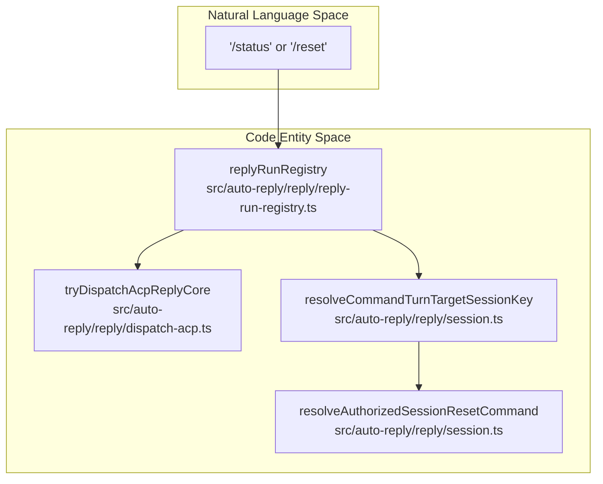
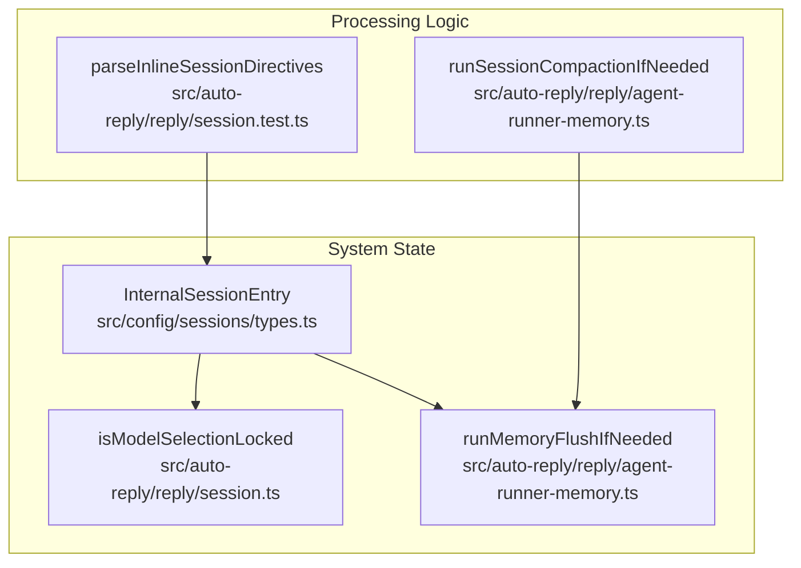
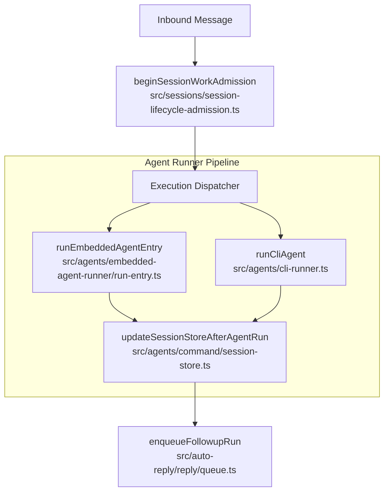

# Commands & Auto-Reply

Relevant source files

The following files were used as context for generating this wiki page:

- [extensions/copilot/harness.ts](extensions/copilot/harness.ts)
- [extensions/telegram/src/bot-message-dispatch.preview-hook-safety.test.ts](extensions/telegram/src/bot-message-dispatch.preview-hook-safety.test.ts)
- [packages/ai/src/providers/clean-for-gemini.ts](packages/ai/src/providers/clean-for-gemini.ts)
- [src/agents/cli-runner.runtime.ts](src/agents/cli-runner.runtime.ts)
- [src/agents/cli-runner/cli-run-settlement.test.ts](src/agents/cli-runner/cli-run-settlement.test.ts)
- [src/agents/cli-session-store.ts](src/agents/cli-session-store.ts)
- [src/agents/cli-session.test.ts](src/agents/cli-session.test.ts)
- [src/agents/cli-session.ts](src/agents/cli-session.ts)
- [src/agents/command/cli-compaction.test.ts](src/agents/command/cli-compaction.test.ts)
- [src/agents/command/cli-compaction.ts](src/agents/command/cli-compaction.ts)
- [src/agents/command/session-store.test.ts](src/agents/command/session-store.test.ts)
- [src/agents/command/session-store.ts](src/agents/command/session-store.ts)
- [src/agents/embedded-agent-runner/run-entry.test.ts](src/agents/embedded-agent-runner/run-entry.test.ts)
- [src/agents/embedded-agent-runner/run-entry.ts](src/agents/embedded-agent-runner/run-entry.ts)
- [src/agents/embedded-agent-runner/run.overflow-compaction.harness.ts](src/agents/embedded-agent-runner/run.overflow-compaction.harness.ts)
- [src/agents/embedded-agent-runner/types.ts](src/agents/embedded-agent-runner/types.ts)
- [src/agents/embedded-agent-subscribe.raw-stream.test.ts](src/agents/embedded-agent-subscribe.raw-stream.test.ts)
- [src/agents/embedded-agent-subscribe.raw-stream.ts](src/agents/embedded-agent-subscribe.raw-stream.ts)
- [src/agents/embedded-agent-subscribe.tool-text-diagnostics.ts](src/agents/embedded-agent-subscribe.tool-text-diagnostics.ts)
- [src/agents/main-session-recovery/main-session-recovery-admission.ts](src/agents/main-session-recovery/main-session-recovery-admission.ts)
- [src/agents/main-session-recovery/main-session-restart-recovery-runtime.ts](src/agents/main-session-recovery/main-session-restart-recovery-runtime.ts)
- [src/agents/subagents/spawn/acp-spawn-parent-stream.ts](src/agents/subagents/spawn/acp-spawn-parent-stream.ts)
- [src/agents/test-helpers/embedded-agent-runner-e2e-mocks.ts](src/agents/test-helpers/embedded-agent-runner-e2e-mocks.ts)
- [src/agents/tools/sessions-tool.self-archive.test.ts](src/agents/tools/sessions-tool.self-archive.test.ts)
- [src/auto-reply/dispatch.delivery-order.test.ts](src/auto-reply/dispatch.delivery-order.test.ts)
- [src/auto-reply/dispatch.ts](src/auto-reply/dispatch.ts)
- [src/auto-reply/reply-payload.ts](src/auto-reply/reply-payload.ts)
- [src/auto-reply/reply/acp-projector.test.ts](src/auto-reply/reply/acp-projector.test.ts)
- [src/auto-reply/reply/acp-projector.ts](src/auto-reply/reply/acp-projector.ts)
- [src/auto-reply/reply/agent-event-bridge.test.ts](src/auto-reply/reply/agent-event-bridge.test.ts)
- [src/auto-reply/reply/agent-event-bridge.ts](src/auto-reply/reply/agent-event-bridge.ts)
- [src/auto-reply/reply/agent-runner-execution-cli-commentary.test.ts](src/auto-reply/reply/agent-runner-execution-cli-commentary.test.ts)
- [src/auto-reply/reply/agent-runner-execution-results.test.ts](src/auto-reply/reply/agent-runner-execution-results.test.ts)
- [src/auto-reply/reply/agent-runner-execution.test-support.ts](src/auto-reply/reply/agent-runner-execution.test-support.ts)
- [src/auto-reply/reply/agent-runner-memory.test.ts](src/auto-reply/reply/agent-runner-memory.test.ts)
- [src/auto-reply/reply/agent-runner-memory.ts](src/auto-reply/reply/agent-runner-memory.ts)
- [src/auto-reply/reply/agent-runner-result-accounting.persistence.test.ts](src/auto-reply/reply/agent-runner-result-accounting.persistence.test.ts)
- [src/auto-reply/reply/agent-runner-result-accounting.ts](src/auto-reply/reply/agent-runner-result-accounting.ts)
- [src/auto-reply/reply/agent-runner-result-complete.ts](src/auto-reply/reply/agent-runner-result-complete.ts)
- [src/auto-reply/reply/agent-runner.final-media-runreplyagent.test.ts](src/auto-reply/reply/agent-runner.final-media-runreplyagent.test.ts)
- [src/auto-reply/reply/agent-runner.media-paths.test.ts](src/auto-reply/reply/agent-runner.media-paths.test.ts)
- [src/auto-reply/reply/agent-runner.misc.runreplyagent.test.ts](src/auto-reply/reply/agent-runner.misc.runreplyagent.test.ts)
- [src/auto-reply/reply/before-deliver.test.ts](src/auto-reply/reply/before-deliver.test.ts)
- [src/auto-reply/reply/dispatch-acp-delivery.test.ts](src/auto-reply/reply/dispatch-acp-delivery.test.ts)
- [src/auto-reply/reply/dispatch-acp-delivery.ts](src/auto-reply/reply/dispatch-acp-delivery.ts)
- [src/auto-reply/reply/dispatch-acp-manager.runtime.ts](src/auto-reply/reply/dispatch-acp-manager.runtime.ts)
- [src/auto-reply/reply/dispatch-acp.test.ts](src/auto-reply/reply/dispatch-acp.test.ts)
- [src/auto-reply/reply/dispatch-acp.ts](src/auto-reply/reply/dispatch-acp.ts)
- [src/auto-reply/reply/dispatch-from-config.abort-and-dedupe.test-utils.ts](src/auto-reply/reply/dispatch-from-config.abort-and-dedupe.test-utils.ts)
- [src/auto-reply/reply/dispatch-from-config.acp-privacy.test.ts](src/auto-reply/reply/dispatch-from-config.acp-privacy.test.ts)
- [src/auto-reply/reply/dispatch-from-config.base.test-utils.ts](src/auto-reply/reply/dispatch-from-config.base.test-utils.ts)
- [src/auto-reply/reply/dispatch-from-config.choose-route.ts](src/auto-reply/reply/dispatch-from-config.choose-route.ts)
- [src/auto-reply/reply/dispatch-from-config.delivery-and-tts.test-utils.ts](src/auto-reply/reply/dispatch-from-config.delivery-and-tts.test-utils.ts)
- [src/auto-reply/reply/dispatch-from-config.events.ts](src/auto-reply/reply/dispatch-from-config.events.ts)
- [src/auto-reply/reply/dispatch-from-config.execute.ts](src/auto-reply/reply/dispatch-from-config.execute.ts)
- [src/auto-reply/reply/dispatch-from-config.finalize.ts](src/auto-reply/reply/dispatch-from-config.finalize.ts)
- [src/auto-reply/reply/dispatch-from-config.gather.ts](src/auto-reply/reply/dispatch-from-config.gather.ts)
- [src/auto-reply/reply/dispatch-from-config.hooks-and-send-policy.test-utils.ts](src/auto-reply/reply/dispatch-from-config.hooks-and-send-policy.test-utils.ts)
- [src/auto-reply/reply/dispatch-from-config.lifecycle-and-bindings.test-utils.ts](src/auto-reply/reply/dispatch-from-config.lifecycle-and-bindings.test-utils.ts)
- [src/auto-reply/reply/dispatch-from-config.lifecycle.ts](src/auto-reply/reply/dispatch-from-config.lifecycle.ts)
- [src/auto-reply/reply/dispatch-from-config.prepare-context.ts](src/auto-reply/reply/dispatch-from-config.prepare-context.ts)
- [src/auto-reply/reply/dispatch-from-config.prepare-operation.ts](src/auto-reply/reply/dispatch-from-config.prepare-operation.ts)
- [src/auto-reply/reply/dispatch-from-config.shared.test-harness.ts](src/auto-reply/reply/dispatch-from-config.shared.test-harness.ts)
- [src/auto-reply/reply/dispatch-from-config.stale-recovery.test.ts](src/auto-reply/reply/dispatch-from-config.stale-recovery.test.ts)
- [src/auto-reply/reply/dispatch-from-config.terminal-recovery.test.ts](src/auto-reply/reply/dispatch-from-config.terminal-recovery.test.ts)
- [src/auto-reply/reply/dispatch-from-config.test-harness.ts](src/auto-reply/reply/dispatch-from-config.test-harness.ts)
- [src/auto-reply/reply/dispatch-from-config.transcript.ts](src/auto-reply/reply/dispatch-from-config.transcript.ts)
- [src/auto-reply/reply/dispatch-from-config.types.ts](src/auto-reply/reply/dispatch-from-config.types.ts)
- [src/auto-reply/reply/get-reply-run-admission.ts](src/auto-reply/reply/get-reply-run-admission.ts)
- [src/auto-reply/reply/queue/drain.identity-guard.test.ts](src/auto-reply/reply/queue/drain.identity-guard.test.ts)
- [src/auto-reply/reply/reply-turn-admission.test.ts](src/auto-reply/reply/reply-turn-admission.test.ts)
- [src/auto-reply/reply/reply-turn-admission.ts](src/auto-reply/reply/reply-turn-admission.ts)
- [src/auto-reply/reply/session-delivery.test.ts](src/auto-reply/reply/session-delivery.test.ts)
- [src/auto-reply/reply/session-delivery.ts](src/auto-reply/reply/session-delivery.ts)
- [src/auto-reply/reply/session-usage.ts](src/auto-reply/reply/session-usage.ts)
- [src/auto-reply/reply/session.test.ts](src/auto-reply/reply/session.test.ts)
- [src/auto-reply/reply/session.ts](src/auto-reply/reply/session.ts)
- [src/auto-reply/reply/source-reply-delivery-mode.test.ts](src/auto-reply/reply/source-reply-delivery-mode.test.ts)
- [src/auto-reply/reply/source-reply-delivery-mode.ts](src/auto-reply/reply/source-reply-delivery-mode.ts)
- [src/auto-reply/reply/test-helpers.ts](src/auto-reply/reply/test-helpers.ts)
- [src/channels/plugins/acp-stateful-target-driver.test.ts](src/channels/plugins/acp-stateful-target-driver.test.ts)
- [src/channels/plugins/acp-stateful-target-driver.ts](src/channels/plugins/acp-stateful-target-driver.ts)
- [src/channels/turn/dispatch-result.ts](src/channels/turn/dispatch-result.ts)
- [src/channels/turn/execution.ts](src/channels/turn/execution.ts)
- [src/channels/turn/lifecycle.ts](src/channels/turn/lifecycle.ts)
- [src/channels/turn/run-channel-turn.finalize.test.ts](src/channels/turn/run-channel-turn.finalize.test.ts)
- [src/channels/turn/run-channel-turn.pipeline.test.ts](src/channels/turn/run-channel-turn.pipeline.test.ts)
- [src/channels/turn/types.ts](src/channels/turn/types.ts)
- [src/config/sessions/cli-session-binding.ts](src/config/sessions/cli-session-binding.ts)
- [src/config/sessions/lifecycle.ts](src/config/sessions/lifecycle.ts)
- [src/cron/isolated-agent.delivery.test-helpers.ts](src/cron/isolated-agent.delivery.test-helpers.ts)
- [src/cron/isolated-agent.direct-delivery-core-channels.test.ts](src/cron/isolated-agent.direct-delivery-core-channels.test.ts)
- [src/cron/isolated-agent.model-formatting.test.ts](src/cron/isolated-agent.model-formatting.test.ts)
- [src/cron/isolated-agent/model-selection.ts](src/cron/isolated-agent/model-selection.ts)
- [src/cron/isolated-agent/run-config.ts](src/cron/isolated-agent/run-config.ts)
- [src/cron/isolated-agent/run-fallback-policy.test.ts](src/cron/isolated-agent/run-fallback-policy.test.ts)
- [src/cron/isolated-agent/run-finalize.ts](src/cron/isolated-agent/run-finalize.ts)
- [src/cron/isolated-agent/run-prepare.ts](src/cron/isolated-agent/run-prepare.ts)
- [src/cron/isolated-agent/run-session-state.ts](src/cron/isolated-agent/run-session-state.ts)
- [src/cron/isolated-agent/run.cron-model-override-forwarding.test.ts](src/cron/isolated-agent/run.cron-model-override-forwarding.test.ts)
- [src/cron/isolated-agent/run.diagnostic-events.test.ts](src/cron/isolated-agent/run.diagnostic-events.test.ts)
- [src/cron/isolated-agent/run.memory-search-config-preserved.test.ts](src/cron/isolated-agent/run.memory-search-config-preserved.test.ts)
- [src/cron/isolated-agent/run.model-policy-config-preserved.test.ts](src/cron/isolated-agent/run.model-policy-config-preserved.test.ts)
- [src/cron/isolated-agent/run.plugin-generation.test.ts](src/cron/isolated-agent/run.plugin-generation.test.ts)
- [src/cron/isolated-agent/run.runtime-plugins.test.ts](src/cron/isolated-agent/run.runtime-plugins.test.ts)
- [src/cron/isolated-agent/run.runtime.ts](src/cron/isolated-agent/run.runtime.ts)
- [src/cron/isolated-agent/run.sandbox-config-preserved.test.ts](src/cron/isolated-agent/run.sandbox-config-preserved.test.ts)
- [src/cron/isolated-agent/run.session-lifecycle.test.ts](src/cron/isolated-agent/run.session-lifecycle.test.ts)
- [src/cron/isolated-agent/run.test-harness.ts](src/cron/isolated-agent/run.test-harness.ts)
- [src/cron/isolated-agent/run.ts](src/cron/isolated-agent/run.ts)
- [src/cron/isolated-agent/run.usage-accounting.test.ts](src/cron/isolated-agent/run.usage-accounting.test.ts)
- [src/gateway/agent-turn/agent-admission-controller.ts](src/gateway/agent-turn/agent-admission-controller.ts)
- [src/gateway/gateway-acp-bind.live.test.ts](src/gateway/gateway-acp-bind.live.test.ts)
- [src/gateway/gateway-concurrent-streams.test.ts](src/gateway/gateway-concurrent-streams.test.ts)
- [src/gateway/server-methods/chat-send-message-injection.test.ts](src/gateway/server-methods/chat-send-message-injection.test.ts)
- [src/gateway/server-methods/chat-send-message-injection.ts](src/gateway/server-methods/chat-send-message-injection.ts)
- [src/gateway/server-methods/chat-send-turn-adoption.ts](src/gateway/server-methods/chat-send-turn-adoption.ts)
- [src/gateway/server-methods/sessions-rewind.storage.test.ts](src/gateway/server-methods/sessions-rewind.storage.test.ts)
- [src/gateway/server-methods/sessions-shared.ts](src/gateway/server-methods/sessions-shared.ts)
- [src/gateway/server.sessions.reset-cleanup.test.ts](src/gateway/server.sessions.reset-cleanup.test.ts)
- [src/gateway/server.sessions.reset-concurrency.test.ts](src/gateway/server.sessions.reset-concurrency.test.ts)
- [src/gateway/server.startup-recovery-webchat.test.ts](src/gateway/server.startup-recovery-webchat.test.ts)
- [src/gateway/session-reset-service.ts](src/gateway/session-reset-service.ts)
- [src/gateway/worker-environments/session-placement-lifecycle.ts](src/gateway/worker-environments/session-placement-lifecycle.ts)
- [src/infra/agent-events.run-listeners.test.ts](src/infra/agent-events.run-listeners.test.ts)
- [src/infra/agent-events.test.ts](src/infra/agent-events.test.ts)
- [src/infra/agent-events.ts](src/infra/agent-events.ts)
- [src/infra/kysely-sync-cache-state.ts](src/infra/kysely-sync-cache-state.ts)
- [src/infra/kysely-sync.test.ts](src/infra/kysely-sync.test.ts)
- [src/infra/kysely-sync.ts](src/infra/kysely-sync.ts)
- [src/plugin-sdk/acp-runtime.ts](src/plugin-sdk/acp-runtime.ts)
- [src/plugin-sdk/acpx.ts](src/plugin-sdk/acpx.ts)
- [src/sessions/session-lifecycle-admission.test.ts](src/sessions/session-lifecycle-admission.test.ts)
- [src/sessions/session-lifecycle-admission.ts](src/sessions/session-lifecycle-admission.ts)
- [src/shared/chat-message-content.ts](src/shared/chat-message-content.ts)
- [src/shared/text-truncate.test.ts](src/shared/text-truncate.test.ts)
- [src/shared/text-truncate.ts](src/shared/text-truncate.ts)

This page explains OpenClaw’s command registry, command detection, handler pipeline, auto-reply logic, and directive processing. The command system enables users to invoke specific functions or query state via standalone messages (e.g., `/status`, `/help`), while the auto-reply system governs how the Gateway detects commands, authorizes senders, processes directives (inline hints or persistent session flags), and orchestrates agent responses.

For detailed information, this page links to child pages:
- See [Command System](#3.5.1) for command definitions, argument parsing, native platform commands, and the menu system.
- See [Status & Directives](#3.5.2) for status message construction, directive parsing, and persistence.

---

## 3.5.1 Command System Overview

OpenClaw supports a flexible and extensible command system where commands are defined as structured entities and dispatched through a prioritized pipeline. 

- **Command Detection:** Inbound messages are scanned for control patterns and native command text. The system resolves the target session using logic in `resolveCommandTurnTargetSessionKey` [src/auto-reply/reply/session.ts:109-109]().
- **Handler Dispatch:** The system uses a specialized dispatch pipeline to coordinate gathering requests, choosing routes, and execution. The `replyRunRegistry` [src/auto-reply/reply/reply-run-registry.ts:52-52]() tracks active operations to prevent concurrent execution conflicts.
- **Authorization:** Before execution, commands are validated. For example, `resolveAuthorizedSessionResetCommand` [src/auto-reply/reply/session.ts:139-139]() ensures only authorized users can trigger session resets.
- **ACP Integration:** OpenClaw supports the Agent Control Protocol (ACP) for sub-agent orchestration. The system determines if a session is an ACP envelope via `isAcpSessionKey` [src/auto-reply/reply/session.ts:78-78]() and dispatches via `tryDispatchAcpReplyCore` [src/auto-reply/reply/dispatch-acp.ts:36-36]().
- **Reset Logic:** Commands like `/reset` trigger session lifecycle rotations, handled by the `Gateway session reset/delete service` [src/gateway/session-reset-service.ts:1-2](), which coordinates cleanup across runtimes.

### Command Detection and Handler Dispatch

Title: "Command Detection and Handler Dispatch"

**Sources:** [src/auto-reply/reply/session.ts:78-139](), [src/auto-reply/reply/dispatch-acp.ts:1-173](), [src/auto-reply/reply/reply-run-registry.ts:52-59]()

---

## 3.5.2 Status & Directives

Status messages and directives provide feedback on the current session state and allow fine-grained control over agent behavior.

- **Inline Directives:** Users can include tags like `/think` or `/verbose`. These are processed via `parseInlineSessionDirectives` [src/auto-reply/reply/session.test.ts:64-64]().
- **Session Persistence:** Directive states and session metadata are stored in `InternalSessionEntry` [src/config/sessions/types.ts:53-56](), which tracks durable per-session data.
- **Compaction & Memory:** The system monitors token usage and triggers memory flushes or preflight compactions when thresholds are met via `runMemoryFlushIfNeeded` [src/auto-reply/reply/agent-runner-memory.ts:106-115]().
- **Model Overrides:** OpenClaw supports locking model selection to prevent accidental changes, throwing a `ModelSelectionLockedError` [src/auto-reply/reply/session.ts:87-87]() if a reset is attempted on a locked session.

### Directive Processing and Session State

Title: "Directive Processing and Session State"

**Sources:** [src/auto-reply/reply/session.ts:85-139](), [src/config/sessions/types.ts:50-56](), [src/auto-reply/reply/agent-runner-memory.ts:1-141]()

---

## Auto-Reply Logic & Execution

The auto-reply system orchestrates the execution of agent turns, handling transcript recording, media processing, and model selection.

1.  **Admission:** Before execution, `beginSessionWorkAdmission` [src/auto-reply/reply/session.test.ts:42-42]() ensures the session is ready for a new turn.
2.  **Execution Runners:** The system dispatches to the agent runtime. `runEmbeddedAgentEntry` [src/auto-reply/reply/agent-runner-memory.ts:18-18]() executes the core logic for embedded agents, while `runCliAgent` [src/auto-reply/reply/agent-runner.misc.runreplyagent.test.ts:141-141]() handles CLI-based backends.
3.  **Memory Management:** The `updateSessionStoreAfterAgentRun` [src/agents/command/session-store.ts:38-38]() function applies run results, usage metadata, and token counts to the session store.
4.  **Follow-up Queue:** If an agent requests a follow-up (e.g., for multi-turn reasoning), it is managed via `enqueueFollowupRun` [src/auto-reply/reply/queue.ts:11]().
5.  **Transcript Persistence:** The system ensures all turns are recorded via the `createUserTurnTranscriptRecorder` [src/auto-reply/reply/agent-runner-execution.test-support.ts:18-18]().

### Auto-Reply Execution Flow

Title: "Auto-Reply Execution Flow"

**Sources:** [src/agents/command/session-store.ts:38-160](), [src/auto-reply/reply/agent-runner-memory.ts:1-141](), [src/auto-reply/reply/session.ts:1-143](), [src/auto-reply/reply/queue.ts:11]()

---

## Summary

The Commands & Auto-Reply system provides the primary interface for controlling OpenClaw agents. It ensures that commands are context-aware, provides rich feedback through directives, and maintains session integrity through a structured admission and execution pipeline.

For deeper technical details, please consult these child pages:

- [Command System](#3.5.1)
- [Status & Directives](#3.5.2)