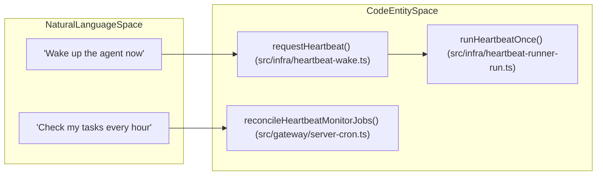
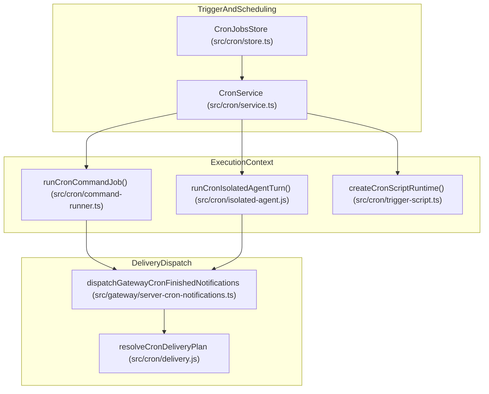
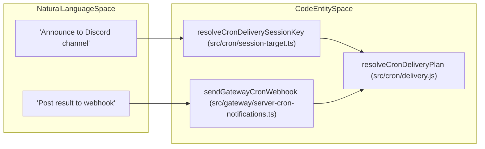

# Automation & Cron

Relevant source files

The following files were used as context for generating this wiki page:

- [config/stylelint.config.mjs](config/stylelint.config.mjs)
- [docs/automation/cron-jobs.md](docs/automation/cron-jobs.md)
- [docs/cli/cron.md](docs/cli/cron.md)
- [docs/gateway/troubleshooting.md](docs/gateway/troubleshooting.md)
- [scripts/bench-gateway-restart.ts](scripts/bench-gateway-restart.ts)
- [scripts/bench-gateway-startup.ts](scripts/bench-gateway-startup.ts)
- [scripts/bench-model.ts](scripts/bench-model.ts)
- [scripts/bench-web-fetch.ts](scripts/bench-web-fetch.ts)
- [scripts/check-gateway-cpu-scenarios.mts](scripts/check-gateway-cpu-scenarios.mts)
- [scripts/control-ui-mock-cron.ts](scripts/control-ui-mock-cron.ts)
- [scripts/dev/discord-acp-plain-language-smoke.ts](scripts/dev/discord-acp-plain-language-smoke.ts)
- [scripts/test-force.ts](scripts/test-force.ts)
- [scripts/test-perf-budget.mts](scripts/test-perf-budget.mts)
- [src/agents/subagents/announce/subagent-announce-delivery-retry.ts](src/agents/subagents/announce/subagent-announce-delivery-retry.ts)
- [src/agents/subagents/announce/subagent-announce-delivery.test-support.ts](src/agents/subagents/announce/subagent-announce-delivery.test-support.ts)
- [src/agents/tools/cron-tool-canonicalize.ts](src/agents/tools/cron-tool-canonicalize.ts)
- [src/agents/tools/cron-tool-schema.ts](src/agents/tools/cron-tool-schema.ts)
- [src/agents/tools/cron-tool-self-list.ts](src/agents/tools/cron-tool-self-list.ts)
- [src/agents/tools/cron-tool.flat-params.test.ts](src/agents/tools/cron-tool.flat-params.test.ts)
- [src/agents/tools/cron-tool.schema.test.ts](src/agents/tools/cron-tool.schema.test.ts)
- [src/agents/tools/cron-tool.test.ts](src/agents/tools/cron-tool.test.ts)
- [src/agents/tools/cron-tool.ts](src/agents/tools/cron-tool.ts)
- [src/cli/cron-cli.test.ts](src/cli/cron-cli.test.ts)
- [src/cli/cron-cli/cron-pagination.gateway.test.ts](src/cli/cron-cli/cron-pagination.gateway.test.ts)
- [src/cli/cron-cli/cron-suppression.gateway.test.ts](src/cli/cron-cli/cron-suppression.gateway.test.ts)
- [src/cli/cron-cli/register.cron-add.ts](src/cli/cron-cli/register.cron-add.ts)
- [src/cli/cron-cli/register.cron-edit-options.ts](src/cli/cron-cli/register.cron-edit-options.ts)
- [src/cli/cron-cli/register.cron-edit.test.ts](src/cli/cron-cli/register.cron-edit.test.ts)
- [src/cli/cron-cli/register.cron-edit.ts](src/cli/cron-cli/register.cron-edit.ts)
- [src/cli/cron-cli/register.cron-options.test.ts](src/cli/cron-cli/register.cron-options.test.ts)
- [src/cli/cron-cli/register.cron-options.ts](src/cli/cron-cli/register.cron-options.ts)
- [src/cli/cron-cli/register.cron-scratch.test.ts](src/cli/cron-cli/register.cron-scratch.test.ts)
- [src/cli/cron-cli/register.cron-simple.ts](src/cli/cron-cli/register.cron-simple.ts)
- [src/cli/cron-cli/shared.test.ts](src/cli/cron-cli/shared.test.ts)
- [src/cli/cron-cli/shared.ts](src/cli/cron-cli/shared.ts)
- [src/cli/cron-cli/thread-id-shared.ts](src/cli/cron-cli/thread-id-shared.ts)
- [src/cli/cron-cli/trigger-options.test.ts](src/cli/cron-cli/trigger-options.test.ts)
- [src/cli/cron-output.process.test.ts](src/cli/cron-output.process.test.ts)
- [src/cron/cron-delivery-outcomes.e2e.test.ts](src/cron/cron-delivery-outcomes.e2e.test.ts)
- [src/cron/cron-protocol-schema.test.ts](src/cron/cron-protocol-schema.test.ts)
- [src/cron/delivery-plan.ts](src/cron/delivery-plan.ts)
- [src/cron/delivery.failure-notify.test.ts](src/cron/delivery.failure-notify.test.ts)
- [src/cron/delivery.test.ts](src/cron/delivery.test.ts)
- [src/cron/delivery.ts](src/cron/delivery.ts)
- [src/cron/isolated-agent/current-session-completion.ts](src/cron/isolated-agent/current-session-completion.ts)
- [src/cron/isolated-agent/delivery-dispatch-awareness.ts](src/cron/isolated-agent/delivery-dispatch-awareness.ts)
- [src/cron/isolated-agent/delivery-dispatch-policy.ts](src/cron/isolated-agent/delivery-dispatch-policy.ts)
- [src/cron/isolated-agent/delivery-dispatch-types.ts](src/cron/isolated-agent/delivery-dispatch-types.ts)
- [src/cron/isolated-agent/delivery-dispatch.double-announce.test.ts](src/cron/isolated-agent/delivery-dispatch.double-announce.test.ts)
- [src/cron/isolated-agent/delivery-dispatch.ts](src/cron/isolated-agent/delivery-dispatch.ts)
- [src/cron/parse.test.ts](src/cron/parse.test.ts)
- [src/cron/parse.ts](src/cron/parse.ts)
- [src/cron/service.failure-alert-notifications.test.ts](src/cron/service.failure-alert-notifications.test.ts)
- [src/cron/service.failure-alert.test.ts](src/cron/service.failure-alert.test.ts)
- [src/cron/service.restart-catchup.test.ts](src/cron/service.restart-catchup.test.ts)
- [src/cron/service.stream-trigger.test.ts](src/cron/service.stream-trigger.test.ts)
- [src/cron/service.stream-validation.test.ts](src/cron/service.stream-validation.test.ts)
- [src/cron/service/agent-watchdog.ts](src/cron/service/agent-watchdog.ts)
- [src/cron/service/failure-alerts.account-routing.test.ts](src/cron/service/failure-alerts.account-routing.test.ts)
- [src/cron/service/failure-alerts.persistence.test.ts](src/cron/service/failure-alerts.persistence.test.ts)
- [src/cron/service/failure-alerts.ts](src/cron/service/failure-alerts.ts)
- [src/cron/service/list-page-validation.ts](src/cron/service/list-page-validation.ts)
- [src/cron/service/ops-read.ts](src/cron/service/ops-read.ts)
- [src/cron/service/run-recovery.lifecycle.test.ts](src/cron/service/run-recovery.lifecycle.test.ts)
- [src/cron/service/state.ts](src/cron/service/state.ts)
- [src/cron/service/timer-execution-timeout.ts](src/cron/service/timer-execution-timeout.ts)
- [src/cron/service/timer-execution.script-wake.test.ts](src/cron/service/timer-execution.script-wake.test.ts)
- [src/cron/service/timer-execution.ts](src/cron/service/timer-execution.ts)
- [src/cron/service/timer-job-runner.ts](src/cron/service/timer-job-runner.ts)
- [src/cron/service/timer.heartbeat-timeout-watchdog.test.ts](src/cron/service/timer.heartbeat-timeout-watchdog.test.ts)
- [src/cron/service/timer.test.ts](src/cron/service/timer.test.ts)
- [src/cron/service/timer.timeout-watchdog.test.ts](src/cron/service/timer.timeout-watchdog.test.ts)
- [src/gateway/cron-exit-watchers.test.ts](src/gateway/cron-exit-watchers.test.ts)
- [src/gateway/cron-exit-watchers.ts](src/gateway/cron-exit-watchers.ts)
- [src/gateway/server-cron-notifications.presentation.test.ts](src/gateway/server-cron-notifications.presentation.test.ts)
- [src/gateway/server-cron-notifications.test.ts](src/gateway/server-cron-notifications.test.ts)
- [src/gateway/server-cron-notifications.ts](src/gateway/server-cron-notifications.ts)
- [src/gateway/server-cron.drain.test.ts](src/gateway/server-cron.drain.test.ts)
- [src/gateway/server-cron.test.ts](src/gateway/server-cron.test.ts)
- [src/gateway/server-cron.ts](src/gateway/server-cron.ts)
- [src/gateway/server.cron.test.ts](src/gateway/server.cron.test.ts)
- [src/gateway/session-message-events.test.ts](src/gateway/session-message-events.test.ts)
- [src/infra/clawhub-promotions.test.ts](src/infra/clawhub-promotions.test.ts)
- [src/infra/delivery-recovery.shared.test.ts](src/infra/delivery-recovery.shared.test.ts)
- [src/infra/delivery-recovery.shared.ts](src/infra/delivery-recovery.shared.ts)
- [src/infra/format-time/parse-offsetless-zoned-datetime.test.ts](src/infra/format-time/parse-offsetless-zoned-datetime.test.ts)
- [src/infra/format-time/parse-offsetless-zoned-datetime.ts](src/infra/format-time/parse-offsetless-zoned-datetime.ts)
- [src/infra/heartbeat-runner-config.ts](src/infra/heartbeat-runner-config.ts)
- [src/infra/heartbeat-runner-execution.ts](src/infra/heartbeat-runner-execution.ts)
- [src/infra/heartbeat-runner-scheduler.ts](src/infra/heartbeat-runner-scheduler.ts)
- [src/infra/heartbeat-runner.broadcast-outcomes.test.ts](src/infra/heartbeat-runner.broadcast-outcomes.test.ts)
- [src/infra/heartbeat-runner.model-override.test.ts](src/infra/heartbeat-runner.model-override.test.ts)
- [src/infra/heartbeat-runner.runtime.ts](src/infra/heartbeat-runner.runtime.ts)
- [src/infra/heartbeat-runner.skips-busy-session-lane.test.ts](src/infra/heartbeat-runner.skips-busy-session-lane.test.ts)
- [src/infra/heartbeat-wake.test.ts](src/infra/heartbeat-wake.test.ts)
- [src/infra/heartbeat-wake.ts](src/infra/heartbeat-wake.ts)
- [src/logging/diagnostic-memory.test.ts](src/logging/diagnostic-memory.test.ts)
- [src/logging/diagnostic-memory.ts](src/logging/diagnostic-memory.ts)
- [src/logging/diagnostic-stability-bundle.test.ts](src/logging/diagnostic-stability-bundle.test.ts)
- [src/logging/diagnostic-stability-bundle.ts](src/logging/diagnostic-stability-bundle.ts)
- [src/logging/diagnostic-stability.test.ts](src/logging/diagnostic-stability.test.ts)
- [src/logging/diagnostic-stability.ts](src/logging/diagnostic-stability.ts)
- [src/plugin-sdk/approval-native-helpers.ts](src/plugin-sdk/approval-native-helpers.ts)
- [src/plugins/contracts/scheduled-turns.contract.test.ts](src/plugins/contracts/scheduled-turns.contract.test.ts)
- [src/plugins/host-hook-scheduled-turns.ts](src/plugins/host-hook-scheduled-turns.ts)
- [src/sessions/background-session-result.test.ts](src/sessions/background-session-result.test.ts)
- [src/sessions/background-session-result.ts](src/sessions/background-session-result.ts)
- [src/shared/iso-time.test.ts](src/shared/iso-time.test.ts)
- [src/shared/iso-time.ts](src/shared/iso-time.ts)
- [test/cron-edit-trigger-preservation.e2e.test.ts](test/cron-edit-trigger-preservation.e2e.test.ts)
- [test/e2e/qa-lab/runtime/gateway-heartbeat-session-routing.e2e.test.ts](test/e2e/qa-lab/runtime/gateway-heartbeat-session-routing.e2e.test.ts)
- [test/scripts/bench-gateway-startup.test.ts](test/scripts/bench-gateway-startup.test.ts)
- [test/scripts/test-force.test.ts](test/scripts/test-force.test.ts)
- [ui/src/api/types.ts](ui/src/api/types.ts)
- [ui/src/e2e/cron-descriptions.e2e.test.ts](ui/src/e2e/cron-descriptions.e2e.test.ts)
- [ui/src/e2e/cron-filters.e2e.test.ts](ui/src/e2e/cron-filters.e2e.test.ts)
- [ui/src/e2e/cron-heartbeat-scratch.e2e.test.ts](ui/src/e2e/cron-heartbeat-scratch.e2e.test.ts)
- [ui/src/e2e/cron-remove.e2e.test.ts](ui/src/e2e/cron-remove.e2e.test.ts)
- [ui/src/e2e/cron-select-values.e2e.test.ts](ui/src/e2e/cron-select-values.e2e.test.ts)
- [ui/src/e2e/cron-trigger-filter.e2e.test.ts](ui/src/e2e/cron-trigger-filter.e2e.test.ts)
- [ui/src/lib/cron-status.test.ts](ui/src/lib/cron-status.test.ts)
- [ui/src/lib/cron-status.ts](ui/src/lib/cron-status.ts)
- [ui/src/lib/cron/index.test.ts](ui/src/lib/cron/index.test.ts)
- [ui/src/lib/cron/index.ts](ui/src/lib/cron/index.ts)
- [ui/src/pages/agents/view.test.ts](ui/src/pages/agents/view.test.ts)
- [ui/src/pages/cron/cron-page.test.ts](ui/src/pages/cron/cron-page.test.ts)
- [ui/src/pages/cron/cron-page.ts](ui/src/pages/cron/cron-page.ts)
- [ui/src/pages/cron/suggestions.ts](ui/src/pages/cron/suggestions.ts)
- [ui/src/pages/cron/view-auto-disabled.test.ts](ui/src/pages/cron/view-auto-disabled.test.ts)
- [ui/src/pages/cron/view-description.test.ts](ui/src/pages/cron/view-description.test.ts)
- [ui/src/pages/cron/view-running-state.test.ts](ui/src/pages/cron/view-running-state.test.ts)
- [ui/src/pages/cron/view-runs.ts](ui/src/pages/cron/view-runs.ts)
- [ui/src/pages/cron/view.editor.test.ts](ui/src/pages/cron/view.editor.test.ts)
- [ui/src/pages/cron/view.test-support.ts](ui/src/pages/cron/view.test-support.ts)
- [ui/src/pages/cron/view.test.ts](ui/src/pages/cron/view.test.ts)
- [ui/src/pages/cron/view.ts](ui/src/pages/cron/view.ts)
- [ui/src/styles/cron.css](ui/src/styles/cron.css)
- [ui/src/styles/usage.css](ui/src/styles/usage.css)
- [ui/src/styles/workboard.css](ui/src/styles/workboard.css)
- [ui/src/test-helpers/cron.ts](ui/src/test-helpers/cron.ts)

OpenClaw features a built-in automation engine managing scheduled tasks, recurring agent turns, supervised process monitoring, and proactive "heartbeat" interactions. This system is centered around the Gateway's internal scheduler, which handles persistent job storage, scheduling logic, and execution across different session scopes [src/gateway/server-cron.ts:1-2]().

## 1. Cron Job Architecture

The Gateway's cron system supports multiple job types and session targets, allowing agents to perform background tasks or initiate conversations autonomously [src/cron/types.ts:30-31](). Job definitions, runtime state, and run history are persisted in a shared SQLite state database, ensuring that restarts do not lose schedules [docs/automation/cron-jobs.md:46]().

### 1.1 Job Types and Session Targets

Jobs are categorized by their `sessionTarget`, which determines the execution context and workspace isolation [src/cron/types.ts:49]().

| Session Target | Description | Best for |
| :--- | :--- | :--- |
| **`main`** | Runs in the agent's primary session. | Reminders, system events [src/gateway/server-cron.ts:26-27]() |
| **`isolated`** | Runs in a dedicated, temporary session. | Reports, background chores [src/cron/isolated-agent.js:43-44]() |
| **`current`** | Bound to the session active at creation. | Context-aware recurring work [src/cron/types.ts:49]() |
| **`session:id`** | Runs in a persistent named session. | Workflows building on specific history [src/cron/types.ts:49]() |

### 1.2 Scheduling Syntax

OpenClaw supports several scheduling kinds [src/cron/types.ts:12-46]():
- **`at`**: One-shot execution at a specific timestamp [src/cron/types.ts:13](). These auto-delete after successful completion unless `--keep-after-run` is specified [docs/automation/cron-jobs.md:48]().
- **`every`**: Fixed interval execution based on `everyMs` [src/cron/types.ts:14]().
- **`cron`**: Standard cron expressions (`expr`) with optional `staggerMs` to prevent resource spikes [src/cron/types.ts:16-21]().
- **`on-exit`**: Event-driven trigger that fires when a gateway-owned watcher process exits [src/cron/types.ts:32-35]().
- **`stream`**: Supervised source `argv` that triggers on batched lines produced by a long-lived command [src/cron/types.ts:38-46]().

**Staggering and Jitter**
Recurring jobs use a stable, deterministic offset to prevent resource spikes. The Gateway handles missed jobs on startup by staggering their execution to avoid overwhelming the system [src/cron/service/state.ts:131-136]().

Sources: [src/cron/types.ts:12-49](), [src/gateway/server-cron.ts:1-63](), [docs/automation/cron-jobs.md:43-51](), [src/cron/service/state.ts:131-147]()

---

## 2. Execution and Delivery

The cron service manages how agent output reaches the user or external systems, including completion notifications and failure alerts [src/gateway/server-cron-notifications.ts:1-2]().

### 2.1 Isolated Agent Turns
Isolated session cron jobs facilitate background agent tasks using a unique session to avoid polluting the main conversation memory [src/gateway/server-cron.ts:44](). The runner dispatches tasks using `runCronIsolatedAgentTurn` [src/gateway/server-cron.ts:44](). These runs are hardened to close tracked browser tabs and dispose of MCP runtimes upon completion [docs/automation/cron-jobs.md:55]().

### 2.2 Delivery Modes
The system supports several delivery modes defined in the `CronDelivery` type [src/cron/types.ts:61-88]():
- **`announce`**: Delivers output to a target channel (Telegram, Discord, etc.) via `sendCronAnnouncePayloadStrict` [src/gateway/server-cron.ts:42]().
- **`webhook`**: Posts results to external HTTP endpoints via `sendGatewayCronWebhook` [src/gateway/server-cron-notifications.ts:126](). Webhooks are subject to SSRF protection via `mergeSsrFPolicies` [src/gateway/server-cron.ts:83]().
- **`silent`**: The run completes without external notification, though logs are still persisted [src/cron/types.ts:62]().

### 2.3 Failure Alerts
If a job fails, the system can dispatch alerts via `sendGatewayCronFailureAlert` [src/gateway/server-cron-notifications.ts:127](). Users can configure alerts to trigger only after a specific number of consecutive errors [src/cli/cron-cli/register.cron-edit.ts:92]().

Sources: [src/gateway/server-cron.ts:41-83](), [src/gateway/server-cron-notifications.ts:125-128](), [docs/automation/cron-jobs.md:54-61](), [src/cli/cron-cli/register.cron-edit.ts:89-105]()

---

## 3. Heartbeat Integration

Heartbeats are periodic turns that allow the agent to surface items needing attention, such as unread messages or pending tasks.

### 3.1 Heartbeat Logic and Wake-ups
The Gateway manages proactive turns through the cron scheduler, integrating with the heartbeat monitor [src/gateway/server-cron.ts:43]().

| Feature | Description |
| :--- | :--- |
| **Wake Requests** | External triggers can call `requestHeartbeat` to schedule the next evaluation [src/gateway/server-cron.ts:78](). |
| **Convergence** | Heartbeat monitor convergence is handled by `reconcileHeartbeatMonitorJobs` [src/gateway/server-cron.ts:43](). |
| **Run Once** | Manual heartbeat triggers use `runHeartbeatOnce` [src/gateway/server-cron.ts:76](). |

### 3.2 Code to Entity Mapping: Heartbeat

Sources: [src/gateway/server-cron.ts:43-82](), [src/infra/heartbeat-runner-execution.ts:160-170](), [src/infra/heartbeat-wake.ts:78-82]()

---

## 4. Execution Safety and Reliability

### 4.1 Process Isolation and Timeouts
The system tracks active jobs and enforces concurrency limits. Active task runs can be cancelled or awaited during gateway shutdown via `abortActiveCronTaskRuns` and `waitForActiveCronTaskRuns` [src/gateway/server-cron.ts:53-54](). Jobs have specific timeouts: isolated agent turns default to 60 minutes, while script payloads default to 5 minutes [docs/automation/cron-jobs.md:49]().

### 4.2 Error Handling and Redaction
- **Diagnostics**: Run failures generate diagnostic summaries [src/cron/service/state.ts:56]().
- **Redaction**: Command summaries are redacted for external delivery to prevent leaking sensitive environment details via `redactCronCommandSummaryForExternalDelivery` [src/gateway/server-cron.ts:38-39]().
- **SSRF Guard**: All outbound webhooks are processed through an SSRF guard policy [src/gateway/server-cron.ts:83]().

### 4.3 Task Reconciliation
Automation task reconciliation is runtime-owned. If a Gateway process dies, startup recovery matches finalized results to the run identity to prevent duplicate execution of one-shot jobs [docs/automation/cron-jobs.md:65-67]().

Sources: [src/gateway/server-cron.ts:38-54](), [src/cron/service/state.ts:45-68](), [docs/automation/cron-jobs.md:49-67]()

---

## 5. API and Tool Integration

The Gateway exposes RPC handlers for cron management, and the Control UI provides a comprehensive interface for monitoring and editing automations.

### 5.1 Gateway RPC Handlers
The Gateway provides a full CRUD interface for automations [src/gateway/server-cron.ts:51-56]():
- `cron.add`: Creates new jobs with validation.
- `cron.update`: Patches existing jobs using `applyJobPatch` [src/gateway/server-cron.ts:56]().
- `cron.list`: Retrieves jobs filtered by status (Active, Paused, All) [ui/src/pages/cron/view.test.ts:22]().
- `cron.runs`: Retrieves run history logs [ui/src/pages/cron/view.ts:105]().

### 5.2 Tooling (Cron Tool)
Agents can manage their own schedules via the automations tool. This allows for "Standing Orders" where an agent schedules its own follow-up turns to check on long-running tasks or provide status updates [docs/automation/cron-jobs.md:57]().

Sources: [src/gateway/server-cron.ts:51-56](), [ui/src/pages/cron/view.ts:67-152](), [ui/src/pages/cron/view.test.ts:10-37]()

---

## 6. System Architecture

This diagram illustrates the data flow from a cron trigger through execution to delivery.

Sources: [src/gateway/server-cron.ts:40-63](), [src/cron/service.ts:51-52](), [src/gateway/server-cron-notifications.ts:125-128]()

---

## 7. Code to Entity Mapping: Delivery

The delivery system maps high-level "announce" or "webhook" requests to specific outbound infrastructure, including channel-specific routing like Telegram thread IDs.

Sources: [src/gateway/server-cron.ts:42-60](), [src/gateway/server-cron-notifications.ts:125-128](), [src/cron/session-target.ts:58-60]()