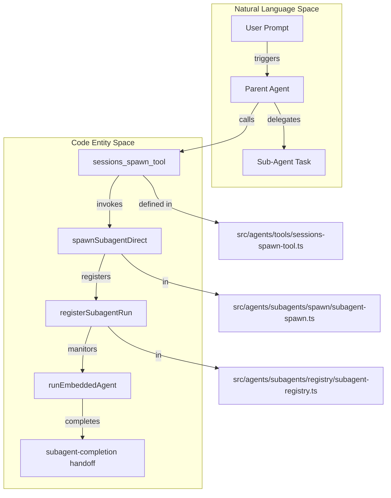
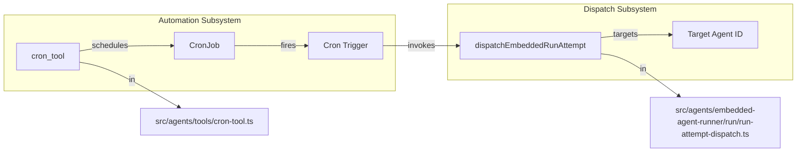

# ACP & Sub-Agents

Relevant source files

The following files were used as context for generating this wiki page:

- [config/assertion-safety-baseline.txt](config/assertion-safety-baseline.txt)
- [docs/concepts/session-tool.md](docs/concepts/session-tool.md)
- [docs/tools/subagents.md](docs/tools/subagents.md)
- [scripts/check-kysely-guardrails.mts](scripts/check-kysely-guardrails.mts)
- [scripts/lib/type-assertion-guard-scope.mjs](scripts/lib/type-assertion-guard-scope.mjs)
- [src/agents/embedded-agent-runner/delivery-evidence.test.ts](src/agents/embedded-agent-runner/delivery-evidence.test.ts)
- [src/agents/embedded-agent-runner/delivery-evidence.ts](src/agents/embedded-agent-runner/delivery-evidence.ts)
- [src/agents/subagent-orphan-recovery.restart-integration.test.ts](src/agents/subagent-orphan-recovery.restart-integration.test.ts)
- [src/agents/subagents/announce/subagent-announce-completion-delivery.ts](src/agents/subagents/announce/subagent-announce-completion-delivery.ts)
- [src/agents/subagents/announce/subagent-announce-delivery.test.ts](src/agents/subagents/announce/subagent-announce-delivery.test.ts)
- [src/agents/subagents/announce/subagent-announce-direct-delivery.ts](src/agents/subagents/announce/subagent-announce-direct-delivery.ts)
- [src/agents/subagents/announce/subagent-announce-dispatch.ts](src/agents/subagents/announce/subagent-announce-dispatch.ts)
- [src/agents/subagents/completion/subagent-completion-admission.store.test.ts](src/agents/subagents/completion/subagent-completion-admission.store.test.ts)
- [src/agents/subagents/completion/subagent-completion-admission.store.ts](src/agents/subagents/completion/subagent-completion-admission.store.ts)
- [src/agents/subagents/completion/subagent-completion-delivery.ts](src/agents/subagents/completion/subagent-completion-delivery.ts)
- [src/agents/subagents/registry/subagent-registry-deps.ts](src/agents/subagents/registry/subagent-registry-deps.ts)
- [src/agents/subagents/registry/subagent-registry-lifecycle-announce-cleanup.ts](src/agents/subagents/registry/subagent-registry-lifecycle-announce-cleanup.ts)
- [src/agents/subagents/registry/subagent-registry-lifecycle-cleanup.ts](src/agents/subagents/registry/subagent-registry-lifecycle-cleanup.ts)
- [src/agents/subagents/registry/subagent-registry-lifecycle-delivery.ts](src/agents/subagents/registry/subagent-registry-lifecycle-delivery.ts)
- [src/agents/subagents/registry/subagent-registry-lifecycle-wake.ts](src/agents/subagents/registry/subagent-registry-lifecycle-wake.ts)
- [src/agents/subagents/registry/subagent-registry-lifecycle.test.ts](src/agents/subagents/registry/subagent-registry-lifecycle.test.ts)
- [src/agents/subagents/registry/subagent-registry-public-api.ts](src/agents/subagents/registry/subagent-registry-public-api.ts)
- [src/agents/subagents/registry/subagent-registry-queries.test.ts](src/agents/subagents/registry/subagent-registry-queries.test.ts)
- [src/agents/subagents/registry/subagent-registry-queries.ts](src/agents/subagents/registry/subagent-registry-queries.ts)
- [src/agents/subagents/registry/subagent-registry-read-context.test.ts](src/agents/subagents/registry/subagent-registry-read-context.test.ts)
- [src/agents/subagents/registry/subagent-registry-restore.ts](src/agents/subagents/registry/subagent-registry-restore.ts)
- [src/agents/subagents/registry/subagent-registry.announce-loop-guard.test.ts](src/agents/subagents/registry/subagent-registry.announce-loop-guard.test.ts)
- [src/agents/subagents/registry/subagent-registry.lifecycle-retry-grace.e2e.test.ts](src/agents/subagents/registry/subagent-registry.lifecycle-retry-grace.e2e.test.ts)
- [src/agents/subagents/registry/subagent-registry.nested.e2e.test.ts](src/agents/subagents/registry/subagent-registry.nested.e2e.test.ts)
- [src/agents/subagents/registry/subagent-registry.persistence.resume.test.ts](src/agents/subagents/registry/subagent-registry.persistence.resume.test.ts)
- [src/agents/subagents/registry/subagent-registry.persistence.test-support.ts](src/agents/subagents/registry/subagent-registry.persistence.test-support.ts)
- [src/agents/subagents/registry/subagent-registry.persistence.test.ts](src/agents/subagents/registry/subagent-registry.persistence.test.ts)
- [src/agents/subagents/registry/subagent-registry.requester-wake.e2e.test.ts](src/agents/subagents/registry/subagent-registry.requester-wake.e2e.test.ts)
- [src/agents/subagents/registry/subagent-registry.store.sqlite.test.ts](src/agents/subagents/registry/subagent-registry.store.sqlite.test.ts)
- [src/agents/subagents/registry/subagent-registry.store.sqlite.ts](src/agents/subagents/registry/subagent-registry.store.sqlite.ts)
- [src/agents/subagents/registry/subagent-registry.test-helpers.ts](src/agents/subagents/registry/subagent-registry.test-helpers.ts)
- [src/agents/subagents/registry/subagent-registry.test.ts](src/agents/subagents/registry/subagent-registry.test.ts)
- [src/agents/subagents/registry/subagent-registry.ts](src/agents/subagents/registry/subagent-registry.ts)
- [src/agents/subagents/registry/subagent-registry.types.ts](src/agents/subagents/registry/subagent-registry.types.ts)
- [src/agents/subagents/spawn/subagent-capabilities.ts](src/agents/subagents/spawn/subagent-capabilities.ts)
- [src/agents/subagents/spawn/subagent-depth.ts](src/agents/subagents/spawn/subagent-depth.ts)
- [src/agents/subagents/spawn/subagent-spawn.test.ts](src/agents/subagents/spawn/subagent-spawn.test.ts)
- [src/agents/tool-description-presets.test.ts](src/agents/tool-description-presets.test.ts)
- [src/agents/tool-description-presets.ts](src/agents/tool-description-presets.ts)
- [src/agents/tools/sessions-helpers.ts](src/agents/tools/sessions-helpers.ts)
- [src/agents/tools/sessions-list-tool.test.ts](src/agents/tools/sessions-list-tool.test.ts)
- [src/agents/tools/sessions-list-tool.ts](src/agents/tools/sessions-list-tool.ts)
- [src/agents/tools/sessions-spawn-tool.test.ts](src/agents/tools/sessions-spawn-tool.test.ts)
- [src/agents/tools/sessions-spawn-tool.ts](src/agents/tools/sessions-spawn-tool.ts)
- [src/agents/tools/sessions-spawn-visible.ts](src/agents/tools/sessions-spawn-visible.ts)
- [src/agents/tools/sessions-tool.test.ts](src/agents/tools/sessions-tool.test.ts)
- [src/agents/tools/sessions-tool.ts](src/agents/tools/sessions-tool.ts)
- [src/gateway/session-delivery-clock-jump.integration.test.ts](src/gateway/session-delivery-clock-jump.integration.test.ts)
- [src/gateway/subagent-completion-blocked.e2e.test.ts](src/gateway/subagent-completion-blocked.e2e.test.ts)
- [src/infra/session-delivery-queue-runtime.test.ts](src/infra/session-delivery-queue-runtime.test.ts)
- [src/infra/session-delivery-queue-runtime.ts](src/infra/session-delivery-queue-runtime.ts)
- [src/infra/state-migrations.cron-run-logs.ts](src/infra/state-migrations.cron-run-logs.ts)
- [src/state/openclaw-state-db-fast-path.ts](src/state/openclaw-state-db-fast-path.ts)
- [src/state/openclaw-state-db-legacy-backfills.test.ts](src/state/openclaw-state-db-legacy-backfills.test.ts)
- [test/e2e/qa-lab/runtime/channel-progress-presentation.e2e.test.ts](test/e2e/qa-lab/runtime/channel-progress-presentation.e2e.test.ts)
- [test/fixtures/agents/prompt-snapshots/codex-runtime-happy-path/codex-dynamic-tools.discord-group.json](test/fixtures/agents/prompt-snapshots/codex-runtime-happy-path/codex-dynamic-tools.discord-group.json)
- [test/fixtures/agents/prompt-snapshots/codex-runtime-happy-path/codex-dynamic-tools.telegram-direct.json](test/fixtures/agents/prompt-snapshots/codex-runtime-happy-path/codex-dynamic-tools.telegram-direct.json)
- [test/fixtures/agents/prompt-snapshots/codex-runtime-happy-path/discord-group-codex-message-tool.md.diff](test/fixtures/agents/prompt-snapshots/codex-runtime-happy-path/discord-group-codex-message-tool.md.diff)
- [test/fixtures/agents/prompt-snapshots/codex-runtime-happy-path/telegram-direct-codex-message-tool.md](test/fixtures/agents/prompt-snapshots/codex-runtime-happy-path/telegram-direct-codex-message-tool.md)
- [test/fixtures/agents/prompt-snapshots/codex-runtime-happy-path/telegram-heartbeat-codex-tool.md.diff](test/fixtures/agents/prompt-snapshots/codex-runtime-happy-path/telegram-heartbeat-codex-tool.md.diff)
- [test/repository-test-api-publications.ts](test/repository-test-api-publications.ts)

The **Agent Control Protocol (ACP)** and the **Sub-Agent** system provide a framework for orchestrating multi-agent workflows within OpenClaw. This system empowers a "parent" agent to delegate discrete tasks to "child" agents, which execute in isolated sessions and report results back asynchronously to the requester.

---

## Agent Control Protocol (ACP)

ACP is a dedicated runtime harness designed for multi-session orchestration involving external AI CLI tools and internal agent coordination. It coordinates session metadata, runtime handles, and turn execution through the `AcpManager`.

### ACP Runtime & Sessions
The system manages the dispatch of agent attempts across embedded, CLI, and ACP runtimes.

- **Attempt Execution:** The `runAgentAttempt` function orchestrates single agent turns, handling logic for both native embedded runs and ACP-based sub-agent runs. [src/agents/command/attempt-execution.ts:45-46]()
- **Timeout Handling:** ACP turns are subject to specific timeout detail codes, such as `ACP_TURN_TIMEOUT_DETAIL_CODE`, ensuring that hanging sub-agents are properly classified. [src/agents/command/attempt-execution.ts:12-12]()
- **Outcome Resolution:** Tool outcomes within ACP are resolved using `resolveAcpToolTerminalOutcome`, which translates ACP-specific events into standard agent terminal outcomes. [src/agents/command/attempt-execution.ts:14-14]()
- **Error Chains:** ACP runtime errors are formatted into readable chains using `formatAcpErrorChain` for better diagnostic visibility. [src/agents/command/attempt-execution.ts:13-13]()
- **ACP Registry:** The `acpRuntimeRegistry` maintains a list of available ACP backends (e.g., `acpx`). The `sessions_spawn` tool dynamically hides ACP affordances if no backend is registered. [src/agents/tools/sessions-spawn-tool.test.ts:112-112](), [src/agents/tools/sessions-spawn-tool.test.ts:182-185]()

**Sources:** [src/agents/command/attempt-execution.ts:1-125](), [src/agents/tools/sessions-spawn-tool.test.ts:106-145]()

---

## Sub-Agent System Architecture

Sub-agents are isolated agent sessions launched by a parent session. Each sub-agent runs in its own session key space, typically identified by a `subagent` segment (e.g., `agent:<agentId>:subagent:<uuid>`). [docs/tools/subagents.md:11-13]()

### Sub-Agent Lifecycle & Handoffs
The system manages the transition of tasks between parent and child agents through the `sessions_spawn` tool.

| Tool / Function | Description |
| :--- | :--- |
| `sessions_spawn` | Programmatically creates child agent sessions. Supports `visible=true` for durable sessions visible in the UI. [src/agents/tools/sessions-spawn-tool.ts:73-73](), [test/fixtures/agents/prompt-snapshots/codex-runtime-happy-path/codex-dynamic-tools.telegram-direct.json:154-154]() |
| `sessions_yield` | Ends a turn after a sub-agent spawn, allowing results to arrive as a new model-visible message. [docs/tools/subagents.md:85-87]() |
| `agents_list` | Lists configured agent IDs metadata, used as targets for `sessions_spawn`. [test/fixtures/agents/prompt-snapshots/codex-runtime-happy-path/codex-dynamic-tools.telegram-direct.json:10-10]() |
| `subagents` | A tool to list, inspect, or cancel background work in the current session tree. [docs/concepts/session-tool.md:26-26]() |

### Sub-Agent Registry & Persistence
The `SubagentLifecycleController` coordinates registration, completion, and cleanup of sub-agent runs. [src/agents/subagents/registry/subagent-registry-lifecycle.ts:39-41]()

- **Durable Sessions:** Visible sub-agent sessions are persistent dashboard sessions designed for coding or multi-step work. [src/agents/tools/sessions-spawn-visible.ts:153-153]()
- **Workspace Inheritance:** Sub-agents inherit the parent agent's workspace by default, though they can be spawned in "isolated" or "fork" contexts. [src/agents/tools/sessions-spawn-tool.test.ts:42-43](), [docs/tools/subagents.md:27-32]()
- **Admission Control:** The system uses `reserveChildAdmissionSlot` to enforce limits on concurrent sub-agent runs, such as `DEFAULT_SUBAGENT_MAX_CHILDREN_PER_AGENT`. [src/agents/tools/sessions-spawn-visible.ts:5-7](), [src/agents/tools/sessions-spawn-visible.ts:20-20]()
- **Recovery & Suppression:** The system tracks `lifecycleGeneration` to suppress session effects from retired recovery receipts or legacy kill intents. [src/agents/subagents/registry/subagent-registry-lifecycle.test.ts:53-86]()

**Sources:** [src/agents/tools/sessions-spawn-visible.ts:1-170](), [src/agents/subagents/registry/subagent-registry-lifecycle.ts:1-41](), [docs/tools/subagents.md:1-120]()

---

## Technical Data Flow: Spawn to Announcement

The orchestration involves a tool-triggered spawn followed by an asynchronous completion announcement.

### Sub-Agent Orchestration Flow

**Sources:** [src/agents/tools/sessions-spawn-tool.ts:42-55](), [src/agents/subagents/registry/subagent-registry.ts:28-29](), [src/agents/subagents/spawn/subagent-spawn.ts:45-45]()

### Delivery Dispatch & Coordination
When a sub-agent completes, the result is announced back to the requester.

- **Direct Delivery:** `sendSubagentAnnounceDirectly` attempts to hand off the result to the requester session immediately. [src/agents/subagents/announce/subagent-announce-direct-delivery.ts:131-154]()
- **Active Wake:** If the parent session is idle, `runDescendantWake` triggers the parent to process the new result. [src/agents/subagents/announce/subagent-announce-delivery.test.ts:60-60]()
- **Queued Handoff:** If the parent is busy, the completion is held in the `session-delivery-queue` until the parent is available. [src/agents/subagents/announce/subagent-announce-delivery.test.ts:110-115]()
- **Backlog Pressure:** The system monitors delivery backlog via `getSubagentDeliveryBacklogPressure` to prevent overwhelming the parent session. [src/agents/tools/sessions-spawn-tool.test.ts:27-30]()

**Sources:** [src/agents/subagents/announce/subagent-announce-direct-delivery.ts:1-175](), [src/agents/subagents/announce/subagent-announce-delivery.test.ts:1-157]()

---

## Automation & Cron Tooling

Sub-agents and ACP workflows are often triggered or managed by the `cron` (automations) tool, which handles scheduled jobs and recurring tasks.

### Cron Tool Architecture
The `cron` tool allows agents to manage scheduled jobs, pacing, and delivery targets.

- **Authority Resolution:** Job creation requires authority, managed via `mintCronCreatorAuthorityGrant` and `runWithCronCreatorAuthorityCapability`. [src/agents/tools/cron-tool.test.ts:24-37]()
- **Payload Normalization:** Supports `agentTurn` payloads (reminders) and `systemEvent` payloads. [src/agents/tools/cron-tool.test.ts:136-148]()
- **Heartbeat Integration:** Agents can respond to heartbeats using the `heartbeat_respond` tool, which reports outcomes like `progress`, `done`, or `needs_attention`. [test/fixtures/agents/prompt-snapshots/codex-runtime-happy-path/telegram-heartbeat-codex-tool.md.diff:63-102]()

### Cron to Sub-Agent Data Flow

**Sources:** [src/agents/tools/cron-tool.ts:1-67](), [src/agents/embedded-agent-runner/run/run-attempt-dispatch.ts:118-133]()

---

## Persistent Bindings & Delivery Policy

OpenClaw ensures that sub-agent results return to the correct conversation thread through session bindings and delivery policies.

- **Session Binding Service:** `registerSessionBindingAdapter` allows different channels to define how sessions map to external thread IDs. [src/agents/subagents/announce/subagent-announce-delivery.test.ts:28-29]()
- **Source Reply Delivery:** The `sourceReplyDeliveryMode` (e.g., `message_tool_only`) determines how the parent agent communicates the sub-agent's progress to the user. [test/fixtures/agents/prompt-snapshots/codex-runtime-happy-path/telegram-direct-codex-message-tool.md:29-29]()
- **Transcript Persistence:** Sub-agent transcripts are persisted via `persistAcpTurnTranscript` or `persistCliTurnTranscript` for audit and history tracking. [src/agents/command/attempt-execution.cli.test.ts:42-46]()
- **Cleanup Policy:** On completion, the system performs `cleanupBrowserSessionsForLifecycleEnd` and `retireSessionMcpRuntimeForSessionKey` to release resources used by the sub-agent. [src/agents/subagents/registry/subagent-registry-lifecycle.test.ts:154-160]()

**Sources:** [src/agents/subagents/announce/subagent-announce-delivery.test.ts:1-59](), [src/agents/subagents/registry/subagent-registry-lifecycle.test.ts:150-165]()