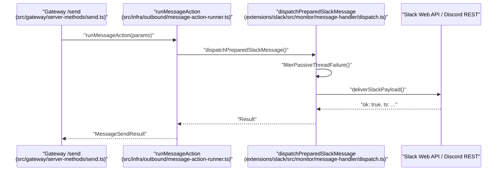

# Messaging Channels

<details>
<summary>Relevant source files</summary>

The following files were used as context for generating this wiki page:

- [docs/channels/discord.md](docs/channels/discord.md)
- [docs/channels/line.md](docs/channels/line.md)
- [docs/channels/slack.md](docs/channels/slack.md)
- [docs/gateway/config-channels.md](docs/gateway/config-channels.md)
- [docs/plugins/sdk-channel-plugins.md](docs/plugins/sdk-channel-plugins.md)
- [extensions/discord/src/actions/handle-action.test.ts](extensions/discord/src/actions/handle-action.test.ts)
- [extensions/discord/src/actions/handle-action.ts](extensions/discord/src/actions/handle-action.ts)
- [extensions/discord/src/actions/handle-action.upload-file-caption.test.ts](extensions/discord/src/actions/handle-action.upload-file-caption.test.ts)
- [extensions/discord/src/actions/runtime.messaging.messages.ts](extensions/discord/src/actions/runtime.messaging.messages.ts)
- [extensions/discord/src/actions/runtime.messaging.reactions.ts](extensions/discord/src/actions/runtime.messaging.reactions.ts)
- [extensions/discord/src/actions/runtime.messaging.runtime.ts](extensions/discord/src/actions/runtime.messaging.runtime.ts)
- [extensions/discord/src/actions/runtime.messaging.send.ts](extensions/discord/src/actions/runtime.messaging.send.ts)
- [extensions/discord/src/actions/runtime.messaging.ts](extensions/discord/src/actions/runtime.messaging.ts)
- [extensions/discord/src/actions/runtime.moderation-shared.ts](extensions/discord/src/actions/runtime.moderation-shared.ts)
- [extensions/discord/src/actions/runtime.moderation.ts](extensions/discord/src/actions/runtime.moderation.ts)
- [extensions/discord/src/actions/runtime.test.ts](extensions/discord/src/actions/runtime.test.ts)
- [extensions/discord/src/channel-actions.contract.test.ts](extensions/discord/src/channel-actions.contract.test.ts)
- [extensions/discord/src/channel-actions.test.ts](extensions/discord/src/channel-actions.test.ts)
- [extensions/discord/src/channel-actions.ts](extensions/discord/src/channel-actions.ts)
- [extensions/discord/src/channel.test.ts](extensions/discord/src/channel.test.ts)
- [extensions/discord/src/channel.ts](extensions/discord/src/channel.ts)
- [extensions/discord/src/components.builders.ts](extensions/discord/src/components.builders.ts)
- [extensions/discord/src/components.modal.ts](extensions/discord/src/components.modal.ts)
- [extensions/discord/src/components.parse.ts](extensions/discord/src/components.parse.ts)
- [extensions/discord/src/components.selects.test.ts](extensions/discord/src/components.selects.test.ts)
- [extensions/discord/src/components.test.ts](extensions/discord/src/components.test.ts)
- [extensions/discord/src/config-ui-hints.ts](extensions/discord/src/config-ui-hints.ts)
- [extensions/discord/src/doctor-contract.ts](extensions/discord/src/doctor-contract.ts)
- [extensions/discord/src/doctor.test.ts](extensions/discord/src/doctor.test.ts)
- [extensions/discord/src/internal/rest.test.ts](extensions/discord/src/internal/rest.test.ts)
- [extensions/discord/src/mentions.test.ts](extensions/discord/src/mentions.test.ts)
- [extensions/discord/src/mentions.ts](extensions/discord/src/mentions.ts)
- [extensions/discord/src/monitor/agent-components.dispatch.ts](extensions/discord/src/monitor/agent-components.dispatch.ts)
- [extensions/discord/src/monitor/provider.commands.test.ts](extensions/discord/src/monitor/provider.commands.test.ts)
- [extensions/discord/src/monitor/provider.commands.ts](extensions/discord/src/monitor/provider.commands.ts)
- [extensions/discord/src/monitor/provider.ts](extensions/discord/src/monitor/provider.ts)
- [extensions/discord/src/monitor/reply-delivery.ts](extensions/discord/src/monitor/reply-delivery.ts)
- [extensions/discord/src/monitor/thread-bindings.discord-api.ts](extensions/discord/src/monitor/thread-bindings.discord-api.ts)
- [extensions/discord/src/outbound-adapter.interactive-order.test.ts](extensions/discord/src/outbound-adapter.interactive-order.test.ts)
- [extensions/discord/src/outbound-adapter.test-harness.ts](extensions/discord/src/outbound-adapter.test-harness.ts)
- [extensions/discord/src/outbound-adapter.test.ts](extensions/discord/src/outbound-adapter.test.ts)
- [extensions/discord/src/outbound-adapter.ts](extensions/discord/src/outbound-adapter.ts)
- [extensions/discord/src/outbound-payload.contract.test.ts](extensions/discord/src/outbound-payload.contract.test.ts)
- [extensions/discord/src/outbound-payload.ts](extensions/discord/src/outbound-payload.ts)
- [extensions/discord/src/question-finalization.test.ts](extensions/discord/src/question-finalization.test.ts)
- [extensions/discord/src/retry.ts](extensions/discord/src/retry.ts)
- [extensions/discord/src/runtime.ts](extensions/discord/src/runtime.ts)
- [extensions/discord/src/send.components.multipart.test.ts](extensions/discord/src/send.components.multipart.test.ts)
- [extensions/discord/src/send.components.test.ts](extensions/discord/src/send.components.test.ts)
- [extensions/discord/src/send.components.ts](extensions/discord/src/send.components.ts)
- [extensions/discord/src/send.creates-thread.chunking.test.ts](extensions/discord/src/send.creates-thread.chunking.test.ts)
- [extensions/discord/src/send.creates-thread.test.ts](extensions/discord/src/send.creates-thread.test.ts)
- [extensions/discord/src/send.message-request.ts](extensions/discord/src/send.message-request.ts)
- [extensions/discord/src/send.messages.ts](extensions/discord/src/send.messages.ts)
- [extensions/discord/src/send.outbound.ts](extensions/discord/src/send.outbound.ts)
- [extensions/discord/src/send.reactions.ts](extensions/discord/src/send.reactions.ts)
- [extensions/discord/src/send.receipt.ts](extensions/discord/src/send.receipt.ts)
- [extensions/discord/src/send.sends-basic-channel-messages.test.ts](extensions/discord/src/send.sends-basic-channel-messages.test.ts)
- [extensions/discord/src/send.shared.ts](extensions/discord/src/send.shared.ts)
- [extensions/discord/src/send.test-harness.ts](extensions/discord/src/send.test-harness.ts)
- [extensions/discord/src/send.voice.test.ts](extensions/discord/src/send.voice.test.ts)
- [extensions/discord/src/send.voice.ts](extensions/discord/src/send.voice.ts)
- [extensions/discord/src/send.webhook.chunk-limit.test.ts](extensions/discord/src/send.webhook.chunk-limit.test.ts)
- [extensions/discord/src/send.webhook.proxy.test.ts](extensions/discord/src/send.webhook.proxy.test.ts)
- [extensions/discord/src/send.webhook.ts](extensions/discord/src/send.webhook.ts)
- [extensions/discord/src/test-support/provider.test-support.ts](extensions/discord/src/test-support/provider.test-support.ts)
- [extensions/discord/src/voice-message.ts](extensions/discord/src/voice-message.ts)
- [extensions/discord/src/voice/command.ts](extensions/discord/src/voice/command.ts)
- [extensions/line/card-command-registration.test.ts](extensions/line/card-command-registration.test.ts)
- [extensions/line/index.ts](extensions/line/index.ts)
- [extensions/line/runtime-api.ts](extensions/line/runtime-api.ts)
- [extensions/line/src/actions.ts](extensions/line/src/actions.ts)
- [extensions/line/src/auto-reply-delivery-recovery.test.ts](extensions/line/src/auto-reply-delivery-recovery.test.ts)
- [extensions/line/src/auto-reply-delivery.row-overflow.test.ts](extensions/line/src/auto-reply-delivery.row-overflow.test.ts)
- [extensions/line/src/auto-reply-delivery.test-helpers.ts](extensions/line/src/auto-reply-delivery.test-helpers.ts)
- [extensions/line/src/auto-reply-delivery.test.ts](extensions/line/src/auto-reply-delivery.test.ts)
- [extensions/line/src/auto-reply-delivery.ts](extensions/line/src/auto-reply-delivery.ts)
- [extensions/line/src/card-command.blank-arguments.test.ts](extensions/line/src/card-command.blank-arguments.test.ts)
- [extensions/line/src/card-command.escapes.test.ts](extensions/line/src/card-command.escapes.test.ts)
- [extensions/line/src/card-command.ts](extensions/line/src/card-command.ts)
- [extensions/line/src/card-image-url.test.ts](extensions/line/src/card-image-url.test.ts)
- [extensions/line/src/channel.rich-messages.test.ts](extensions/line/src/channel.rich-messages.test.ts)
- [extensions/line/src/channel.sendPayload.delivery-outcomes.test.ts](extensions/line/src/channel.sendPayload.delivery-outcomes.test.ts)
- [extensions/line/src/channel.sendPayload.test-support.ts](extensions/line/src/channel.sendPayload.test-support.ts)
- [extensions/line/src/channel.sendPayload.test.ts](extensions/line/src/channel.sendPayload.test.ts)
- [extensions/line/src/channel.ts](extensions/line/src/channel.ts)
- [extensions/line/src/flex-templates/basic-cards.ts](extensions/line/src/flex-templates/basic-cards.ts)
- [extensions/line/src/flex-templates/message.ts](extensions/line/src/flex-templates/message.ts)
- [extensions/line/src/flex-templates/schedule-cards.ts](extensions/line/src/flex-templates/schedule-cards.ts)
- [extensions/line/src/markdown-to-line.test.ts](extensions/line/src/markdown-to-line.test.ts)
- [extensions/line/src/markdown-to-line.ts](extensions/line/src/markdown-to-line.ts)
- [extensions/line/src/media-url.ts](extensions/line/src/media-url.ts)
- [extensions/line/src/message-cards.test.ts](extensions/line/src/message-cards.test.ts)
- [extensions/line/src/outbound-media.test.ts](extensions/line/src/outbound-media.test.ts)
- [extensions/line/src/outbound-media.ts](extensions/line/src/outbound-media.ts)
- [extensions/line/src/outbound.ts](extensions/line/src/outbound.ts)
- [extensions/line/src/probe.test-support.ts](extensions/line/src/probe.test-support.ts)
- [extensions/line/src/probe.test.ts](extensions/line/src/probe.test.ts)
- [extensions/line/src/probe.ts](extensions/line/src/probe.ts)
- [extensions/line/src/rich-messages.ts](extensions/line/src/rich-messages.ts)
- [extensions/line/src/row-overflow-delivery.loopback.test.ts](extensions/line/src/row-overflow-delivery.loopback.test.ts)
- [extensions/line/src/send-retry.test.ts](extensions/line/src/send-retry.test.ts)
- [extensions/line/src/send-retry.ts](extensions/line/src/send-retry.ts)
- [extensions/line/src/send.response-bounds.test.ts](extensions/line/src/send.response-bounds.test.ts)
- [extensions/line/src/send.test.ts](extensions/line/src/send.test.ts)
- [extensions/line/src/send.ts](extensions/line/src/send.ts)
- [extensions/line/src/status.ts](extensions/line/src/status.ts)
- [extensions/line/src/types.ts](extensions/line/src/types.ts)
- [extensions/slack/src/__traces__/cancel-mid-stream.trace.jsonl](extensions/slack/src/__traces__/cancel-mid-stream.trace.jsonl)
- [extensions/slack/src/__traces__/final-blocks-and-text.trace.jsonl](extensions/slack/src/__traces__/final-blocks-and-text.trace.jsonl)
- [extensions/slack/src/__traces__/native-prose-then-exec-failed.trace.jsonl](extensions/slack/src/__traces__/native-prose-then-exec-failed.trace.jsonl)
- [extensions/slack/src/__traces__/preview-edit-fallback.trace.jsonl](extensions/slack/src/__traces__/preview-edit-fallback.trace.jsonl)
- [extensions/slack/src/__traces__/preview-exec-failed-then-prose.trace.jsonl](extensions/slack/src/__traces__/preview-exec-failed-then-prose.trace.jsonl)
- [extensions/slack/src/__traces__/progress-compact-commentary.trace.jsonl](extensions/slack/src/__traces__/progress-compact-commentary.trace.jsonl)
- [extensions/slack/src/__traces__/progress-native-unified.trace.jsonl](extensions/slack/src/__traces__/progress-native-unified.trace.jsonl)
- [extensions/slack/src/__traces__/progress-session-card.trace.jsonl](extensions/slack/src/__traces__/progress-session-card.trace.jsonl)
- [extensions/slack/src/__traces__/short-final-native-rejection.trace.jsonl](extensions/slack/src/__traces__/short-final-native-rejection.trace.jsonl)
- [extensions/slack/src/__traces__/streaming-happy-native.trace.jsonl](extensions/slack/src/__traces__/streaming-happy-native.trace.jsonl)
- [extensions/slack/src/accounts.test.ts](extensions/slack/src/accounts.test.ts)
- [extensions/slack/src/approval-handler.runtime.test.ts](extensions/slack/src/approval-handler.runtime.test.ts)
- [extensions/slack/src/approval-handler.runtime.ts](extensions/slack/src/approval-handler.runtime.ts)
- [extensions/slack/src/channel.test.ts](extensions/slack/src/channel.test.ts)
- [extensions/slack/src/channel.ts](extensions/slack/src/channel.ts)
- [extensions/slack/src/config-schema.test.ts](extensions/slack/src/config-schema.test.ts)
- [extensions/slack/src/config-schema.ts](extensions/slack/src/config-schema.ts)
- [extensions/slack/src/config-ui-hints.ts](extensions/slack/src/config-ui-hints.ts)
- [extensions/slack/src/delivery-trace.test.ts](extensions/slack/src/delivery-trace.test.ts)
- [extensions/slack/src/monitor/agent-view-state.ts](extensions/slack/src/monitor/agent-view-state.ts)
- [extensions/slack/src/monitor/context.test.ts](extensions/slack/src/monitor/context.test.ts)
- [extensions/slack/src/monitor/context.ts](extensions/slack/src/monitor/context.ts)
- [extensions/slack/src/monitor/enterprise-install.test.ts](extensions/slack/src/monitor/enterprise-install.test.ts)
- [extensions/slack/src/monitor/enterprise-install.ts](extensions/slack/src/monitor/enterprise-install.ts)
- [extensions/slack/src/monitor/events/assistant.ts](extensions/slack/src/monitor/events/assistant.ts)
- [extensions/slack/src/monitor/events/home.test.ts](extensions/slack/src/monitor/events/home.test.ts)
- [extensions/slack/src/monitor/events/home.ts](extensions/slack/src/monitor/events/home.ts)
- [extensions/slack/src/monitor/message-handler/dispatch-helpers.ts](extensions/slack/src/monitor/message-handler/dispatch-helpers.ts)
- [extensions/slack/src/monitor/message-handler/dispatch-progress.ts](extensions/slack/src/monitor/message-handler/dispatch-progress.ts)
- [extensions/slack/src/monitor/message-handler/dispatch-setup.ts](extensions/slack/src/monitor/message-handler/dispatch-setup.ts)
- [extensions/slack/src/monitor/message-handler/dispatch-streaming.ts](extensions/slack/src/monitor/message-handler/dispatch-streaming.ts)
- [extensions/slack/src/monitor/message-handler/dispatch.preview-fallback.test.ts](extensions/slack/src/monitor/message-handler/dispatch.preview-fallback.test.ts)
- [extensions/slack/src/monitor/message-handler/dispatch.ts](extensions/slack/src/monitor/message-handler/dispatch.ts)
- [extensions/slack/src/monitor/message-handler/prepare.ts](extensions/slack/src/monitor/message-handler/prepare.ts)
- [extensions/slack/src/monitor/presence-monitor.test.ts](extensions/slack/src/monitor/presence-monitor.test.ts)
- [extensions/slack/src/monitor/presence-monitor.ts](extensions/slack/src/monitor/presence-monitor.ts)
- [extensions/slack/src/monitor/provider-support.ts](extensions/slack/src/monitor/provider-support.ts)
- [extensions/slack/src/monitor/provider.event-identity-recovery.test.ts](extensions/slack/src/monitor/provider.event-identity-recovery.test.ts)
- [extensions/slack/src/monitor/provider.transport-credentials.test.ts](extensions/slack/src/monitor/provider.transport-credentials.test.ts)
- [extensions/slack/src/monitor/provider.ts](extensions/slack/src/monitor/provider.ts)
- [extensions/slack/src/monitor/replies.test.ts](extensions/slack/src/monitor/replies.test.ts)
- [extensions/slack/src/monitor/replies.ts](extensions/slack/src/monitor/replies.ts)
- [extensions/slack/src/monitor/slash.test-harness.ts](extensions/slack/src/monitor/slash.test-harness.ts)
- [extensions/slack/src/monitor/slash.test.ts](extensions/slack/src/monitor/slash.test.ts)
- [extensions/slack/src/monitor/slash.ts](extensions/slack/src/monitor/slash.ts)
- [extensions/slack/src/monitor/suggested-prompts.test.ts](extensions/slack/src/monitor/suggested-prompts.test.ts)
- [extensions/slack/src/monitor/suggested-prompts.ts](extensions/slack/src/monitor/suggested-prompts.ts)
- [extensions/slack/src/setup-core.ts](extensions/slack/src/setup-core.ts)
- [extensions/slack/src/setup-shared.ts](extensions/slack/src/setup-shared.ts)
- [extensions/slack/src/setup-surface.test.ts](extensions/slack/src/setup-surface.test.ts)
- [extensions/slack/src/streaming.test.ts](extensions/slack/src/streaming.test.ts)
- [extensions/slack/src/streaming.ts](extensions/slack/src/streaming.ts)
- [extensions/slack/src/thread-ts.test.ts](extensions/slack/src/thread-ts.test.ts)
- [extensions/slack/src/thread-ts.ts](extensions/slack/src/thread-ts.ts)
- [src/auto-reply/reply/agent-runner-payloads.test.ts](src/auto-reply/reply/agent-runner-payloads.test.ts)
- [src/auto-reply/reply/followup-delivery.channel.test.ts](src/auto-reply/reply/followup-delivery.channel.test.ts)
- [src/auto-reply/reply/reply-payloads-dedupe.ts](src/auto-reply/reply/reply-payloads-dedupe.ts)
- [src/auto-reply/reply/reply-payloads-transport-dedupe.test.ts](src/auto-reply/reply/reply-payloads-transport-dedupe.test.ts)
- [src/auto-reply/reply/route-reply.ts](src/auto-reply/reply/route-reply.ts)
- [src/channels/plugins/types.core.ts](src/channels/plugins/types.core.ts)
- [src/channels/turn/direct-delivery-custody.ts](src/channels/turn/direct-delivery-custody.ts)
- [src/channels/turn/run-channel-turn.custody.test.ts](src/channels/turn/run-channel-turn.custody.test.ts)
- [src/config/types.slack.test.ts](src/config/types.slack.test.ts)
- [src/config/types.slack.ts](src/config/types.slack.ts)
- [src/plugin-sdk/test-helpers/channel-contract-suites.ts](src/plugin-sdk/test-helpers/channel-contract-suites.ts)

</details>


OpenClaw's messaging channel integrations bridge external communication platforms—such as Telegram, Discord, Slack, WhatsApp, and Signal—to the central Gateway and Agent Runtime. These integrations normalize diverse platform events into a unified format, enforce access control, and manage the complexities of real-time streaming, durable delivery, and message deduplication.

For information about the Agent Runtime that processes these messages, see [Agent Runtime](#3). For the Gateway protocol that coordinates state, see [Gateway](#2). For platform-specific native client applications, see [Native Clients & Nodes](#6).

---

## Channel Architecture

The channel system is built on a **provider monitor and worker pattern**. The architecture ensures that ingress (incoming messages) is handled durably. For instance, the LINE plugin utilizes a durable ingress queue to acknowledge webhooks only after persistence [extensions/line/src/line.md:48-49]().

A central orchestration layer manages the lifecycle of claimed events, providing lane-based serialization (e.g., per-conversation ordering in LINE [extensions/line/src/line.md:77-83]()) and retry logic with exponential backoff [extensions/line/src/line.md:84-86]().

### Provider Monitor & Normalization Diagram

This diagram shows how platform-specific implementations (Natural Language Space) interact with core kernel entities (Code Entity Space) to route messages through durable queues.

```mermaid
graph TB
    subgraph "Natural Language Space (Platforms)"
        ["Telegram Bot API"]
        ["Discord Gateway"]
        ["Slack Events API"]
        ["LINE Messaging API"]
    end

    subgraph "Code Entity Space (Ingress & Spooling)"
        TG_SPOOL["openTelegramIngressQueue<br/>(extensions/telegram/src/telegram-ingress-spool.ts)"]
        DI_MON["createDiscordIngressMonitor<br/>(extensions/discord/src/monitor/ingress.ts)"]
        SL_MON["createSlackMessageHandler<br/>(extensions/slack/src/monitor/message-handler.ts)"]
        LN_WEB["line/webhook<br/>(extensions/line/src/line.md)"]
    end

    subgraph "Core Orchestration (Durable Ingress)"
        DRAIN["createChannelIngressDrain<br/>(src/channels/message/ingress-drain.ts)"]
        QUEUE["ChannelIngressQueue<br/>(src/channels/message/ingress-queue.ts)"]
    end

    ["Telegram Bot API"] --> TG_SPOOL
    ["Discord Gateway"] --> DI_MON
    ["Slack Events API"] --> SL_MON
    ["LINE Messaging API"] --> LN_WEB
    TG_SPOOL --> QUEUE
    DI_MON --> QUEUE
    SL_MON --> QUEUE
    LN_WEB --> QUEUE
    QUEUE --> DRAIN
```
Sources: [extensions/telegram/src/telegram-ingress-spool.ts:28-28](), [extensions/discord/src/monitor/ingress.ts:20-20](), [extensions/slack/src/monitor/message-handler.ts:86-94](), [extensions/line/src/line.md:42-49]()

For details on session reply route switching, provider monitors, and group message policies, see [Channel Architecture](#4.1).

---

## Platform Integrations

OpenClaw provides first-class support for several major messaging platforms, each encapsulated in its own extension using the `plugin-sdk`. 

- **Slack:** Supports **Socket Mode** for firewalled environments and **HTTP Request URLs** for load-balanced deployments [docs/channels/slack.md:22-36](). It includes a sophisticated **Relay Mode** to separate ingress from the gateway [docs/channels/slack.md:48-50]().
- **Discord:** Connects as a bot over the official Discord gateway, supporting DMs and guild channels [docs/channels/discord.md:8-8](). It utilizes a `createDiscordClient` [extensions/discord/src/send.outbound.ts:172-172]() for REST interactions.
- **LINE:** Implements a webhook receiver [docs/channels/line.md:10-12]() with strict signature verification and a stall watchdog to prevent stuck deliveries [docs/channels/line.md:95-101]().
- **Streaming & Progress:** Plugins like Slack implement `createSlackProgressRuntime` [extensions/slack/src/monitor/message-handler/dispatch-progress.ts:44-48]() to provide real-time feedback (e.g., "thinking" status or progress cards) before the final reply is sent.

Refer to [Platform Integrations](#4.2) for configuration details and platform-specific capabilities.

Sources: [docs/channels/slack.md:22-36](), [docs/channels/discord.md:8-8](), [docs/channels/line.md:10-12](), [extensions/slack/src/monitor/message-handler/dispatch-progress.ts:44-48]()

---

## Policy & Access Control

Access control ensures that agents only respond to authorized users and in permitted contexts.

- **DM Policies:** Supports `pairing` (default), `allowlist`, `open`, and `disabled` [docs/gateway/config-channels.md:22-27](). Pairing codes typically expire after 1 hour [docs/gateway/config-channels.md:37-37]().
- **Group Policies:** Options include `allowlist` (default), `open`, and `disabled` [docs/gateway/config-channels.md:29-33]().
- **Mention Gating:** Controls whether an agent responds to implicit mentions (e.g., `replyToBot`, `threadParticipation`) via `channels.defaults.implicitMentions` [docs/gateway/config-channels.md:89-93]().
- **Model Overrides:** The `modelByChannel` configuration allows pinning specific users or channels to specific AI models [docs/gateway/config-channels.md:59-75]().

For detailed documentation on mention requirements and allowlist logic, see [Policy & Access Control](#4.3).

Sources: [docs/gateway/config-channels.md:22-37](), [docs/gateway/config-channels.md:59-75](), [docs/gateway/config-channels.md:89-93]()

---

## Message Flow & Delivery

The delivery pipeline manages the transition from agent output to platform-specific messages, handling deduplication, formatting, and durable retries.

### Message Delivery Sequence

This diagram bridges high-level gateway requests to the physical delivery via channel plugins.


Sources: [extensions/slack/src/monitor/message-handler/dispatch.ts:49-49](), [extensions/slack/src/monitor/message-handler/dispatch.ts:109-109](), [extensions/slack/src/monitor/message-handler/dispatch.ts:164-164]()

### Key Delivery Mechanics

- **Deduplication:** Platforms like LINE deduplicate by `messageId` or `webhookEventId` [docs/channels/line.md:55-56]().
- **Normalization:** The system normalizes outbound text for platform-specific constraints, such as converting CommonMark underscores to Discord-friendly bold/italic [extensions/discord/src/send.sends-basic-channel-messages.test.ts:42-47]().
- **Durable Ingress:** Events are serialized by conversation "lanes" to ensure order while maintaining high throughput across independent chats [docs/channels/line.md:77-83]().
- **Failure Notices:** Slack integration includes logic to suppress repeated passive failure notices in channels to avoid spamming [extensions/slack/src/monitor/message-handler/dispatch.ts:156-160]().

For details on the message processing pipeline and update watermarking, see [Message Flow & Delivery](#4.4).

Sources: [docs/channels/line.md:55-56](), [docs/channels/line.md:77-83](), [extensions/discord/src/send.sends-basic-channel-messages.test.ts:42-47](), [extensions/slack/src/monitor/message-handler/dispatch.ts:156-160]()