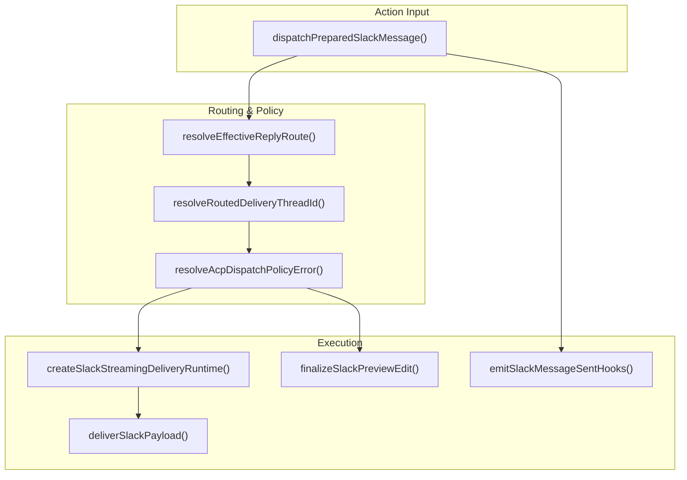
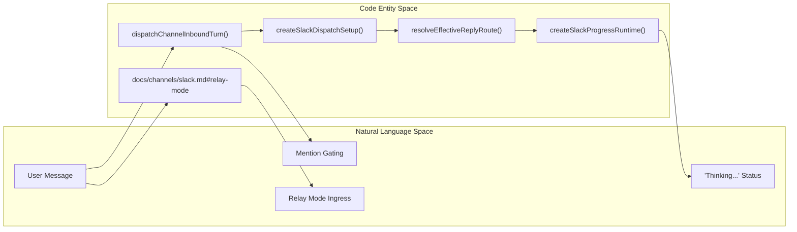

# Channel Architecture

<details>
<summary>Relevant source files</summary>

The following files were used as context for generating this wiki page:

- [docs/channels/slack.md](docs/channels/slack.md)
- [docs/plugins/sdk-channel-plugins.md](docs/plugins/sdk-channel-plugins.md)
- [extensions/copilot/harness.ts](extensions/copilot/harness.ts)
- [extensions/discord/src/monitor/provider.commands.test.ts](extensions/discord/src/monitor/provider.commands.test.ts)
- [extensions/discord/src/monitor/provider.commands.ts](extensions/discord/src/monitor/provider.commands.ts)
- [extensions/discord/src/monitor/provider.ts](extensions/discord/src/monitor/provider.ts)
- [extensions/discord/src/test-support/provider.test-support.ts](extensions/discord/src/test-support/provider.test-support.ts)
- [extensions/discord/src/voice/command.ts](extensions/discord/src/voice/command.ts)
- [extensions/slack/src/__traces__/cancel-mid-stream.trace.jsonl](extensions/slack/src/__traces__/cancel-mid-stream.trace.jsonl)
- [extensions/slack/src/__traces__/final-blocks-and-text.trace.jsonl](extensions/slack/src/__traces__/final-blocks-and-text.trace.jsonl)
- [extensions/slack/src/__traces__/native-prose-then-exec-failed.trace.jsonl](extensions/slack/src/__traces__/native-prose-then-exec-failed.trace.jsonl)
- [extensions/slack/src/__traces__/preview-edit-fallback.trace.jsonl](extensions/slack/src/__traces__/preview-edit-fallback.trace.jsonl)
- [extensions/slack/src/__traces__/preview-exec-failed-then-prose.trace.jsonl](extensions/slack/src/__traces__/preview-exec-failed-then-prose.trace.jsonl)
- [extensions/slack/src/__traces__/progress-compact-commentary.trace.jsonl](extensions/slack/src/__traces__/progress-compact-commentary.trace.jsonl)
- [extensions/slack/src/__traces__/progress-native-unified.trace.jsonl](extensions/slack/src/__traces__/progress-native-unified.trace.jsonl)
- [extensions/slack/src/__traces__/progress-session-card.trace.jsonl](extensions/slack/src/__traces__/progress-session-card.trace.jsonl)
- [extensions/slack/src/__traces__/short-final-native-rejection.trace.jsonl](extensions/slack/src/__traces__/short-final-native-rejection.trace.jsonl)
- [extensions/slack/src/__traces__/streaming-happy-native.trace.jsonl](extensions/slack/src/__traces__/streaming-happy-native.trace.jsonl)
- [extensions/slack/src/accounts.test.ts](extensions/slack/src/accounts.test.ts)
- [extensions/slack/src/approval-handler.runtime.test.ts](extensions/slack/src/approval-handler.runtime.test.ts)
- [extensions/slack/src/approval-handler.runtime.ts](extensions/slack/src/approval-handler.runtime.ts)
- [extensions/slack/src/channel.test.ts](extensions/slack/src/channel.test.ts)
- [extensions/slack/src/channel.ts](extensions/slack/src/channel.ts)
- [extensions/slack/src/config-schema.test.ts](extensions/slack/src/config-schema.test.ts)
- [extensions/slack/src/config-schema.ts](extensions/slack/src/config-schema.ts)
- [extensions/slack/src/config-ui-hints.ts](extensions/slack/src/config-ui-hints.ts)
- [extensions/slack/src/delivery-trace.test.ts](extensions/slack/src/delivery-trace.test.ts)
- [extensions/slack/src/monitor/agent-view-state.ts](extensions/slack/src/monitor/agent-view-state.ts)
- [extensions/slack/src/monitor/context.test.ts](extensions/slack/src/monitor/context.test.ts)
- [extensions/slack/src/monitor/context.ts](extensions/slack/src/monitor/context.ts)
- [extensions/slack/src/monitor/enterprise-install.test.ts](extensions/slack/src/monitor/enterprise-install.test.ts)
- [extensions/slack/src/monitor/enterprise-install.ts](extensions/slack/src/monitor/enterprise-install.ts)
- [extensions/slack/src/monitor/events/assistant.ts](extensions/slack/src/monitor/events/assistant.ts)
- [extensions/slack/src/monitor/events/home.test.ts](extensions/slack/src/monitor/events/home.test.ts)
- [extensions/slack/src/monitor/events/home.ts](extensions/slack/src/monitor/events/home.ts)
- [extensions/slack/src/monitor/message-handler/dispatch-helpers.ts](extensions/slack/src/monitor/message-handler/dispatch-helpers.ts)
- [extensions/slack/src/monitor/message-handler/dispatch-progress.ts](extensions/slack/src/monitor/message-handler/dispatch-progress.ts)
- [extensions/slack/src/monitor/message-handler/dispatch-setup.ts](extensions/slack/src/monitor/message-handler/dispatch-setup.ts)
- [extensions/slack/src/monitor/message-handler/dispatch-streaming.ts](extensions/slack/src/monitor/message-handler/dispatch-streaming.ts)
- [extensions/slack/src/monitor/message-handler/dispatch.preview-fallback.test.ts](extensions/slack/src/monitor/message-handler/dispatch.preview-fallback.test.ts)
- [extensions/slack/src/monitor/message-handler/dispatch.ts](extensions/slack/src/monitor/message-handler/dispatch.ts)
- [extensions/slack/src/monitor/message-handler/prepare.ts](extensions/slack/src/monitor/message-handler/prepare.ts)
- [extensions/slack/src/monitor/presence-monitor.test.ts](extensions/slack/src/monitor/presence-monitor.test.ts)
- [extensions/slack/src/monitor/presence-monitor.ts](extensions/slack/src/monitor/presence-monitor.ts)
- [extensions/slack/src/monitor/provider-support.ts](extensions/slack/src/monitor/provider-support.ts)
- [extensions/slack/src/monitor/provider.event-identity-recovery.test.ts](extensions/slack/src/monitor/provider.event-identity-recovery.test.ts)
- [extensions/slack/src/monitor/provider.transport-credentials.test.ts](extensions/slack/src/monitor/provider.transport-credentials.test.ts)
- [extensions/slack/src/monitor/provider.ts](extensions/slack/src/monitor/provider.ts)
- [extensions/slack/src/monitor/replies.test.ts](extensions/slack/src/monitor/replies.test.ts)
- [extensions/slack/src/monitor/replies.ts](extensions/slack/src/monitor/replies.ts)
- [extensions/slack/src/monitor/slash.test-harness.ts](extensions/slack/src/monitor/slash.test-harness.ts)
- [extensions/slack/src/monitor/slash.test.ts](extensions/slack/src/monitor/slash.test.ts)
- [extensions/slack/src/monitor/slash.ts](extensions/slack/src/monitor/slash.ts)
- [extensions/slack/src/monitor/suggested-prompts.test.ts](extensions/slack/src/monitor/suggested-prompts.test.ts)
- [extensions/slack/src/monitor/suggested-prompts.ts](extensions/slack/src/monitor/suggested-prompts.ts)
- [extensions/slack/src/setup-core.ts](extensions/slack/src/setup-core.ts)
- [extensions/slack/src/setup-shared.ts](extensions/slack/src/setup-shared.ts)
- [extensions/slack/src/setup-surface.test.ts](extensions/slack/src/setup-surface.test.ts)
- [extensions/slack/src/streaming.test.ts](extensions/slack/src/streaming.test.ts)
- [extensions/slack/src/streaming.ts](extensions/slack/src/streaming.ts)
- [extensions/slack/src/thread-ts.test.ts](extensions/slack/src/thread-ts.test.ts)
- [extensions/slack/src/thread-ts.ts](extensions/slack/src/thread-ts.ts)
- [extensions/telegram/src/bot-message-dispatch.preview-hook-safety.test.ts](extensions/telegram/src/bot-message-dispatch.preview-hook-safety.test.ts)
- [packages/ai/src/providers/clean-for-gemini.ts](packages/ai/src/providers/clean-for-gemini.ts)
- [src/agents/embedded-agent-subscribe.raw-stream.test.ts](src/agents/embedded-agent-subscribe.raw-stream.test.ts)
- [src/agents/embedded-agent-subscribe.raw-stream.ts](src/agents/embedded-agent-subscribe.raw-stream.ts)
- [src/agents/embedded-agent-subscribe.tool-text-diagnostics.ts](src/agents/embedded-agent-subscribe.tool-text-diagnostics.ts)
- [src/agents/main-session-recovery/main-session-recovery-admission.ts](src/agents/main-session-recovery/main-session-recovery-admission.ts)
- [src/agents/main-session-recovery/main-session-restart-recovery-runtime.ts](src/agents/main-session-recovery/main-session-restart-recovery-runtime.ts)
- [src/agents/subagents/spawn/acp-spawn-parent-stream.ts](src/agents/subagents/spawn/acp-spawn-parent-stream.ts)
- [src/agents/tools/sessions-tool.self-archive.test.ts](src/agents/tools/sessions-tool.self-archive.test.ts)
- [src/auto-reply/dispatch.delivery-order.test.ts](src/auto-reply/dispatch.delivery-order.test.ts)
- [src/auto-reply/dispatch.ts](src/auto-reply/dispatch.ts)
- [src/auto-reply/reply-payload.ts](src/auto-reply/reply-payload.ts)
- [src/auto-reply/reply/acp-projector.test.ts](src/auto-reply/reply/acp-projector.test.ts)
- [src/auto-reply/reply/acp-projector.ts](src/auto-reply/reply/acp-projector.ts)
- [src/auto-reply/reply/agent-event-bridge.test.ts](src/auto-reply/reply/agent-event-bridge.test.ts)
- [src/auto-reply/reply/agent-event-bridge.ts](src/auto-reply/reply/agent-event-bridge.ts)
- [src/auto-reply/reply/agent-runner-payloads.test.ts](src/auto-reply/reply/agent-runner-payloads.test.ts)
- [src/auto-reply/reply/before-deliver.test.ts](src/auto-reply/reply/before-deliver.test.ts)
- [src/auto-reply/reply/dispatch-acp-delivery.test.ts](src/auto-reply/reply/dispatch-acp-delivery.test.ts)
- [src/auto-reply/reply/dispatch-acp-delivery.ts](src/auto-reply/reply/dispatch-acp-delivery.ts)
- [src/auto-reply/reply/dispatch-acp-manager.runtime.ts](src/auto-reply/reply/dispatch-acp-manager.runtime.ts)
- [src/auto-reply/reply/dispatch-acp.test.ts](src/auto-reply/reply/dispatch-acp.test.ts)
- [src/auto-reply/reply/dispatch-acp.ts](src/auto-reply/reply/dispatch-acp.ts)
- [src/auto-reply/reply/dispatch-from-config.abort-and-dedupe.test-utils.ts](src/auto-reply/reply/dispatch-from-config.abort-and-dedupe.test-utils.ts)
- [src/auto-reply/reply/dispatch-from-config.acp-privacy.test.ts](src/auto-reply/reply/dispatch-from-config.acp-privacy.test.ts)
- [src/auto-reply/reply/dispatch-from-config.base.test-utils.ts](src/auto-reply/reply/dispatch-from-config.base.test-utils.ts)
- [src/auto-reply/reply/dispatch-from-config.choose-route.ts](src/auto-reply/reply/dispatch-from-config.choose-route.ts)
- [src/auto-reply/reply/dispatch-from-config.delivery-and-tts.test-utils.ts](src/auto-reply/reply/dispatch-from-config.delivery-and-tts.test-utils.ts)
- [src/auto-reply/reply/dispatch-from-config.events.ts](src/auto-reply/reply/dispatch-from-config.events.ts)
- [src/auto-reply/reply/dispatch-from-config.execute.ts](src/auto-reply/reply/dispatch-from-config.execute.ts)
- [src/auto-reply/reply/dispatch-from-config.finalize.ts](src/auto-reply/reply/dispatch-from-config.finalize.ts)
- [src/auto-reply/reply/dispatch-from-config.gather.ts](src/auto-reply/reply/dispatch-from-config.gather.ts)
- [src/auto-reply/reply/dispatch-from-config.hooks-and-send-policy.test-utils.ts](src/auto-reply/reply/dispatch-from-config.hooks-and-send-policy.test-utils.ts)
- [src/auto-reply/reply/dispatch-from-config.lifecycle-and-bindings.test-utils.ts](src/auto-reply/reply/dispatch-from-config.lifecycle-and-bindings.test-utils.ts)
- [src/auto-reply/reply/dispatch-from-config.lifecycle.ts](src/auto-reply/reply/dispatch-from-config.lifecycle.ts)
- [src/auto-reply/reply/dispatch-from-config.prepare-context.ts](src/auto-reply/reply/dispatch-from-config.prepare-context.ts)
- [src/auto-reply/reply/dispatch-from-config.prepare-operation.ts](src/auto-reply/reply/dispatch-from-config.prepare-operation.ts)
- [src/auto-reply/reply/dispatch-from-config.shared.test-harness.ts](src/auto-reply/reply/dispatch-from-config.shared.test-harness.ts)
- [src/auto-reply/reply/dispatch-from-config.stale-recovery.test.ts](src/auto-reply/reply/dispatch-from-config.stale-recovery.test.ts)
- [src/auto-reply/reply/dispatch-from-config.terminal-recovery.test.ts](src/auto-reply/reply/dispatch-from-config.terminal-recovery.test.ts)
- [src/auto-reply/reply/dispatch-from-config.test-harness.ts](src/auto-reply/reply/dispatch-from-config.test-harness.ts)
- [src/auto-reply/reply/dispatch-from-config.transcript.ts](src/auto-reply/reply/dispatch-from-config.transcript.ts)
- [src/auto-reply/reply/dispatch-from-config.types.ts](src/auto-reply/reply/dispatch-from-config.types.ts)
- [src/auto-reply/reply/followup-delivery.channel.test.ts](src/auto-reply/reply/followup-delivery.channel.test.ts)
- [src/auto-reply/reply/get-reply-run-admission.ts](src/auto-reply/reply/get-reply-run-admission.ts)
- [src/auto-reply/reply/queue/drain.identity-guard.test.ts](src/auto-reply/reply/queue/drain.identity-guard.test.ts)
- [src/auto-reply/reply/reply-payloads-dedupe.ts](src/auto-reply/reply/reply-payloads-dedupe.ts)
- [src/auto-reply/reply/reply-payloads-transport-dedupe.test.ts](src/auto-reply/reply/reply-payloads-transport-dedupe.test.ts)
- [src/auto-reply/reply/reply-turn-admission.test.ts](src/auto-reply/reply/reply-turn-admission.test.ts)
- [src/auto-reply/reply/reply-turn-admission.ts](src/auto-reply/reply/reply-turn-admission.ts)
- [src/auto-reply/reply/route-reply.ts](src/auto-reply/reply/route-reply.ts)
- [src/auto-reply/reply/source-reply-delivery-mode.test.ts](src/auto-reply/reply/source-reply-delivery-mode.test.ts)
- [src/auto-reply/reply/source-reply-delivery-mode.ts](src/auto-reply/reply/source-reply-delivery-mode.ts)
- [src/channels/plugins/acp-stateful-target-driver.test.ts](src/channels/plugins/acp-stateful-target-driver.test.ts)
- [src/channels/plugins/acp-stateful-target-driver.ts](src/channels/plugins/acp-stateful-target-driver.ts)
- [src/channels/plugins/types.core.ts](src/channels/plugins/types.core.ts)
- [src/channels/turn/dispatch-result.ts](src/channels/turn/dispatch-result.ts)
- [src/channels/turn/execution.ts](src/channels/turn/execution.ts)
- [src/channels/turn/lifecycle.ts](src/channels/turn/lifecycle.ts)
- [src/channels/turn/run-channel-turn.finalize.test.ts](src/channels/turn/run-channel-turn.finalize.test.ts)
- [src/channels/turn/run-channel-turn.pipeline.test.ts](src/channels/turn/run-channel-turn.pipeline.test.ts)
- [src/channels/turn/types.ts](src/channels/turn/types.ts)
- [src/config/sessions/lifecycle.ts](src/config/sessions/lifecycle.ts)
- [src/config/types.slack.test.ts](src/config/types.slack.test.ts)
- [src/config/types.slack.ts](src/config/types.slack.ts)
- [src/gateway/agent-turn/agent-admission-controller.ts](src/gateway/agent-turn/agent-admission-controller.ts)
- [src/gateway/gateway-acp-bind.live.test.ts](src/gateway/gateway-acp-bind.live.test.ts)
- [src/gateway/gateway-concurrent-streams.test.ts](src/gateway/gateway-concurrent-streams.test.ts)
- [src/gateway/server-methods/chat-send-turn-adoption.ts](src/gateway/server-methods/chat-send-turn-adoption.ts)
- [src/gateway/server-methods/sessions-rewind.storage.test.ts](src/gateway/server-methods/sessions-rewind.storage.test.ts)
- [src/gateway/server-methods/sessions-shared.ts](src/gateway/server-methods/sessions-shared.ts)
- [src/gateway/server.startup-recovery-webchat.test.ts](src/gateway/server.startup-recovery-webchat.test.ts)
- [src/gateway/worker-environments/session-placement-lifecycle.ts](src/gateway/worker-environments/session-placement-lifecycle.ts)
- [src/infra/agent-events.run-listeners.test.ts](src/infra/agent-events.run-listeners.test.ts)
- [src/infra/agent-events.test.ts](src/infra/agent-events.test.ts)
- [src/infra/agent-events.ts](src/infra/agent-events.ts)
- [src/infra/kysely-sync-cache-state.ts](src/infra/kysely-sync-cache-state.ts)
- [src/infra/kysely-sync.test.ts](src/infra/kysely-sync.test.ts)
- [src/infra/kysely-sync.ts](src/infra/kysely-sync.ts)
- [src/plugin-sdk/acp-runtime.ts](src/plugin-sdk/acp-runtime.ts)
- [src/plugin-sdk/acpx.ts](src/plugin-sdk/acpx.ts)
- [src/sessions/session-lifecycle-admission.test.ts](src/sessions/session-lifecycle-admission.test.ts)
- [src/sessions/session-lifecycle-admission.ts](src/sessions/session-lifecycle-admission.ts)
- [src/shared/chat-message-content.ts](src/shared/chat-message-content.ts)
- [src/shared/text-truncate.test.ts](src/shared/text-truncate.test.ts)
- [src/shared/text-truncate.ts](src/shared/text-truncate.ts)

</details>


This page documents the unified channel architecture that enables OpenClaw to connect to multiple messaging platforms (Telegram, Discord, Slack, WhatsApp, and others). It explains the multi-platform channel system, provider monitors, message normalization, and event processing patterns involved in handling inbound and outbound messaging.

OpenClaw treats messaging platforms as **Channels**, which are implemented as extensible plugins. Each channel is responsible for maintaining a live connection, normalizing inbound events, managing multi-account configurations, and delivering outbound messages with proper session routing and character-limit handling.

---

## Channel Plugin Architecture

The Gateway manages the lifecycle of channel accounts through the `ChannelManager`. It handles starting, stopping, and monitoring the health of plugin-based channel runtimes.

### Channel Plugin Component Model

The architecture is built around a pipeline that moves from raw platform events to a normalized `ReplyPayload`.

Title: "Channel Plugin Component Model"
```mermaid
classDiagram
    class "ChannelManager" {
        +startAccount()
        +stopAccount()
        +runtimes: Map
    }

    class "ChannelPlugin" {
        +gateway: startAccount()
        +config: resolveAccount()
        +capabilities: chatTypes
        +messaging: targetResolver
        +actions: handleAction()
    }

    class "ProviderMonitor" {
        +TelegramPollingSession
        +SlackSocketMode
        +DiscordClient
    }

    class "InboundHandler" {
        +dispatchChannelInboundTurn()
        +openChannelIngressQueue()
    }

    class "ReplyPipeline" {
        +createSlackStreamingDeliveryRuntime()
        +deliverWithFinalizableLivePreviewAdapter()
    }

    "ChannelManager" --> "ChannelPlugin" : "Orchestrates"
    "ChannelPlugin" --> "ProviderMonitor" : "Implements"
    "ProviderMonitor" --> "InboundHandler" : "Normalizes & Dispatches"
    "InboundHandler" --> "ReplyPipeline" : "Initializes Outbound"
```

- **Normalization**: Inbound messages are normalized into a standard format. For example, Slack events are processed via `createSlackDispatchSetup` [extensions/slack/src/monitor/message-handler/dispatch.ts:50-50]() which prepares the context for the reply pipeline.
- **Ingress Queuing**: Platforms use a spooling mechanism to ensure updates are not lost. The system utilizes `dispatchChannelInboundTurn` to manage the handoff from the channel provider to the agent runtime [extensions/slack/src/monitor/message-handler/dispatch.ts:4-4]().
- **Turn Admission**: Before a reply starts, the system must admit the turn. `admitReplyTurn` decides whether an inbound turn may start, queue, or abort a reply run based on the session's current state [src/auto-reply/reply/reply-turn-admission.ts:10-17]().

Sources:
- [extensions/slack/src/monitor/message-handler/dispatch.ts:1-80]()
- [src/auto-reply/reply/reply-turn-admission.ts:1-60]()
- [src/auto-reply/reply/dispatch-acp.ts:1-80]()

---

## Message Action Routing and Docking

The architecture includes a sophisticated **docking** system for session reply route switching. This allows an agent to respond to a specific session even if the message originates from a different channel or tool call.

### Outbound Routing Logic

The system resolves the appropriate delivery path using `resolveEffectiveReplyRoute` [src/auto-reply/reply/dispatch-from-config.gather.ts:52-52]().

1.  **Channel Selection**: The system resolves the appropriate channel using `resolveStableChannelMessageIngress` [src/auto-reply/reply/dispatch-acp.test.ts:20-20]().
2.  **Target Resolution**: `resolveRoutedDeliveryThreadId` determines the specific thread or message ID to target for the reply [src/auto-reply/reply/dispatch-from-config.gather.ts:63-63]().
3.  **Docking (Session Reply Route Switching)**: `resolveBoundAcpDispatchSessionKey` allows the system to switch the reply route based on the active session binding [src/auto-reply/reply/dispatch-from-config.gather.ts:38-38]().
4.  **Relay Mode**: For Slack, relay mode separates ingress from the gateway, using a trusted router to forward events over an authenticated websocket [docs/channels/slack.md:48-52]().

Title: "Outbound Message Action Data Flow"


Sources:
- [src/auto-reply/reply/dispatch-from-config.gather.ts:1-70]()
- [extensions/slack/src/monitor/message-handler/dispatch.ts:49-160]()
- [docs/channels/slack.md:48-68]()

---

## Progress Drafts and Streaming

To improve user experience during long-running tasks, OpenClaw supports **Progress Drafts** and **Live Previews** (streaming).

- **Compositor**: The `createChannelProgressDraftCompositor` merges status headlines and tool execution updates into a single transient message [extensions/slack/src/monitor/message-handler/dispatch-progress.ts:3-3]().
- **Slack Implementation**: Slack uses `createSlackStreamingDeliveryRuntime` to manage the lifecycle of a draft message, including updating the preview as chunks arrive [extensions/slack/src/monitor/message-handler/dispatch.ts:78-78]().
- **Native Progress**: The system supports native progress streaming (e.g., Slack blocks) via `createSlackNativeProgressTransport` [extensions/slack/src/monitor/message-handler/dispatch-progress.ts:35-35]().
- **Draft Progress Cards**: For a structured view of agent activity, the system can render a "card" using `createSlackDraftProgressCardRuntime` [extensions/slack/src/monitor/message-handler/dispatch-progress.ts:32-34]().

Sources:
- [extensions/slack/src/monitor/message-handler/dispatch.ts:78-95]()
- [extensions/slack/src/monitor/message-handler/dispatch-progress.ts:1-150]()

---

## Channel Docking and Session Persistence

When a message is received, the system generates a `SessionKey`. This key is used to "dock" the reply route so that subsequent messages in that conversation are delivered back to the correct source.

- **Session Key Generation**: Keys are derived using `resolveSessionAgentId` and platform-specific metadata [src/auto-reply/reply/dispatch-acp.ts:29-30]().
- **Route Persistence**: `updateLastRouteMock` in tests illustrates the pattern of persisting the successful delivery route for future turns [extensions/slack/src/monitor/message-handler/dispatch.preview-fallback.test.ts:26-26]().
- **Deduplication**: The system uses `claimPendingAgentQuestionAnswer` to ensure that responses to gateway questions are not processed multiple times [src/auto-reply/reply/dispatch-acp.ts:31-31]().
- **Lifecycle Admission**: `runWithReplyOperationLifecycleAdmission` ensures that work is only performed if the turn has successfully claimed the session's execution slot [src/auto-reply/reply/reply-turn-admission.ts:87-93]().

Sources:
- [src/auto-reply/reply/dispatch-acp.ts:1-50]()
- [src/auto-reply/reply/reply-turn-admission.ts:150-174]()
- [extensions/slack/src/monitor/message-handler/dispatch.preview-fallback.test.ts:1-40]()

---

## Policy and Access Control

Channel access is governed by DM and group policies.

- **Mention Gating**: The system checks `ExplicitlyMentionedBot` and `MentionSource` (e.g., `implicit_thread`, `subteam`) to determine if a response is required in group settings [extensions/slack/src/monitor/message-handler/dispatch.ts:122-130]().
- **Loop Protection**: `resolveSlackBotLoopProtection` prevents automated bots from triggering infinite message loops [extensions/slack/src/monitor/message-handler/dispatch.ts:42-42]().
- **Tool Policies**: `toolPolicyRestrictsTools` is checked during dispatch to ensure the agent only uses authorized tools for the specific channel context [src/auto-reply/reply/dispatch-acp.ts:32-32]().
- **Slash Command Auth**: Native commands (like `/openclaw`) are governed by `ChatCommandDefinition` and `NativeCommandSpec` to enforce authorization before execution [extensions/slack/src/monitor/slash.test.ts:1-10]().

Title: "Natural Language Space to Code Entity Space"


Sources:
- [extensions/slack/src/monitor/message-handler/dispatch.ts:109-162]()
- [src/auto-reply/reply/dispatch-acp.ts:13-35]()
- [extensions/slack/src/monitor/slash.test.ts:36-60]()
- [docs/channels/slack.md:48-68]()