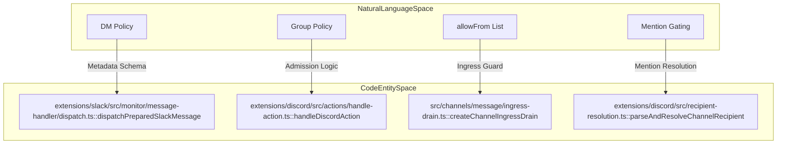
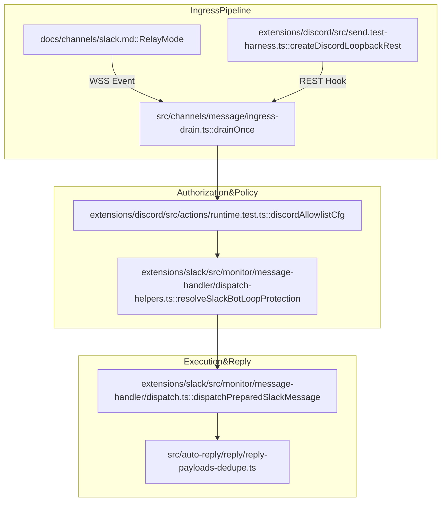

# Policy & Access Control

Relevant source files

The following files were used as context for generating this wiki page:

- [docs/channels/discord.md](docs/channels/discord.md)
- [docs/channels/slack.md](docs/channels/slack.md)
- [docs/gateway/config-channels.md](docs/gateway/config-channels.md)
- [docs/plugins/sdk-channel-plugins.md](docs/plugins/sdk-channel-plugins.md)
- [extensions/discord/src/actions/handle-action.test.ts](extensions/discord/src/actions/handle-action.test.ts)
- [extensions/discord/src/actions/handle-action.ts](extensions/discord/src/actions/handle-action.ts)
- [extensions/discord/src/actions/handle-action.upload-file-caption.test.ts](extensions/discord/src/actions/handle-action.upload-file-caption.test.ts)
- [extensions/discord/src/actions/runtime.messaging.messages.ts](extensions/discord/src/actions/runtime.messaging.messages.ts)
- [extensions/discord/src/actions/runtime.messaging.reactions.ts](extensions/discord/src/actions/runtime.messaging.reactions.ts)
- [extensions/discord/src/actions/runtime.messaging.runtime.ts](extensions/discord/src/actions/runtime.messaging.runtime.ts)
- [extensions/discord/src/actions/runtime.messaging.send.ts](extensions/discord/src/actions/runtime.messaging.send.ts)
- [extensions/discord/src/actions/runtime.messaging.ts](extensions/discord/src/actions/runtime.messaging.ts)
- [extensions/discord/src/actions/runtime.moderation-shared.ts](extensions/discord/src/actions/runtime.moderation-shared.ts)
- [extensions/discord/src/actions/runtime.moderation.ts](extensions/discord/src/actions/runtime.moderation.ts)
- [extensions/discord/src/actions/runtime.test.ts](extensions/discord/src/actions/runtime.test.ts)
- [extensions/discord/src/channel-actions.contract.test.ts](extensions/discord/src/channel-actions.contract.test.ts)
- [extensions/discord/src/channel-actions.test.ts](extensions/discord/src/channel-actions.test.ts)
- [extensions/discord/src/channel-actions.ts](extensions/discord/src/channel-actions.ts)
- [extensions/discord/src/channel.test.ts](extensions/discord/src/channel.test.ts)
- [extensions/discord/src/channel.ts](extensions/discord/src/channel.ts)
- [extensions/discord/src/components.builders.ts](extensions/discord/src/components.builders.ts)
- [extensions/discord/src/components.modal.ts](extensions/discord/src/components.modal.ts)
- [extensions/discord/src/components.parse.ts](extensions/discord/src/components.parse.ts)
- [extensions/discord/src/components.selects.test.ts](extensions/discord/src/components.selects.test.ts)
- [extensions/discord/src/components.test.ts](extensions/discord/src/components.test.ts)
- [extensions/discord/src/config-ui-hints.ts](extensions/discord/src/config-ui-hints.ts)
- [extensions/discord/src/doctor-contract.ts](extensions/discord/src/doctor-contract.ts)
- [extensions/discord/src/doctor.test.ts](extensions/discord/src/doctor.test.ts)
- [extensions/discord/src/internal/rest.test.ts](extensions/discord/src/internal/rest.test.ts)
- [extensions/discord/src/mentions.test.ts](extensions/discord/src/mentions.test.ts)
- [extensions/discord/src/mentions.ts](extensions/discord/src/mentions.ts)
- [extensions/discord/src/monitor/agent-components.dispatch.ts](extensions/discord/src/monitor/agent-components.dispatch.ts)
- [extensions/discord/src/monitor/provider.commands.test.ts](extensions/discord/src/monitor/provider.commands.test.ts)
- [extensions/discord/src/monitor/provider.commands.ts](extensions/discord/src/monitor/provider.commands.ts)
- [extensions/discord/src/monitor/provider.ts](extensions/discord/src/monitor/provider.ts)
- [extensions/discord/src/monitor/reply-delivery.ts](extensions/discord/src/monitor/reply-delivery.ts)
- [extensions/discord/src/monitor/thread-bindings.discord-api.ts](extensions/discord/src/monitor/thread-bindings.discord-api.ts)
- [extensions/discord/src/outbound-adapter.interactive-order.test.ts](extensions/discord/src/outbound-adapter.interactive-order.test.ts)
- [extensions/discord/src/outbound-adapter.test-harness.ts](extensions/discord/src/outbound-adapter.test-harness.ts)
- [extensions/discord/src/outbound-adapter.test.ts](extensions/discord/src/outbound-adapter.test.ts)
- [extensions/discord/src/outbound-adapter.ts](extensions/discord/src/outbound-adapter.ts)
- [extensions/discord/src/outbound-payload.contract.test.ts](extensions/discord/src/outbound-payload.contract.test.ts)
- [extensions/discord/src/outbound-payload.ts](extensions/discord/src/outbound-payload.ts)
- [extensions/discord/src/question-finalization.test.ts](extensions/discord/src/question-finalization.test.ts)
- [extensions/discord/src/retry.ts](extensions/discord/src/retry.ts)
- [extensions/discord/src/runtime.ts](extensions/discord/src/runtime.ts)
- [extensions/discord/src/send.components.multipart.test.ts](extensions/discord/src/send.components.multipart.test.ts)
- [extensions/discord/src/send.components.test.ts](extensions/discord/src/send.components.test.ts)
- [extensions/discord/src/send.components.ts](extensions/discord/src/send.components.ts)
- [extensions/discord/src/send.creates-thread.chunking.test.ts](extensions/discord/src/send.creates-thread.chunking.test.ts)
- [extensions/discord/src/send.creates-thread.test.ts](extensions/discord/src/send.creates-thread.test.ts)
- [extensions/discord/src/send.message-request.ts](extensions/discord/src/send.message-request.ts)
- [extensions/discord/src/send.messages.ts](extensions/discord/src/send.messages.ts)
- [extensions/discord/src/send.outbound.ts](extensions/discord/src/send.outbound.ts)
- [extensions/discord/src/send.reactions.ts](extensions/discord/src/send.reactions.ts)
- [extensions/discord/src/send.receipt.ts](extensions/discord/src/send.receipt.ts)
- [extensions/discord/src/send.sends-basic-channel-messages.test.ts](extensions/discord/src/send.sends-basic-channel-messages.test.ts)
- [extensions/discord/src/send.shared.ts](extensions/discord/src/send.shared.ts)
- [extensions/discord/src/send.test-harness.ts](extensions/discord/src/send.test-harness.ts)
- [extensions/discord/src/send.voice.test.ts](extensions/discord/src/send.voice.test.ts)
- [extensions/discord/src/send.voice.ts](extensions/discord/src/send.voice.ts)
- [extensions/discord/src/send.webhook.chunk-limit.test.ts](extensions/discord/src/send.webhook.chunk-limit.test.ts)
- [extensions/discord/src/send.webhook.proxy.test.ts](extensions/discord/src/send.webhook.proxy.test.ts)
- [extensions/discord/src/send.webhook.ts](extensions/discord/src/send.webhook.ts)
- [extensions/discord/src/test-support/provider.test-support.ts](extensions/discord/src/test-support/provider.test-support.ts)
- [extensions/discord/src/voice-message.ts](extensions/discord/src/voice-message.ts)
- [extensions/discord/src/voice/command.ts](extensions/discord/src/voice/command.ts)
- [extensions/slack/src/__traces__/cancel-mid-stream.trace.jsonl](extensions/slack/src/__traces__/cancel-mid-stream.trace.jsonl)
- [extensions/slack/src/__traces__/final-blocks-and-text.trace.jsonl](extensions/slack/src/__traces__/final-blocks-and-text.trace.jsonl)
- [extensions/slack/src/__traces__/native-prose-then-exec-failed.trace.jsonl](extensions/slack/src/__traces__/native-prose-then-exec-failed.trace.jsonl)
- [extensions/slack/src/__traces__/preview-edit-fallback.trace.jsonl](extensions/slack/src/__traces__/preview-edit-fallback.trace.jsonl)
- [extensions/slack/src/__traces__/preview-exec-failed-then-prose.trace.jsonl](extensions/slack/src/__traces__/preview-exec-failed-then-prose.trace.jsonl)
- [extensions/slack/src/__traces__/progress-compact-commentary.trace.jsonl](extensions/slack/src/__traces__/progress-compact-commentary.trace.jsonl)
- [extensions/slack/src/__traces__/progress-native-unified.trace.jsonl](extensions/slack/src/__traces__/progress-native-unified.trace.jsonl)
- [extensions/slack/src/__traces__/progress-session-card.trace.jsonl](extensions/slack/src/__traces__/progress-session-card.trace.jsonl)
- [extensions/slack/src/__traces__/short-final-native-rejection.trace.jsonl](extensions/slack/src/__traces__/short-final-native-rejection.trace.jsonl)
- [extensions/slack/src/__traces__/streaming-happy-native.trace.jsonl](extensions/slack/src/__traces__/streaming-happy-native.trace.jsonl)
- [extensions/slack/src/accounts.test.ts](extensions/slack/src/accounts.test.ts)
- [extensions/slack/src/approval-handler.runtime.test.ts](extensions/slack/src/approval-handler.runtime.test.ts)
- [extensions/slack/src/approval-handler.runtime.ts](extensions/slack/src/approval-handler.runtime.ts)
- [extensions/slack/src/channel.test.ts](extensions/slack/src/channel.test.ts)
- [extensions/slack/src/channel.ts](extensions/slack/src/channel.ts)
- [extensions/slack/src/config-schema.test.ts](extensions/slack/src/config-schema.test.ts)
- [extensions/slack/src/config-schema.ts](extensions/slack/src/config-schema.ts)
- [extensions/slack/src/config-ui-hints.ts](extensions/slack/src/config-ui-hints.ts)
- [extensions/slack/src/delivery-trace.test.ts](extensions/slack/src/delivery-trace.test.ts)
- [extensions/slack/src/monitor/agent-view-state.ts](extensions/slack/src/monitor/agent-view-state.ts)
- [extensions/slack/src/monitor/context.test.ts](extensions/slack/src/monitor/context.test.ts)
- [extensions/slack/src/monitor/context.ts](extensions/slack/src/monitor/context.ts)
- [extensions/slack/src/monitor/enterprise-install.test.ts](extensions/slack/src/monitor/enterprise-install.test.ts)
- [extensions/slack/src/monitor/enterprise-install.ts](extensions/slack/src/monitor/enterprise-install.ts)
- [extensions/slack/src/monitor/events/assistant.ts](extensions/slack/src/monitor/events/assistant.ts)
- [extensions/slack/src/monitor/events/home.test.ts](extensions/slack/src/monitor/events/home.test.ts)
- [extensions/slack/src/monitor/events/home.ts](extensions/slack/src/monitor/events/home.ts)
- [extensions/slack/src/monitor/message-handler/dispatch-helpers.ts](extensions/slack/src/monitor/message-handler/dispatch-helpers.ts)
- [extensions/slack/src/monitor/message-handler/dispatch-progress.ts](extensions/slack/src/monitor/message-handler/dispatch-progress.ts)
- [extensions/slack/src/monitor/message-handler/dispatch-setup.ts](extensions/slack/src/monitor/message-handler/dispatch-setup.ts)
- [extensions/slack/src/monitor/message-handler/dispatch-streaming.ts](extensions/slack/src/monitor/message-handler/dispatch-streaming.ts)
- [extensions/slack/src/monitor/message-handler/dispatch.preview-fallback.test.ts](extensions/slack/src/monitor/message-handler/dispatch.preview-fallback.test.ts)
- [extensions/slack/src/monitor/message-handler/dispatch.ts](extensions/slack/src/monitor/message-handler/dispatch.ts)
- [extensions/slack/src/monitor/message-handler/prepare.ts](extensions/slack/src/monitor/message-handler/prepare.ts)
- [extensions/slack/src/monitor/presence-monitor.test.ts](extensions/slack/src/monitor/presence-monitor.test.ts)
- [extensions/slack/src/monitor/presence-monitor.ts](extensions/slack/src/monitor/presence-monitor.ts)
- [extensions/slack/src/monitor/provider-support.ts](extensions/slack/src/monitor/provider-support.ts)
- [extensions/slack/src/monitor/provider.event-identity-recovery.test.ts](extensions/slack/src/monitor/provider.event-identity-recovery.test.ts)
- [extensions/slack/src/monitor/provider.transport-credentials.test.ts](extensions/slack/src/monitor/provider.transport-credentials.test.ts)
- [extensions/slack/src/monitor/provider.ts](extensions/slack/src/monitor/provider.ts)
- [extensions/slack/src/monitor/replies.test.ts](extensions/slack/src/monitor/replies.test.ts)
- [extensions/slack/src/monitor/replies.ts](extensions/slack/src/monitor/replies.ts)
- [extensions/slack/src/monitor/slash.test-harness.ts](extensions/slack/src/monitor/slash.test-harness.ts)
- [extensions/slack/src/monitor/slash.test.ts](extensions/slack/src/monitor/slash.test.ts)
- [extensions/slack/src/monitor/slash.ts](extensions/slack/src/monitor/slash.ts)
- [extensions/slack/src/monitor/suggested-prompts.test.ts](extensions/slack/src/monitor/suggested-prompts.test.ts)
- [extensions/slack/src/monitor/suggested-prompts.ts](extensions/slack/src/monitor/suggested-prompts.ts)
- [extensions/slack/src/setup-core.ts](extensions/slack/src/setup-core.ts)
- [extensions/slack/src/setup-shared.ts](extensions/slack/src/setup-shared.ts)
- [extensions/slack/src/setup-surface.test.ts](extensions/slack/src/setup-surface.test.ts)
- [extensions/slack/src/streaming.test.ts](extensions/slack/src/streaming.test.ts)
- [extensions/slack/src/streaming.ts](extensions/slack/src/streaming.ts)
- [extensions/slack/src/thread-ts.test.ts](extensions/slack/src/thread-ts.test.ts)
- [extensions/slack/src/thread-ts.ts](extensions/slack/src/thread-ts.ts)
- [src/auto-reply/reply/agent-runner-payloads.test.ts](src/auto-reply/reply/agent-runner-payloads.test.ts)
- [src/auto-reply/reply/followup-delivery.channel.test.ts](src/auto-reply/reply/followup-delivery.channel.test.ts)
- [src/auto-reply/reply/reply-payloads-dedupe.ts](src/auto-reply/reply/reply-payloads-dedupe.ts)
- [src/auto-reply/reply/reply-payloads-transport-dedupe.test.ts](src/auto-reply/reply/reply-payloads-transport-dedupe.test.ts)
- [src/auto-reply/reply/route-reply.ts](src/auto-reply/reply/route-reply.ts)
- [src/channels/plugins/types.core.ts](src/channels/plugins/types.core.ts)
- [src/channels/turn/direct-delivery-custody.ts](src/channels/turn/direct-delivery-custody.ts)
- [src/channels/turn/run-channel-turn.custody.test.ts](src/channels/turn/run-channel-turn.custody.test.ts)
- [src/config/types.slack.test.ts](src/config/types.slack.test.ts)
- [src/config/types.slack.ts](src/config/types.slack.ts)
- [src/plugin-sdk/test-helpers/channel-contract-suites.ts](src/plugin-sdk/test-helpers/channel-contract-suites.ts)

This page documents the access control mechanisms, messaging policies, and durable ingress behaviors for messaging channels in OpenClaw. These policies determine which messages trigger agent responses, which senders are authorized to interact with the AI gateway, and how message flow is managed between platforms.

---

## Overview

OpenClaw utilizes a layered policy system to govern access across various messaging platforms. The system operates on a **personal assistant trust model**, assuming one trusted operator boundary per gateway.

Key policy components include:

- **DM (Direct Message) Policies**: Specify handling of unknown direct message senders with modes like `pairing`, `allowlist`, `open`, or `disabled`.
- **Group Policies**: Dictate how group/room messages are gated, supporting `requireMention` gating and allowlist filtering.
- **allowFrom Configuration**: Provides explicit numeric ID allowlists for senders and groups, supporting platform-specific normalization.
- **Durable Ingress Admission**: A multi-stage process involving claiming, adoption, and settlement to ensure message delivery guarantees even during gateway restarts.

Sources: [docs/gateway/config-channels.md:18-39](), [docs/channels/slack.md:10-20](), [docs/channels/discord.md:10-20]()

---

## DM Policy Modes

The `dmPolicy` setting governs how the gateway responds to messages received directly from unknown senders. These are typically configured under `channels.<provider>.dmPolicy`.

| Mode | Behavior |
|---|---|
| `pairing` (default) | Unknown senders receive a one-time pairing code. The owner must approve the code via an existing channel or CLI. |
| `allowlist` | Only senders explicitly listed in `allowFrom` are permitted. |
| `open` | Allow all inbound DMs (requires `allowFrom: ["*"]`). |
| `disabled` | Ignore all inbound DMs entirely. |

Sources: [docs/gateway/config-channels.md:22-27](), [docs/channels/slack.md:11-13](), [docs/channels/discord.md:11-13]()

---

## Group & Channel Policies

Group policies regulate whether group messages are processed and under which conditions.

### Group Admission Modes
Configured via `groupPolicy` at the provider or account level:
- `allowlist` (default): Only groups matching the `groupAllowFrom` list are processed.
- `open`: Bypass group allowlists, though mention-gating still applies.
- `disabled`: Block all group/room messages.

### Mention Gating
Mention gating ensures agents only respond when intended.
- **Implicit Mentions**: OpenClaw can be configured to treat replies to the bot, quotes of the bot, or active thread participation as mentions. This is controlled via `channels.defaults.implicitMentions`.
- **Bot Collaboration**: Explicit opt-in for bot-authored inbound dispatch is required, with mention gating and loop protection enabled by default. The `resolveSlackBotLoopProtection` function in the Slack plugin specifically handles preventing infinite loops between automated agents.

Sources: [docs/gateway/config-channels.md:29-39](), [docs/gateway/config-channels.md:89-93](), [extensions/slack/src/monitor/message-handler/dispatch.ts:42-42]()

---

## Technical Implementation: Access & Flow

### Code Entity Mapping (Policy Components)

This diagram illustrates how configuration-level policies map to internal runtime entities and classes within the Gateway and Channel systems.

Sources: [extensions/slack/src/monitor/message-handler/dispatch.ts:49-77](), [extensions/discord/src/actions/handle-action.ts:20-23](), [src/channels/message/ingress-drain.ts:4-6](), [extensions/discord/src/recipient-resolution.ts:27-27]()

### Message Processing & Authorization Flow

The flow from an inbound event through authorization to the execution of a reply operation.

Sources: [docs/channels/slack.md:48-68](), [extensions/discord/src/actions/runtime.test.ts:153-163](), [extensions/slack/src/monitor/message-handler/dispatch.ts:49-50](), [src/auto-reply/reply/reply-payloads-dedupe.ts:1-5]()

---

## Durable Ingress & Deduplication

OpenClaw implements a robust ingress system to prevent message loss and duplicate processing.

### Inbound Deduplication
Channels utilize persistent replay guards to ensure each message is processed exactly once.
- **Slack Loop Protection**: `resolveSlackBotLoopProtection` prevents the bot from responding to its own messages or other bots unless explicitly authorized.
- **Discord Nonce**: `createDiscordMessageNonce` is used during outbound sends to ensure idempotency at the platform level.

### Ingress Drain Lifecycle
The `ChannelIngressDrain` manages the lifecycle of claimed events:
1. **Claiming**: An owner ID is assigned to a specific message in the queue.
2. **Adoption**: The system monitors for "stalled" claims where a process claimed a message but failed to start work within the adoption timeout.
3. **Lease Management**: Claims have a lease. If a process holds a claim too long without completion, it is considered stale and recovered.

### Slack & Discord Specifics
- **Slack Relay Mode**: Separates Slack ingress from the OpenClaw gateway. A trusted router owns the Socket Mode connection and forwards events over an authenticated websocket.
- **Discord Privileged Intents**: Requires `Message Content Intent` and `Server Members Intent` for proper policy enforcement in guild channels.

Sources: [extensions/slack/src/monitor/message-handler/dispatch-helpers.ts:42-42](), [extensions/discord/src/send.shared.ts:31-31](), [docs/channels/slack.md:48-68](), [docs/channels/discord.md:34-41]()

---

## Sources:
- [docs/gateway/config-channels.md:18-39]()
- [docs/gateway/config-channels.md:89-93]()
- [docs/channels/slack.md:10-20]()
- [docs/channels/slack.md:48-68]()
- [docs/channels/discord.md:10-20]()
- [docs/channels/discord.md:34-41]()
- [extensions/slack/src/monitor/message-handler/dispatch.ts:42-77]()
- [extensions/discord/src/actions/handle-action.ts:20-23]()
- [extensions/discord/src/actions/runtime.test.ts:153-163]()
- [extensions/discord/src/send.shared.ts:31-31]()
- [extensions/discord/src/recipient-resolution.ts:27-27]()
- [src/channels/message/ingress-drain.ts:4-6]()
- [src/auto-reply/reply/reply-payloads-dedupe.ts:1-5]()