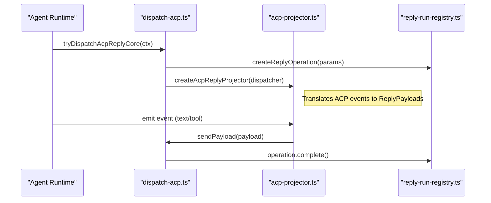

# Message Flow & Delivery

<details>
<summary>Relevant source files</summary>

The following files were used as context for generating this wiki page:

- [extensions/copilot/harness.ts](extensions/copilot/harness.ts)
- [extensions/telegram/src/bot-message-dispatch.preview-hook-safety.test.ts](extensions/telegram/src/bot-message-dispatch.preview-hook-safety.test.ts)
- [packages/ai/src/providers/clean-for-gemini.ts](packages/ai/src/providers/clean-for-gemini.ts)
- [src/agents/embedded-agent-subscribe.raw-stream.test.ts](src/agents/embedded-agent-subscribe.raw-stream.test.ts)
- [src/agents/embedded-agent-subscribe.raw-stream.ts](src/agents/embedded-agent-subscribe.raw-stream.ts)
- [src/agents/embedded-agent-subscribe.tool-text-diagnostics.ts](src/agents/embedded-agent-subscribe.tool-text-diagnostics.ts)
- [src/agents/main-session-recovery/main-session-recovery-admission.ts](src/agents/main-session-recovery/main-session-recovery-admission.ts)
- [src/agents/main-session-recovery/main-session-restart-recovery-runtime.ts](src/agents/main-session-recovery/main-session-restart-recovery-runtime.ts)
- [src/agents/subagents/spawn/acp-spawn-parent-stream.ts](src/agents/subagents/spawn/acp-spawn-parent-stream.ts)
- [src/agents/tools/sessions-tool.self-archive.test.ts](src/agents/tools/sessions-tool.self-archive.test.ts)
- [src/auto-reply/dispatch.delivery-order.test.ts](src/auto-reply/dispatch.delivery-order.test.ts)
- [src/auto-reply/dispatch.ts](src/auto-reply/dispatch.ts)
- [src/auto-reply/reply-payload.ts](src/auto-reply/reply-payload.ts)
- [src/auto-reply/reply/acp-projector.test.ts](src/auto-reply/reply/acp-projector.test.ts)
- [src/auto-reply/reply/acp-projector.ts](src/auto-reply/reply/acp-projector.ts)
- [src/auto-reply/reply/agent-event-bridge.test.ts](src/auto-reply/reply/agent-event-bridge.test.ts)
- [src/auto-reply/reply/agent-event-bridge.ts](src/auto-reply/reply/agent-event-bridge.ts)
- [src/auto-reply/reply/agent-runner-core.test.ts](src/auto-reply/reply/agent-runner-core.test.ts)
- [src/auto-reply/reply/agent-runner-core.ts](src/auto-reply/reply/agent-runner-core.ts)
- [src/auto-reply/reply/agent-runner-direct-runtime-config.test.ts](src/auto-reply/reply/agent-runner-direct-runtime-config.test.ts)
- [src/auto-reply/reply/agent-runner-execute.ts](src/auto-reply/reply/agent-runner-execute.ts)
- [src/auto-reply/reply/agent-runner-run.ts](src/auto-reply/reply/agent-runner-run.ts)
- [src/auto-reply/reply/agent-runner-steer-adoption.ts](src/auto-reply/reply/agent-runner-steer-adoption.ts)
- [src/auto-reply/reply/agent-runner.runreplyagent.e2e.test.ts](src/auto-reply/reply/agent-runner.runreplyagent.e2e.test.ts)
- [src/auto-reply/reply/before-deliver.test.ts](src/auto-reply/reply/before-deliver.test.ts)
- [src/auto-reply/reply/dispatch-acp-delivery.test.ts](src/auto-reply/reply/dispatch-acp-delivery.test.ts)
- [src/auto-reply/reply/dispatch-acp-delivery.ts](src/auto-reply/reply/dispatch-acp-delivery.ts)
- [src/auto-reply/reply/dispatch-acp-manager.runtime.ts](src/auto-reply/reply/dispatch-acp-manager.runtime.ts)
- [src/auto-reply/reply/dispatch-acp.test.ts](src/auto-reply/reply/dispatch-acp.test.ts)
- [src/auto-reply/reply/dispatch-acp.ts](src/auto-reply/reply/dispatch-acp.ts)
- [src/auto-reply/reply/dispatch-from-config.abort-and-dedupe.test-utils.ts](src/auto-reply/reply/dispatch-from-config.abort-and-dedupe.test-utils.ts)
- [src/auto-reply/reply/dispatch-from-config.acp-privacy.test.ts](src/auto-reply/reply/dispatch-from-config.acp-privacy.test.ts)
- [src/auto-reply/reply/dispatch-from-config.base.test-utils.ts](src/auto-reply/reply/dispatch-from-config.base.test-utils.ts)
- [src/auto-reply/reply/dispatch-from-config.choose-route.ts](src/auto-reply/reply/dispatch-from-config.choose-route.ts)
- [src/auto-reply/reply/dispatch-from-config.delivery-and-tts.test-utils.ts](src/auto-reply/reply/dispatch-from-config.delivery-and-tts.test-utils.ts)
- [src/auto-reply/reply/dispatch-from-config.events.ts](src/auto-reply/reply/dispatch-from-config.events.ts)
- [src/auto-reply/reply/dispatch-from-config.execute.ts](src/auto-reply/reply/dispatch-from-config.execute.ts)
- [src/auto-reply/reply/dispatch-from-config.finalize.ts](src/auto-reply/reply/dispatch-from-config.finalize.ts)
- [src/auto-reply/reply/dispatch-from-config.gather.ts](src/auto-reply/reply/dispatch-from-config.gather.ts)
- [src/auto-reply/reply/dispatch-from-config.hooks-and-send-policy.test-utils.ts](src/auto-reply/reply/dispatch-from-config.hooks-and-send-policy.test-utils.ts)
- [src/auto-reply/reply/dispatch-from-config.lifecycle-and-bindings.test-utils.ts](src/auto-reply/reply/dispatch-from-config.lifecycle-and-bindings.test-utils.ts)
- [src/auto-reply/reply/dispatch-from-config.lifecycle.ts](src/auto-reply/reply/dispatch-from-config.lifecycle.ts)
- [src/auto-reply/reply/dispatch-from-config.prepare-context.ts](src/auto-reply/reply/dispatch-from-config.prepare-context.ts)
- [src/auto-reply/reply/dispatch-from-config.prepare-operation.ts](src/auto-reply/reply/dispatch-from-config.prepare-operation.ts)
- [src/auto-reply/reply/dispatch-from-config.shared.test-harness.ts](src/auto-reply/reply/dispatch-from-config.shared.test-harness.ts)
- [src/auto-reply/reply/dispatch-from-config.stale-recovery.test.ts](src/auto-reply/reply/dispatch-from-config.stale-recovery.test.ts)
- [src/auto-reply/reply/dispatch-from-config.terminal-recovery.test.ts](src/auto-reply/reply/dispatch-from-config.terminal-recovery.test.ts)
- [src/auto-reply/reply/dispatch-from-config.test-harness.ts](src/auto-reply/reply/dispatch-from-config.test-harness.ts)
- [src/auto-reply/reply/dispatch-from-config.transcript.ts](src/auto-reply/reply/dispatch-from-config.transcript.ts)
- [src/auto-reply/reply/dispatch-from-config.types.ts](src/auto-reply/reply/dispatch-from-config.types.ts)
- [src/auto-reply/reply/get-reply-run-admission.ts](src/auto-reply/reply/get-reply-run-admission.ts)
- [src/auto-reply/reply/queue/drain.identity-guard.test.ts](src/auto-reply/reply/queue/drain.identity-guard.test.ts)
- [src/auto-reply/reply/reply-operation-agent-turn-state.ts](src/auto-reply/reply/reply-operation-agent-turn-state.ts)
- [src/auto-reply/reply/reply-turn-admission.test.ts](src/auto-reply/reply/reply-turn-admission.test.ts)
- [src/auto-reply/reply/reply-turn-admission.ts](src/auto-reply/reply/reply-turn-admission.ts)
- [src/auto-reply/reply/session-system-events.ts](src/auto-reply/reply/session-system-events.ts)
- [src/auto-reply/reply/source-reply-delivery-mode.test.ts](src/auto-reply/reply/source-reply-delivery-mode.test.ts)
- [src/auto-reply/reply/source-reply-delivery-mode.ts](src/auto-reply/reply/source-reply-delivery-mode.ts)
- [src/channels/plugins/acp-stateful-target-driver.test.ts](src/channels/plugins/acp-stateful-target-driver.test.ts)
- [src/channels/plugins/acp-stateful-target-driver.ts](src/channels/plugins/acp-stateful-target-driver.ts)
- [src/channels/turn/dispatch-result.ts](src/channels/turn/dispatch-result.ts)
- [src/channels/turn/execution.ts](src/channels/turn/execution.ts)
- [src/channels/turn/lifecycle.ts](src/channels/turn/lifecycle.ts)
- [src/channels/turn/run-channel-turn.finalize.test.ts](src/channels/turn/run-channel-turn.finalize.test.ts)
- [src/channels/turn/run-channel-turn.pipeline.test.ts](src/channels/turn/run-channel-turn.pipeline.test.ts)
- [src/channels/turn/types.ts](src/channels/turn/types.ts)
- [src/commands/doctor-heartbeat-session-target.test.ts](src/commands/doctor-heartbeat-session-target.test.ts)
- [src/commands/doctor-heartbeat-session-target.ts](src/commands/doctor-heartbeat-session-target.ts)
- [src/config/sessions/cleanup-service.serialization.test.ts](src/config/sessions/cleanup-service.serialization.test.ts)
- [src/config/sessions/lifecycle.ts](src/config/sessions/lifecycle.ts)
- [src/gateway/agent-turn/agent-admission-controller.ts](src/gateway/agent-turn/agent-admission-controller.ts)
- [src/gateway/gateway-acp-bind.live.test.ts](src/gateway/gateway-acp-bind.live.test.ts)
- [src/gateway/gateway-concurrent-streams.test.ts](src/gateway/gateway-concurrent-streams.test.ts)
- [src/gateway/server-methods/chat-send-turn-adoption.ts](src/gateway/server-methods/chat-send-turn-adoption.ts)
- [src/gateway/server-methods/sessions-rewind.storage.test.ts](src/gateway/server-methods/sessions-rewind.storage.test.ts)
- [src/gateway/server-methods/sessions-shared.ts](src/gateway/server-methods/sessions-shared.ts)
- [src/gateway/server.startup-recovery-webchat.test.ts](src/gateway/server.startup-recovery-webchat.test.ts)
- [src/gateway/worker-environments/session-placement-lifecycle.ts](src/gateway/worker-environments/session-placement-lifecycle.ts)
- [src/infra/agent-events.run-listeners.test.ts](src/infra/agent-events.run-listeners.test.ts)
- [src/infra/agent-events.test.ts](src/infra/agent-events.test.ts)
- [src/infra/agent-events.ts](src/infra/agent-events.ts)
- [src/infra/heartbeat-delivery-normalization.ts](src/infra/heartbeat-delivery-normalization.ts)
- [src/infra/heartbeat-events-filter.ts](src/infra/heartbeat-events-filter.ts)
- [src/infra/heartbeat-failure-notice.test.ts](src/infra/heartbeat-failure-notice.test.ts)
- [src/infra/heartbeat-failure-notice.ts](src/infra/heartbeat-failure-notice.ts)
- [src/infra/heartbeat-runner-delivery.ts](src/infra/heartbeat-runner-delivery.ts)
- [src/infra/heartbeat-runner-prompt.ts](src/infra/heartbeat-runner-prompt.ts)
- [src/infra/heartbeat-runner-run.ts](src/infra/heartbeat-runner-run.ts)
- [src/infra/heartbeat-runner.ack-token-heartbeat-acks.test.ts](src/infra/heartbeat-runner.ack-token-heartbeat-acks.test.ts)
- [src/infra/heartbeat-runner.isolated-session-mirror.test.ts](src/infra/heartbeat-runner.isolated-session-mirror.test.ts)
- [src/infra/heartbeat-runner.stale-exec.test.ts](src/infra/heartbeat-runner.stale-exec.test.ts)
- [src/infra/heartbeat-runner.tool-response.test.ts](src/infra/heartbeat-runner.tool-response.test.ts)
- [src/infra/kysely-sync-cache-state.ts](src/infra/kysely-sync-cache-state.ts)
- [src/infra/kysely-sync.test.ts](src/infra/kysely-sync.test.ts)
- [src/infra/kysely-sync.ts](src/infra/kysely-sync.ts)
- [src/infra/outbound/outbound-session.test.ts](src/infra/outbound/outbound-session.test.ts)
- [src/infra/outbound/outbound-session.ts](src/infra/outbound/outbound-session.ts)
- [src/infra/outbound/targets.test.ts](src/infra/outbound/targets.test.ts)
- [src/infra/outbound/targets.ts](src/infra/outbound/targets.ts)
- [src/plugin-sdk/acp-runtime.ts](src/plugin-sdk/acp-runtime.ts)
- [src/plugin-sdk/acpx.ts](src/plugin-sdk/acpx.ts)
- [src/sessions/session-lifecycle-admission.test.ts](src/sessions/session-lifecycle-admission.test.ts)
- [src/sessions/session-lifecycle-admission.ts](src/sessions/session-lifecycle-admission.ts)
- [src/shared/chat-message-content.ts](src/shared/chat-message-content.ts)
- [src/shared/text-truncate.test.ts](src/shared/text-truncate.test.ts)
- [src/shared/text-truncate.ts](src/shared/text-truncate.ts)

</details>


This page documents the message processing pipeline in OpenClaw, specifically focusing on the outbound delivery system, session key generation, update watermarking, deduplication, and reply delivery. It explains how OpenClaw routes messages from agents back to users across various platforms, ensuring continuity of conversations and reliable delivery.

---

## Overview

OpenClaw’s message delivery architecture separates message intent from platform-specific implementation details. Outbound message dispatch follows a pipeline that progresses from agent message action invocation through layered resolution and finally to platform-specific delivery.

The fundamental stages are:

1.  **Action Initiation**: Agents or commands invoke outbound message actions. This is often triggered by tools like `message` (built-in tool) which are processed by the `MessageActionRunner`. [src/infra/outbound/message-action-runner.ts:68-82]()
2.  **Target Resolution**: Human-friendly identifiers or user/channel IDs are converted to concrete channel-account-message targets using the `resolveMessageTarget` system. [src/infra/outbound/message-action-runner.ts:44-44]()
3.  **Session Routing**: The system calculates or confirms the appropriate session key to maintain conversation continuity, ensuring messages land in the correct chat or thread. [src/infra/outbound/message-action-runner.ts:44-44]()
4.  **Delivery Execution**: Payloads are chunked, sanitized, and dispatched via the outbound adapter specific to the messaging channel using `executeMessageSend`. [src/infra/outbound/message-action-runner.ts:45-45]()

**Sources:** [src/infra/outbound/message-action-runner.ts:1-51](), [src/auto-reply/reply/agent-runner.runreplyagent.e2e.test.ts:5-23]()

---

## Outbound Delivery Pipeline

The core of the delivery system is the platform-independent `MessageActionRunner`. This module encapsulates assembling outbound payloads, leveraging delivery hooks, and invoking dispatchers for final delivery.

### Message Action Flow

The flow of a message from the agent runtime to the physical channel involves several layers of normalization and policy checking.

**Diagram: Message Action Execution Flow**
```mermaid
graph TD
  subgraph "NaturalLanguageSpace"
    "AgentRuntime"["Agent Runtime"] --> "RunMessageAction"["Run Message Action"]
  end

  subgraph "CodeEntitySpace"
    "RunMessageAction"["runMessageAction"] --> "MessageActionRunner"["src/infra/outbound/message-action-runner.ts"]
    "MessageActionRunner"["MessageActionRunner"] --> "ExecuteMessageSend"["executeMessageSend"]
    "ExecuteMessageSend"["executeMessageSend"] --> "PluginDispatch"["executeMessagePlugin"]
    "PluginDispatch"["executeMessagePlugin"] --> "ChannelPlugin"["src/channels/plugins/types.public.ts"]
  end
```

- `runMessageAction`: The primary entry point for executing message-related tools from the agent. [src/auto-reply/reply/dispatch-acp.ts:110-112]()
- `executeMessageSend`: Orchestrates the actual sending of a message payload through the resolved channel plugin. [src/infra/outbound/message-action-runner.ts:45-45]()
- `executeMessagePlugin`: Routes the action to the specific plugin implementation for final delivery. [src/infra/outbound/message-action-runner.ts:34-34]()

**Sources:** [src/infra/outbound/message-action-runner.ts:1-180](), [src/auto-reply/reply/dispatch-from-config.execute.ts:34-72]()

---

## Session Key Generation & Routing

Session keys uniquely identify conversations and are crucial for maintaining consistent state across message turns and platforms.

### Session Key Formation

Session keys are derived from the message context. OpenClaw uses outbound session resolution to manage these identifiers. [src/auto-reply/reply/dispatch-from-config.lifecycle.ts:4-5]()

The system handles specific threading logic:
- **Thread Addressing**: Sessions are scoped to specific threads or topics. In Telegram, this uses `buildTelegramThreadParams`. [src/auto-reply/reply/dispatch-from-config.gather.ts:62-63]()
- **Routing**: Determining the appropriate agent for a session key is handled by `resolveSessionAgentId`. [src/auto-reply/reply/dispatch-from-config.gather.ts:6-9]()

### Outbound Session Resolution

When sending a message, OpenClaw ensures the session entry exists and resolves the appropriate route.

| Context Component | Description | Source |
| :--- | :--- | :--- |
| **Session Admission** | Controls exclusive access to session lifecycle via `admitReplyTurn`. | [src/auto-reply/reply/reply-turn-admission.ts:48-51]() |
| **Transcript Persistence** | Records messages to the session history using `persistAcpDispatchTranscript`. | [src/auto-reply/reply/dispatch-acp.ts:149-151]() |
| **Deduplication** | Prevents duplicate deliveries using idempotency keys and route bindings. | [src/auto-reply/reply/dispatch-from-config.gather.ts:99-101]() |

**Diagram: Session Route Resolution State**
```mermaid
stateDiagram-v2
  [*] --> "loadSessionEntry"
  "loadSessionEntry" --> "admitReplyTurn"
  "admitReplyTurn" --> "resolveReplyTurnKind"
  "resolveReplyTurnKind" --> "runWithReplyOperationLifecycleAdmission"
  "runWithReplyOperationLifecycleAdmission" --> [*]
```

**Sources:** [src/auto-reply/reply/reply-turn-admission.ts:1-174](), [src/auto-reply/reply/dispatch-from-config.lifecycle.ts:1-174]()

---

## Message Processing: Deduplication & Sanitization

To prevent processing the same incoming update multiple times and handle race conditions, OpenClaw employs deduplication and feedback mechanisms.

- **Inbound Deduplication**: The Gateway uses `messageOperationRouteBindings` to track and deduplicate active requests based on a request scope. [src/auto-reply/reply/dispatch-from-config.gather.ts:100-101]()
- **Update Watermarking**: The system uses `REPLY_RUN_TERMINAL_SETTLE_TIMEOUT_MS` to manage the lifecycle of message operations, pruning expired or excess entries. [src/auto-reply/reply/reply-turn-admission.ts:38-40](), [src/auto-reply/reply/reply-turn-admission.ts:125-133]()

### Payload Normalization & Media

Before delivery, messages are enriched with metadata and formatted according to platform capabilities.

- **Normalization**: `ReplyPayload` defines the channel-agnostic structure for text and media. [src/auto-reply/reply-payload.ts:43-112]()
- **Media Staging**: Media attachments are resolved and normalized using `resolveAgentTurnAttachments`. [src/auto-reply/reply/dispatch-acp.ts:70-73]()

### Delivery Queues & Streaming

OpenClaw supports live streaming of responses to improve perceived latency.

- **Reply Operations**: `createReplyOperation` manages the lifecycle of a specific reply turn. [src/auto-reply/reply/reply-turn-admission.ts:34-34]()
- **Typing Signaler**: `createTypingSignaler` manages "is typing" indicators during long-running agent operations. [src/auto-reply/reply/agent-runner-run.ts:64-64]()
- **Block Streaming**: `resolveEffectiveBlockStreamingConfig` determines if a channel supports incremental block delivery. [src/auto-reply/reply/agent-runner-run.ts:34-34]()

**Sources:** [src/auto-reply/reply-payload.ts:1-112](), [src/auto-reply/reply/agent-runner-run.ts:65-158](), [src/auto-reply/reply/dispatch-from-config.execute.ts:1-152]()

---

## Technical Data Flow: ACP Delivery

The following sequence diagram shows the flow from an agent generating a reply to the message being delivered through the Agent Control Protocol (ACP) infrastructure.

**Diagram: ACP Delivery Sequence**


**Sources:** [src/auto-reply/reply/dispatch-acp.ts:1-173](), [src/auto-reply/reply/reply-turn-admission.ts:54-62](), [src/auto-reply/reply/dispatch-acp.test.ts:36-50]()