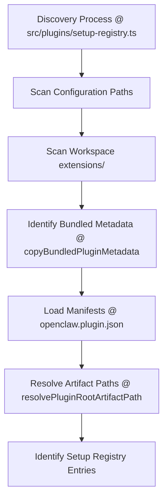
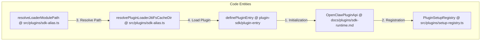
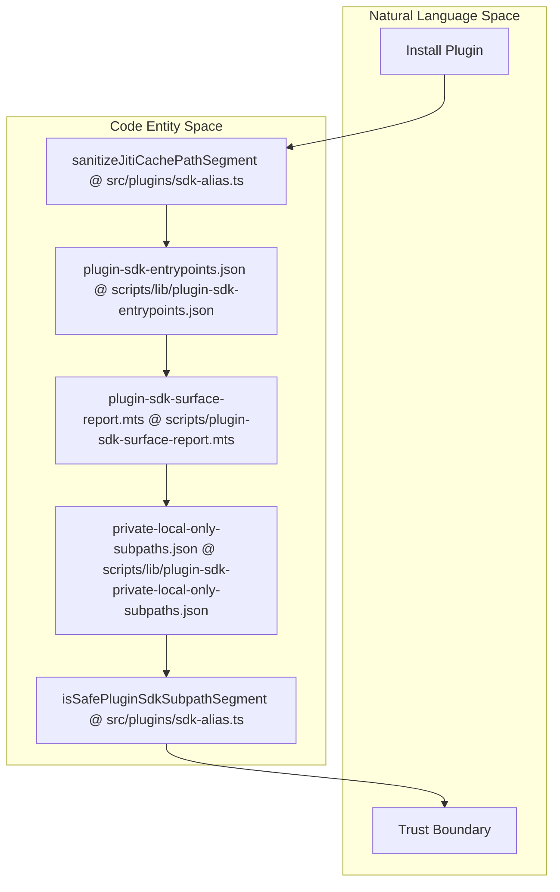
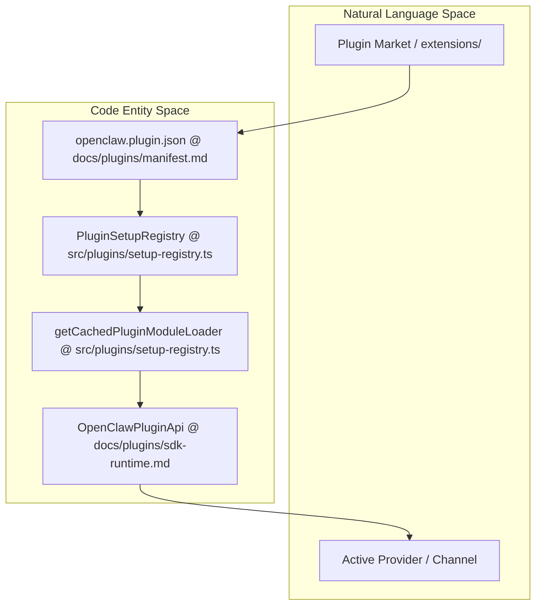

# Plugin Architecture

Relevant source files

The following files were used as context for generating this wiki page:

- [docs/concepts/model-providers.md](docs/concepts/model-providers.md)
- [docs/plugins/dependency-resolution.md](docs/plugins/dependency-resolution.md)
- [docs/plugins/manifest.md](docs/plugins/manifest.md)
- [docs/plugins/sdk-runtime.md](docs/plugins/sdk-runtime.md)
- [docs/plugins/sdk-subpaths.md](docs/plugins/sdk-subpaths.md)
- [extensions/anthropic/cli-auth-api.ts](extensions/anthropic/cli-auth-api.ts)
- [extensions/anthropic/cli-auth-seam.test.ts](extensions/anthropic/cli-auth-seam.test.ts)
- [extensions/anthropic/cli-auth-seam.ts](extensions/anthropic/cli-auth-seam.ts)
- [extensions/codex/src/app-server/attempt-startup.test.ts](extensions/codex/src/app-server/attempt-startup.test.ts)
- [extensions/codex/src/app-server/managed-binary.test.ts](extensions/codex/src/app-server/managed-binary.test.ts)
- [extensions/codex/src/app-server/managed-binary.ts](extensions/codex/src/app-server/managed-binary.ts)
- [extensions/codex/src/app-server/run-attempt-test-harness.ts](extensions/codex/src/app-server/run-attempt-test-harness.ts)
- [extensions/codex/src/app-server/runtime-artifact.test.ts](extensions/codex/src/app-server/runtime-artifact.test.ts)
- [extensions/codex/src/app-server/transport-stdio.config.test.ts](extensions/codex/src/app-server/transport-stdio.config.test.ts)
- [extensions/codex/src/node-exec-server.test.ts](extensions/codex/src/node-exec-server.test.ts)
- [extensions/openai/cli-auth-api.test.ts](extensions/openai/cli-auth-api.test.ts)
- [extensions/openai/cli-auth-api.ts](extensions/openai/cli-auth-api.ts)
- [extensions/tsconfig.package-boundary.paths.json](extensions/tsconfig.package-boundary.paths.json)
- [extensions/xai/tsconfig.json](extensions/xai/tsconfig.json)
- [scripts/build-external-plugin-local-dist.mts](scripts/build-external-plugin-local-dist.mts)
- [scripts/copy-bundled-plugin-metadata.mts](scripts/copy-bundled-plugin-metadata.mts)
- [scripts/lib/plugin-npm-package-manifest.mts](scripts/lib/plugin-npm-package-manifest.mts)
- [scripts/lib/plugin-npm-runtime-build.mjs](scripts/lib/plugin-npm-runtime-build.mjs)
- [scripts/lib/plugin-npm-runtime-build.mts](scripts/lib/plugin-npm-runtime-build.mts)
- [scripts/lib/plugin-sdk-entrypoints.json](scripts/lib/plugin-sdk-entrypoints.json)
- [scripts/lib/plugin-sdk-private-local-only-subpaths.json](scripts/lib/plugin-sdk-private-local-only-subpaths.json)
- [scripts/plugin-sdk-surface-report.mts](scripts/plugin-sdk-surface-report.mts)
- [scripts/sync-plugin-sdk-exports.mts](scripts/sync-plugin-sdk-exports.mts)
- [src/commands/onboard-inference.test.ts](src/commands/onboard-inference.test.ts)
- [src/commands/onboard-inference.ts](src/commands/onboard-inference.ts)
- [src/config/sessions/session-accessor.transcript-turn.ts](src/config/sessions/session-accessor.transcript-turn.ts)
- [src/plugin-sdk/facade-resolution-shared.ts](src/plugin-sdk/facade-resolution-shared.ts)
- [src/plugin-sdk/process-runtime.ts](src/plugin-sdk/process-runtime.ts)
- [src/plugin-sdk/session-transcript-runtime.guarded.test.ts](src/plugin-sdk/session-transcript-runtime.guarded.test.ts)
- [src/plugin-sdk/session-transcript-runtime.test.ts](src/plugin-sdk/session-transcript-runtime.test.ts)
- [src/plugin-sdk/windows-spawn.test.ts](src/plugin-sdk/windows-spawn.test.ts)
- [src/plugin-sdk/windows-spawn.ts](src/plugin-sdk/windows-spawn.ts)
- [src/plugins/copy-bundled-plugin-metadata.test.ts](src/plugins/copy-bundled-plugin-metadata.test.ts)
- [src/plugins/doctor-contract-artifact.ts](src/plugins/doctor-contract-artifact.ts)
- [src/plugins/package-entrypoints.ts](src/plugins/package-entrypoints.ts)
- [src/plugins/plugin-sdk-native-resolver.test.ts](src/plugins/plugin-sdk-native-resolver.test.ts)
- [src/plugins/plugin-sdk-native-resolver.ts](src/plugins/plugin-sdk-native-resolver.ts)
- [src/plugins/public-surface-runtime.ts](src/plugins/public-surface-runtime.ts)
- [src/plugins/root-artifact-path.ts](src/plugins/root-artifact-path.ts)
- [src/plugins/sdk-alias.test.ts](src/plugins/sdk-alias.test.ts)
- [src/plugins/sdk-alias.ts](src/plugins/sdk-alias.ts)
- [src/plugins/setup-registry.lifecycle.test.ts](src/plugins/setup-registry.lifecycle.test.ts)
- [src/plugins/setup-registry.ts](src/plugins/setup-registry.ts)
- [test/plugin-npm-package-manifest.test.ts](test/plugin-npm-package-manifest.test.ts)
- [test/plugin-npm-runtime-build.test.ts](test/plugin-npm-runtime-build.test.ts)
- [test/scripts/build-external-plugin-local-dist.test.ts](test/scripts/build-external-plugin-local-dist.test.ts)
- [test/scripts/plugin-npm-runtime-native-import.test.ts](test/scripts/plugin-npm-runtime-native-import.test.ts)
- [test/scripts/sync-plugin-sdk-exports.test.ts](test/scripts/sync-plugin-sdk-exports.test.ts)
- [test/vitest/vitest.shared.config.ts](test/vitest/vitest.shared.config.ts)
- [ui/src/e2e/browser-route-handoff.e2e.test.ts](ui/src/e2e/browser-route-handoff.e2e.test.ts)

This page documents OpenClaw's plugin system comprehensively, explaining the Plugin SDK, registration APIs, the various plugin exports (providers, tools, hooks), and the discovery process. It covers the manifest-driven architecture centered around `openclaw.plugin.json`, the activation planner, capability availability checks, and the plugin boundary enforcement system that ensures security and stability.

---

## Overview

OpenClaw's plugin architecture is a modular extensibility framework enabling dynamic integration of new capabilities such as model providers, tools, messaging channels, and hooks without modifying core code. Plugins are first-class citizens that register themselves through a rich SDK and expose capabilities following strict contracts.

Key framework components:
- **PluginRegistry**: Central record keeper for plugins and registrations per capability [src/plugins/setup-registry.ts:78-84]().
- **Plugin SDK**: Typed interface presented to plugins during registration (via `register(api)`) to add providers, tools, and hooks [docs/plugins/sdk-runtime.md:23-27]().
- **Plugin Manifest**: Discovered metadata (`openclaw.plugin.json`) enables manifest-driven discovery and capability activation without executing plugin code [docs/plugins/manifest.md:20-22]().
- **Activation Planner**: Decides when plugins should load based on manifest activation hints such as `onStartup` or presence of requested providers/channels [docs/plugins/manifest.md:30-38]().
- **Capability Boundary Enforcement**: Ensures only enabled and authorized plugins participate, rejecting potentially dangerous plugins or invalid states [docs/plugins/sdk-subpaths.md:13-24]().

Plugins have shapes — e.g., provider-only, hook-only, or hybrid — that define what registration methods they can expose [src/plugins/setup-registry.ts:42-60]().

Sources: [src/plugins/setup-registry.ts:42-84](), [docs/plugins/sdk-runtime.md:23-27](), [docs/plugins/manifest.md:20-38](), [docs/plugins/sdk-subpaths.md:13-24]()

---

## Plugin Discovery and Loading

### Discovery Mechanism

OpenClaw discovers plugins by scanning directories for manifests or explicit paths defined in the configuration. The discovery order respects explicit user paths, workspace-level plugins, global installations, and finally built-in bundled plugins:

- **Workspace Extensions**: Plugins in `extensions/` within the current workspace [docs/plugins/sdk-subpaths.md:28-30]().
- **Bundled Plugins**: Packaged with OpenClaw; discovered using environment variables and root npm package exclusions [test/scripts/build-external-plugin-local-dist.test.ts:10-15]().
- **Setup Registry**: Maintains plugin setup entries discovered from manifests and light exports before full activation [src/plugins/setup-registry.ts:1-2]().

### Discovery Logic Flow

Sources: [src/plugins/setup-registry.ts:1-22](), [docs/plugins/manifest.md:20-22](), [test/scripts/build-external-plugin-local-dist.test.ts:10-15]()

### Plugin Loading and Activation Planning

The loading routine takes discovered manifests and activation hints to decide which plugins to import and execute their `register(api)` calls.

- **Dynamic Imports & Aliasing**: OpenClaw uses a sophisticated aliasing system (`sdk-alias.ts`) to resolve plugin SDK imports to either `src` or `dist` files depending on the environment [src/plugins/sdk-alias.ts:1-26]().
- **JITI Runtime**: The loader utilizes `jiti` for dynamic TypeScript execution with a dedicated filesystem cache located in the user's cache directory [src/plugins/sdk-alias.ts:167-174]().
- **SDK Resolution Preference**: Supports `auto`, `dist`, or `src` resolution modes to handle different build environments [src/plugins/sdk-alias.ts:29-30]().

### Code Entity Association

Sources: [docs/plugins/sdk-runtime.md:23-27](), [src/plugins/sdk-alias.ts:1-174](), [src/plugins/setup-registry.ts:78-84]()

---

## Plugin SDK and Capability Registration API

The **Plugin SDK** is exposed as narrow public subpaths under `openclaw/plugin-sdk/` [docs/plugins/sdk-subpaths.md:9-11](). These subpaths are strictly audited to maintain a stable API surface [scripts/plugin-sdk-surface-report.mts:3-18]().

### Key SDK Subpaths
| Subpath | Key Exports | Purpose |
| :--- | :--- | :--- |
| `plugin-sdk/plugin-entry` | `definePluginEntry` | Main plugin entry point [docs/plugins/sdk-subpaths.md:48-48]() |
| `plugin-sdk/core` | `defineChannelPluginEntry`, `createChatChannelPlugin` | Messaging channel and setup integration [docs/plugins/sdk-subpaths.md:49-49]() |
| `plugin-sdk/health` | `Doctor health-check registration` | Diagnostics and repair registration [docs/plugins/sdk-subpaths.md:53-53]() |
| `plugin-sdk/channel-setup` | `defineChannelSetupContract` | Configuration and onboarding UI [docs/plugins/sdk-subpaths.md:95-95]() |
| `plugin-sdk/agent-harness-runtime` | `EmbeddedRunAttemptParamsV2` | Runtime tool execution and harness management [extensions/codex/src/app-server/attempt-startup.test.ts:5-8]() |

### Registration Interface
The `register(api)` callback receives an `OpenClawPluginApi` object [docs/plugins/sdk-runtime.md:23-27](). Key registration methods include:
- `api.registerProvider()`: LLM text inference [docs/plugins/sdk-runtime.md:18-20]().
- `api.registerChannel()`: Messaging channels [docs/plugins/sdk-runtime.md:15-17]().
- `api.registerHook()`: System lifecycle and tool hooks [docs/plugins/sdk-subpaths.md:59-60]().

### Plugin Runtime Helpers
Plugins access core services via `api.runtime` [docs/plugins/sdk-runtime.md:12-12]():
- **Config Mutation**: `api.runtime.config.mutateConfigFile()` allows plugins to persist configuration changes with explicit reload policies (`auto`, `restart`, or `none`) [docs/plugins/sdk-runtime.md:39-43]().
- **Agent Ingress**: `api.runtime.agent.runCommandFromIngress()` allows channel plugins to admit authenticated agent turns [docs/plugins/sdk-runtime.md:87-90]().
- **Error Diagnostics**: `attachErrorDiagnostic()` allows plugins to attach supplemental operator diagnostics to errors [docs/plugins/sdk-runtime.md:75-80]().

Sources: [docs/plugins/sdk-subpaths.md:9-108](), [docs/plugins/sdk-runtime.md:12-90](), [scripts/plugin-sdk-surface-report.mts:3-18]()

---

## Plugin Manifests: The `openclaw.plugin.json` File

Each plugin must include a manifest that enables the Gateway to reason about the plugin without executing its code. This is mandatory for native OpenClaw plugins [docs/plugins/manifest.md:20-22]().

### Manifest Schema Structure
| Field | Description |
| :--- | :--- |
| `id` | Canonical plugin ID used in configuration [docs/plugins/manifest.md:140-140](). |
| `configSchema` | Inline JSON Schema for strict config validation [docs/plugins/manifest.md:141-141](). |
| `requiresPlugins` | Dependency list of other required plugin IDs [docs/plugins/manifest.md:142-142](). |
| `providers` | List of LLM providers exposed by the plugin [docs/plugins/manifest.md:65-65](). |
| `cliBackends` | CLI backends provided for model interaction [docs/plugins/manifest.md:89-89](). |

Sources: [docs/plugins/manifest.md:20-142]()

---

## Plugin Boundary Enforcement System

OpenClaw enforces strict boundaries to ensure system stability and security, particularly through the Plugin SDK surface management and integrity verification.

### 1. SDK Surface Auditing
- **Export Inventory**: The system maintains a strictly maintained entrypoint inventory defined in `plugin-sdk-entrypoints.json` [docs/plugins/sdk-subpaths.md:15-16]().
- **Subpath Isolation**: "Private-local" subpaths are excluded from the documented SDK to prevent unstable imports [docs/plugins/sdk-subpaths.md:17-20]().
- **Surface Budget**: CI checks fail if SDK surface budgets for callable or deprecated exports are exceeded [scripts/plugin-sdk-surface-report.mts:32-38]().

### 2. Boundary Integrity
- **Path Sanitization**: The aliasing system sanitizes cache paths to prevent injection or escapement [src/plugins/sdk-alias.ts:69-72]().
- **Alias Guards**: Validates that SDK subpath segments are safe alphanumeric strings [src/plugins/sdk-alias.ts:182-184]().
- **Version Locking**: The JITI cache directory is keyed by the plugin version and install marker to prevent stale code execution [src/plugins/sdk-alias.ts:154-174]().

### Boundary Enforcement Flow

Sources: [docs/plugins/sdk-subpaths.md:13-23](), [src/plugins/sdk-alias.ts:69-184](), [scripts/plugin-sdk-surface-report.mts:32-38]()

---

## Plugin Discovery and Registry Association

This diagram bridges the discovery-level plugin metadata to the runtime registration.

Sources: [src/plugins/setup-registry.ts:1-121](), [docs/plugins/sdk-runtime.md:23-27](), [docs/plugins/manifest.md:20-22]()