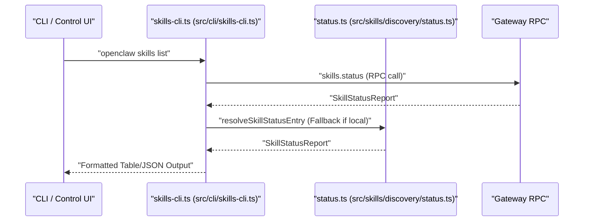

# Skills System

<details>
<summary>Relevant source files</summary>

The following files were used as context for generating this wiki page:

- [.agents/skills/auto-qa/SKILL.md](.agents/skills/auto-qa/SKILL.md)
- [.agents/skills/auto-qa/references/live-proof-routing.md](.agents/skills/auto-qa/references/live-proof-routing.md)
- [.agents/skills/control-ui-e2e/SKILL.md](.agents/skills/control-ui-e2e/SKILL.md)
- [.agents/skills/crabbox/SKILL.md](.agents/skills/crabbox/SKILL.md)
- [.agents/skills/openclaw-debugging/SKILL.md](.agents/skills/openclaw-debugging/SKILL.md)
- [.agents/skills/openclaw-pr-maintainer/SKILL.md](.agents/skills/openclaw-pr-maintainer/SKILL.md)
- [.agents/skills/openclaw-pr-maintainer/scripts/github-activity.sh](.agents/skills/openclaw-pr-maintainer/scripts/github-activity.sh)
- [.agents/skills/openclaw-repair-sweep/SKILL.md](.agents/skills/openclaw-repair-sweep/SKILL.md)
- [.agents/skills/openclaw-test-performance/SKILL.md](.agents/skills/openclaw-test-performance/SKILL.md)
- [.agents/skills/openclaw-testing/SKILL.md](.agents/skills/openclaw-testing/SKILL.md)
- [.agents/skills/release-openclaw-plugin-testing/SKILL.md](.agents/skills/release-openclaw-plugin-testing/SKILL.md)
- [.agents/skills/test-audit/SKILL.md](.agents/skills/test-audit/SKILL.md)
- [.github/CODEOWNERS](.github/CODEOWNERS)
- [AGENTS.md](AGENTS.md)
- [CONTRIBUTING.md](CONTRIBUTING.md)
- [docs/automation/hooks.md](docs/automation/hooks.md)
- [docs/cli/hooks.md](docs/cli/hooks.md)
- [extensions/memory-wiki/skills/wiki-maintainer/SKILL.md](extensions/memory-wiki/skills/wiki-maintainer/SKILL.md)
- [git-hooks/pre-commit](git-hooks/pre-commit)
- [scripts/README.md](scripts/README.md)
- [scripts/github/dependency-guard.mjs](scripts/github/dependency-guard.mjs)
- [scripts/github/guard-shared.mjs](scripts/github/guard-shared.mjs)
- [scripts/github/security-sensitive-guard.mjs](scripts/github/security-sensitive-guard.mjs)
- [src/cli/hooks-cli.format.ts](src/cli/hooks-cli.format.ts)
- [src/cli/hooks-cli.test.ts](src/cli/hooks-cli.test.ts)
- [src/cli/hooks-cli.toggle.test.ts](src/cli/hooks-cli.toggle.test.ts)
- [src/cli/hooks-cli.ts](src/cli/hooks-cli.ts)
- [src/cli/skills-cli.commands.test.ts](src/cli/skills-cli.commands.test.ts)
- [src/cli/skills-cli.curator.test.ts](src/cli/skills-cli.curator.test.ts)
- [src/cli/skills-cli.ts](src/cli/skills-cli.ts)
- [src/cli/skills-cli.verify.test.ts](src/cli/skills-cli.verify.test.ts)
- [src/cli/skills-cli.workshop-cache.test.ts](src/cli/skills-cli.workshop-cache.test.ts)
- [src/cli/skills-cli.workshop.test.ts](src/cli/skills-cli.workshop.test.ts)
- [src/commands/doctor/shared/legacy-config-migrations.runtime.retired.test.ts](src/commands/doctor/shared/legacy-config-migrations.runtime.retired.test.ts)
- [src/commands/migrate/context.ts](src/commands/migrate/context.ts)
- [src/config/config.hooks-module-paths.test.ts](src/config/config.hooks-module-paths.test.ts)
- [src/gateway/server-methods/skills.clawhub.test.ts](src/gateway/server-methods/skills.clawhub.test.ts)
- [src/hooks/bundled/README.md](src/hooks/bundled/README.md)
- [src/hooks/bundled/command-logger/HOOK.md](src/hooks/bundled/command-logger/HOOK.md)
- [src/hooks/bundled/command-logger/handler.ts](src/hooks/bundled/command-logger/handler.ts)
- [src/hooks/configured.test.ts](src/hooks/configured.test.ts)
- [src/skills/lifecycle/archive-install.ts](src/skills/lifecycle/archive-install.ts)
- [src/skills/lifecycle/clawhub-install-core.ts](src/skills/lifecycle/clawhub-install-core.ts)
- [src/skills/lifecycle/clawhub-request-error.ts](src/skills/lifecycle/clawhub-request-error.ts)
- [src/skills/lifecycle/clawhub.test.ts](src/skills/lifecycle/clawhub.test.ts)
- [src/skills/lifecycle/clawhub.ts](src/skills/lifecycle/clawhub.ts)
- [test/scripts/dependency-guard-script.test.ts](test/scripts/dependency-guard-script.test.ts)
- [test/scripts/dependency-guard-workflow.test.ts](test/scripts/dependency-guard-workflow.test.ts)
- [test/scripts/github-activity-helper.test.ts](test/scripts/github-activity-helper.test.ts)
- [test/scripts/security-sensitive-guard-script.test.ts](test/scripts/security-sensitive-guard-script.test.ts)
- [test/scripts/security-sensitive-guard-workflow.test.ts](test/scripts/security-sensitive-guard-workflow.test.ts)

</details>


The Skills System in OpenClaw extends agent capabilities by providing modular instruction sets and tool definitions packaged as directory-based "skills". Each skill defines how an agent should use specific binaries, APIs, or local scripts, and includes metadata for environment injection, dependency checking, and automated installation via the `SKILL.md` format.

## SKILL.md Format and Metadata

A skill is organized as a directory containing a `SKILL.md` file. This file mixes YAML frontmatter for configuration with Markdown for rich instructions provided to the agent [.agents/skills/openclaw-pr-maintainer/SKILL.md:1-4]().

### Technical Specification

OpenClaw implements the **AgentSkills.io** specification. The parser extracts frontmatter values to ensure compatibility with the embedded Pi agent runtime and deterministic prompt construction.

The YAML frontmatter defines essential skill metadata:

| Field | Type | Description |
| :--- | :--- | :--- |
| `name` | string | Unique identifier for the skill, normalized via tracked slugs [src/cli/skills-cli.ts:34-34](). |
| `description` | string | Summary used during discovery and routing [.agents/skills/openclaw-testing/SKILL.md:3-3](). |
| `metadata.openclaw.events` | string[] | (Optional) Event subscriptions for skill-based automation [docs/automation/hooks.md:129-130](). |

### Requirement Evaluation

OpenClaw verifies skill eligibility through requirement evaluators. This process determines if a skill is "active" or "missing-deps". The system evaluates:

- **OS Matching**: Skills may specify supported platforms via `requirements.os`. If the current platform doesn't match, the skill is marked ineligible [src/cli/skills-cli.commands.test.ts:63-63]().
- **Binary Availability**: The system checks if required tools (e.g., `git`, `gh`) exist on the system PATH [src/cli/skills-cli.commands.test.ts:59-59]().
- **Environment Variables**: Verifies if specific environment keys (e.g., `CALENDAR_API_KEY`) are present [src/cli/skills-cli.commands.test.ts:61-61]().
- **Configuration Paths**: Verifies if specific feature flags are active in the global `openclaw.json` [src/cli/skills-cli.commands.test.ts:62-62]().

**Sources:** [.agents/skills/openclaw-pr-maintainer/SKILL.md:1-4](), [src/cli/skills-cli.ts:34-34](), [src/cli/skills-cli.commands.test.ts:56-74](), [docs/automation/hooks.md:129-130]().

---

## Skill Installation and Sources

OpenClaw supports skills from multiple tiers. Higher-priority sources override lower ones if names collide [src/cli/hooks-cli.ts:148-151]().

### Locations and Precedence

OpenClaw loads skills from these sources, highest precedence first:

1.  **Workspace Skills**: `<workspace>/skills` (Per-agent/project specific) [src/cli/skills-cli.ts:177-177]().
2.  **Bundled Repo Skills**: Repo-level skills shipped in the root `./skills` or `.agents/skills` directories [AGENTS.md:92-92](), [.agents/skills/openclaw-testing/SKILL.md:1-4]().
3.  **Managed Skills**: `~/.openclaw/skills` (Installed via ClawHub/CLI) [src/cli/skills-cli.commands.test.ts:41-41]().
4.  **Plugin Skills**: Plugins ship skills in their internal directories (e.g., `extensions/memory-wiki/skills/`) [src/cli/hooks-cli.ts:106-107]().

### Skill Workshop & Proposals

The Skill Workshop provides a lifecycle for creating and revising skills. It uses a "Proposal" system where drafts are reviewed before being applied [src/cli/skills-cli.ts:49-61]().

-   **Proposal Lifecycle**: Proposals transition through states managed by the workshop service, including `proposeCreateSkill` and `proposeUpdateSkill` [src/cli/skills-cli.ts:53-54]().
-   **Workshop Service**: The CLI interacts with `applySkillProposal`, `inspectSkillProposal`, and `rejectSkillProposal` to manage the lifecycle [src/cli/skills-cli.ts:50-58]().
-   **Draft Management**: The system reads proposal drafts from dedicated directories [src/cli/skills-cli.ts:56-57]().

### ClawHub Integration

Skills can be discovered and installed from ClawHub, the public skills registry [src/cli/skills-cli.ts:20-26]().

-   **Metadata & Resolution**: The system fetches package details via `fetchClawHubSkillCard` and resolves installation targets [src/cli/skills-cli.ts:24-35]().
-   **Security Trust**: Metadata includes verification status and publisher info [src/cli/skills-cli.ts:38-39]().
-   **Risk Acknowledgement**: Users must acknowledge risks when installing community skills via the CLI [src/cli/skills-cli.ts:69-74]().

### Natural Language to Code Entity Space: Installation & Workshop

Title: "Skill Installation and Workshop Lifecycle"
```mermaid
graph TD
    subgraph "NaturalLanguageConcepts"
        NL_PROPOSE["Propose Skill Change"]
        NL_APPLY["Apply Proposal"]
        NL_SEARCH["Search ClawHub"]
        NL_HUB["Install from ClawHub"]
        NL_VERIFY["Verify Integrity"]
    end

    subgraph "CodeEntitySpace"
        CE_PROPOSE["proposeCreateSkill" (src/skills/workshop/service.ts)]
        CE_APPLY["applySkillProposal" (src/skills/workshop/service.ts)]
        CE_SEARCH["searchSkillsFromClawHub" (src/skills/lifecycle/clawhub.ts)]
        CE_INSTALL["installSkillFromClawHub" (src/skills/lifecycle/clawhub.ts)]
        CE_VERIFY["verifySkillWithClawHub" (src/skills/lifecycle/clawhub.ts)]
    end

    NL_PROPOSE --> CE_PROPOSE
    NL_APPLY --> CE_APPLY
    NL_SEARCH --> CE_SEARCH
    NL_HUB --> CE_INSTALL
    NL_VERIFY --> CE_VERIFY
```

**Sources:** [src/cli/skills-cli.ts:20-74](), [src/cli/hooks-cli.ts:106-151](), [AGENTS.md:92-92]().

---

## Skill Execution and Prompt Injection

The system aggregates eligible skills to construct the agent's context and toolset.

### Prompt Construction & Visibility

1.  **Status Reporting**: `resolveSkillStatusEntry` aggregates skills across workspace and managed directories [src/cli/skills-cli.ts:30-30]().
2.  **Agent Scoping**: The `--agent <id>` flag narrows the workspace context for skill discovery [src/cli/skills-cli.ts:162-173]().
3.  **Allowlists**: The Gateway filters available skills based on configured allowlists. If a skill is blocked, it is marked with `blockedByAllowlist: true` [src/cli/skills-cli.commands.test.ts:55-55]().

### Skill Execution

-   **Gateway RPC**: Skill operations (status, evaluation, apply) are typically routed through the Gateway via RPC methods like `skills.status` [src/cli/skills-cli.ts:133-147]().
-   **Timeouts**: Execution is governed by strict timeouts, ranging from status checks (1.5s) to complex proposal applications (1850s) [src/cli/skills-cli.ts:127-131]().

### Natural Language to Code Entity Space: Execution & UI

Title: "Skills Discovery and Status Mapping"


**Sources:** [src/cli/skills-cli.ts:30-173](), [src/cli/skills-cli.commands.test.ts:55-55]().

---

## Workspace Skills vs Managed Skills

OpenClaw differentiates between skills isolated to a specific agent workspace and those shared globally across the system.

| Feature | Workspace Skills | Managed Skills |
| :--- | :--- | :--- |
| **Path** | `<workspaceDir>/skills` [src/cli/skills-cli.ts:177-177]() | `~/.openclaw/skills` [src/cli/skills-cli.commands.test.ts:41-41]() |
| **Scope** | Inferred from CWD or `--agent` [src/cli/skills-cli.ts:162-173]() | Global to the Gateway instance |
| **Installation** | `installSkillFromSource` [src/cli/skills-cli.ts:41-43]() | `installSkillFromClawHub` [src/cli/skills-cli.ts:32-32]() |
| **Origin Tracking** | Local `SKILL.md` metadata | `.clawhub/origin.json` & `lock.json` [src/cli/skills-cli.verify.test.ts:137-169]() |

### Security & Verification

ClawHub skills undergo strict verification. The CLI provides commands to verify local skill files against the registry's recorded hash [src/cli/skills-cli.ts:38-39]().

-   **Verification Target**: `resolveClawHubSkillVerificationTarget` identifies which local skill to check [src/cli/skills-cli.ts:35-35]().
-   **Trust Codes**: Specific error codes like `CLAWHUB_DOWNLOAD_BLOCKED` are used to signal security risks [src/cli/skills-cli.ts:104-104]().
-   **Integrity**: The system tracks registry provenance and installation timestamps in lockfiles [src/cli/skills-cli.verify.test.ts:153-169]().

**Sources:** [src/cli/skills-cli.ts:32-177](), [src/cli/skills-cli.commands.test.ts:41-41](), [src/cli/skills-cli.verify.test.ts:137-169]().