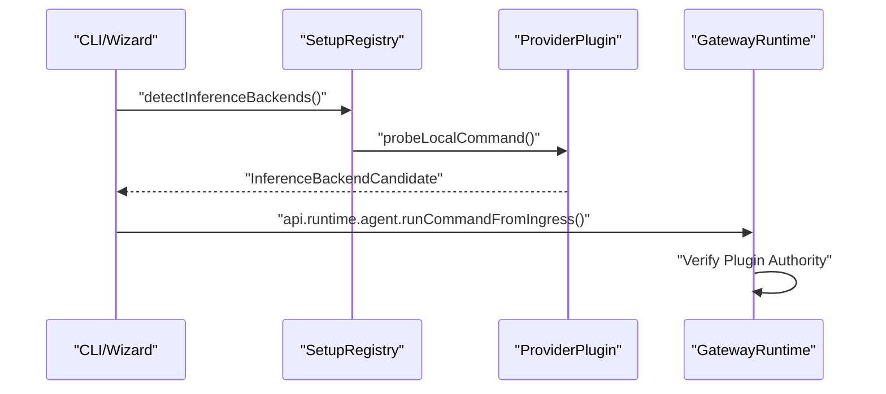

# Plugin Examples

<details>
<summary>Relevant source files</summary>

The following files were used as context for generating this wiki page:

- [docs/concepts/model-providers.md](docs/concepts/model-providers.md)
- [docs/plugins/dependency-resolution.md](docs/plugins/dependency-resolution.md)
- [docs/plugins/manifest.md](docs/plugins/manifest.md)
- [docs/plugins/sdk-runtime.md](docs/plugins/sdk-runtime.md)
- [extensions/anthropic/cli-auth-api.ts](extensions/anthropic/cli-auth-api.ts)
- [extensions/anthropic/cli-auth-seam.test.ts](extensions/anthropic/cli-auth-seam.test.ts)
- [extensions/anthropic/cli-auth-seam.ts](extensions/anthropic/cli-auth-seam.ts)
- [extensions/openai/cli-auth-api.test.ts](extensions/openai/cli-auth-api.test.ts)
- [extensions/openai/cli-auth-api.ts](extensions/openai/cli-auth-api.ts)
- [scripts/build-external-plugin-local-dist.mts](scripts/build-external-plugin-local-dist.mts)
- [scripts/copy-bundled-plugin-metadata.mts](scripts/copy-bundled-plugin-metadata.mts)
- [scripts/lib/plugin-npm-package-manifest.mts](scripts/lib/plugin-npm-package-manifest.mts)
- [scripts/lib/plugin-npm-runtime-build.mjs](scripts/lib/plugin-npm-runtime-build.mjs)
- [scripts/lib/plugin-npm-runtime-build.mts](scripts/lib/plugin-npm-runtime-build.mts)
- [src/commands/onboard-inference.test.ts](src/commands/onboard-inference.test.ts)
- [src/commands/onboard-inference.ts](src/commands/onboard-inference.ts)
- [src/config/sessions/session-accessor.transcript-turn.ts](src/config/sessions/session-accessor.transcript-turn.ts)
- [src/plugin-sdk/facade-resolution-shared.ts](src/plugin-sdk/facade-resolution-shared.ts)
- [src/plugin-sdk/process-runtime.ts](src/plugin-sdk/process-runtime.ts)
- [src/plugin-sdk/session-transcript-runtime.guarded.test.ts](src/plugin-sdk/session-transcript-runtime.guarded.test.ts)
- [src/plugin-sdk/session-transcript-runtime.test.ts](src/plugin-sdk/session-transcript-runtime.test.ts)
- [src/plugins/copy-bundled-plugin-metadata.test.ts](src/plugins/copy-bundled-plugin-metadata.test.ts)
- [src/plugins/doctor-contract-artifact.ts](src/plugins/doctor-contract-artifact.ts)
- [src/plugins/package-entrypoints.ts](src/plugins/package-entrypoints.ts)
- [src/plugins/public-surface-runtime.ts](src/plugins/public-surface-runtime.ts)
- [src/plugins/root-artifact-path.ts](src/plugins/root-artifact-path.ts)
- [src/plugins/setup-registry.lifecycle.test.ts](src/plugins/setup-registry.lifecycle.test.ts)
- [src/plugins/setup-registry.ts](src/plugins/setup-registry.ts)
- [test/plugin-npm-package-manifest.test.ts](test/plugin-npm-package-manifest.test.ts)
- [test/plugin-npm-runtime-build.test.ts](test/plugin-npm-runtime-build.test.ts)
- [test/scripts/build-external-plugin-local-dist.test.ts](test/scripts/build-external-plugin-local-dist.test.ts)
- [test/scripts/plugin-npm-runtime-native-import.test.ts](test/scripts/plugin-npm-runtime-native-import.test.ts)
- [test/vitest/vitest.shared.config.ts](test/vitest/vitest.shared.config.ts)
- [ui/src/e2e/browser-route-handoff.e2e.test.ts](ui/src/e2e/browser-route-handoff.e2e.test.ts)

</details>


This page demonstrates how to implement OpenClaw plugins through concrete examples from the codebase, focusing on OAuth provider implementations (Google Gemini CLI, Qwen Portal) and the runtime mechanisms for registration and authentication.

For broader architectural context and the plugin registration API, see **5.1 Plugin Architecture**.

---

## Plugin Identity and Manifests

Every native OpenClaw plugin **must** ship an `openclaw.plugin.json` manifest in its root directory [docs/plugins/manifest.md:20-20](). This file allows the Gateway to validate configuration and discover capabilities without executing plugin code [docs/plugins/manifest.md:26-26]().

### Manifest-Driven Capabilities
The manifest defines static metadata used for:
- **Identity & Config**: Canonical IDs and JSON Schema for validation [docs/plugins/manifest.md:140-141]().
- **Auth Onboarding**: Defining environment variables (`envVars`) and auth choices for the CLI onboarding wizard [docs/plugins/manifest.md:91-116]().
- **Provider Ownership**: Declaring model prefixes and provider IDs the plugin manages [docs/plugins/manifest.md:65-68]().

**Diagram: Manifest to Code Entity Mapping**

```mermaid
graph TD
    subgraph "openclaw.plugin.json"
        [id] --> [pluginId]
        [configSchema] --> [ZodValidation]
        [providerAuthChoices] --> [CLIOnboarding]
        [setup] --> [AutoEnableProbe]
    end

    subgraph "CodeEntities"
        [pluginId] --> PluginManifestRecord["PluginManifestRecord"]
        [ZodValidation] --> OpenClawConfig["OpenClawConfig"]
        [CLIOnboarding] --> detectInferenceBackends["detectInferenceBackends()"]
        [AutoEnableProbe] --> PluginSetupAutoEnableProbe["PluginSetupAutoEnableProbe"]
    end
```

Sources: `docs/plugins/manifest.md` [docs/plugins/manifest.md:60-141](), `src/plugins/setup-registry.ts` [src/plugins/setup-registry.ts:57-60](), `src/commands/onboard-inference.ts` [src/commands/onboard-inference.ts:65-80]()

---

## OAuth and CLI Provider Examples

OpenClaw supports local CLI backends and OAuth-based providers. These implementations typically split logic between a "lightweight" setup entry and the full plugin runtime.

### Google Gemini CLI
The Gemini integration demonstrates a CLI-based provider that utilizes local credentials. During onboarding, OpenClaw probes for the `gemini` command and checks for stored credentials [src/commands/onboard-inference.ts:195-195]().

- **Auth Detection**: The system uses `readGeminiCliCredentialsCached` to identify if the user is already logged in via the official Google CLI [src/commands/onboard-inference.ts:9-10]().
- **Runtime Selection**: Users can choose the `google-gemini-cli` runtime to route requests through their local installation instead of direct API calls [docs/concepts/model-providers.md:50-51]().

### Anthropic / Claude CLI
The Claude plugin uses a facade-based approach to probe authentication status without loading the entire plugin runtime [src/commands/onboard-inference.ts:142-156]().

- **CLI Auth Probe**: `probeClaudeCliAuthStatus` returns the login state (e.g., `claude.ai` account vs `api_key`) and the associated email [src/commands/onboard-inference.ts:156-162]().
- **Credential Priority**: OpenClaw prioritizes `OPENCLAW_LIVE_<PROVIDER>_KEY` environment variables over stored session tokens [docs/concepts/model-providers.md:86-91]().

**Diagram: Auth Flow and Ingress Ingress**



Sources: `src/commands/onboard-inference.ts` [src/commands/onboard-inference.ts:151-165](), `docs/plugins/sdk-runtime.md` [docs/plugins/sdk-runtime.md:86-90]()

---

## Plugin Setup and Registration

Plugins register their capabilities through a `register(api)` function. OpenClaw provides different runtime helpers via `api.runtime` depending on the registration mode [docs/plugins/sdk-runtime.md:12-12]().

### Setup Registry (`setup-api.ts`)
The `PluginSetupRegistry` maintains entries discovered from manifests. It allows plugins to perform "light" exports for:
1. **Providers**: Registering LLM inference backends [src/plugins/setup-registry.ts:42-45]().
2. **CLI Backends**: Registering alternative execution runtimes (like `claude-cli`) [src/plugins/setup-registry.ts:47-50]().
3. **Config Migrations**: Handling schema changes between versions [src/plugins/setup-registry.ts:52-55]().

### Runtime Helpers
When a plugin is fully activated, `api.runtime` exposes:
- **Config Mutation**: `mutateConfigFile` for persisting user settings with explicit reload policies (`auto`, `restart`, or `none`) [docs/plugins/sdk-runtime.md:39-45]().
- **Agent Ingress**: `runCommandFromIngress` for channel plugins to inject authenticated turns into the agent loop [docs/plugins/sdk-runtime.md:86-90]().
- **Interactive UI**: `renderPresentationForDelivery` for adapting rich cards to specific channel limits (e.g., Telegram vs Slack) [docs/plugins/sdk-runtime.md:65-72]().

Sources: `src/plugins/setup-registry.ts` [src/plugins/setup-registry.ts:78-84](), `docs/plugins/sdk-runtime.md` [docs/plugins/sdk-runtime.md:39-45]()

---

## Summary: Implementation Checklist

| Component | Responsibility | Reference |
| :--- | :--- | :--- |
| **Manifest** | Static metadata, config schema, and auth hints. | `openclaw.plugin.json` [docs/plugins/manifest.md:28-40]() |
| **Setup Entry** | Fast-path auth probes and provider registration. | `setup-api.ts` [src/plugins/setup-registry.ts:146-150]() |
| **Provider Logic** | Normalizes requests, handles stream wrapping and tool schemas. | `registerProvider` [docs/concepts/model-providers.md:72-74]() |
| **Config Migration** | Upgrades legacy user settings to new schemas. | `PluginConfigMigration` [src/plugins/setup-registry.ts:52-55]() |

Sources: `docs/plugins/manifest.md` [docs/plugins/manifest.md:28-40](), `src/plugins/setup-registry.ts` [src/plugins/setup-registry.ts:146-150]()