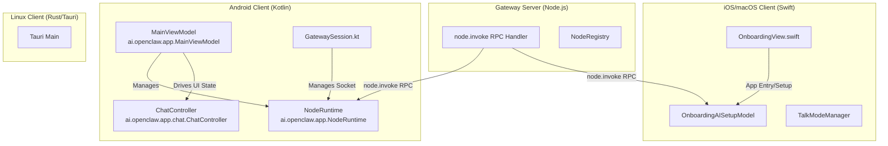
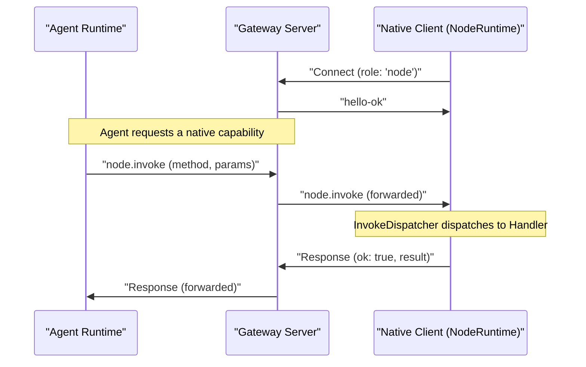

# Native Clients & Nodes

Relevant source files

The following files were used as context for generating this wiki page:

- [apps/.i18n/native-source.json](apps/.i18n/native-source.json)
- [apps/android/README.md](apps/android/README.md)
- [apps/android/THIRD_PARTY_LICENSES/openclaw/licenses/AndroidX Room.txt](apps/android/THIRD_PARTY_LICENSES/openclaw/licenses/AndroidX Room.txt)
- [apps/android/THIRD_PARTY_LICENSES/openclaw/licenses/AndroidX SQLite.txt](apps/android/THIRD_PARTY_LICENSES/openclaw/licenses/AndroidX SQLite.txt)
- [apps/android/app/src/main/assets/katex/README.md](apps/android/app/src/main/assets/katex/README.md)
- [apps/android/app/src/main/assets/katex/katex.min.css](apps/android/app/src/main/assets/katex/katex.min.css)
- [apps/android/app/src/main/assets/katex/katex.min.js](apps/android/app/src/main/assets/katex/katex.min.js)
- [apps/android/app/src/main/java/ai/openclaw/app/AndroidScreenshotFixture.kt](apps/android/app/src/main/java/ai/openclaw/app/AndroidScreenshotFixture.kt)
- [apps/android/app/src/main/java/ai/openclaw/app/MainViewModel.kt](apps/android/app/src/main/java/ai/openclaw/app/MainViewModel.kt)
- [apps/android/app/src/main/java/ai/openclaw/app/NodeRuntime.kt](apps/android/app/src/main/java/ai/openclaw/app/NodeRuntime.kt)
- [apps/android/app/src/main/java/ai/openclaw/app/PermissionRequester.kt](apps/android/app/src/main/java/ai/openclaw/app/PermissionRequester.kt)
- [apps/android/app/src/main/java/ai/openclaw/app/chat/ChatCommandOutbox.kt](apps/android/app/src/main/java/ai/openclaw/app/chat/ChatCommandOutbox.kt)
- [apps/android/app/src/main/java/ai/openclaw/app/chat/ChatController.kt](apps/android/app/src/main/java/ai/openclaw/app/chat/ChatController.kt)
- [apps/android/app/src/main/java/ai/openclaw/app/chat/ChatModels.kt](apps/android/app/src/main/java/ai/openclaw/app/chat/ChatModels.kt)
- [apps/android/app/src/main/java/ai/openclaw/app/chat/ChatQuestion.kt](apps/android/app/src/main/java/ai/openclaw/app/chat/ChatQuestion.kt)
- [apps/android/app/src/main/java/ai/openclaw/app/chat/ChatTranscriptCache.kt](apps/android/app/src/main/java/ai/openclaw/app/chat/ChatTranscriptCache.kt)
- [apps/android/app/src/main/java/ai/openclaw/app/chat/ClientDatabases.kt](apps/android/app/src/main/java/ai/openclaw/app/chat/ClientDatabases.kt)
- [apps/android/app/src/main/java/ai/openclaw/app/node/ConnectionManager.kt](apps/android/app/src/main/java/ai/openclaw/app/node/ConnectionManager.kt)
- [apps/android/app/src/main/java/ai/openclaw/app/node/InvokeDispatcher.kt](apps/android/app/src/main/java/ai/openclaw/app/node/InvokeDispatcher.kt)
- [apps/android/app/src/main/java/ai/openclaw/app/node/NotificationsHandler.kt](apps/android/app/src/main/java/ai/openclaw/app/node/NotificationsHandler.kt)
- [apps/android/app/src/main/java/ai/openclaw/app/node/SystemHandler.kt](apps/android/app/src/main/java/ai/openclaw/app/node/SystemHandler.kt)
- [apps/android/app/src/main/java/ai/openclaw/app/ui/AgentPicker.kt](apps/android/app/src/main/java/ai/openclaw/app/ui/AgentPicker.kt)
- [apps/android/app/src/main/java/ai/openclaw/app/ui/OnboardingFlow.kt](apps/android/app/src/main/java/ai/openclaw/app/ui/OnboardingFlow.kt)
- [apps/android/app/src/main/java/ai/openclaw/app/ui/SessionsScreen.kt](apps/android/app/src/main/java/ai/openclaw/app/ui/SessionsScreen.kt)
- [apps/android/app/src/main/java/ai/openclaw/app/ui/SettingsScreens.kt](apps/android/app/src/main/java/ai/openclaw/app/ui/SettingsScreens.kt)
- [apps/android/app/src/main/java/ai/openclaw/app/ui/ShellNavigation.kt](apps/android/app/src/main/java/ai/openclaw/app/ui/ShellNavigation.kt)
- [apps/android/app/src/main/java/ai/openclaw/app/ui/ShellScreen.kt](apps/android/app/src/main/java/ai/openclaw/app/ui/ShellScreen.kt)
- [apps/android/app/src/main/java/ai/openclaw/app/ui/SidebarComponents.kt](apps/android/app/src/main/java/ai/openclaw/app/ui/SidebarComponents.kt)
- [apps/android/app/src/main/java/ai/openclaw/app/ui/SidebarContent.kt](apps/android/app/src/main/java/ai/openclaw/app/ui/SidebarContent.kt)
- [apps/android/app/src/main/java/ai/openclaw/app/ui/SystemAgentSettingsScreen.kt](apps/android/app/src/main/java/ai/openclaw/app/ui/SystemAgentSettingsScreen.kt)
- [apps/android/app/src/main/java/ai/openclaw/app/ui/WorkspaceFilesScreen.kt](apps/android/app/src/main/java/ai/openclaw/app/ui/WorkspaceFilesScreen.kt)
- [apps/android/app/src/main/java/ai/openclaw/app/ui/chat/ChatDictation.kt](apps/android/app/src/main/java/ai/openclaw/app/ui/chat/ChatDictation.kt)
- [apps/android/app/src/main/java/ai/openclaw/app/ui/chat/ChatMessageActions.kt](apps/android/app/src/main/java/ai/openclaw/app/ui/chat/ChatMessageActions.kt)
- [apps/android/app/src/main/java/ai/openclaw/app/ui/chat/ChatMessageDisclosure.kt](apps/android/app/src/main/java/ai/openclaw/app/ui/chat/ChatMessageDisclosure.kt)
- [apps/android/app/src/main/java/ai/openclaw/app/ui/chat/ChatQuestionCard.kt](apps/android/app/src/main/java/ai/openclaw/app/ui/chat/ChatQuestionCard.kt)
- [apps/android/app/src/main/java/ai/openclaw/app/ui/chat/ChatScreen.kt](apps/android/app/src/main/java/ai/openclaw/app/ui/chat/ChatScreen.kt)
- [apps/android/app/src/main/java/ai/openclaw/app/ui/chat/ChatSystemRows.kt](apps/android/app/src/main/java/ai/openclaw/app/ui/chat/ChatSystemRows.kt)
- [apps/android/app/src/main/java/ai/openclaw/app/ui/chat/ChatTimeline.kt](apps/android/app/src/main/java/ai/openclaw/app/ui/chat/ChatTimeline.kt)
- [apps/android/app/src/main/java/ai/openclaw/app/ui/design/ClawComponents.kt](apps/android/app/src/main/java/ai/openclaw/app/ui/design/ClawComponents.kt)
- [apps/android/app/src/main/java/ai/openclaw/app/ui/design/MascotAnimator.kt](apps/android/app/src/main/java/ai/openclaw/app/ui/design/MascotAnimator.kt)
- [apps/android/app/src/test/java/ai/openclaw/app/AndroidLicenseNoticesTest.kt](apps/android/app/src/test/java/ai/openclaw/app/AndroidLicenseNoticesTest.kt)
- [apps/android/app/src/test/java/ai/openclaw/app/AndroidScreenshotFixtureRuntimeTest.kt](apps/android/app/src/test/java/ai/openclaw/app/AndroidScreenshotFixtureRuntimeTest.kt)
- [apps/android/app/src/test/java/ai/openclaw/app/AndroidScreenshotFixtureTest.kt](apps/android/app/src/test/java/ai/openclaw/app/AndroidScreenshotFixtureTest.kt)
- [apps/android/app/src/test/java/ai/openclaw/app/AppLanguageTest.kt](apps/android/app/src/test/java/ai/openclaw/app/AppLanguageTest.kt)
- [apps/android/app/src/test/java/ai/openclaw/app/PermissionRequesterTest.kt](apps/android/app/src/test/java/ai/openclaw/app/PermissionRequesterTest.kt)
- [apps/android/app/src/test/java/ai/openclaw/app/chat/ChatControllerBranchCoordinationTest.kt](apps/android/app/src/test/java/ai/openclaw/app/chat/ChatControllerBranchCoordinationTest.kt)
- [apps/android/app/src/test/java/ai/openclaw/app/chat/ChatControllerCommandControlsTest.kt](apps/android/app/src/test/java/ai/openclaw/app/chat/ChatControllerCommandControlsTest.kt)
- [apps/android/app/src/test/java/ai/openclaw/app/chat/ChatControllerMessageIdentityTest.kt](apps/android/app/src/test/java/ai/openclaw/app/chat/ChatControllerMessageIdentityTest.kt)
- [apps/android/app/src/test/java/ai/openclaw/app/chat/ChatControllerOutboxTest.kt](apps/android/app/src/test/java/ai/openclaw/app/chat/ChatControllerOutboxTest.kt)
- [apps/android/app/src/test/java/ai/openclaw/app/chat/ChatControllerProgressCardTest.kt](apps/android/app/src/test/java/ai/openclaw/app/chat/ChatControllerProgressCardTest.kt)
- [apps/android/app/src/test/java/ai/openclaw/app/chat/ChatControllerReconnectRestoreTest.kt](apps/android/app/src/test/java/ai/openclaw/app/chat/ChatControllerReconnectRestoreTest.kt)
- [apps/android/app/src/test/java/ai/openclaw/app/chat/ChatControllerSessionActionsTest.kt](apps/android/app/src/test/java/ai/openclaw/app/chat/ChatControllerSessionActionsTest.kt)
- [apps/android/app/src/test/java/ai/openclaw/app/chat/ChatControllerTranscriptCacheTest.kt](apps/android/app/src/test/java/ai/openclaw/app/chat/ChatControllerTranscriptCacheTest.kt)
- [apps/android/app/src/test/java/ai/openclaw/app/chat/ChatMessageContentParsingTest.kt](apps/android/app/src/test/java/ai/openclaw/app/chat/ChatMessageContentParsingTest.kt)
- [apps/android/app/src/test/java/ai/openclaw/app/chat/ChatQuestionTest.kt](apps/android/app/src/test/java/ai/openclaw/app/chat/ChatQuestionTest.kt)
- [apps/android/app/src/test/java/ai/openclaw/app/chat/ChatReplayHarness.kt](apps/android/app/src/test/java/ai/openclaw/app/chat/ChatReplayHarness.kt)
- [apps/android/app/src/test/java/ai/openclaw/app/chat/ClientDatabasesTest.kt](apps/android/app/src/test/java/ai/openclaw/app/chat/ClientDatabasesTest.kt)
- [apps/android/app/src/test/java/ai/openclaw/app/chat/RoomChatCommandOutboxTest.kt](apps/android/app/src/test/java/ai/openclaw/app/chat/RoomChatCommandOutboxTest.kt)
- [apps/android/app/src/test/java/ai/openclaw/app/chat/RoomChatTranscriptCacheTest.kt](apps/android/app/src/test/java/ai/openclaw/app/chat/RoomChatTranscriptCacheTest.kt)
- [apps/android/app/src/test/java/ai/openclaw/app/node/ConnectionManagerTest.kt](apps/android/app/src/test/java/ai/openclaw/app/node/ConnectionManagerTest.kt)
- [apps/android/app/src/test/java/ai/openclaw/app/node/InvokeDispatcherTest.kt](apps/android/app/src/test/java/ai/openclaw/app/node/InvokeDispatcherTest.kt)
- [apps/android/app/src/test/java/ai/openclaw/app/node/SystemHandlerTest.kt](apps/android/app/src/test/java/ai/openclaw/app/node/SystemHandlerTest.kt)
- [apps/android/app/src/test/java/ai/openclaw/app/ui/AgentPickerTest.kt](apps/android/app/src/test/java/ai/openclaw/app/ui/AgentPickerTest.kt)
- [apps/android/app/src/test/java/ai/openclaw/app/ui/InitialOnboardingLayoutTest.kt](apps/android/app/src/test/java/ai/openclaw/app/ui/InitialOnboardingLayoutTest.kt)
- [apps/android/app/src/test/java/ai/openclaw/app/ui/OnboardingFlowLogicTest.kt](apps/android/app/src/test/java/ai/openclaw/app/ui/OnboardingFlowLogicTest.kt)
- [apps/android/app/src/test/java/ai/openclaw/app/ui/SessionsScreenDescendantSignalsTest.kt](apps/android/app/src/test/java/ai/openclaw/app/ui/SessionsScreenDescendantSignalsTest.kt)
- [apps/android/app/src/test/java/ai/openclaw/app/ui/SessionsScreenGroupingTest.kt](apps/android/app/src/test/java/ai/openclaw/app/ui/SessionsScreenGroupingTest.kt)
- [apps/android/app/src/test/java/ai/openclaw/app/ui/SettingsDetailInsetsTest.kt](apps/android/app/src/test/java/ai/openclaw/app/ui/SettingsDetailInsetsTest.kt)
- [apps/android/app/src/test/java/ai/openclaw/app/ui/ShellScreenLogicTest.kt](apps/android/app/src/test/java/ai/openclaw/app/ui/ShellScreenLogicTest.kt)
- [apps/android/app/src/test/java/ai/openclaw/app/ui/SidebarShellLogicTest.kt](apps/android/app/src/test/java/ai/openclaw/app/ui/SidebarShellLogicTest.kt)
- [apps/android/app/src/test/java/ai/openclaw/app/ui/SystemAnimationsTest.kt](apps/android/app/src/test/java/ai/openclaw/app/ui/SystemAnimationsTest.kt)
- [apps/android/app/src/test/java/ai/openclaw/app/ui/chat/ChatComposerLayoutTest.kt](apps/android/app/src/test/java/ai/openclaw/app/ui/chat/ChatComposerLayoutTest.kt)
- [apps/android/app/src/test/java/ai/openclaw/app/ui/chat/ChatContextMeterTest.kt](apps/android/app/src/test/java/ai/openclaw/app/ui/chat/ChatContextMeterTest.kt)
- [apps/android/app/src/test/java/ai/openclaw/app/ui/chat/ChatMessageViewsTest.kt](apps/android/app/src/test/java/ai/openclaw/app/ui/chat/ChatMessageViewsTest.kt)
- [apps/android/app/src/test/java/ai/openclaw/app/ui/chat/ChatQuestionDraftLayoutTest.kt](apps/android/app/src/test/java/ai/openclaw/app/ui/chat/ChatQuestionDraftLayoutTest.kt)
- [apps/android/app/src/test/java/ai/openclaw/app/ui/chat/ChatScreenTest.kt](apps/android/app/src/test/java/ai/openclaw/app/ui/chat/ChatScreenTest.kt)
- [apps/android/app/src/test/java/ai/openclaw/app/ui/chat/ChatTimelineTest.kt](apps/android/app/src/test/java/ai/openclaw/app/ui/chat/ChatTimelineTest.kt)
- [apps/macos/Sources/OpenClaw/CLIInstallPrompter.swift](apps/macos/Sources/OpenClaw/CLIInstallPrompter.swift)
- [apps/macos/Sources/OpenClaw/Onboarding.swift](apps/macos/Sources/OpenClaw/Onboarding.swift)
- [apps/macos/Sources/OpenClaw/OnboardingAISetup.swift](apps/macos/Sources/OpenClaw/OnboardingAISetup.swift)
- [apps/macos/Sources/OpenClaw/OnboardingAISetupSupport.swift](apps/macos/Sources/OpenClaw/OnboardingAISetupSupport.swift)
- [apps/macos/Sources/OpenClaw/OnboardingAISetupView.swift](apps/macos/Sources/OpenClaw/OnboardingAISetupView.swift)
- [apps/macos/Sources/OpenClaw/OnboardingGatewayAuthBlocker.swift](apps/macos/Sources/OpenClaw/OnboardingGatewayAuthBlocker.swift)
- [apps/macos/Sources/OpenClaw/OnboardingSystemAgentChat.swift](apps/macos/Sources/OpenClaw/OnboardingSystemAgentChat.swift)
- [apps/macos/Sources/OpenClaw/OnboardingView+AISetupPage.swift](apps/macos/Sources/OpenClaw/OnboardingView+AISetupPage.swift)
- [apps/macos/Sources/OpenClaw/OnboardingView+Actions.swift](apps/macos/Sources/OpenClaw/OnboardingView+Actions.swift)
- [apps/macos/Sources/OpenClaw/OnboardingView+Layout.swift](apps/macos/Sources/OpenClaw/OnboardingView+Layout.swift)
- [apps/macos/Sources/OpenClaw/OnboardingView+Monitoring.swift](apps/macos/Sources/OpenClaw/OnboardingView+Monitoring.swift)
- [apps/macos/Sources/OpenClaw/OnboardingView+Pages.swift](apps/macos/Sources/OpenClaw/OnboardingView+Pages.swift)
- [apps/macos/Sources/OpenClaw/OnboardingWidgets.swift](apps/macos/Sources/OpenClaw/OnboardingWidgets.swift)
- [apps/macos/Tests/OpenClawIPCTests/OnboardingAISetupTests.swift](apps/macos/Tests/OpenClawIPCTests/OnboardingAISetupTests.swift)
- [apps/macos/Tests/OpenClawIPCTests/OnboardingMascotMoodTests.swift](apps/macos/Tests/OpenClawIPCTests/OnboardingMascotMoodTests.swift)
- [apps/macos/Tests/OpenClawIPCTests/OnboardingSystemAgentChatTests.swift](apps/macos/Tests/OpenClawIPCTests/OnboardingSystemAgentChatTests.swift)
- [apps/macos/Tests/OpenClawIPCTests/OnboardingViewSmokeTests.swift](apps/macos/Tests/OpenClawIPCTests/OnboardingViewSmokeTests.swift)
- [apps/macos/Tests/OpenClawIPCTests/ShellExecutorTimeoutTests.swift](apps/macos/Tests/OpenClawIPCTests/ShellExecutorTimeoutTests.swift)
- [docs/cli/worker.md](docs/cli/worker.md)
- [docs/nodes/index.md](docs/nodes/index.md)
- [docs/platforms/android.md](docs/platforms/android.md)
- [extensions/openai/provider-policy-api.ts](extensions/openai/provider-policy-api.ts)
- [packages/gateway-protocol/src/schema/environments.test.ts](packages/gateway-protocol/src/schema/environments.test.ts)
- [packages/gateway-protocol/src/schema/environments.ts](packages/gateway-protocol/src/schema/environments.ts)
- [packages/gateway-protocol/src/schema/openclaw.test.ts](packages/gateway-protocol/src/schema/openclaw.test.ts)
- [packages/gateway-protocol/src/schema/openclaw.ts](packages/gateway-protocol/src/schema/openclaw.ts)
- [src/commands/onboard-remote-gateway.test.ts](src/commands/onboard-remote-gateway.test.ts)
- [src/commands/onboard-remote-gateway.ts](src/commands/onboard-remote-gateway.ts)
- [src/gateway/node-runner-inventory-runtime.ts](src/gateway/node-runner-inventory-runtime.ts)
- [src/gateway/server-methods/environments.node-command-authority.test.ts](src/gateway/server-methods/environments.node-command-authority.test.ts)
- [src/gateway/server-methods/environments.node-ownership.test.ts](src/gateway/server-methods/environments.node-ownership.test.ts)
- [src/gateway/server-methods/environments.test.ts](src/gateway/server-methods/environments.test.ts)
- [src/gateway/server-methods/environments.ts](src/gateway/server-methods/environments.ts)
- [src/gateway/server-methods/nodes.read.test.ts](src/gateway/server-methods/nodes.read.test.ts)
- [src/gateway/server-methods/nodes.read.ts](src/gateway/server-methods/nodes.read.ts)
- [src/gateway/server-methods/nodes.runner-inventory.test.ts](src/gateway/server-methods/nodes.runner-inventory.test.ts)
- [src/gateway/server-methods/system-agent-chat-turn.test.ts](src/gateway/server-methods/system-agent-chat-turn.test.ts)
- [src/gateway/server-methods/system-agent-chat-turn.ts](src/gateway/server-methods/system-agent-chat-turn.ts)
- [src/gateway/server-methods/system-agent-greeting-welcome.test.ts](src/gateway/server-methods/system-agent-greeting-welcome.test.ts)
- [src/gateway/server-methods/system-agent-reset-boundary.test.ts](src/gateway/server-methods/system-agent-reset-boundary.test.ts)
- [src/gateway/server-methods/system-agent-session-ownership.test.ts](src/gateway/server-methods/system-agent-session-ownership.test.ts)
- [src/gateway/server-methods/system-agent.test.ts](src/gateway/server-methods/system-agent.test.ts)
- [src/gateway/server-methods/system-agent.ts](src/gateway/server-methods/system-agent.ts)
- [src/gateway/server.node-pairing-auto-approve.test.ts](src/gateway/server.node-pairing-auto-approve.test.ts)
- [src/gateway/server.node-pairing-ssh-verify.test.ts](src/gateway/server.node-pairing-ssh-verify.test.ts)
- [src/gateway/test-helpers.lan-pairing.ts](src/gateway/test-helpers.lan-pairing.ts)
- [src/infra/device-pairing-node-state.ts](src/infra/device-pairing-node-state.ts)
- [src/infra/node-commands.ts](src/infra/node-commands.ts)
- [src/infra/node-runner-inventory.ts](src/infra/node-runner-inventory.ts)
- [src/node-host/invoke-worker-supervisor.test.ts](src/node-host/invoke-worker-supervisor.test.ts)
- [src/node-host/node-worker-capacity.ts](src/node-host/node-worker-capacity.ts)
- [src/node-host/node-worker-container-engine.ts](src/node-host/node-worker-container-engine.ts)
- [src/node-host/node-worker-launch-store.ts](src/node-host/node-worker-launch-store.ts)
- [src/node-host/node-worker-launch-transport.ts](src/node-host/node-worker-launch-transport.ts)
- [src/node-host/node-worker-launch.ts](src/node-host/node-worker-launch.ts)
- [src/node-host/node-worker-supervisor-commands.ts](src/node-host/node-worker-supervisor-commands.ts)
- [src/node-host/node-worker-supervisor-contract.ts](src/node-host/node-worker-supervisor-contract.ts)
- [src/node-host/node-worker-supervisor-ownership.ts](src/node-host/node-worker-supervisor-ownership.ts)
- [src/node-host/node-worker-supervisor.container.test-support.ts](src/node-host/node-worker-supervisor.container.test-support.ts)
- [src/node-host/node-worker-supervisor.container.test.ts](src/node-host/node-worker-supervisor.container.test.ts)
- [src/node-host/node-worker-supervisor.recovery.test.ts](src/node-host/node-worker-supervisor.recovery.test.ts)
- [src/node-host/node-worker-supervisor.test-support.ts](src/node-host/node-worker-supervisor.test-support.ts)
- [src/node-host/node-worker-supervisor.test.ts](src/node-host/node-worker-supervisor.test.ts)
- [src/node-host/node-worker-supervisor.ts](src/node-host/node-worker-supervisor.ts)
- [src/node-host/runner.test.ts](src/node-host/runner.test.ts)
- [src/node-host/runner.ts](src/node-host/runner.ts)
- [src/node-host/runtime.test.ts](src/node-host/runtime.test.ts)
- [src/node-host/runtime.ts](src/node-host/runtime.ts)
- [src/node-host/runtime.worker-supervisor.test.ts](src/node-host/runtime.worker-supervisor.test.ts)
- [src/plugin-sdk/provider-model-types.ts](src/plugin-sdk/provider-model-types.ts)
- [src/system-agent/inference-error.ts](src/system-agent/inference-error.ts)
- [src/system-agent/inference-fallback.test.ts](src/system-agent/inference-fallback.test.ts)
- [src/system-agent/inference-fallback.ts](src/system-agent/inference-fallback.ts)
- [src/system-agent/inference-route.test.ts](src/system-agent/inference-route.test.ts)
- [src/system-agent/inference-route.ts](src/system-agent/inference-route.ts)
- [src/system-agent/revalidate-inference-owner.ts](src/system-agent/revalidate-inference-owner.ts)
- [src/system-agent/setup-app-recommendations.live.test.ts](src/system-agent/setup-app-recommendations.live.test.ts)
- [src/system-agent/setup-inference-activate-persist.ts](src/system-agent/setup-inference-activate-persist.ts)
- [src/system-agent/setup-inference-activate.ts](src/system-agent/setup-inference-activate.ts)
- [src/system-agent/setup-inference-core.ts](src/system-agent/setup-inference-core.ts)
- [src/system-agent/setup-inference-detect.ts](src/system-agent/setup-inference-detect.ts)
- [src/system-agent/setup-inference-detection.worker.ts](src/system-agent/setup-inference-detection.worker.ts)
- [src/system-agent/setup-inference-persist.ts](src/system-agent/setup-inference-persist.ts)
- [src/system-agent/setup-inference-plan-helpers.ts](src/system-agent/setup-inference-plan-helpers.ts)
- [src/system-agent/setup-inference-plan.ts](src/system-agent/setup-inference-plan.ts)
- [src/system-agent/setup-inference-probe.ts](src/system-agent/setup-inference-probe.ts)
- [src/system-agent/setup-inference-route-guard.ts](src/system-agent/setup-inference-route-guard.ts)
- [src/system-agent/setup-inference-verify.ts](src/system-agent/setup-inference-verify.ts)
- [src/system-agent/setup-inference.test.ts](src/system-agent/setup-inference.test.ts)
- [src/system-agent/system-agent.test-helpers.ts](src/system-agent/system-agent.test-helpers.ts)
- [src/system-agent/verified-inference.test-support.ts](src/system-agent/verified-inference.test-support.ts)
- [src/system-agent/verified-inference.test.ts](src/system-agent/verified-inference.test.ts)
- [src/worker/node-supervisor-protocol.test.ts](src/worker/node-supervisor-protocol.test.ts)
- [src/worker/node-supervisor-protocol.ts](src/worker/node-supervisor-protocol.ts)

This document provides a high-level introduction to OpenClaw's native client applications for iOS, macOS, Android, and Linux. These apps serve as both **Gateway clients** connecting to the Gateway server via WebSocket, and **Device Nodes** that expose rich, platform-specific device capabilities to the agent runtime. Integration with the agent runtime occurs through the `node.invoke` RPC method, enabling agents to control native features like camera, screen capture, notifications, and location on the device [docs/nodes/index.md:1-13]().

For the Gateway WebSocket protocol and RPC methods, see [WebSocket Protocol & RPC](#2.1). For the web-based Control UI dashboard, see [Gateway](#2).

---

## Overview

OpenClaw's native clients differ from CLI clients and web Control UI in three key ways:

1.  **Platform Integration:**  
    Native clients access platform-specific APIs that are not available to Node.js or browser clients, such as Android's hardware sensors, SMS, and call logs [apps/android/app/src/main/java/ai/openclaw/app/NodeRuntime.kt:70-92](), and macOS menu bar management [apps/macos/Sources/OpenClaw/OnboardingAISetup.swift:1-12]().
2.  **Device Node Protocol:**  
    Native clients register with the Gateway as **device nodes** using device pairing [docs/nodes/index.md:28-35](). They handle `node.invoke` RPC calls routed from the Gateway, which allows agents to invoke native tools like `camera.*` or `system.*`. The `node.invoke` method is dispatched via an `InvokeDispatcher` on Android [apps/android/app/src/main/java/ai/openclaw/app/NodeRuntime.kt:81]() and similar models on Apple platforms.
3.  **Native UI:**  
    They provide rich, platform-native user experiences—SwiftUI on iOS/macOS, Jetpack Compose on Android—supporting OS-level features such as share extensions, widgets, and background services [apps/android/app/src/main/java/ai/openclaw/app/chat/ChatController.kt:159-165]().

Behind the scenes, all clients share a code-generated protocol layer to guarantee type safety and protocol consistency across platforms. The Gateway WebSocket accepts authenticated node clients across an N-1 protocol window [docs/nodes/index.md:58-62]().

**Sources:**
- [apps/android/app/src/main/java/ai/openclaw/app/NodeRuntime.kt:70-92]()
- [docs/nodes/index.md:1-13]()
- [docs/nodes/index.md:28-35]()
- [docs/nodes/index.md:58-62]()
- [apps/android/app/src/main/java/ai/openclaw/app/chat/ChatController.kt:159-165]()

---

## Multi-Platform Architecture

OpenClaw's native client architecture bridges high-level agent requests to native platform implementations using a consistent RPC dispatching pattern.

### System Mapping: Logic to Code Entities

Summary:  
* The Gateway routes `node.invoke` RPC calls through server-side handlers to the connected native client.  
* Native client runtimes (Swift, Kotlin, Rust) parse the protocol and dispatch calls to platform-specific handlers that implement tools like camera, location, and notifications.
* On Android, `MainViewModel` manages the lifecycle of the `NodeRuntime` which handles the actual gateway communication [apps/android/app/src/main/java/ai/openclaw/app/NodeRuntime.kt:74-79]().
* On macOS, `OnboardingAISetupModel` manages the interactive activation wizard and AI connection testing [apps/macos/Sources/OpenClaw/OnboardingAISetup.swift:14-25]().

For detailed architecture and client codebases, see [Platform Overview](#6.1).

**Sources:**
- [apps/android/app/src/main/java/ai/openclaw/app/NodeRuntime.kt:74-79]()
- [apps/macos/Sources/OpenClaw/OnboardingAISetup.swift:14-25]()

---

## Device Node Protocol

Native clients connect to the Gateway with device-specific metadata, registering as device nodes to receive commands. The Gateway maintains a dynamic registry of **paired nodes**, enabling secure RPC dispatch to the correct native client.

### Protocol Flow: Request to Native Execution

The device pairing process establishes mutual trust. A node presents a signed device identity during connect. On Android, the `NodeRuntime` handles registration of various native handlers such as `CameraHandler`, `LocationHandler`, `SmsHandler`, and `NotificationsHandler` [apps/android/app/src/main/java/ai/openclaw/app/NodeRuntime.kt:70-92]().

Detailed node-specific tools include native APIs for camera, location, notifications, and system information. Command policy enforcement ensures only authorized RPCs are executed.

For comprehensive protocol details, pairing system, native node tooling, and command policy documentation, see [Device Node Protocol](#6.2).

**Sources:**
- [apps/android/app/src/main/java/ai/openclaw/app/NodeRuntime.kt:70-92]()
- [docs/nodes/index.md:28-38]()

---

## iOS & macOS Ecosystem

The iOS and macOS clients provide deep integration into native platform frameworks using SwiftUI and OpenClawKit.

### Features and Services
* **macOS App:** Provides a menu bar interface and interactive onboarding. `OnboardingAISetupModel` detects reusable AI access and hosts the interactive activation wizard [apps/macos/Sources/OpenClaw/OnboardingAISetup.swift:7-12]().
* **Watch App:** The Wear OS companion (via Android) or direct Apple Watch node provides transcript access and voice replies [docs/platforms/android.md:41-43]().
* **Onboarding & Setup:** macOS testing includes smoke tests for various gateway attachment scenarios (managed, external, remote) [apps/macos/Tests/OpenClawIPCTests/OnboardingViewSmokeTests.swift:34-45]().

For detailed iOS/macOS architecture, build process, and platform capabilities, see [iOS & macOS Apps](#6.3).

**Sources:**
- [apps/macos/Sources/OpenClaw/OnboardingAISetup.swift:7-12]()
- [apps/macos/Tests/OpenClawIPCTests/OnboardingViewSmokeTests.swift:34-45]()
- [docs/platforms/android.md:41-43]()

---

## Android Ecosystem

The Android native client is implemented in Kotlin, emphasizing modern Android development practices and Jetpack Compose.

### Build System and UI
* **Jetpack Compose:** Fully declarative UI framework. `ChatScreen` handles the transcript rendering, tool progress, and model selection [apps/android/app/src/main/java/ai/openclaw/app/ui/chat/ChatScreen.kt:1-30]().
* **Chat Controller:** `ChatController` manages session selection, history fetching, and outbox queueing [apps/android/app/src/main/java/ai/openclaw/app/chat/ChatController.kt:80-108]().
* **Wear OS companion:** Uses the paired Android phone's authenticated Gateway connection to select agents, read transcripts, and start realtime Talk [docs/platforms/android.md:41-43]().
* **Node Runtime:** Maintains the connection and dispatches RPCs to native handlers like `CalendarHandler`, `ContactsHandler`, and `PhotosHandler` [apps/android/app/src/main/java/ai/openclaw/app/NodeRuntime.kt:72-92]().

For detailed Android client internals, UI, and build configuration, see [Android App](#6.4).

**Sources:**
- [apps/android/app/src/main/java/ai/openclaw/app/ui/chat/ChatScreen.kt:1-30]()
- [apps/android/app/src/main/java/ai/openclaw/app/chat/ChatController.kt:80-108]()
- [apps/android/app/src/main/java/ai/openclaw/app/NodeRuntime.kt:72-92]()
- [docs/platforms/android.md:41-43]()

---

## Linux App

The Linux companion app is built with Tauri v2 and Rust. It provides a lightweight system tray interface and handles Gateway discovery via Bonjour.

* **Tauri Backend:** Manages the system tray and lifecycle of the local node host.
* **Canvas Bridge:** Provides a WebView bridge for rendering interactive UIs on Linux desktops via the `linux-canvas` plugin.

For detailed Linux app documentation, see [Linux App](#6.5).

---

## Summary

OpenClaw's native clients function as the essential bridge connecting the Gateway and agent runtime to native device capabilities:

* They implement a **type-safe protocol layer** ensuring consistency across platforms.
* They support a secure **device node protocol**, enabling hardware and OS feature exposure over WebSocket.  
* They provide **rich native user experiences** tailored to each platform's unique strengths (SwiftUI, Jetpack Compose, Tauri).

For thorough technical documentation on the native client architecture, detailed device node protocol, and platform-specific apps, consult the child pages:

* [Platform Overview](#6.1)  
* [Device Node Protocol](#6.2)  
* [iOS & macOS Apps](#6.3)  
* [Android App](#6.4)
* [Linux App](#6.5)