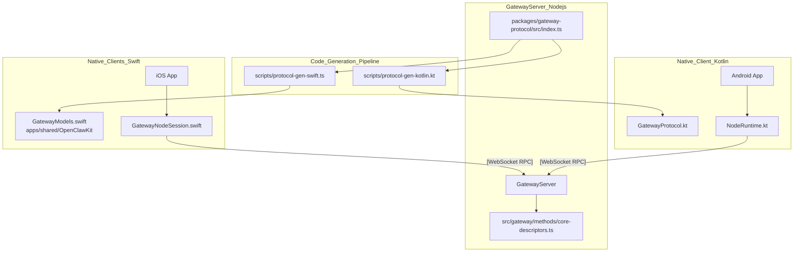
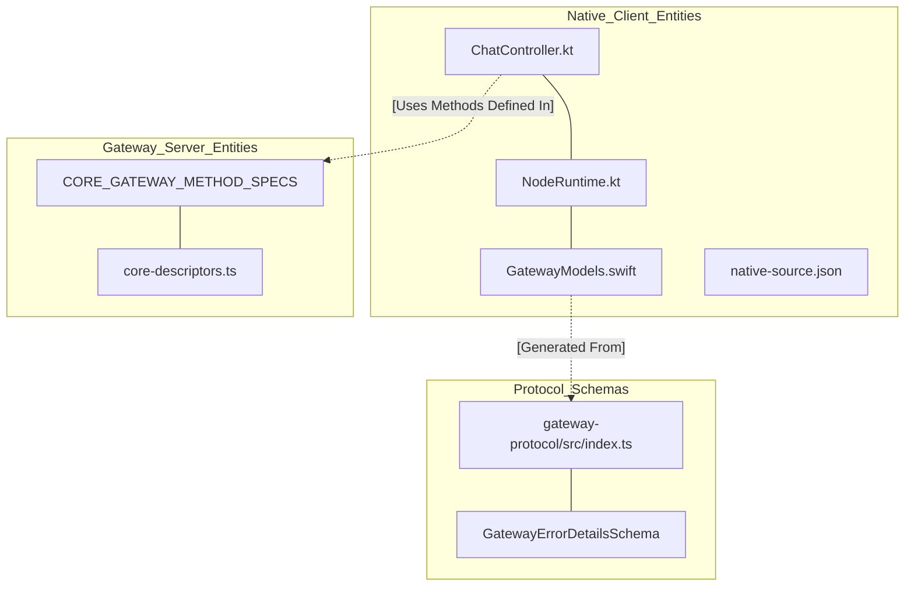

# Platform Overview

Relevant source files

The following files were used as context for generating this wiki page:

- [apps/.i18n/native-source.json](apps/.i18n/native-source.json)
- [apps/android/README.md](apps/android/README.md)
- [apps/android/THIRD_PARTY_LICENSES/openclaw/licenses/AndroidX Room.txt](apps/android/THIRD_PARTY_LICENSES/openclaw/licenses/AndroidX Room.txt)
- [apps/android/THIRD_PARTY_LICENSES/openclaw/licenses/AndroidX SQLite.txt](apps/android/THIRD_PARTY_LICENSES/openclaw/licenses/AndroidX SQLite.txt)
- [apps/android/app/src/main/assets/katex/README.md](apps/android/app/src/main/assets/katex/README.md)
- [apps/android/app/src/main/assets/katex/katex.min.css](apps/android/app/src/main/assets/katex/katex.min.css)
- [apps/android/app/src/main/assets/katex/katex.min.js](apps/android/app/src/main/assets/katex/katex.min.js)
- [apps/android/app/src/main/java/ai/openclaw/app/AndroidScreenshotFixture.kt](apps/android/app/src/main/java/ai/openclaw/app/AndroidScreenshotFixture.kt)
- [apps/android/app/src/main/java/ai/openclaw/app/MainViewModel.kt](apps/android/app/src/main/java/ai/openclaw/app/MainViewModel.kt)
- [apps/android/app/src/main/java/ai/openclaw/app/NodeRuntime.kt](apps/android/app/src/main/java/ai/openclaw/app/NodeRuntime.kt)
- [apps/android/app/src/main/java/ai/openclaw/app/PermissionRequester.kt](apps/android/app/src/main/java/ai/openclaw/app/PermissionRequester.kt)
- [apps/android/app/src/main/java/ai/openclaw/app/chat/ChatCommandOutbox.kt](apps/android/app/src/main/java/ai/openclaw/app/chat/ChatCommandOutbox.kt)
- [apps/android/app/src/main/java/ai/openclaw/app/chat/ChatController.kt](apps/android/app/src/main/java/ai/openclaw/app/chat/ChatController.kt)
- [apps/android/app/src/main/java/ai/openclaw/app/chat/ChatModels.kt](apps/android/app/src/main/java/ai/openclaw/app/chat/ChatModels.kt)
- [apps/android/app/src/main/java/ai/openclaw/app/chat/ChatQuestion.kt](apps/android/app/src/main/java/ai/openclaw/app/chat/ChatQuestion.kt)
- [apps/android/app/src/main/java/ai/openclaw/app/chat/ChatTranscriptCache.kt](apps/android/app/src/main/java/ai/openclaw/app/chat/ChatTranscriptCache.kt)
- [apps/android/app/src/main/java/ai/openclaw/app/chat/ClientDatabases.kt](apps/android/app/src/main/java/ai/openclaw/app/chat/ClientDatabases.kt)
- [apps/android/app/src/main/java/ai/openclaw/app/gateway/GatewayProtocol.kt](apps/android/app/src/main/java/ai/openclaw/app/gateway/GatewayProtocol.kt)
- [apps/android/app/src/main/java/ai/openclaw/app/node/ConnectionManager.kt](apps/android/app/src/main/java/ai/openclaw/app/node/ConnectionManager.kt)
- [apps/android/app/src/main/java/ai/openclaw/app/node/InvokeDispatcher.kt](apps/android/app/src/main/java/ai/openclaw/app/node/InvokeDispatcher.kt)
- [apps/android/app/src/main/java/ai/openclaw/app/node/NotificationsHandler.kt](apps/android/app/src/main/java/ai/openclaw/app/node/NotificationsHandler.kt)
- [apps/android/app/src/main/java/ai/openclaw/app/node/SystemHandler.kt](apps/android/app/src/main/java/ai/openclaw/app/node/SystemHandler.kt)
- [apps/android/app/src/main/java/ai/openclaw/app/ui/AgentPicker.kt](apps/android/app/src/main/java/ai/openclaw/app/ui/AgentPicker.kt)
- [apps/android/app/src/main/java/ai/openclaw/app/ui/OnboardingFlow.kt](apps/android/app/src/main/java/ai/openclaw/app/ui/OnboardingFlow.kt)
- [apps/android/app/src/main/java/ai/openclaw/app/ui/SessionsScreen.kt](apps/android/app/src/main/java/ai/openclaw/app/ui/SessionsScreen.kt)
- [apps/android/app/src/main/java/ai/openclaw/app/ui/SettingsScreens.kt](apps/android/app/src/main/java/ai/openclaw/app/ui/SettingsScreens.kt)
- [apps/android/app/src/main/java/ai/openclaw/app/ui/ShellNavigation.kt](apps/android/app/src/main/java/ai/openclaw/app/ui/ShellNavigation.kt)
- [apps/android/app/src/main/java/ai/openclaw/app/ui/ShellScreen.kt](apps/android/app/src/main/java/ai/openclaw/app/ui/ShellScreen.kt)
- [apps/android/app/src/main/java/ai/openclaw/app/ui/SidebarComponents.kt](apps/android/app/src/main/java/ai/openclaw/app/ui/SidebarComponents.kt)
- [apps/android/app/src/main/java/ai/openclaw/app/ui/SidebarContent.kt](apps/android/app/src/main/java/ai/openclaw/app/ui/SidebarContent.kt)
- [apps/android/app/src/main/java/ai/openclaw/app/ui/SystemAgentSettingsScreen.kt](apps/android/app/src/main/java/ai/openclaw/app/ui/SystemAgentSettingsScreen.kt)
- [apps/android/app/src/main/java/ai/openclaw/app/ui/WorkspaceFilesScreen.kt](apps/android/app/src/main/java/ai/openclaw/app/ui/WorkspaceFilesScreen.kt)
- [apps/android/app/src/main/java/ai/openclaw/app/ui/chat/ChatDictation.kt](apps/android/app/src/main/java/ai/openclaw/app/ui/chat/ChatDictation.kt)
- [apps/android/app/src/main/java/ai/openclaw/app/ui/chat/ChatMessageActions.kt](apps/android/app/src/main/java/ai/openclaw/app/ui/chat/ChatMessageActions.kt)
- [apps/android/app/src/main/java/ai/openclaw/app/ui/chat/ChatMessageDisclosure.kt](apps/android/app/src/main/java/ai/openclaw/app/ui/chat/ChatMessageDisclosure.kt)
- [apps/android/app/src/main/java/ai/openclaw/app/ui/chat/ChatQuestionCard.kt](apps/android/app/src/main/java/ai/openclaw/app/ui/chat/ChatQuestionCard.kt)
- [apps/android/app/src/main/java/ai/openclaw/app/ui/chat/ChatScreen.kt](apps/android/app/src/main/java/ai/openclaw/app/ui/chat/ChatScreen.kt)
- [apps/android/app/src/main/java/ai/openclaw/app/ui/chat/ChatSystemRows.kt](apps/android/app/src/main/java/ai/openclaw/app/ui/chat/ChatSystemRows.kt)
- [apps/android/app/src/main/java/ai/openclaw/app/ui/chat/ChatTimeline.kt](apps/android/app/src/main/java/ai/openclaw/app/ui/chat/ChatTimeline.kt)
- [apps/android/app/src/main/java/ai/openclaw/app/ui/design/ClawComponents.kt](apps/android/app/src/main/java/ai/openclaw/app/ui/design/ClawComponents.kt)
- [apps/android/app/src/main/java/ai/openclaw/app/ui/design/MascotAnimator.kt](apps/android/app/src/main/java/ai/openclaw/app/ui/design/MascotAnimator.kt)
- [apps/android/app/src/test/java/ai/openclaw/app/AndroidLicenseNoticesTest.kt](apps/android/app/src/test/java/ai/openclaw/app/AndroidLicenseNoticesTest.kt)
- [apps/android/app/src/test/java/ai/openclaw/app/AndroidScreenshotFixtureRuntimeTest.kt](apps/android/app/src/test/java/ai/openclaw/app/AndroidScreenshotFixtureRuntimeTest.kt)
- [apps/android/app/src/test/java/ai/openclaw/app/AndroidScreenshotFixtureTest.kt](apps/android/app/src/test/java/ai/openclaw/app/AndroidScreenshotFixtureTest.kt)
- [apps/android/app/src/test/java/ai/openclaw/app/AppLanguageTest.kt](apps/android/app/src/test/java/ai/openclaw/app/AppLanguageTest.kt)
- [apps/android/app/src/test/java/ai/openclaw/app/PermissionRequesterTest.kt](apps/android/app/src/test/java/ai/openclaw/app/PermissionRequesterTest.kt)
- [apps/android/app/src/test/java/ai/openclaw/app/chat/ChatControllerBranchCoordinationTest.kt](apps/android/app/src/test/java/ai/openclaw/app/chat/ChatControllerBranchCoordinationTest.kt)
- [apps/android/app/src/test/java/ai/openclaw/app/chat/ChatControllerCommandControlsTest.kt](apps/android/app/src/test/java/ai/openclaw/app/chat/ChatControllerCommandControlsTest.kt)
- [apps/android/app/src/test/java/ai/openclaw/app/chat/ChatControllerMessageIdentityTest.kt](apps/android/app/src/test/java/ai/openclaw/app/chat/ChatControllerMessageIdentityTest.kt)
- [apps/android/app/src/test/java/ai/openclaw/app/chat/ChatControllerOutboxTest.kt](apps/android/app/src/test/java/ai/openclaw/app/chat/ChatControllerOutboxTest.kt)
- [apps/android/app/src/test/java/ai/openclaw/app/chat/ChatControllerProgressCardTest.kt](apps/android/app/src/test/java/ai/openclaw/app/chat/ChatControllerProgressCardTest.kt)
- [apps/android/app/src/test/java/ai/openclaw/app/chat/ChatControllerReconnectRestoreTest.kt](apps/android/app/src/test/java/ai/openclaw/app/chat/ChatControllerReconnectRestoreTest.kt)
- [apps/android/app/src/test/java/ai/openclaw/app/chat/ChatControllerSessionActionsTest.kt](apps/android/app/src/test/java/ai/openclaw/app/chat/ChatControllerSessionActionsTest.kt)
- [apps/android/app/src/test/java/ai/openclaw/app/chat/ChatControllerTranscriptCacheTest.kt](apps/android/app/src/test/java/ai/openclaw/app/chat/ChatControllerTranscriptCacheTest.kt)
- [apps/android/app/src/test/java/ai/openclaw/app/chat/ChatMessageContentParsingTest.kt](apps/android/app/src/test/java/ai/openclaw/app/chat/ChatMessageContentParsingTest.kt)
- [apps/android/app/src/test/java/ai/openclaw/app/chat/ChatQuestionTest.kt](apps/android/app/src/test/java/ai/openclaw/app/chat/ChatQuestionTest.kt)
- [apps/android/app/src/test/java/ai/openclaw/app/chat/ChatReplayHarness.kt](apps/android/app/src/test/java/ai/openclaw/app/chat/ChatReplayHarness.kt)
- [apps/android/app/src/test/java/ai/openclaw/app/chat/ClientDatabasesTest.kt](apps/android/app/src/test/java/ai/openclaw/app/chat/ClientDatabasesTest.kt)
- [apps/android/app/src/test/java/ai/openclaw/app/chat/RoomChatCommandOutboxTest.kt](apps/android/app/src/test/java/ai/openclaw/app/chat/RoomChatCommandOutboxTest.kt)
- [apps/android/app/src/test/java/ai/openclaw/app/chat/RoomChatTranscriptCacheTest.kt](apps/android/app/src/test/java/ai/openclaw/app/chat/RoomChatTranscriptCacheTest.kt)
- [apps/android/app/src/test/java/ai/openclaw/app/node/ConnectionManagerTest.kt](apps/android/app/src/test/java/ai/openclaw/app/node/ConnectionManagerTest.kt)
- [apps/android/app/src/test/java/ai/openclaw/app/node/InvokeDispatcherTest.kt](apps/android/app/src/test/java/ai/openclaw/app/node/InvokeDispatcherTest.kt)
- [apps/android/app/src/test/java/ai/openclaw/app/node/SystemHandlerTest.kt](apps/android/app/src/test/java/ai/openclaw/app/node/SystemHandlerTest.kt)
- [apps/android/app/src/test/java/ai/openclaw/app/ui/AgentPickerTest.kt](apps/android/app/src/test/java/ai/openclaw/app/ui/AgentPickerTest.kt)
- [apps/android/app/src/test/java/ai/openclaw/app/ui/InitialOnboardingLayoutTest.kt](apps/android/app/src/test/java/ai/openclaw/app/ui/InitialOnboardingLayoutTest.kt)
- [apps/android/app/src/test/java/ai/openclaw/app/ui/OnboardingFlowLogicTest.kt](apps/android/app/src/test/java/ai/openclaw/app/ui/OnboardingFlowLogicTest.kt)
- [apps/android/app/src/test/java/ai/openclaw/app/ui/SessionsScreenDescendantSignalsTest.kt](apps/android/app/src/test/java/ai/openclaw/app/ui/SessionsScreenDescendantSignalsTest.kt)
- [apps/android/app/src/test/java/ai/openclaw/app/ui/SessionsScreenGroupingTest.kt](apps/android/app/src/test/java/ai/openclaw/app/ui/SessionsScreenGroupingTest.kt)
- [apps/android/app/src/test/java/ai/openclaw/app/ui/SettingsDetailInsetsTest.kt](apps/android/app/src/test/java/ai/openclaw/app/ui/SettingsDetailInsetsTest.kt)
- [apps/android/app/src/test/java/ai/openclaw/app/ui/ShellScreenLogicTest.kt](apps/android/app/src/test/java/ai/openclaw/app/ui/ShellScreenLogicTest.kt)
- [apps/android/app/src/test/java/ai/openclaw/app/ui/SidebarShellLogicTest.kt](apps/android/app/src/test/java/ai/openclaw/app/ui/SidebarShellLogicTest.kt)
- [apps/android/app/src/test/java/ai/openclaw/app/ui/SystemAnimationsTest.kt](apps/android/app/src/test/java/ai/openclaw/app/ui/SystemAnimationsTest.kt)
- [apps/android/app/src/test/java/ai/openclaw/app/ui/chat/ChatComposerLayoutTest.kt](apps/android/app/src/test/java/ai/openclaw/app/ui/chat/ChatComposerLayoutTest.kt)
- [apps/android/app/src/test/java/ai/openclaw/app/ui/chat/ChatContextMeterTest.kt](apps/android/app/src/test/java/ai/openclaw/app/ui/chat/ChatContextMeterTest.kt)
- [apps/android/app/src/test/java/ai/openclaw/app/ui/chat/ChatMessageViewsTest.kt](apps/android/app/src/test/java/ai/openclaw/app/ui/chat/ChatMessageViewsTest.kt)
- [apps/android/app/src/test/java/ai/openclaw/app/ui/chat/ChatQuestionDraftLayoutTest.kt](apps/android/app/src/test/java/ai/openclaw/app/ui/chat/ChatQuestionDraftLayoutTest.kt)
- [apps/android/app/src/test/java/ai/openclaw/app/ui/chat/ChatScreenTest.kt](apps/android/app/src/test/java/ai/openclaw/app/ui/chat/ChatScreenTest.kt)
- [apps/android/app/src/test/java/ai/openclaw/app/ui/chat/ChatTimelineTest.kt](apps/android/app/src/test/java/ai/openclaw/app/ui/chat/ChatTimelineTest.kt)
- [apps/shared/OpenClawKit/Sources/OpenClawProtocol/GatewayModels.swift](apps/shared/OpenClawKit/Sources/OpenClawProtocol/GatewayModels.swift)
- [docs/gateway/operator-scopes.md](docs/gateway/operator-scopes.md)
- [docs/gateway/protocol.md](docs/gateway/protocol.md)
- [docs/platforms/android.md](docs/platforms/android.md)
- [packages/gateway-protocol/src/error-details.ts](packages/gateway-protocol/src/error-details.ts)
- [packages/gateway-protocol/src/gateway-error-details.ts](packages/gateway-protocol/src/gateway-error-details.ts)
- [packages/gateway-protocol/src/index.test.ts](packages/gateway-protocol/src/index.test.ts)
- [packages/gateway-protocol/src/index.ts](packages/gateway-protocol/src/index.ts)
- [packages/gateway-protocol/src/schema/error-codes.test.ts](packages/gateway-protocol/src/schema/error-codes.test.ts)
- [packages/gateway-protocol/src/schema/error-codes.ts](packages/gateway-protocol/src/schema/error-codes.ts)
- [packages/gateway-protocol/src/schema/logs-chat.test.ts](packages/gateway-protocol/src/schema/logs-chat.test.ts)
- [packages/gateway-protocol/src/schema/logs-chat.ts](packages/gateway-protocol/src/schema/logs-chat.ts)
- [packages/gateway-protocol/src/schema/protocol-schema-fragment-transport.ts](packages/gateway-protocol/src/schema/protocol-schema-fragment-transport.ts)
- [packages/gateway-protocol/src/validator-registry.ts](packages/gateway-protocol/src/validator-registry.ts)
- [src/agents/code-mode.bridge.host-denial.test.ts](src/agents/code-mode.bridge.host-denial.test.ts)
- [src/agents/tools/message-tool-execution.test.ts](src/agents/tools/message-tool-execution.test.ts)
- [src/gateway/chat-abort.test.ts](src/gateway/chat-abort.test.ts)
- [src/gateway/chat-abort.ts](src/gateway/chat-abort.ts)
- [src/gateway/live-chat-projector.ts](src/gateway/live-chat-projector.ts)
- [src/gateway/method-scopes.test.ts](src/gateway/method-scopes.test.ts)
- [src/gateway/method-scopes.ts](src/gateway/method-scopes.ts)
- [src/gateway/methods/core-descriptors.since.test.ts](src/gateway/methods/core-descriptors.since.test.ts)
- [src/gateway/methods/core-descriptors.ts](src/gateway/methods/core-descriptors.ts)
- [src/gateway/server-methods-list.test.ts](src/gateway/server-methods-list.test.ts)
- [src/gateway/server-methods/chat-broadcast.test.ts](src/gateway/server-methods/chat-broadcast.test.ts)
- [src/gateway/server-methods/chat-broadcast.ts](src/gateway/server-methods/chat-broadcast.ts)
- [src/gateway/server-methods/chat-send-request.test.ts](src/gateway/server-methods/chat-send-request.test.ts)
- [src/gateway/server-methods/chat-send-request.ts](src/gateway/server-methods/chat-send-request.ts)
- [src/gateway/server-methods/chat-send-session.ts](src/gateway/server-methods/chat-send-session.ts)
- [src/gateway/server-methods/plugin-host-hooks.ts](src/gateway/server-methods/plugin-host-hooks.ts)
- [src/gateway/server-methods/sessions-subscriptions.ts](src/gateway/server-methods/sessions-subscriptions.ts)
- [src/gateway/server-methods/sessions-suggestions.test.ts](src/gateway/server-methods/sessions-suggestions.test.ts)
- [src/gateway/server-methods/sessions-suggestions.ts](src/gateway/server-methods/sessions-suggestions.ts)
- [src/gateway/server-methods/sessions-typing.test.ts](src/gateway/server-methods/sessions-typing.test.ts)
- [src/gateway/server.node-chat-subscriptions.test.ts](src/gateway/server.node-chat-subscriptions.test.ts)
- [src/gateway/worker-environments/live-chat.test-support.ts](src/gateway/worker-environments/live-chat.test-support.ts)
- [src/plugins/contracts/session-actions.contract.test.ts](src/plugins/contracts/session-actions.contract.test.ts)

## Purpose and Scope

This page provides a detailed technical explanation of OpenClaw's native client architecture, covering the iOS, macOS, Android, and Linux platforms. It explains how the platform-native codebases (Swift, Kotlin, and Rust) interact with the Gateway server via a robust, versioned WebSocket RPC protocol. It also describes the automated code generation process that derives native data model classes and protocol structures directly from TypeScript protocol schemas.

For more platform-centric details, see the linked pages: [Device Node Protocol (6.2)](), [iOS & macOS Apps (6.3)](), [Android App (6.4)](), and [Linux App (6.5)]().

---

## Multi-Platform Architecture

OpenClaw supports native client applications across major platforms using a variety of technologies:

-   **iOS/iPadOS/macOS/watchOS**: Built with Swift using SwiftUI. The codebase includes main apps, share extensions, and watchOS companion apps. Native models are centralized in `OpenClawKit` [apps/shared/OpenClawKit/Sources/OpenClawProtocol/GatewayModels.swift:1-5]().
-   **Android**: Written in Kotlin using Jetpack Compose. The Android app utilizes generated data classes for gateway communication [apps/android/app/src/main/java/ai/openclaw/app/gateway/GatewayProtocol.kt:1-10]().
-   **Linux**: Built with Tauri v2 using a Rust-based backend and a WebView bridge for rendering the Canvas UI.

All native clients communicate with the OpenClaw Gateway server via a standardized protocol called **Gateway Protocol v4** [apps/shared/OpenClawKit/Sources/OpenClawProtocol/GatewayModels.swift:5-6](). Its schemas are code-generated into native Swift and Kotlin types to ensure strong typing [apps/shared/OpenClawKit/Sources/OpenClawProtocol/GatewayModels.swift:1-3]().

### Architecture Diagram: Platform Codebases & Gateway Communication

**Sources:**
[apps/shared/OpenClawKit/Sources/OpenClawProtocol/GatewayModels.swift:1-7](), [docs/gateway/protocol.md:11-14](), [src/gateway/methods/core-descriptors.ts:39-45](), [apps/shared/OpenClawKit/Sources/OpenClawProtocol/GatewayModels.swift:5-6]()

---

## Gateway Protocol Code Generation

OpenClaw's Gateway protocol is specified in TypeScript schemas. The native client models are automatically generated to ensure synchronization between the Node.js backend and mobile/desktop frontends.

- **Swift Generation**: The `scripts/protocol-gen-swift.ts` script translates schema definitions into Swift `struct`s and `enum`s that conform to `Codable` and `Sendable` [apps/shared/OpenClawKit/Sources/OpenClawProtocol/GatewayModels.swift:1-3](). It handles complex types like `ErrorCode` [apps/shared/OpenClawKit/Sources/OpenClawProtocol/GatewayModels.swift:24-32]() and `AuthProbeStatus` [apps/shared/OpenClawKit/Sources/OpenClawProtocol/GatewayModels.swift:34-43]().
- **Kotlin Generation**: A similar pipeline produces `@Serializable` Kotlin data classes for the Android app, ensuring parity for enums like `SessionObserverHealth` [apps/shared/OpenClawKit/Sources/OpenClawProtocol/GatewayModels.swift:107-115]().

### Key Protocol Frame Structures

| Frame Type | Purpose | Swift Type |
| :--- | :--- | :--- |
| `ErrorCode` | Standardized RPC errors | `ErrorCode` [apps/shared/OpenClawKit/Sources/OpenClawProtocol/GatewayModels.swift:24-32]() |
| `AuthProbeStatus` | Auth status check | `AuthProbeStatus` [apps/shared/OpenClawKit/Sources/OpenClawProtocol/GatewayModels.swift:34-43]() |
| `SessionVisibility` | Session access levels | `SessionVisibility` [apps/shared/OpenClawKit/Sources/OpenClawProtocol/GatewayModels.swift:117-122]() |
| `WorkerEnvironmentState` | Sandbox lifecycle | `WorkerEnvironmentState` [apps/shared/OpenClawKit/Sources/OpenClawProtocol/GatewayModels.swift:59-71]() |
| `NodePresenceAliveReason` | Wake/Presence triggers | `NodePresenceAliveReason` [apps/shared/OpenClawKit/Sources/OpenClawProtocol/GatewayModels.swift:91-98]() |

**Sources:**
[apps/shared/OpenClawKit/Sources/OpenClawProtocol/GatewayModels.swift:1-233](), [docs/gateway/protocol.md:49-53]()

---

## Native Client Implementation

### Protocol Method Registry
The Gateway maintains a descriptor registry in `CORE_GATEWAY_METHOD_SPECS` that defines every available RPC method, its required scopes, and family classification [src/gateway/methods/core-descriptors.ts:39-124](). 

Native clients utilize these generated types to handle complex state transitions, such as `SessionPlacementState` [apps/shared/OpenClawKit/Sources/OpenClawProtocol/GatewayModels.swift:155-166]() or `SessionObserverHealth` [apps/shared/OpenClawKit/Sources/OpenClawProtocol/GatewayModels.swift:107-115](). The Android client implements a `ChatController` to manage session state, outbox delivery, and history reconciliation [apps/android/app/src/main/java/ai/openclaw/app/chat/ChatController.kt:173-176]().

### Localization (i18n)
Native clients share a unified localization system managed by `apps/.i18n/native-source.json` [apps/.i18n/native-source.json:1-3](). 
- **Inventory**: Strings are extracted from source files across platforms. For example, Android strings like `native.android.037e745ddfe3faa3` (" · Mic: Listening") are mapped to specific UI call sites in `NodeForegroundService.kt` [apps/.i18n/native-source.json:5]().
- **Android UI Integration**: Kotlin UI components in `ChatScreen.kt` use `nativeText` and `verbatimText` to resolve these IDs into user-facing strings [apps/android/app/src/main/java/ai/openclaw/app/ui/chat/ChatScreen.kt:47-52]().

### Platform Entity Map

### Protocol Security and Scopes
Clients must declare their intent and handle specific server-side errors. Standardized errors like `forbidden` or `notPaired` [apps/shared/OpenClawKit/Sources/OpenClawProtocol/GatewayModels.swift:26-29]() are used by native UI to trigger onboarding or permission prompts. The server enforces these via `operator.read`, `operator.write`, and `operator.admin` scopes [docs/gateway/operator-scopes.md:32-36]().

**Sources:**
[apps/shared/OpenClawKit/Sources/OpenClawProtocol/GatewayModels.swift:24-115](), [apps/android/app/src/main/java/ai/openclaw/app/chat/ChatController.kt:173-176](), [src/gateway/methods/core-descriptors.ts:39-124](), [apps/.i18n/native-source.json:1-40](), [docs/gateway/operator-scopes.md:32-41]()