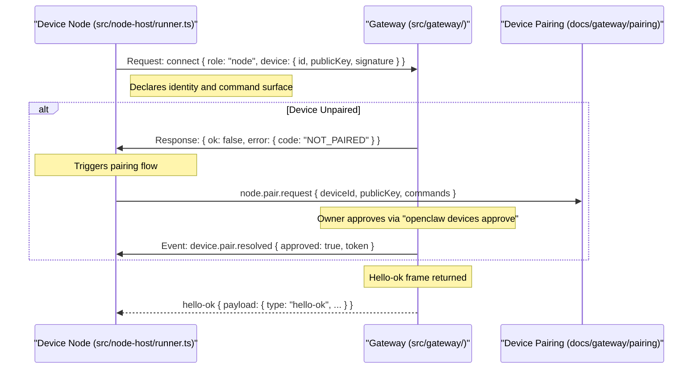
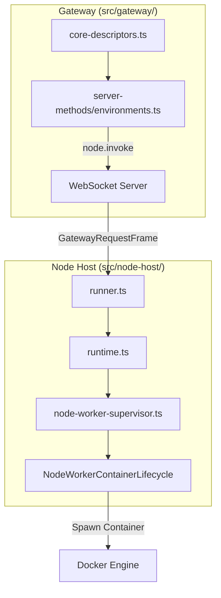

# Device Node Protocol

Relevant source files

The following files were used as context for generating this wiki page:

- [apps/android/app/src/main/java/ai/openclaw/app/gateway/GatewayProtocol.kt](apps/android/app/src/main/java/ai/openclaw/app/gateway/GatewayProtocol.kt)
- [apps/shared/OpenClawKit/Sources/OpenClawProtocol/GatewayModels.swift](apps/shared/OpenClawKit/Sources/OpenClawProtocol/GatewayModels.swift)
- [docs/cli/worker.md](docs/cli/worker.md)
- [docs/gateway/operator-scopes.md](docs/gateway/operator-scopes.md)
- [docs/gateway/protocol.md](docs/gateway/protocol.md)
- [docs/nodes/index.md](docs/nodes/index.md)
- [packages/gateway-protocol/src/error-details.ts](packages/gateway-protocol/src/error-details.ts)
- [packages/gateway-protocol/src/gateway-error-details.ts](packages/gateway-protocol/src/gateway-error-details.ts)
- [packages/gateway-protocol/src/index.test.ts](packages/gateway-protocol/src/index.test.ts)
- [packages/gateway-protocol/src/index.ts](packages/gateway-protocol/src/index.ts)
- [packages/gateway-protocol/src/schema/environments.test.ts](packages/gateway-protocol/src/schema/environments.test.ts)
- [packages/gateway-protocol/src/schema/environments.ts](packages/gateway-protocol/src/schema/environments.ts)
- [packages/gateway-protocol/src/schema/error-codes.test.ts](packages/gateway-protocol/src/schema/error-codes.test.ts)
- [packages/gateway-protocol/src/schema/error-codes.ts](packages/gateway-protocol/src/schema/error-codes.ts)
- [packages/gateway-protocol/src/schema/logs-chat.test.ts](packages/gateway-protocol/src/schema/logs-chat.test.ts)
- [packages/gateway-protocol/src/schema/logs-chat.ts](packages/gateway-protocol/src/schema/logs-chat.ts)
- [packages/gateway-protocol/src/schema/protocol-schema-fragment-transport.ts](packages/gateway-protocol/src/schema/protocol-schema-fragment-transport.ts)
- [packages/gateway-protocol/src/validator-registry.ts](packages/gateway-protocol/src/validator-registry.ts)
- [src/agents/code-mode.bridge.host-denial.test.ts](src/agents/code-mode.bridge.host-denial.test.ts)
- [src/agents/tools/message-tool-execution.test.ts](src/agents/tools/message-tool-execution.test.ts)
- [src/gateway/chat-abort.test.ts](src/gateway/chat-abort.test.ts)
- [src/gateway/chat-abort.ts](src/gateway/chat-abort.ts)
- [src/gateway/live-chat-projector.ts](src/gateway/live-chat-projector.ts)
- [src/gateway/method-scopes.test.ts](src/gateway/method-scopes.test.ts)
- [src/gateway/method-scopes.ts](src/gateway/method-scopes.ts)
- [src/gateway/methods/core-descriptors.since.test.ts](src/gateway/methods/core-descriptors.since.test.ts)
- [src/gateway/methods/core-descriptors.ts](src/gateway/methods/core-descriptors.ts)
- [src/gateway/node-runner-inventory-runtime.ts](src/gateway/node-runner-inventory-runtime.ts)
- [src/gateway/server-methods-list.test.ts](src/gateway/server-methods-list.test.ts)
- [src/gateway/server-methods/chat-broadcast.test.ts](src/gateway/server-methods/chat-broadcast.test.ts)
- [src/gateway/server-methods/chat-broadcast.ts](src/gateway/server-methods/chat-broadcast.ts)
- [src/gateway/server-methods/chat-send-request.test.ts](src/gateway/server-methods/chat-send-request.test.ts)
- [src/gateway/server-methods/chat-send-request.ts](src/gateway/server-methods/chat-send-request.ts)
- [src/gateway/server-methods/chat-send-session.ts](src/gateway/server-methods/chat-send-session.ts)
- [src/gateway/server-methods/environments.node-command-authority.test.ts](src/gateway/server-methods/environments.node-command-authority.test.ts)
- [src/gateway/server-methods/environments.node-ownership.test.ts](src/gateway/server-methods/environments.node-ownership.test.ts)
- [src/gateway/server-methods/environments.test.ts](src/gateway/server-methods/environments.test.ts)
- [src/gateway/server-methods/environments.ts](src/gateway/server-methods/environments.ts)
- [src/gateway/server-methods/nodes.read.test.ts](src/gateway/server-methods/nodes.read.test.ts)
- [src/gateway/server-methods/nodes.read.ts](src/gateway/server-methods/nodes.read.ts)
- [src/gateway/server-methods/nodes.runner-inventory.test.ts](src/gateway/server-methods/nodes.runner-inventory.test.ts)
- [src/gateway/server-methods/plugin-host-hooks.ts](src/gateway/server-methods/plugin-host-hooks.ts)
- [src/gateway/server-methods/sessions-subscriptions.ts](src/gateway/server-methods/sessions-subscriptions.ts)
- [src/gateway/server-methods/sessions-suggestions.test.ts](src/gateway/server-methods/sessions-suggestions.test.ts)
- [src/gateway/server-methods/sessions-suggestions.ts](src/gateway/server-methods/sessions-suggestions.ts)
- [src/gateway/server-methods/sessions-typing.test.ts](src/gateway/server-methods/sessions-typing.test.ts)
- [src/gateway/server.node-chat-subscriptions.test.ts](src/gateway/server.node-chat-subscriptions.test.ts)
- [src/gateway/server.node-pairing-auto-approve.test.ts](src/gateway/server.node-pairing-auto-approve.test.ts)
- [src/gateway/server.node-pairing-ssh-verify.test.ts](src/gateway/server.node-pairing-ssh-verify.test.ts)
- [src/gateway/test-helpers.lan-pairing.ts](src/gateway/test-helpers.lan-pairing.ts)
- [src/gateway/worker-environments/live-chat.test-support.ts](src/gateway/worker-environments/live-chat.test-support.ts)
- [src/infra/device-pairing-node-state.ts](src/infra/device-pairing-node-state.ts)
- [src/infra/node-commands.ts](src/infra/node-commands.ts)
- [src/infra/node-runner-inventory.ts](src/infra/node-runner-inventory.ts)
- [src/node-host/invoke-worker-supervisor.test.ts](src/node-host/invoke-worker-supervisor.test.ts)
- [src/node-host/node-worker-capacity.ts](src/node-host/node-worker-capacity.ts)
- [src/node-host/node-worker-container-engine.ts](src/node-host/node-worker-container-engine.ts)
- [src/node-host/node-worker-launch-store.ts](src/node-host/node-worker-launch-store.ts)
- [src/node-host/node-worker-launch-transport.ts](src/node-host/node-worker-launch-transport.ts)
- [src/node-host/node-worker-launch.ts](src/node-host/node-worker-launch.ts)
- [src/node-host/node-worker-supervisor-commands.ts](src/node-host/node-worker-supervisor-commands.ts)
- [src/node-host/node-worker-supervisor-contract.ts](src/node-host/node-worker-supervisor-contract.ts)
- [src/node-host/node-worker-supervisor-ownership.ts](src/node-host/node-worker-supervisor-ownership.ts)
- [src/node-host/node-worker-supervisor.container.test-support.ts](src/node-host/node-worker-supervisor.container.test-support.ts)
- [src/node-host/node-worker-supervisor.container.test.ts](src/node-host/node-worker-supervisor.container.test.ts)
- [src/node-host/node-worker-supervisor.recovery.test.ts](src/node-host/node-worker-supervisor.recovery.test.ts)
- [src/node-host/node-worker-supervisor.test-support.ts](src/node-host/node-worker-supervisor.test-support.ts)
- [src/node-host/node-worker-supervisor.test.ts](src/node-host/node-worker-supervisor.test.ts)
- [src/node-host/node-worker-supervisor.ts](src/node-host/node-worker-supervisor.ts)
- [src/node-host/runner.test.ts](src/node-host/runner.test.ts)
- [src/node-host/runner.ts](src/node-host/runner.ts)
- [src/node-host/runtime.test.ts](src/node-host/runtime.test.ts)
- [src/node-host/runtime.ts](src/node-host/runtime.ts)
- [src/node-host/runtime.worker-supervisor.test.ts](src/node-host/runtime.worker-supervisor.test.ts)
- [src/plugins/contracts/session-actions.contract.test.ts](src/plugins/contracts/session-actions.contract.test.ts)
- [src/worker/node-supervisor-protocol.test.ts](src/worker/node-supervisor-protocol.test.ts)
- [src/worker/node-supervisor-protocol.ts](src/worker/node-supervisor-protocol.ts)

The Device Node Protocol defines the secure communication and RPC method handling between the OpenClaw Gateway and native device clients (referred to as nodes). These nodes run on platforms such as iOS, Android, macOS, and Linux, exposing low-level device capabilities (camera, screen capture, notifications, etc.) for AI agents via the Gateway.

---

## Protocol Overview

Device nodes connect to the Gateway via the Gateway WebSocket protocol. The Gateway accepts authenticated node clients across a protocol version window; the current standard is `GATEWAY_PROTOCOL_VERSION = 4` [[apps/shared/OpenClawKit/Sources/OpenClawProtocol/GatewayModels.swift:5]](), with a minimum node version of `GATEWAY_MIN_NODE_PROTOCOL_VERSION = 3` [[apps/shared/OpenClawKit/Sources/OpenClawProtocol/GatewayModels.swift:7]]().

A **node** is a companion device that connects with `role: "node"` and exposes a command surface via `node.invoke` [[docs/nodes/index.md:12-13]](). While most nodes use WebSockets, the Apple Watch node uses signed HTTPS polling due to watchOS networking restrictions [[docs/nodes/index.md:13]]().

### Node Connection Flow

The connection flow involves a handshake, identity verification, and an optional pairing phase. Nodes declare their hardware capabilities and supported commands during the `connect` request frame [[docs/gateway/protocol.md:126-159]](). The Gateway continues a valid `traceparent` as a child trace context for requests after authentication [[docs/gateway/protocol.md:55-62]]().

**Title: Node Connection and Pairing Sequence**

Sources: [[docs/nodes/index.md:12-29]](), [[docs/gateway/protocol.md:126-169]](), [[src/node-host/runner.ts:136-160]]()

---

## Node Role & Authorization

Nodes are **peripherals**, not gateways; they do not run the gateway service or receive channel messages (e.g., Telegram) directly [[docs/nodes/index.md:22-23]](). The `node` role is distinct from the `operator` role and is bound by a durable approved-role contract in the paired-device store [[docs/nodes/index.md:48-49]]().

### Pairing and Command Allowlists
Approval scope follows the pending request's declared commands [[docs/nodes/index.md:51-52]]():
- **Commandless requests**: Require `operator.pairing` [[docs/nodes/index.md:52]]().
- **Non-exec node commands**: Require `operator.pairing` + `operator.write` [[docs/nodes/index.md:53]]().
- **System execution (`system.run`)**: Require `operator.pairing` + `operator.admin` [[docs/nodes/index.md:54]]().

### Version Skew
The Gateway supports N-1 protocol versions. Current v4 Gateways accept v3 nodes if they declare `client.mode: "node"` [[docs/nodes/index.md:58-61]](). Legacy nodes receive an upgrade recommendation but remain manageable for basic operations [[docs/nodes/index.md:63-67]]().

Sources: [[docs/nodes/index.md:22-67]](), [[docs/gateway/operator-scopes.md:20-28]]()

---

## Node Invocation Protocol (`node.invoke`)

The mechanism for remote device commands is the `node.invoke` RPC method. This allows the Gateway to route agent tool calls to specific hardware.

### Node Host & Remote Execution
A **node host** is used when the Gateway runs on one machine and commands must execute on another [[docs/nodes/index.md:76]](). The Gateway forwards `exec` calls to the node host when `host=node` is selected [[docs/nodes/index.md:76-77]]().

| Responsibility | Component |
|---|---|
| Routes tool calls & runs model | Gateway Host [[docs/nodes/index.md:80]]() |
| Executes `system.run` | Node Host [[docs/nodes/index.md:81]]() |
| Enforces approvals | `exec_approvals_config` on Node Host [[docs/nodes/index.md:82]]() |

### Execution Pipeline & Approvals
For `system.run` commands, the Gateway prepares a canonical `systemRunPlan` before requesting approval [[docs/nodes/index.md:86]](). Once granted, the Gateway forwards this exact plan. The node host re-validates the working directory and file operands before execution to prevent race-condition exploits [[docs/nodes/index.md:86-88]]().

**Title: Node Invocation and Worker Supervision**

Sources: [[docs/nodes/index.md:74-89]](), [[src/node-host/runner.ts:18-31]](), [[src/node-host/node-worker-supervisor.container.test.ts:13-25]](), [[src/gateway/methods/core-descriptors.ts:71-74]]()

---

## Node-Specific Tools & Capabilities

### Node Manifest & Inventory
Nodes report their capabilities via a manifest. This includes `caps` (capabilities), `commands`, and `nodePluginTools` [[src/node-host/runner.test.ts:136-143]](). The inventory tracks versioning and protocol features like `NODE_WORKER_SUPERVISOR_PROTOCOL_FEATURE` [[src/node-host/runner.test.ts:7-10]]().

### Worker Environments
Nodes can host isolated worker environments. The Gateway manages these via `environments.*` methods [[src/gateway/server-methods/environments.ts:17]]().
*   `environments.list`: Lists available environments across nodes [[src/gateway/server-methods/environments.test.ts:143]]().
*   `environments.create`: Provisions a new environment (e.g., via Docker) [[src/gateway/server-methods/environments.test.ts:145]]().
*   `worker.desktop.observe`: Provides a VNC/RFB stream of the worker desktop [[src/gateway/server-methods/environments.test.ts:131-136]]().

### Node Command Policies
Commands are classified by risk and required scope. `operator.admin` is required for `config.set` and `openclaw.chat`, while `operator.talk` is sufficient for voice steering [[src/gateway/methods/core-descriptors.ts:66-124]]().

| Command Category | Examples | Scope Required |
|---|---|---|
| **System** | `system.run`, `system.which` | `operator.admin` [[docs/nodes/index.md:54-55]]() |
| **Media** | `camera.snap`, `screen.record` | `operator.write` [[src/gateway/server-methods/environments.test.ts:203-204]]() |
| **Environment** | `environments.create`, `environments.destroy` | `operator.admin` [[src/gateway/server-methods/environments.test.ts:128-130]]() |
| **Talk/Voice** | `talk.client.steer`, `talk.speak` | `operator.talk` [[src/gateway/methods/core-descriptors.ts:115-123]]() |

Sources: [[src/gateway/methods/core-descriptors.ts:39-124]](), [[src/node-host/runner.test.ts:134-154]](), [[src/gateway/server-methods/environments.test.ts:91-120]]()

---

## Active Computer Presence

A connected native Mac can opt into "Active computer detection" via **Settings -> Permissions** [[docs/nodes/index.md:41-43]]().
1.  **Detection**: The node monitors physical input activity (requires Accessibility permissions) [[docs/nodes/index.md:41-42]]().
2.  **Routing**: The Gateway marks the freshest eligible Mac as `active` [[docs/nodes/index.md:43-44]]().
3.  **Prioritization**: Agent connection alerts and node-id hints are routed to the active node before falling back to others [[docs/nodes/index.md:44-45]]().

Sources: [[docs/nodes/index.md:41-47]]()