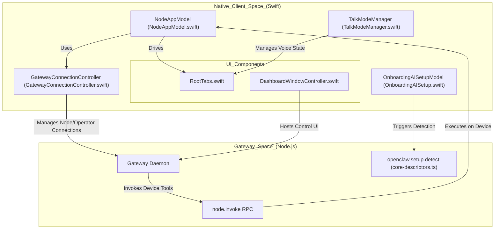
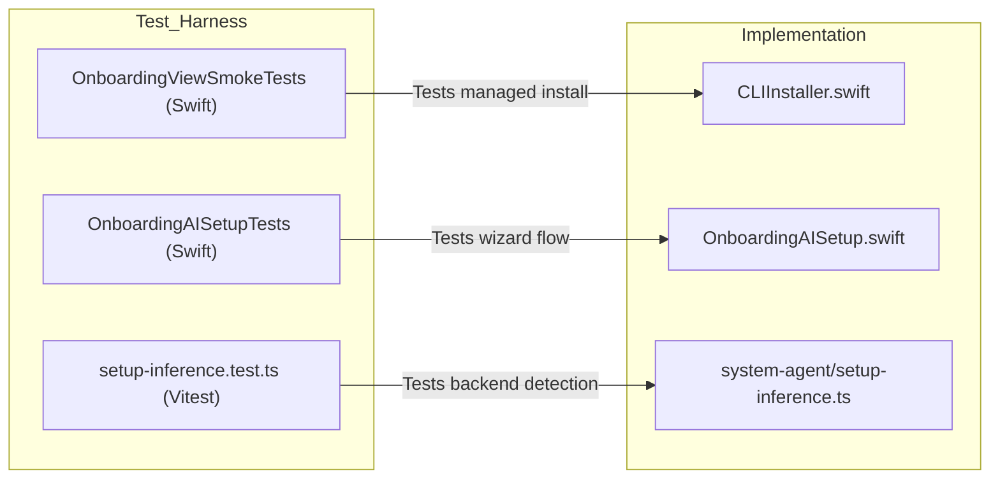

# iOS & macOS Apps

Relevant source files

The following files were used as context for generating this wiki page:

- [apps/android/app/src/main/java/ai/openclaw/app/gateway/GatewayProtocol.kt](apps/android/app/src/main/java/ai/openclaw/app/gateway/GatewayProtocol.kt)
- [apps/macos/Sources/OpenClaw/CLIInstallPrompter.swift](apps/macos/Sources/OpenClaw/CLIInstallPrompter.swift)
- [apps/macos/Sources/OpenClaw/Onboarding.swift](apps/macos/Sources/OpenClaw/Onboarding.swift)
- [apps/macos/Sources/OpenClaw/OnboardingAISetup.swift](apps/macos/Sources/OpenClaw/OnboardingAISetup.swift)
- [apps/macos/Sources/OpenClaw/OnboardingAISetupSupport.swift](apps/macos/Sources/OpenClaw/OnboardingAISetupSupport.swift)
- [apps/macos/Sources/OpenClaw/OnboardingAISetupView.swift](apps/macos/Sources/OpenClaw/OnboardingAISetupView.swift)
- [apps/macos/Sources/OpenClaw/OnboardingGatewayAuthBlocker.swift](apps/macos/Sources/OpenClaw/OnboardingGatewayAuthBlocker.swift)
- [apps/macos/Sources/OpenClaw/OnboardingSystemAgentChat.swift](apps/macos/Sources/OpenClaw/OnboardingSystemAgentChat.swift)
- [apps/macos/Sources/OpenClaw/OnboardingView+AISetupPage.swift](apps/macos/Sources/OpenClaw/OnboardingView+AISetupPage.swift)
- [apps/macos/Sources/OpenClaw/OnboardingView+Actions.swift](apps/macos/Sources/OpenClaw/OnboardingView+Actions.swift)
- [apps/macos/Sources/OpenClaw/OnboardingView+Layout.swift](apps/macos/Sources/OpenClaw/OnboardingView+Layout.swift)
- [apps/macos/Sources/OpenClaw/OnboardingView+Monitoring.swift](apps/macos/Sources/OpenClaw/OnboardingView+Monitoring.swift)
- [apps/macos/Sources/OpenClaw/OnboardingView+Pages.swift](apps/macos/Sources/OpenClaw/OnboardingView+Pages.swift)
- [apps/macos/Sources/OpenClaw/OnboardingWidgets.swift](apps/macos/Sources/OpenClaw/OnboardingWidgets.swift)
- [apps/macos/Tests/OpenClawIPCTests/OnboardingAISetupTests.swift](apps/macos/Tests/OpenClawIPCTests/OnboardingAISetupTests.swift)
- [apps/macos/Tests/OpenClawIPCTests/OnboardingMascotMoodTests.swift](apps/macos/Tests/OpenClawIPCTests/OnboardingMascotMoodTests.swift)
- [apps/macos/Tests/OpenClawIPCTests/OnboardingSystemAgentChatTests.swift](apps/macos/Tests/OpenClawIPCTests/OnboardingSystemAgentChatTests.swift)
- [apps/macos/Tests/OpenClawIPCTests/OnboardingViewSmokeTests.swift](apps/macos/Tests/OpenClawIPCTests/OnboardingViewSmokeTests.swift)
- [apps/macos/Tests/OpenClawIPCTests/ShellExecutorTimeoutTests.swift](apps/macos/Tests/OpenClawIPCTests/ShellExecutorTimeoutTests.swift)
- [apps/shared/OpenClawKit/Sources/OpenClawProtocol/GatewayModels.swift](apps/shared/OpenClawKit/Sources/OpenClawProtocol/GatewayModels.swift)
- [docs/gateway/operator-scopes.md](docs/gateway/operator-scopes.md)
- [docs/gateway/protocol.md](docs/gateway/protocol.md)
- [extensions/openai/provider-policy-api.ts](extensions/openai/provider-policy-api.ts)
- [packages/gateway-protocol/src/error-details.ts](packages/gateway-protocol/src/error-details.ts)
- [packages/gateway-protocol/src/gateway-error-details.ts](packages/gateway-protocol/src/gateway-error-details.ts)
- [packages/gateway-protocol/src/index.test.ts](packages/gateway-protocol/src/index.test.ts)
- [packages/gateway-protocol/src/index.ts](packages/gateway-protocol/src/index.ts)
- [packages/gateway-protocol/src/schema/error-codes.test.ts](packages/gateway-protocol/src/schema/error-codes.test.ts)
- [packages/gateway-protocol/src/schema/error-codes.ts](packages/gateway-protocol/src/schema/error-codes.ts)
- [packages/gateway-protocol/src/schema/logs-chat.test.ts](packages/gateway-protocol/src/schema/logs-chat.test.ts)
- [packages/gateway-protocol/src/schema/logs-chat.ts](packages/gateway-protocol/src/schema/logs-chat.ts)
- [packages/gateway-protocol/src/schema/openclaw.test.ts](packages/gateway-protocol/src/schema/openclaw.test.ts)
- [packages/gateway-protocol/src/schema/openclaw.ts](packages/gateway-protocol/src/schema/openclaw.ts)
- [packages/gateway-protocol/src/schema/protocol-schema-fragment-transport.ts](packages/gateway-protocol/src/schema/protocol-schema-fragment-transport.ts)
- [packages/gateway-protocol/src/validator-registry.ts](packages/gateway-protocol/src/validator-registry.ts)
- [src/agents/code-mode.bridge.host-denial.test.ts](src/agents/code-mode.bridge.host-denial.test.ts)
- [src/agents/tools/message-tool-execution.test.ts](src/agents/tools/message-tool-execution.test.ts)
- [src/commands/onboard-remote-gateway.test.ts](src/commands/onboard-remote-gateway.test.ts)
- [src/commands/onboard-remote-gateway.ts](src/commands/onboard-remote-gateway.ts)
- [src/gateway/chat-abort.test.ts](src/gateway/chat-abort.test.ts)
- [src/gateway/chat-abort.ts](src/gateway/chat-abort.ts)
- [src/gateway/live-chat-projector.ts](src/gateway/live-chat-projector.ts)
- [src/gateway/method-scopes.test.ts](src/gateway/method-scopes.test.ts)
- [src/gateway/method-scopes.ts](src/gateway/method-scopes.ts)
- [src/gateway/methods/core-descriptors.since.test.ts](src/gateway/methods/core-descriptors.since.test.ts)
- [src/gateway/methods/core-descriptors.ts](src/gateway/methods/core-descriptors.ts)
- [src/gateway/server-methods-list.test.ts](src/gateway/server-methods-list.test.ts)
- [src/gateway/server-methods/chat-broadcast.test.ts](src/gateway/server-methods/chat-broadcast.test.ts)
- [src/gateway/server-methods/chat-broadcast.ts](src/gateway/server-methods/chat-broadcast.ts)
- [src/gateway/server-methods/chat-send-request.test.ts](src/gateway/server-methods/chat-send-request.test.ts)
- [src/gateway/server-methods/chat-send-request.ts](src/gateway/server-methods/chat-send-request.ts)
- [src/gateway/server-methods/chat-send-session.ts](src/gateway/server-methods/chat-send-session.ts)
- [src/gateway/server-methods/plugin-host-hooks.ts](src/gateway/server-methods/plugin-host-hooks.ts)
- [src/gateway/server-methods/sessions-subscriptions.ts](src/gateway/server-methods/sessions-subscriptions.ts)
- [src/gateway/server-methods/sessions-suggestions.test.ts](src/gateway/server-methods/sessions-suggestions.test.ts)
- [src/gateway/server-methods/sessions-suggestions.ts](src/gateway/server-methods/sessions-suggestions.ts)
- [src/gateway/server-methods/sessions-typing.test.ts](src/gateway/server-methods/sessions-typing.test.ts)
- [src/gateway/server-methods/system-agent-chat-turn.test.ts](src/gateway/server-methods/system-agent-chat-turn.test.ts)
- [src/gateway/server-methods/system-agent-chat-turn.ts](src/gateway/server-methods/system-agent-chat-turn.ts)
- [src/gateway/server-methods/system-agent-greeting-welcome.test.ts](src/gateway/server-methods/system-agent-greeting-welcome.test.ts)
- [src/gateway/server-methods/system-agent-reset-boundary.test.ts](src/gateway/server-methods/system-agent-reset-boundary.test.ts)
- [src/gateway/server-methods/system-agent-session-ownership.test.ts](src/gateway/server-methods/system-agent-session-ownership.test.ts)
- [src/gateway/server-methods/system-agent.test.ts](src/gateway/server-methods/system-agent.test.ts)
- [src/gateway/server-methods/system-agent.ts](src/gateway/server-methods/system-agent.ts)
- [src/gateway/server.node-chat-subscriptions.test.ts](src/gateway/server.node-chat-subscriptions.test.ts)
- [src/gateway/worker-environments/live-chat.test-support.ts](src/gateway/worker-environments/live-chat.test-support.ts)
- [src/plugin-sdk/provider-model-types.ts](src/plugin-sdk/provider-model-types.ts)
- [src/plugins/contracts/session-actions.contract.test.ts](src/plugins/contracts/session-actions.contract.test.ts)
- [src/system-agent/inference-error.ts](src/system-agent/inference-error.ts)
- [src/system-agent/inference-fallback.test.ts](src/system-agent/inference-fallback.test.ts)
- [src/system-agent/inference-fallback.ts](src/system-agent/inference-fallback.ts)
- [src/system-agent/inference-route.test.ts](src/system-agent/inference-route.test.ts)
- [src/system-agent/inference-route.ts](src/system-agent/inference-route.ts)
- [src/system-agent/revalidate-inference-owner.ts](src/system-agent/revalidate-inference-owner.ts)
- [src/system-agent/setup-app-recommendations.live.test.ts](src/system-agent/setup-app-recommendations.live.test.ts)
- [src/system-agent/setup-inference-activate-persist.ts](src/system-agent/setup-inference-activate-persist.ts)
- [src/system-agent/setup-inference-activate.ts](src/system-agent/setup-inference-activate.ts)
- [src/system-agent/setup-inference-core.ts](src/system-agent/setup-inference-core.ts)
- [src/system-agent/setup-inference-detect.ts](src/system-agent/setup-inference-detect.ts)
- [src/system-agent/setup-inference-detection.worker.ts](src/system-agent/setup-inference-detection.worker.ts)
- [src/system-agent/setup-inference-persist.ts](src/system-agent/setup-inference-persist.ts)
- [src/system-agent/setup-inference-plan-helpers.ts](src/system-agent/setup-inference-plan-helpers.ts)
- [src/system-agent/setup-inference-plan.ts](src/system-agent/setup-inference-plan.ts)
- [src/system-agent/setup-inference-probe.ts](src/system-agent/setup-inference-probe.ts)
- [src/system-agent/setup-inference-route-guard.ts](src/system-agent/setup-inference-route-guard.ts)
- [src/system-agent/setup-inference-verify.ts](src/system-agent/setup-inference-verify.ts)
- [src/system-agent/setup-inference.test.ts](src/system-agent/setup-inference.test.ts)
- [src/system-agent/system-agent.test-helpers.ts](src/system-agent/system-agent.test-helpers.ts)
- [src/system-agent/verified-inference.test-support.ts](src/system-agent/verified-inference.test-support.ts)
- [src/system-agent/verified-inference.test.ts](src/system-agent/verified-inference.test.ts)

OpenClaw ships native Swift applications for iOS, watchOS, and macOS. These apps connect to the Gateway via WebSocket, expose device capabilities through the `node.invoke` protocol, and provide platform-native UI for chat, voice interaction, and agent management.

The iOS app includes multiple components: the main app, a share extension, a watch companion app, and an activity widget. The macOS app provides a menubar utility and integrated Gateway management. Both platforms share common code through `OpenClawKit` and use code-generated Gateway protocol models.

---

## iOS App Structure

The iOS app UI is built with SwiftUI and organized into functional tabs managed by `RootTabs` [apps/ios/Sources/RootTabs.swift:5-23](). It supports dynamic layouts including an iPad split-view and a compact drawer for iPhone [apps/ios/Tests/RootTabsSourceGuardTests.swift:51-86]().

### App UI Components

*   **RootTabs**: The top-level container managing navigation state, sidebar visibility, and onboarding evaluation [apps/ios/Sources/RootTabs.swift:22-60]().
*   **ChatProTab**: The primary chat interface synchronized with `OpenClawChatViewModel` [apps/ios/Tests/RootTabsSourceGuardTests.swift:88-94]().
*   **SettingsProTab**: Configuration for Gateway addresses, appearance, and diagnostic checks [apps/ios/Sources/Design/SettingsProTab.swift:15-124](). It includes specific sections for Gateway connection details [apps/ios/Sources/Design/SettingsProTabSections.swift:129-146]().
*   **WatchApp**: A companion application for watchOS that provides an inbox for messages and status updates [apps/ios/WatchApp/Sources/WatchInboxView.swift:1-20]().

### Onboarding and Setup
The app includes an onboarding flow that explains capabilities and establishes the trust model between the user and the agent [apps/ios/UITests/OpenClawSnapshotUITests.swift:112-124](). The `GatewaySetupRequest` structure handles deep-linked connection attempts [apps/ios/Sources/Design/SettingsProTab.swift:4-7]().

**Sources:** [apps/ios/Sources/RootTabs.swift:5-60](), [apps/ios/Tests/RootTabsSourceGuardTests.swift:51-94](), [apps/ios/UITests/OpenClawSnapshotUITests.swift:112-124](), [apps/ios/Sources/Design/SettingsProTab.swift:4-124](), [apps/ios/Sources/Design/SettingsProTabSections.swift:129-146]()

---

## macOS App and Onboarding

The macOS application provides a menubar interface managed via `OpenClawApp` and `AppDelegate` [apps/macos/Sources/OpenClaw/MenuBar.swift:37-55](). It supervision the local Gateway process and handles complex AI setup through a native wizard.

### AI Setup & Inference Detection
The macOS client includes a specialized `OnboardingAISetupModel` that manages the "Connect your AI" phase [apps/macos/Sources/OpenClaw/OnboardingAISetup.swift:14-113](). It communicates with the Gateway to:
*   **Detect Backends**: Calls `openclaw.setup.detect` to find local CLI tools (e.g., Claude Code, Codex) [src/gateway/methods/core-descriptors.ts:97](), [src/system-agent/setup-inference.test.ts:128-149]().
*   **Activation Wizard**: Orchestrates the `openclaw.setup.activate` RPC to verify model connectivity [apps/macos/Sources/OpenClaw/OnboardingAISetupSupport.swift:140-147](), [src/gateway/methods/core-descriptors.ts:100]().
*   **Lease Management**: Uses `OnboardingSystemAgentResumeStore` to track pending activations across app restarts, preventing duplicate setup attempts [apps/macos/Sources/OpenClaw/Onboarding.swift:43-82]().

### Dashboard and Web Integration
The macOS app features a `DashboardWindowController` which hosts a `WKWebView` for the Control UI [apps/macos/Sources/OpenClaw/DashboardWindowController.swift:77-108](). It includes a native bridge for:
*   **Link Handling**: Intercepting clicks to open in native browsers via `DashboardLinkMessageHandler` [apps/macos/Sources/OpenClaw/DashboardWindowController.swift:50-56]().
*   **Sparkle Auto-Update**: Integrates the `Sparkle` framework [apps/macos/Package.swift:22-71](). The `DashboardUpdateMessageHandler` bridges web-based update notifications to the native Sparkle controller [apps/macos/Sources/OpenClaw/DashboardWindowController.swift:68-74]().

**Sources:** [apps/macos/Sources/OpenClaw/OnboardingAISetup.swift:1-162](), [apps/macos/Sources/OpenClaw/Onboarding.swift:43-182](), [apps/macos/Sources/OpenClaw/OnboardingAISetupSupport.swift:1-222](), [apps/macos/Sources/OpenClaw/DashboardWindowController.swift:50-108](), [src/gateway/methods/core-descriptors.ts:97-103]()

---

## Architecture & Data Flow

Native clients revolve around the `NodeAppModel`, which manages the application state, execution approvals, and integration with system services like notifications and location [apps/ios/Sources/Model/NodeAppModel.swift:54-186]().

### Architecture Diagram: Code Entity Mapping

This diagram maps the high-level architecture to specific code entities within the Swift and TypeScript codebases.

**Sources:** [apps/ios/Sources/Model/NodeAppModel.swift:54-186](), [apps/ios/Sources/Gateway/GatewayConnectionController.swift:1-50](), [apps/macos/Sources/OpenClaw/OnboardingAISetup.swift:14-113](), [src/gateway/methods/core-descriptors.ts:39-124]()

---

## Gateway Protocol Integration

Swift clients use code-generated models that mirror the TypeScript definitions in `packages/gateway-protocol`.

*   **Protocol Versions**: The `GATEWAY_PROTOCOL_VERSION` is currently `4` [apps/shared/OpenClawKit/Sources/OpenClawProtocol/GatewayModels.swift:5-7]().
*   **Error Handling**: Clients handle standard codes like `NOT_PAIRED`, `FORBIDDEN`, and `MISSING_SCOPE` [apps/shared/OpenClawKit/Sources/OpenClawProtocol/GatewayModels.swift:24-32](), [docs/gateway/protocol.md:70-87]().
*   **Status Enums**: Includes shared state definitions for `EnvironmentStatus`, `WorkerEnvironmentState`, and `SessionPlacementState` [apps/shared/OpenClawKit/Sources/OpenClawProtocol/GatewayModels.swift:51-166]().

### Operator Scopes
The apps request specific scopes during the WebSocket `connect` handshake [docs/gateway/protocol.md:133-159](). Scopes like `operator.read`, `operator.write`, and `operator.admin` gate native features like config mutation and tool execution [docs/gateway/operator-scopes.md:32-41]().

**Sources:** [apps/shared/OpenClawKit/Sources/OpenClawProtocol/GatewayModels.swift:1-233](), [docs/gateway/protocol.md:1-169](), [docs/gateway/operator-scopes.md:1-128](), [packages/gateway-protocol/src/index.ts:1-62]()

---

## Chat & Voice Interaction

### Talk Mode & Audio Capture
Voice interaction is centralized in `TalkModeManager`, which handles:
*   **Push-to-Talk (PTT)**: Managed via operations like `TalkPushToTalkOnceOperation` [apps/ios/Sources/Voice/TalkModeManager.swift:104-127]().
*   **Phase Management**: Transitions between `idle`, `listening`, `thinking`, and `speaking` [apps/ios/Sources/Voice/TalkModeManager.swift:32-42]().

### Execution Approvals
The `NodeAppModel` handles `ExecApprovalPrompt` requests from the Gateway, allowing users to allow or deny tool executions [apps/ios/Sources/Model/NodeAppModel.swift:64-126]().

### A2UI Canvas Rendering
The apps visualize rich agent-driven UI components via the A2UI canvas. The `ChatMarkdownRenderer` in `OpenClawKit` handles the presentation of these components within the chat stream [apps/shared/OpenClawKit/Sources/OpenClawChatUI/ChatMarkdownRenderer.swift:1-20]().

**Sources:** [apps/ios/Sources/Voice/TalkModeManager.swift:32-202](), [apps/ios/Sources/Model/NodeAppModel.swift:64-126](), [apps/shared/OpenClawKit/Sources/OpenClawChatUI/ChatMarkdownRenderer.swift:1-20]()

---

## Build System & Testing

The macOS app is defined as a Swift Package with multiple targets including `OpenClawIPC`, `OpenClawDiscovery`, and the main `OpenClaw` executable [apps/macos/Package.swift:6-16]().

### Testing Logic
Native logic is verified through extensive smoke tests and unit tests:
*   **Onboarding Tests**: `OnboardingViewSmokeTests.swift` validates that CLI installation is only triggered for app-managed local Gateways [apps/macos/Tests/OpenClawIPCTests/OnboardingViewSmokeTests.swift:34-113]().
*   **AI Setup Tests**: `OnboardingAISetupTests.swift` uses an actor-based request recorder to verify that activation tokens and API keys are correctly passed to the Gateway [apps/macos/Tests/OpenClawIPCTests/OnboardingAISetupTests.swift:117-136]().

### Testing Data Flow Diagram

**Sources:** [apps/macos/Tests/OpenClawIPCTests/OnboardingViewSmokeTests.swift:1-150](), [apps/macos/Tests/OpenClawIPCTests/OnboardingAISetupTests.swift:1-225](), [src/system-agent/setup-inference.test.ts:1-161](), [apps/macos/Package.swift:100-115]()

---

## Sources
- [apps/ios/Sources/RootTabs.swift:5-150]()
- [apps/ios/Sources/Model/NodeAppModel.swift:54-186]()
- [apps/ios/Sources/Voice/TalkModeManager.swift:32-202]()
- [apps/macos/Sources/OpenClaw/OnboardingAISetup.swift:1-162]()
- [apps/macos/Sources/OpenClaw/OnboardingAISetupSupport.swift:1-222]()
- [apps/macos/Sources/OpenClaw/Onboarding.swift:1-182]()
- [apps/macos/Sources/OpenClaw/DashboardWindowController.swift:50-108]()
- [apps/macos/Tests/OpenClawIPCTests/OnboardingViewSmokeTests.swift:1-150]()
- [apps/macos/Tests/OpenClawIPCTests/OnboardingAISetupTests.swift:1-225]()
- [apps/shared/OpenClawKit/Sources/OpenClawProtocol/GatewayModels.swift:1-233]()
- [docs/gateway/protocol.md:1-169]()
- [docs/gateway/operator-scopes.md:1-128]()
- [src/system-agent/setup-inference.test.ts:1-161]()
- [src/gateway/methods/core-descriptors.ts:1-124]()