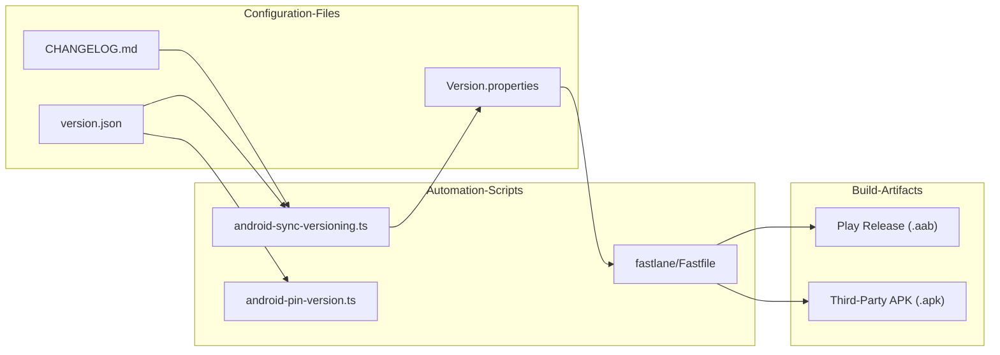

# Android App

<details>
<summary>Relevant source files</summary>

The following files were used as context for generating this wiki page:

- [apps/.i18n/native-source.json](apps/.i18n/native-source.json)
- [apps/android/README.md](apps/android/README.md)
- [apps/android/THIRD_PARTY_LICENSES/openclaw/licenses/AndroidX Room.txt](apps/android/THIRD_PARTY_LICENSES/openclaw/licenses/AndroidX Room.txt)
- [apps/android/THIRD_PARTY_LICENSES/openclaw/licenses/AndroidX SQLite.txt](apps/android/THIRD_PARTY_LICENSES/openclaw/licenses/AndroidX SQLite.txt)
- [apps/android/app/src/main/assets/katex/README.md](apps/android/app/src/main/assets/katex/README.md)
- [apps/android/app/src/main/assets/katex/katex.min.css](apps/android/app/src/main/assets/katex/katex.min.css)
- [apps/android/app/src/main/assets/katex/katex.min.js](apps/android/app/src/main/assets/katex/katex.min.js)
- [apps/android/app/src/main/java/ai/openclaw/app/AndroidScreenshotFixture.kt](apps/android/app/src/main/java/ai/openclaw/app/AndroidScreenshotFixture.kt)
- [apps/android/app/src/main/java/ai/openclaw/app/MainViewModel.kt](apps/android/app/src/main/java/ai/openclaw/app/MainViewModel.kt)
- [apps/android/app/src/main/java/ai/openclaw/app/NodeRuntime.kt](apps/android/app/src/main/java/ai/openclaw/app/NodeRuntime.kt)
- [apps/android/app/src/main/java/ai/openclaw/app/PermissionRequester.kt](apps/android/app/src/main/java/ai/openclaw/app/PermissionRequester.kt)
- [apps/android/app/src/main/java/ai/openclaw/app/chat/ChatCommandOutbox.kt](apps/android/app/src/main/java/ai/openclaw/app/chat/ChatCommandOutbox.kt)
- [apps/android/app/src/main/java/ai/openclaw/app/chat/ChatController.kt](apps/android/app/src/main/java/ai/openclaw/app/chat/ChatController.kt)
- [apps/android/app/src/main/java/ai/openclaw/app/chat/ChatModels.kt](apps/android/app/src/main/java/ai/openclaw/app/chat/ChatModels.kt)
- [apps/android/app/src/main/java/ai/openclaw/app/chat/ChatQuestion.kt](apps/android/app/src/main/java/ai/openclaw/app/chat/ChatQuestion.kt)
- [apps/android/app/src/main/java/ai/openclaw/app/chat/ChatTranscriptCache.kt](apps/android/app/src/main/java/ai/openclaw/app/chat/ChatTranscriptCache.kt)
- [apps/android/app/src/main/java/ai/openclaw/app/chat/ClientDatabases.kt](apps/android/app/src/main/java/ai/openclaw/app/chat/ClientDatabases.kt)
- [apps/android/app/src/main/java/ai/openclaw/app/node/ConnectionManager.kt](apps/android/app/src/main/java/ai/openclaw/app/node/ConnectionManager.kt)
- [apps/android/app/src/main/java/ai/openclaw/app/node/InvokeDispatcher.kt](apps/android/app/src/main/java/ai/openclaw/app/node/InvokeDispatcher.kt)
- [apps/android/app/src/main/java/ai/openclaw/app/node/NotificationsHandler.kt](apps/android/app/src/main/java/ai/openclaw/app/node/NotificationsHandler.kt)
- [apps/android/app/src/main/java/ai/openclaw/app/node/SystemHandler.kt](apps/android/app/src/main/java/ai/openclaw/app/node/SystemHandler.kt)
- [apps/android/app/src/main/java/ai/openclaw/app/ui/AgentPicker.kt](apps/android/app/src/main/java/ai/openclaw/app/ui/AgentPicker.kt)
- [apps/android/app/src/main/java/ai/openclaw/app/ui/OnboardingFlow.kt](apps/android/app/src/main/java/ai/openclaw/app/ui/OnboardingFlow.kt)
- [apps/android/app/src/main/java/ai/openclaw/app/ui/SessionsScreen.kt](apps/android/app/src/main/java/ai/openclaw/app/ui/SessionsScreen.kt)
- [apps/android/app/src/main/java/ai/openclaw/app/ui/SettingsScreens.kt](apps/android/app/src/main/java/ai/openclaw/app/ui/SettingsScreens.kt)
- [apps/android/app/src/main/java/ai/openclaw/app/ui/ShellNavigation.kt](apps/android/app/src/main/java/ai/openclaw/app/ui/ShellNavigation.kt)
- [apps/android/app/src/main/java/ai/openclaw/app/ui/ShellScreen.kt](apps/android/app/src/main/java/ai/openclaw/app/ui/ShellScreen.kt)
- [apps/android/app/src/main/java/ai/openclaw/app/ui/SidebarComponents.kt](apps/android/app/src/main/java/ai/openclaw/app/ui/SidebarComponents.kt)
- [apps/android/app/src/main/java/ai/openclaw/app/ui/SidebarContent.kt](apps/android/app/src/main/java/ai/openclaw/app/ui/SidebarContent.kt)
- [apps/android/app/src/main/java/ai/openclaw/app/ui/SystemAgentSettingsScreen.kt](apps/android/app/src/main/java/ai/openclaw/app/ui/SystemAgentSettingsScreen.kt)
- [apps/android/app/src/main/java/ai/openclaw/app/ui/WorkspaceFilesScreen.kt](apps/android/app/src/main/java/ai/openclaw/app/ui/WorkspaceFilesScreen.kt)
- [apps/android/app/src/main/java/ai/openclaw/app/ui/chat/ChatDictation.kt](apps/android/app/src/main/java/ai/openclaw/app/ui/chat/ChatDictation.kt)
- [apps/android/app/src/main/java/ai/openclaw/app/ui/chat/ChatMessageActions.kt](apps/android/app/src/main/java/ai/openclaw/app/ui/chat/ChatMessageActions.kt)
- [apps/android/app/src/main/java/ai/openclaw/app/ui/chat/ChatMessageDisclosure.kt](apps/android/app/src/main/java/ai/openclaw/app/ui/chat/ChatMessageDisclosure.kt)
- [apps/android/app/src/main/java/ai/openclaw/app/ui/chat/ChatQuestionCard.kt](apps/android/app/src/main/java/ai/openclaw/app/ui/chat/ChatQuestionCard.kt)
- [apps/android/app/src/main/java/ai/openclaw/app/ui/chat/ChatScreen.kt](apps/android/app/src/main/java/ai/openclaw/app/ui/chat/ChatScreen.kt)
- [apps/android/app/src/main/java/ai/openclaw/app/ui/chat/ChatSystemRows.kt](apps/android/app/src/main/java/ai/openclaw/app/ui/chat/ChatSystemRows.kt)
- [apps/android/app/src/main/java/ai/openclaw/app/ui/chat/ChatTimeline.kt](apps/android/app/src/main/java/ai/openclaw/app/ui/chat/ChatTimeline.kt)
- [apps/android/app/src/main/java/ai/openclaw/app/ui/design/ClawComponents.kt](apps/android/app/src/main/java/ai/openclaw/app/ui/design/ClawComponents.kt)
- [apps/android/app/src/main/java/ai/openclaw/app/ui/design/MascotAnimator.kt](apps/android/app/src/main/java/ai/openclaw/app/ui/design/MascotAnimator.kt)
- [apps/android/app/src/test/java/ai/openclaw/app/AndroidLicenseNoticesTest.kt](apps/android/app/src/test/java/ai/openclaw/app/AndroidLicenseNoticesTest.kt)
- [apps/android/app/src/test/java/ai/openclaw/app/AndroidScreenshotFixtureRuntimeTest.kt](apps/android/app/src/test/java/ai/openclaw/app/AndroidScreenshotFixtureRuntimeTest.kt)
- [apps/android/app/src/test/java/ai/openclaw/app/AndroidScreenshotFixtureTest.kt](apps/android/app/src/test/java/ai/openclaw/app/AndroidScreenshotFixtureTest.kt)
- [apps/android/app/src/test/java/ai/openclaw/app/AppLanguageTest.kt](apps/android/app/src/test/java/ai/openclaw/app/AppLanguageTest.kt)
- [apps/android/app/src/test/java/ai/openclaw/app/PermissionRequesterTest.kt](apps/android/app/src/test/java/ai/openclaw/app/PermissionRequesterTest.kt)
- [apps/android/app/src/test/java/ai/openclaw/app/chat/ChatControllerBranchCoordinationTest.kt](apps/android/app/src/test/java/ai/openclaw/app/chat/ChatControllerBranchCoordinationTest.kt)
- [apps/android/app/src/test/java/ai/openclaw/app/chat/ChatControllerCommandControlsTest.kt](apps/android/app/src/test/java/ai/openclaw/app/chat/ChatControllerCommandControlsTest.kt)
- [apps/android/app/src/test/java/ai/openclaw/app/chat/ChatControllerMessageIdentityTest.kt](apps/android/app/src/test/java/ai/openclaw/app/chat/ChatControllerMessageIdentityTest.kt)
- [apps/android/app/src/test/java/ai/openclaw/app/chat/ChatControllerOutboxTest.kt](apps/android/app/src/test/java/ai/openclaw/app/chat/ChatControllerOutboxTest.kt)
- [apps/android/app/src/test/java/ai/openclaw/app/chat/ChatControllerProgressCardTest.kt](apps/android/app/src/test/java/ai/openclaw/app/chat/ChatControllerProgressCardTest.kt)
- [apps/android/app/src/test/java/ai/openclaw/app/chat/ChatControllerReconnectRestoreTest.kt](apps/android/app/src/test/java/ai/openclaw/app/chat/ChatControllerReconnectRestoreTest.kt)
- [apps/android/app/src/test/java/ai/openclaw/app/chat/ChatControllerSessionActionsTest.kt](apps/android/app/src/test/java/ai/openclaw/app/chat/ChatControllerSessionActionsTest.kt)
- [apps/android/app/src/test/java/ai/openclaw/app/chat/ChatControllerTranscriptCacheTest.kt](apps/android/app/src/test/java/ai/openclaw/app/chat/ChatControllerTranscriptCacheTest.kt)
- [apps/android/app/src/test/java/ai/openclaw/app/chat/ChatMessageContentParsingTest.kt](apps/android/app/src/test/java/ai/openclaw/app/chat/ChatMessageContentParsingTest.kt)
- [apps/android/app/src/test/java/ai/openclaw/app/chat/ChatQuestionTest.kt](apps/android/app/src/test/java/ai/openclaw/app/chat/ChatQuestionTest.kt)
- [apps/android/app/src/test/java/ai/openclaw/app/chat/ChatReplayHarness.kt](apps/android/app/src/test/java/ai/openclaw/app/chat/ChatReplayHarness.kt)
- [apps/android/app/src/test/java/ai/openclaw/app/chat/ClientDatabasesTest.kt](apps/android/app/src/test/java/ai/openclaw/app/chat/ClientDatabasesTest.kt)
- [apps/android/app/src/test/java/ai/openclaw/app/chat/RoomChatCommandOutboxTest.kt](apps/android/app/src/test/java/ai/openclaw/app/chat/RoomChatCommandOutboxTest.kt)
- [apps/android/app/src/test/java/ai/openclaw/app/chat/RoomChatTranscriptCacheTest.kt](apps/android/app/src/test/java/ai/openclaw/app/chat/RoomChatTranscriptCacheTest.kt)
- [apps/android/app/src/test/java/ai/openclaw/app/node/ConnectionManagerTest.kt](apps/android/app/src/test/java/ai/openclaw/app/node/ConnectionManagerTest.kt)
- [apps/android/app/src/test/java/ai/openclaw/app/node/InvokeDispatcherTest.kt](apps/android/app/src/test/java/ai/openclaw/app/node/InvokeDispatcherTest.kt)
- [apps/android/app/src/test/java/ai/openclaw/app/node/SystemHandlerTest.kt](apps/android/app/src/test/java/ai/openclaw/app/node/SystemHandlerTest.kt)
- [apps/android/app/src/test/java/ai/openclaw/app/ui/AgentPickerTest.kt](apps/android/app/src/test/java/ai/openclaw/app/ui/AgentPickerTest.kt)
- [apps/android/app/src/test/java/ai/openclaw/app/ui/InitialOnboardingLayoutTest.kt](apps/android/app/src/test/java/ai/openclaw/app/ui/InitialOnboardingLayoutTest.kt)
- [apps/android/app/src/test/java/ai/openclaw/app/ui/OnboardingFlowLogicTest.kt](apps/android/app/src/test/java/ai/openclaw/app/ui/OnboardingFlowLogicTest.kt)
- [apps/android/app/src/test/java/ai/openclaw/app/ui/SessionsScreenDescendantSignalsTest.kt](apps/android/app/src/test/java/ai/openclaw/app/ui/SessionsScreenDescendantSignalsTest.kt)
- [apps/android/app/src/test/java/ai/openclaw/app/ui/SessionsScreenGroupingTest.kt](apps/android/app/src/test/java/ai/openclaw/app/ui/SessionsScreenGroupingTest.kt)
- [apps/android/app/src/test/java/ai/openclaw/app/ui/SettingsDetailInsetsTest.kt](apps/android/app/src/test/java/ai/openclaw/app/ui/SettingsDetailInsetsTest.kt)
- [apps/android/app/src/test/java/ai/openclaw/app/ui/ShellScreenLogicTest.kt](apps/android/app/src/test/java/ai/openclaw/app/ui/ShellScreenLogicTest.kt)
- [apps/android/app/src/test/java/ai/openclaw/app/ui/SidebarShellLogicTest.kt](apps/android/app/src/test/java/ai/openclaw/app/ui/SidebarShellLogicTest.kt)
- [apps/android/app/src/test/java/ai/openclaw/app/ui/SystemAnimationsTest.kt](apps/android/app/src/test/java/ai/openclaw/app/ui/SystemAnimationsTest.kt)
- [apps/android/app/src/test/java/ai/openclaw/app/ui/chat/ChatComposerLayoutTest.kt](apps/android/app/src/test/java/ai/openclaw/app/ui/chat/ChatComposerLayoutTest.kt)
- [apps/android/app/src/test/java/ai/openclaw/app/ui/chat/ChatContextMeterTest.kt](apps/android/app/src/test/java/ai/openclaw/app/ui/chat/ChatContextMeterTest.kt)
- [apps/android/app/src/test/java/ai/openclaw/app/ui/chat/ChatMessageViewsTest.kt](apps/android/app/src/test/java/ai/openclaw/app/ui/chat/ChatMessageViewsTest.kt)
- [apps/android/app/src/test/java/ai/openclaw/app/ui/chat/ChatQuestionDraftLayoutTest.kt](apps/android/app/src/test/java/ai/openclaw/app/ui/chat/ChatQuestionDraftLayoutTest.kt)
- [apps/android/app/src/test/java/ai/openclaw/app/ui/chat/ChatScreenTest.kt](apps/android/app/src/test/java/ai/openclaw/app/ui/chat/ChatScreenTest.kt)
- [apps/android/app/src/test/java/ai/openclaw/app/ui/chat/ChatTimelineTest.kt](apps/android/app/src/test/java/ai/openclaw/app/ui/chat/ChatTimelineTest.kt)
- [docs/platforms/android.md](docs/platforms/android.md)

</details>


The Android app is a native Kotlin client implementation for OpenClaw. It acts as a device node implementing the Device Node Protocol, exposing Android-specific device capabilities such as camera, location, notifications, SMS, call logs, and more to the agent runtime controlled via the Gateway. The app delivers a fluid user experience with a user interface built using Jetpack Compose and Material 3 components, optimized for mobile usage. It connects to the Gateway via WebSocket and supports gateway discovery through QR code scanning and DNS-SD (mDNS).

---

## Build System

The Android app uses the Gradle build system. While the core build logic resides in `apps/android/app/build.gradle.kts`, the release process is heavily automated via Fastlane and specialized TypeScript/Node.js scripts.

### Build Configuration

| Property | Value | Description |
|:---------|:------|:------------|
| Application ID | `ai.openclaw.app` | The stable package identifier for the Android application [apps/android/fastlane/Fastfile:10-10](). |
| Version Name | CalVer (`YYYY.M.D`) | Marketing version string, e.g., `2026.7.1` [apps/android/CHANGELOG.md:7-7](). |
| Version Code | `YYYYMMDDNN` | Internal monotonic build number where `NN` is a two-digit build counter [apps/android/VERSIONING.md:9-9](). |

### Signing Configuration

The Android pipeline uses an encrypted shared repository (`apps-signing`) to manage release credentials. The signing assets are materialized via `scripts/android-release-signing.mjs` using the `MATCH_PASSWORD` secret [apps/android/VERSIONING.md:91-95]().

Decrypted signing properties are stored in `apps/android/build/release-signing/gradle.properties` and include:
- `OPENCLAW_ANDROID_STORE_FILE`
- `OPENCLAW_ANDROID_STORE_PASSWORD`
- `OPENCLAW_ANDROID_KEY_ALIAS`
- `OPENCLAW_ANDROID_KEY_PASSWORD`

Sources: [apps/android/fastlane/Fastfile:13-18](), [apps/android/VERSIONING.md:91-98](), [apps/android/fastlane/Fastfile:46-52]()

### Product Flavors

The build defines two product flavors to handle distribution policy differences:

| Flavor | Description |
|:-------|:------------|
| `play` | Google Play Store compliant variant restricting sensitive permissions like SMS and call logs [apps/android/VERSIONING.md:56-57](). |
| `thirdParty` | Full feature set variant archived as a signed APK for non-Play distribution (e.g., side-loading) [apps/android/VERSIONING.md:56-57](). |

---

## Application Architecture

The Android app follows a Single-Activity architecture where `MainActivity` hosts the UI layer. The backend logic is encapsulated in `NodeRuntime`.

### NodeRuntime

`NodeRuntime` is the core orchestrator. It initializes capture managers and delegates command execution to specialized handlers [apps/android/app/src/main/java/ai/openclaw/app/NodeRuntime.kt:70-94]().

- **Subsystem Initialization**: It instantiates `CameraCaptureManager`, `LocationCaptureManager`, and `MicCaptureManager` [apps/android/app/src/main/java/ai/openclaw/app/NodeRuntime.kt:73-106]().
- **Handler Registry**: It maps incoming RPC calls via `InvokeDispatcher` to handlers such as `CameraHandler`, `LocationHandler`, `SmsHandler`, and `NotificationsHandler` [apps/android/app/src/main/java/ai/openclaw/app/NodeRuntime.kt:74-93]().
- **Discovery**: Uses `GatewayDiscovery` to find local network gateways via mDNS [apps/android/app/src/main/java/ai/openclaw/app/NodeRuntime.kt:42-42]().
- **Presence**: Maintains a `NodePresenceAliveBeacon` to signal node availability to the Gateway [apps/android/app/src/main/java/ai/openclaw/app/NodeRuntime.kt:86-86]().

### MainViewModel

`MainViewModel` serves as the state holder for the Compose UI. It consumes flows from `NodeRuntime` and exposes them as `StateFlow` objects for reactive UI updates, including gateway connection status and microphone states [apps/android/app/src/main/java/ai/openclaw/app/MainViewModel.kt:58-65](). 

Key responsibilities include:
- **Draft Management**: Handling `ChatDraft` and `PendingAssistantAutoSend` for conversation persistence [apps/android/app/src/main/java/ai/openclaw/app/MainViewModel.kt:79-115]().
- **Sharing**: Managing `ChatShareDraftQueue` to process content shared from other Android applications [apps/android/app/src/main/java/ai/openclaw/app/MainViewModel.kt:138-188]().
- **Theme Coordination**: Exposing `appearanceThemeMode`, `appearanceThemeFamily`, and `appearanceAccentArgb` to the UI shell [apps/android/app/src/main/java/ai/openclaw/app/ui/ShellScreen.kt:144-147]().

---

### Android App Architecture Components

"This diagram maps high-level system capabilities to the underlying Kotlin classes and orchestrators."

```mermaid
graph TD
    subgraph "Natural-Language-Space"
        ["Android App"]
        ["User Interface"]
        ["Voice Interaction"]
        ["Device Node Capabilities"]
        ["Gateway Connection"]
    end

    subgraph "Code-Entity-Space"
        MainActivity["ai.openclaw.app.MainActivity"]
        MainViewModel["ai.openclaw.app.MainViewModel"]
        NodeRuntime["ai.openclaw.app.NodeRuntime"]
        TalkModeManager["ai.openclaw.app.voice.TalkModeManager"]
        GatewaySession["ai.openclaw.app.gateway.GatewaySession"]
        InvokeDispatcher["ai.openclaw.app.node.InvokeDispatcher"]
        CameraHandler["ai.openclaw.app.node.CameraHandler"]
        LocationHandler["ai.openclaw.app.node.LocationHandler"]
        SmsHandler["ai.openclaw.app.node.SmsHandler"]
        NotificationsHandler["ai.openclaw.app.node.NotificationsHandler"]
        ConnectionManager["ai.openclaw.app.node.ConnectionManager"]
    end

    ["Android App"] --> MainActivity
    MainActivity --> MainViewModel
    MainViewModel --> NodeRuntime
    NodeRuntime --> GatewaySession
    NodeRuntime --> InvokeDispatcher
    NodeRuntime --> TalkModeManager
    NodeRuntime --> ConnectionManager

    InvokeDispatcher --> CameraHandler
    InvokeDispatcher --> LocationHandler
    InvokeDispatcher --> SmsHandler
    InvokeDispatcher --> NotificationsHandler

    ["User Interface"] --> MainActivity
    ["Voice Interaction"] --> TalkModeManager
    ["Device Node Capabilities"] --> InvokeDispatcher
    ["Gateway Connection"] --> GatewaySession
```

Sources: [apps/android/app/src/main/java/ai/openclaw/app/NodeRuntime.kt:70-94](), [apps/android/app/src/main/java/ai/openclaw/app/MainViewModel.kt:50-70]()

---

## Jetpack Compose UI

The Android UI is built using Jetpack Compose and Material 3, organized into a hierarchical shell.

### Navigation and Shell
The `ShellScreen` manages top-level navigation via the `Tab` enumeration [apps/android/app/src/main/java/ai/openclaw/app/ui/ShellScreen.kt:119-127]().
- **Overview**: General status and home view [apps/android/app/src/main/java/ai/openclaw/app/ui/ShellScreen.kt:120-120]().
- **Chat**: Interaction with agents via `ChatScreen` [apps/android/app/src/main/java/ai/openclaw/app/ui/ShellScreen.kt:121-121]().
- **Sessions**: Navigation of historical message threads [apps/android/app/src/main/java/ai/openclaw/app/ui/ShellScreen.kt:122-122]().
- **Settings**: Configuration and device management [apps/android/app/src/main/java/ai/openclaw/app/ui/ShellScreen.kt:123-123]().

### Localization
The app uses a JSON-based translation system. Strings are extracted from source files and mapped to stable IDs in `apps/.i18n/native-source.json` [apps/.i18n/native-source.json:3-5]().

Examples of localized entries:
- `native.android.037e745ddfe3faa3` for "Mic: Listening" [apps/.i18n/native-source.json:5-5]().
- `native.android.9f033f13a2912ad7` for "$agentName is working" [apps/.i18n/native-source.json:11-11]().
- `native.android.9c7b88bf8ce1ff2d` for progress indicators like "$currentPosition/${steps.size}" [apps/.i18n/native-source.json:24-24]().

### Onboarding Flow
The `OnboardingFlow` guides new users through:
1. **Welcome**: Introduction to the platform [apps/android/app/src/main/java/ai/openclaw/app/ui/OnboardingFlow.kt:114-122]().
2. **Gateway Setup**: Discovery and pairing, including QR code scanning using `BarcodeScanner` [apps/android/app/src/main/java/ai/openclaw/app/ui/OnboardingFlow.kt:143-146]().
3. **Permissions**: Requesting necessary Android system permissions (Camera, Mic, Location, Notifications) [apps/android/app/src/main/java/ai/openclaw/app/ui/OnboardingFlow.kt:88-103]().

Sources: [apps/android/app/src/main/java/ai/openclaw/app/ui/ShellScreen.kt:119-151](), [apps/android/app/src/main/java/ai/openclaw/app/ui/OnboardingFlow.kt:88-146](), [apps/.i18n/native-source.json:4-39]()

---

## Android-Specific Features

### Device Node Protocol Implementation
The app implements the `node.invoke` RPC method. When the Gateway sends a request, `InvokeDispatcher` dispatches it to the appropriate handler [apps/android/app/src/main/java/ai/openclaw/app/node/InvokeDispatcher.kt:1-20]():
- **Location**: `LocationHandler` provides GPS coordinates via `LocationCaptureManager` [apps/android/app/src/main/java/ai/openclaw/app/NodeRuntime.kt:82-83]().
- **Notifications**: `NotificationsHandler` and `DeviceNotificationListenerService` allow the Gateway to read and manage system notifications [apps/android/app/src/main/java/ai/openclaw/app/NodeRuntime.kt:80-87]().
- **SMS/Calls**: `SmsHandler` and `CallLogHandler` expose communication history [apps/android/app/src/main/java/ai/openclaw/app/NodeRuntime.kt:73-89]().
- **Media**: `CameraHandler` and `PhotosHandler` manage visual input [apps/android/app/src/main/java/ai/openclaw/app/NodeRuntime.kt:75-88]().

### Chat and Session Management
The `ChatController` manages the lifecycle of chat sessions, including transcript caching and branch coordination [apps/android/app/src/main/java/ai/openclaw/app/chat/ChatController.kt:173-176]().
- **Branching**: Supports session forking and rewinding via `forkSessionAtEntry` and `rewindSessionAtEntryResult` [apps/android/app/src/test/java/ai/openclaw/app/chat/ChatControllerBranchCoordinationTest.kt:120-121]().
- **Outbox**: Manages a local `ChatCommandOutbox` to ensure message delivery even across connection drops [apps/android/app/src/test/java/ai/openclaw/app/chat/ChatControllerBranchCoordinationTest.kt:55-55]().
- **UI Components**: `ChatBubble` renders messages with support for long-press actions like "Reply", "Rewind", and "Fork" [apps/android/app/src/test/java/ai/openclaw/app/ui/chat/ChatMessageViewsTest.kt:52-76]().

### Wear OS companion
The Android app serves as a bridge for the Wear OS companion. It uses the authenticated phone-to-gateway connection to proxy agent selection, transcripts, and realtime Talk [docs/platforms/android.md:41-43]().

---

### Release and Versioning Data Flow

"This diagram illustrates how version metadata and build artifacts are synchronized and produced by the CI/CD pipeline."



Sources: [apps/android/VERSIONING.md:7-12](), [apps/android/fastlane/Fastfile:120-148](), [apps/android/fastlane/Fastfile:189-195]()

Sources:
- [apps/android/app/src/main/java/ai/openclaw/app/NodeRuntime.kt:70-98]()
- [apps/android/app/src/main/java/ai/openclaw/app/MainViewModel.kt:50-188]()
- [apps/android/app/src/main/java/ai/openclaw/app/ui/ShellScreen.kt:119-151]()
- [apps/android/app/src/main/java/ai/openclaw/app/ui/OnboardingFlow.kt:86-146]()
- [apps/android/app/src/main/java/ai/openclaw/app/chat/ChatController.kt:173-176]()
- [apps/android/VERSIONING.md:1-98]()
- [apps/android/fastlane/Fastfile:1-235]()
- [apps/.i18n/native-source.json:1-39]()
- [docs/platforms/android.md:1-43]()
- [apps/android/app/src/test/java/ai/openclaw/app/chat/ChatControllerBranchCoordinationTest.kt:51-125]()
- [apps/android/app/src/test/java/ai/openclaw/app/ui/chat/ChatMessageViewsTest.kt:39-116]()