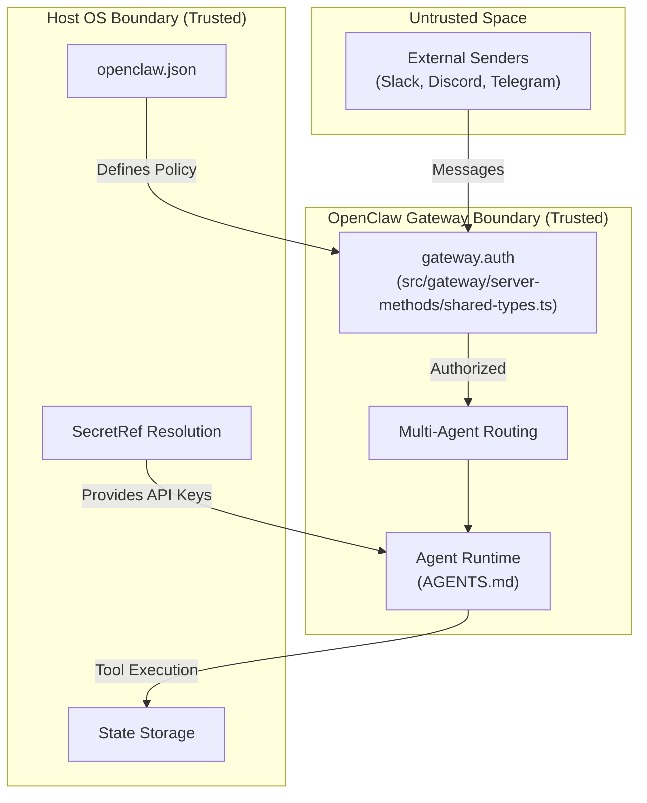
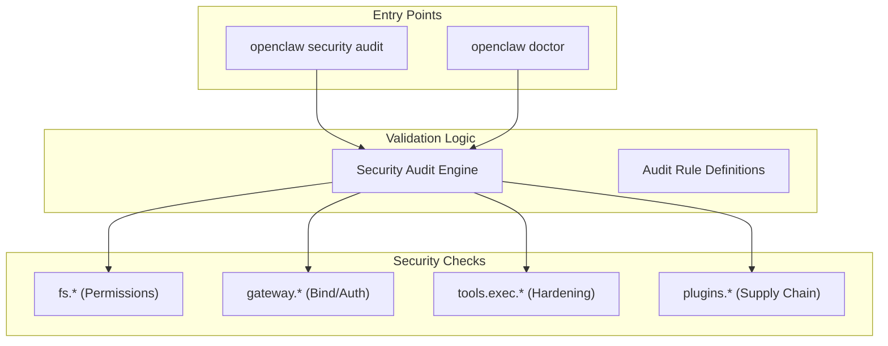
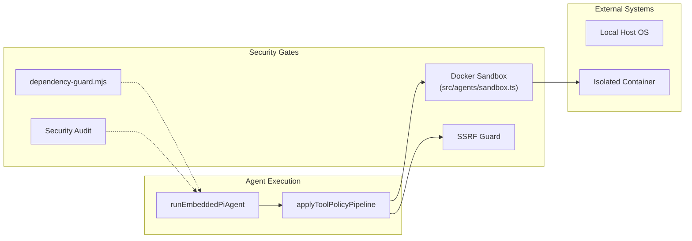

# Security

<details>
<summary>Relevant source files</summary>

The following files were used as context for generating this wiki page:

- [.agents/skills/auto-qa/SKILL.md](.agents/skills/auto-qa/SKILL.md)
- [.agents/skills/auto-qa/references/live-proof-routing.md](.agents/skills/auto-qa/references/live-proof-routing.md)
- [.agents/skills/control-ui-e2e/SKILL.md](.agents/skills/control-ui-e2e/SKILL.md)
- [.agents/skills/crabbox/SKILL.md](.agents/skills/crabbox/SKILL.md)
- [.agents/skills/openclaw-debugging/SKILL.md](.agents/skills/openclaw-debugging/SKILL.md)
- [.agents/skills/openclaw-pr-maintainer/SKILL.md](.agents/skills/openclaw-pr-maintainer/SKILL.md)
- [.agents/skills/openclaw-pr-maintainer/scripts/github-activity.sh](.agents/skills/openclaw-pr-maintainer/scripts/github-activity.sh)
- [.agents/skills/openclaw-repair-sweep/SKILL.md](.agents/skills/openclaw-repair-sweep/SKILL.md)
- [.agents/skills/openclaw-test-performance/SKILL.md](.agents/skills/openclaw-test-performance/SKILL.md)
- [.agents/skills/openclaw-testing/SKILL.md](.agents/skills/openclaw-testing/SKILL.md)
- [.agents/skills/release-openclaw-plugin-testing/SKILL.md](.agents/skills/release-openclaw-plugin-testing/SKILL.md)
- [.agents/skills/test-audit/SKILL.md](.agents/skills/test-audit/SKILL.md)
- [.github/CODEOWNERS](.github/CODEOWNERS)
- [AGENTS.md](AGENTS.md)
- [CONTRIBUTING.md](CONTRIBUTING.md)
- [extensions/memory-wiki/skills/wiki-maintainer/SKILL.md](extensions/memory-wiki/skills/wiki-maintainer/SKILL.md)
- [git-hooks/pre-commit](git-hooks/pre-commit)
- [scripts/README.md](scripts/README.md)
- [scripts/github/dependency-guard.mjs](scripts/github/dependency-guard.mjs)
- [scripts/github/guard-shared.mjs](scripts/github/guard-shared.mjs)
- [scripts/github/security-sensitive-guard.mjs](scripts/github/security-sensitive-guard.mjs)
- [test/scripts/dependency-guard-script.test.ts](test/scripts/dependency-guard-script.test.ts)
- [test/scripts/dependency-guard-workflow.test.ts](test/scripts/dependency-guard-workflow.test.ts)
- [test/scripts/github-activity-helper.test.ts](test/scripts/github-activity-helper.test.ts)
- [test/scripts/security-sensitive-guard-script.test.ts](test/scripts/security-sensitive-guard-script.test.ts)
- [test/scripts/security-sensitive-guard-workflow.test.ts](test/scripts/security-sensitive-guard-workflow.test.ts)

</details>


This page provides a high-level overview of OpenClaw's security model and implementation. It introduces the core trust assumptions underpinning OpenClaw’s design, describes the defense-in-depth audit system, sandboxing mechanisms, and secret management approach.

---

## Trust Model and Scope

OpenClaw operates under a **personal assistant trust model**. This means a single trusted operator is expected per gateway instance. The key assumptions include:

- **Trusted Host and Configuration**: The OpenClaw host environment and its configuration files (e.g., `openclaw.json`) must be controlled and trusted. Anyone able to modify this state is considered a trusted operator.
- **Trusted Gateway Authentication**: Callers authenticated to the Gateway API (via token, password, or device pairing) are trusted operators. OpenClaw supports multiple auth modes, including `token` and `password`.
- **No Multi-Tenant Hostile Isolation**: Running a single Gateway for multiple mutually untrusted or adversarial users is unsupported. OpenClaw is not a hostile multi-tenant security boundary.
- **State Integrity**: OpenClaw assumes the integrity of the underlying filesystem for storing sensitive state, including SQLite databases and session logs.

The trust boundary centers on the personal assistant operator who controls the Gateway and its associated agents. OpenClaw uses `security audit` and `doctor` checks to ensure these boundaries are not inadvertently weakened. Static analysis is further bolstered by the **OpenGrep** security rulepack (`security/opengrep/precise.yml`) and **CodeQL** critical quality gates enforced during CI [AGENTS.md:14-14]().

### Trust Boundary Concept



For a detailed explanation of the trust model, threat assumptions, and security guarantees, see [Security Model & Trust Boundaries](#7.1).

**Sources:**
[AGENTS.md:14-14](); [src/gateway/server-methods/shared-types.ts:1-20](); [CONTRIBUTING.md:35-35]()

---

## Security Audit System

OpenClaw features an automated security audit system integrated into the `openclaw security audit` command. This system performs comprehensive runtime environment checks to uncover security issues or misconfigurations.

The audit system detects common risks such as:
- **Inbound Access Policies**: Checks DM and group policies to ensure strangers cannot trigger the bot.
- **Tool Blast Radius**: Evaluates if prompt injection could lead to unauthorized shell, file, or network actions.
- **Network Exposure**: Scans for weak gateway binds (e.g., LAN bind without auth) or exposed Tailscale Funnels.
- **Local Disk Hygiene**: Hardens state/config/credential permissions (e.g., `600` files, `700` dirs) and resets ACLs on Windows.
- **Auto-Fix Capabilities**: The `--fix` flag applies safe remediations, such as tightening permissions or flipping open group policies to allowlists.

### Architecture Diagram: Security Audit & Validation



For details on the security audit command, finding categories, severity levels, and auto-fix capabilities, see [Security Audit System](#7.2).

**Sources:**
[AGENTS.md:28-31](); [CONTRIBUTING.md:35-35]()

---

## Sandboxing & Isolation

OpenClaw employs layered sandboxing and isolation mechanisms to reduce risks from executing arbitrary tools:

- **Docker Sandboxing**: Tools can be configured to execute inside Docker containers with specific seccomp profiles and AppArmor settings to isolate the host.
- **Workspace Guards**: File system tools are restricted to the workspace by default.
- **SSRF Protection**: Outbound network requests from tools are protected against Server-Side Request Forgery.
- **Dependency Guard**: PRs changing dependencies are gated by a mandatory security review [scripts/github/dependency-guard.mjs:21-25]().
- **Remote Proof (Crabbox)**: For untrusted code or repository tooling, OpenClaw uses `crabbox` to provide clean-machine isolation and remote proofing, preventing local execution of untrusted scripts [\.agents/skills/openclaw-testing/SKILL.md:21-30]().

### Code Entity Space: Execution Protection Flow



For details on Docker sandbox configuration, seccomp profiles, AppArmor, bind mount validation, and OpenShell, see [Sandboxing & Isolation](#7.3).

**Sources:**
[\.agents/skills/openclaw-testing/SKILL.md:21-30](); [scripts/github/dependency-guard.mjs:21-25](); [src/agents/sandbox.ts:1-10](); [test/scripts/dependency-guard-script.test.ts:44-56]()

---

## Secret Management

OpenClaw integrates a unified system for credentials and secrets to minimize exposure:

- **SecretRef System**: Abstracts credential references, allowing resolution from environment variables, files, or encrypted profiles [src/gateway/server-methods/shared-types.ts:6-13]().
- **Environment Resolution**: Supports a hierarchy of environment variable resolution for multiple providers (e.g., `ANTHROPIC_API_KEY`, `OPENAI_API_KEY`).
- **Credential Scrubbing**: The codebase includes strict patterns to identify and redact sensitive tokens and keys in logs and diagnostic reports.
- **Source Trust Isolation**: Untrusted contributor code is blocked from accessing hydrated credentials in CI/CD environments [\.agents/skills/openclaw-testing/SKILL.md:28-30]().

For details on the SecretRef system, environment variable resolution, auth profile encryption, and credential storage security, see [Secret Management](#7.4).

**Sources:**
[src/gateway/server-methods/shared-types.ts:6-13](); [\.agents/skills/openclaw-testing/SKILL.md:28-30](); [AGENTS.md:16-16]()

---

## Summary and Next Steps

OpenClaw's security is grounded in the **single trusted operator boundary**. Its defense-in-depth approach combines:

- **Strict Configuration Validation**: Ensuring the Gateway and Agents are not misconfigured via the `security audit` command.
- **Permission Hardening**: Automated enforcement of private file modes on sensitive state.
- **Secure Secret Resolution**: A robust resolution system that avoids plaintext leakage [src/gateway/server-methods/shared-types.ts:6-13]().
- **Dependency Guarding**: Automated blocking of unauthorized dependency changes in the supply chain [scripts/github/dependency-guard.mjs:21-25]().

Continue your exploration with these detailed child pages:

- [Security Model & Trust Boundaries](#7.1) — Detailed threat model and scope.
- [Security Audit System](#7.2) — Documentation of the audit/doctor CLI and findings.
- [Sandboxing & Isolation](#7.3) — Deep dive into Docker, OpenShell, and isolation guards.
- [Secret Management](#7.4) — Coverage of the SecretRef system and credential storage.

---

# Bridging Natural Language and Code: Trust Boundary to Core Code Entities

This diagram relates the natural language concepts of OpenClaw's trust model components to specific code entities implementing those components:

```mermaid
graph TB
  "PersonalAssistantTrustBoundary"["Personal Assistant Trusted Operator"] --> "GatewayInstance"
  "GatewayInstance"[Gateway Instance] --> "src/gateway/"
  "AuditChecks"[Security Audit Checks] --> "security audit command"
  "IdentityVerification"[Identity Verification] --> "guardTrustedActorCandidates"
  "SecretResolution"[Secret Resolution] --> "SecretRef"

  "SecretRefSys"["SecretRef System"] --> "src/gateway/server-methods/shared-types.ts"
  "ExecutionIsolation"["Execution Isolation"] --> "src/agents/sandbox.ts"

  "SecurityAuditCLI"["Security Audit CLI"] --> "openclaw security audit"
  "DockerSandbox"["Docker Isolation"] --> "sandbox.ts"
  "DepGuard"["Dependency Guard"] --> "dependency-guard.mjs"
  "NetworkGuard"["SSRF Guard"] --> "fetchWithSsrFGuard"
```

**Sources:**
[src/gateway/server-methods/shared-types.ts:6-13](); [scripts/github/dependency-guard.mjs:21-25](); [src/agents/sandbox.ts:1-10](); [scripts/github/guard-shared.mjs:13-13]()