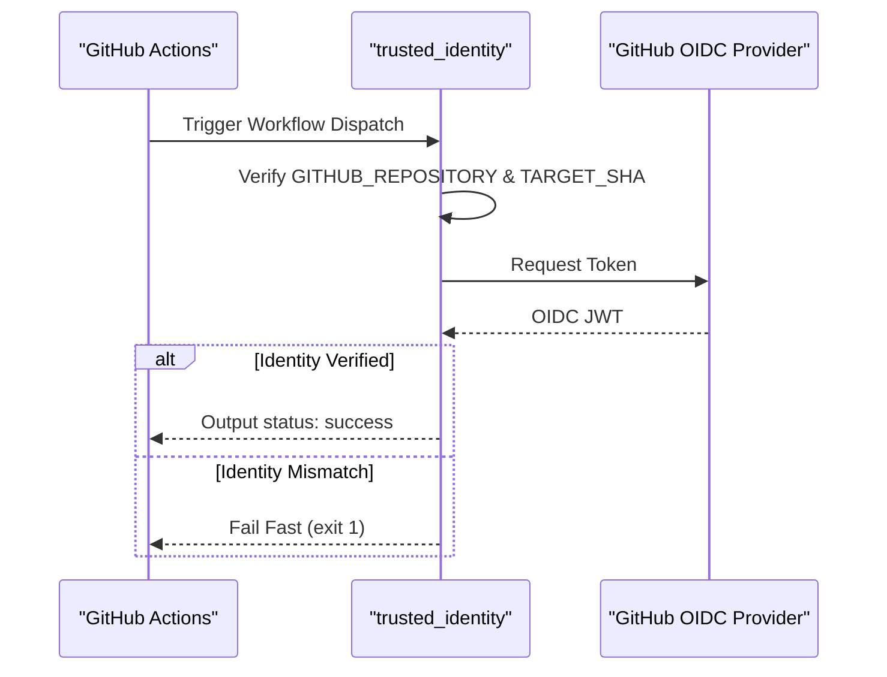

# Security Model & Trust Boundaries

<details>
<summary>Relevant source files</summary>

The following files were used as context for generating this wiki page:

- [.agents/skills/auto-qa/SKILL.md](.agents/skills/auto-qa/SKILL.md)
- [.agents/skills/auto-qa/references/live-proof-routing.md](.agents/skills/auto-qa/references/live-proof-routing.md)
- [.agents/skills/control-ui-e2e/SKILL.md](.agents/skills/control-ui-e2e/SKILL.md)
- [.agents/skills/crabbox/SKILL.md](.agents/skills/crabbox/SKILL.md)
- [.agents/skills/openclaw-debugging/SKILL.md](.agents/skills/openclaw-debugging/SKILL.md)
- [.agents/skills/openclaw-pr-maintainer/SKILL.md](.agents/skills/openclaw-pr-maintainer/SKILL.md)
- [.agents/skills/openclaw-pr-maintainer/scripts/github-activity.sh](.agents/skills/openclaw-pr-maintainer/scripts/github-activity.sh)
- [.agents/skills/openclaw-repair-sweep/SKILL.md](.agents/skills/openclaw-repair-sweep/SKILL.md)
- [.agents/skills/openclaw-test-performance/SKILL.md](.agents/skills/openclaw-test-performance/SKILL.md)
- [.agents/skills/openclaw-testing/SKILL.md](.agents/skills/openclaw-testing/SKILL.md)
- [.agents/skills/release-openclaw-plugin-testing/SKILL.md](.agents/skills/release-openclaw-plugin-testing/SKILL.md)
- [.agents/skills/test-audit/SKILL.md](.agents/skills/test-audit/SKILL.md)
- [.github/CODEOWNERS](.github/CODEOWNERS)
- [AGENTS.md](AGENTS.md)
- [CONTRIBUTING.md](CONTRIBUTING.md)
- [config/env-var-count-budget.txt](config/env-var-count-budget.txt)
- [docs/reference/test.md](docs/reference/test.md)
- [extensions/memory-wiki/skills/wiki-maintainer/SKILL.md](extensions/memory-wiki/skills/wiki-maintainer/SKILL.md)
- [extensions/telegram/src/bot-message-dispatch-draft.ts](extensions/telegram/src/bot-message-dispatch-draft.ts)
- [extensions/telegram/src/bot-message-dispatch.draft-finalization.test.ts](extensions/telegram/src/bot-message-dispatch.draft-finalization.test.ts)
- [extensions/telegram/src/button-types.test.ts](extensions/telegram/src/button-types.test.ts)
- [extensions/telegram/src/button-types.ts](extensions/telegram/src/button-types.ts)
- [extensions/telegram/src/reasoning-lane-coordinator.ts](extensions/telegram/src/reasoning-lane-coordinator.ts)
- [git-hooks/pre-commit](git-hooks/pre-commit)
- [scripts/README.md](scripts/README.md)
- [scripts/changed-lanes.mts](scripts/changed-lanes.mts)
- [scripts/check-assertion-safety-ratchet.mts](scripts/check-assertion-safety-ratchet.mts)
- [scripts/check-changed.mts](scripts/check-changed.mts)
- [scripts/check-env-var-count.mts](scripts/check-env-var-count.mts)
- [scripts/check-max-lines-ratchet.mts](scripts/check-max-lines-ratchet.mts)
- [scripts/check-script-erasability.mjs](scripts/check-script-erasability.mjs)
- [scripts/check.mts](scripts/check.mts)
- [scripts/e2e/parallels/macos-discord.ts](scripts/e2e/parallels/macos-discord.ts)
- [scripts/e2e/parallels/phase-runner.ts](scripts/e2e/parallels/phase-runner.ts)
- [scripts/github/dependency-guard.mjs](scripts/github/dependency-guard.mjs)
- [scripts/github/guard-shared.mjs](scripts/github/guard-shared.mjs)
- [scripts/github/security-sensitive-guard.mjs](scripts/github/security-sensitive-guard.mjs)
- [scripts/lib/changed-path-facts.mjs](scripts/lib/changed-path-facts.mjs)
- [scripts/lib/shrink-ratchet.mts](scripts/lib/shrink-ratchet.mts)
- [src/gateway/server.auth.control-ui.bootstrap-lifecycle.suite.ts](src/gateway/server.auth.control-ui.bootstrap-lifecycle.suite.ts)
- [src/gateway/server.auth.control-ui.device-token.suite.ts](src/gateway/server.auth.control-ui.device-token.suite.ts)
- [src/gateway/server.auth.control-ui.fixtures.test-support.ts](src/gateway/server.auth.control-ui.fixtures.test-support.ts)
- [src/gateway/server.auth.control-ui.mobile-bootstrap.suite.ts](src/gateway/server.auth.control-ui.mobile-bootstrap.suite.ts)
- [src/gateway/server.auth.control-ui.owner-bootstrap.suite.ts](src/gateway/server.auth.control-ui.owner-bootstrap.suite.ts)
- [src/gateway/server.auth.control-ui.pairing.suite.ts](src/gateway/server.auth.control-ui.pairing.suite.ts)
- [src/gateway/server.auth.control-ui.test.ts](src/gateway/server.auth.control-ui.test.ts)
- [src/gateway/server.auth.control-ui.trusted-proxy.suite.ts](src/gateway/server.auth.control-ui.trusted-proxy.suite.ts)
- [src/gateway/server.silent-scope-upgrade-reconnect.poc.test.ts](src/gateway/server.silent-scope-upgrade-reconnect.poc.test.ts)
- [test/scripts/changed-lanes.test.ts](test/scripts/changed-lanes.test.ts)
- [test/scripts/changed-path-facts.test.ts](test/scripts/changed-path-facts.test.ts)
- [test/scripts/check-assertion-safety-ratchet.test.ts](test/scripts/check-assertion-safety-ratchet.test.ts)
- [test/scripts/check-env-var-count.test.ts](test/scripts/check-env-var-count.test.ts)
- [test/scripts/check-max-lines-ratchet.test.ts](test/scripts/check-max-lines-ratchet.test.ts)
- [test/scripts/check.test.ts](test/scripts/check.test.ts)
- [test/scripts/dependency-guard-script.test.ts](test/scripts/dependency-guard-script.test.ts)
- [test/scripts/dependency-guard-workflow.test.ts](test/scripts/dependency-guard-workflow.test.ts)
- [test/scripts/github-activity-helper.test.ts](test/scripts/github-activity-helper.test.ts)
- [test/scripts/oxlint-config.test.ts](test/scripts/oxlint-config.test.ts)
- [test/scripts/security-sensitive-guard-script.test.ts](test/scripts/security-sensitive-guard-script.test.ts)
- [test/scripts/security-sensitive-guard-workflow.test.ts](test/scripts/security-sensitive-guard-workflow.test.ts)
- [test/scripts/shrink-ratchet.test.ts](test/scripts/shrink-ratchet.test.ts)
- [test/tsconfig.json](test/tsconfig.json)

</details>


This page documents OpenClaw's security model, threat assumptions, and trust boundaries. It explains the single trusted operator security model, secret management protocols, and defense-in-depth mechanisms including static analysis, plugin supply chain hardening, and code quality gates.

---

## Trust Model Overview

OpenClaw assumes a **personal assistant security model** with a single trusted operator boundary per Gateway instance. It is **not** designed as a multi-tenant adversarial isolation system where untrusted or adversarial users share one gateway configuration or agent runtime.

| Boundary | Trust Level | Explanation |
| :--- | :--- | :--- |
| **Gateway Config and State** | **Trusted** | Anyone who can modify `openclaw.json` effectively controls the gateway and all agents. |
| **Gateway Authenticated Callers** | **Trusted** | Gateway authentication grants operator-level access; DM-capable channels pair unknown senders by default. |
| **Session Keys** | **Routing Context Only** | Session keys route messages but do not confer authorization on their own. |
| **Channel Messages** | **Untrusted Input** | Messages from third-party sources are treated as untrusted input. |
| **Plugins and Extensions** | **Trusted Code** | Plugins run inside the Gateway process with full operator privileges. |
| **Model Providers** | **Trusted External Services** | Network requests to model providers are subject to sentinels and SSRF protection. |

### Trust Boundary Diagram: Concepts to Code Entities

```mermaid
graph TD
    subgraph "Trusted_Operator_Boundary"
        [openclaw.json] --> [ConfigManager]
        [PluginLoader] --> [PluginManifest]
        [SecretResolver] --> [AuthProfiles]
    end

    subgraph "Untrusted_Input_Boundary"
        [IncomingMessage] --> [SentinelGuard]
        [ProcessExec] --> [SSRFGuard]
        [UntrustedPR] --> [CrabboxBootstrap]
    end

    [IncomingMessage] -- "Routed via" --> [SessionKey]
    [ConfigManager] -- "Validates" --> [ZodSchema]
    [PluginLoader] -- "Executes" --> [ProcessExec]
    [CrabboxBootstrap] -- "Isolates" --> [RemoteHome]
```

**Sources:** [AGENTS.md:9-9](), [AGENTS.md:27-31](), [AGENTS.md:44-45](), [docs/reference/test.md:39-56]()

---

## Secret Management & Hardening

OpenClaw supports additive `SecretRef` objects so credentials do not live as plaintext in configuration.

### Runtime Resolution
- **Eager Resolution**: Secrets resolve into an in-memory runtime snapshot during activation, not lazily on request paths.
- **Sentinels**: For model providers, OpenClaw mints opaque, process-local sentinels. These sentinels replace plaintext in logs and SDK configuration, being swapped for real values only at the final egress point.
- **Fail-Closed**: Unknown sentinel-shaped values or resolution failures for Gateway-required components result in a fail-closed state to prevent accidental leakage.

### Secret Providers
OpenClaw resolves secrets from primary sources:
1.  **Environment Variables**: Resolves via `process.env`. The system maintains a strict budget for allowed `OPENCLAW_*` environment variables, capped by a ratchet at 500 [config/env-var-count-budget.txt:1-5]().
2.  **Files**: Reads from secure files with strict permission checks (e.g., `0o600`).
3.  **Executables**: Invokes external commands using a secure JSON-RPC protocol to fetch values from vault systems.

### Security Audit System
The `openclaw secrets audit --check` command identifies plaintext residue in configuration files and generated metadata. The system also uses automated ratchets to ensure safety assertions are not weakened over time.

---

## Static Analysis & Quality Gates

### CI/CD Security Pipeline
OpenClaw enforces high-confidence security invariants through automated gates defined in the release and CI workflows:
- **CodeQL**: Critical quality gates are enforced in CI for Node.js, macOS, and Android platforms.
- **OpenGrep**: Uses the precise rulepack (`security/opengrep/precise.yml`) to detect dangerous patterns in PRs, such as unsafe path joins or unredacted logging of sensitive variables.
- **Assertion Safety Ratchet**: Prevents the introduction of new unsafe TypeScript type assertions (`as`, `!`) unless accompanied by a `// SAFETY:` comment explaining the invariant [scripts/check-assertion-safety-ratchet.mts:1-10](), [test/scripts/check-assertion-safety-ratchet.test.ts:55-84]().
- **Dependency Guard**: Detects changes to `package.json` or lockfiles and requires a `/allow-dependencies-change` command from a member of the security team (`openclaw-secops`) before merging [scripts/github/dependency-guard.mjs:21-36](), [scripts/github/dependency-guard.mjs:202-214]().

### Plugin Supply Chain
Plugin installation is strictly controlled to prevent untrusted execution:
- **NPM Spec Integrity**: Plugins installed from NPM are verified via shasum and integrity hashes.
- **QA Staging**: The QA system creates isolated, staged bundled plugin directories to verify plugin behavior before deployment.
- **Dependency Isolation**: The system ensures that worker bundle installations do not leak sensitive state into remote processes [config/env-var-count-budget.txt:3-3]().

---

## CI Workflow Guards & Provenance

OpenClaw employs specialized guards to prevent accidental or malicious workflow execution, particularly during releases.

- **Provenance Validation**: Release workflows include explicit steps to validate candidate release provenance before proceeding.
- **Trusted Identity Verification**: The system verifies the identity of dispatched workflows using OIDC tokens and SHA-bound release-ci references.
- **Untrusted Source Isolation**: Untrusted contributor or fork code is never executed locally. It is routed to a sanitized, secretless environment (Crabbox/Testbox) with a fresh temporary `HOME` and network isolation [docs/reference/test.md:15-21](), [docs/reference/test.md:39-56]().
- **Bootstrap Integrity**: For untrusted PRs, a maintainer-reviewed `scripts/crabbox-untrusted-bootstrap.sh` is uploaded from the trusted `main` branch to the remote environment to verify the PR's SHA and package manager pin before any execution [docs/reference/test.md:51-54](), [.agents/skills/openclaw-testing/SKILL.md:70-75]().

### CI Release Identity Flow



**Sources:** [docs/reference/test.md:39-56](), [.agents/skills/openclaw-testing/SKILL.md:37-64]()

---

## Out of Scope & Known Limitations

- **Sandboxing**: Tools run on the host by default unless Docker/Seccomp sandboxing is explicitly configured.
- **Physical Access**: Local configuration and SQLite database files are not encrypted at rest by OpenClaw; OS-level disk encryption is assumed.
- **Model Behavior**: Security guarantees do not cover LLM hallucinations unless they interact with a protected tool boundary.
- **Max Lines Ratchet**: While the system ratchets file length to encourage modularity, it does not strictly prevent large files if they are already grandfathered in `config/max-lines-baseline.txt` [scripts/check-max-lines-ratchet.mts:1-12](), [test/scripts/check-max-lines-ratchet.test.ts:102-122]().

**Sources:**
- [AGENTS.md:23-38]()
- [docs/reference/test.md:15-21]()
- [config/env-var-count-budget.txt:1-5]()
- [scripts/check-assertion-safety-ratchet.mts:1-10]()