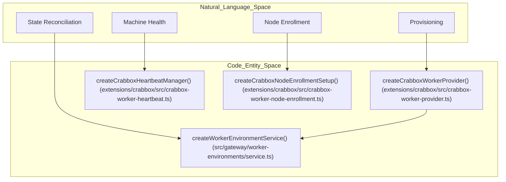
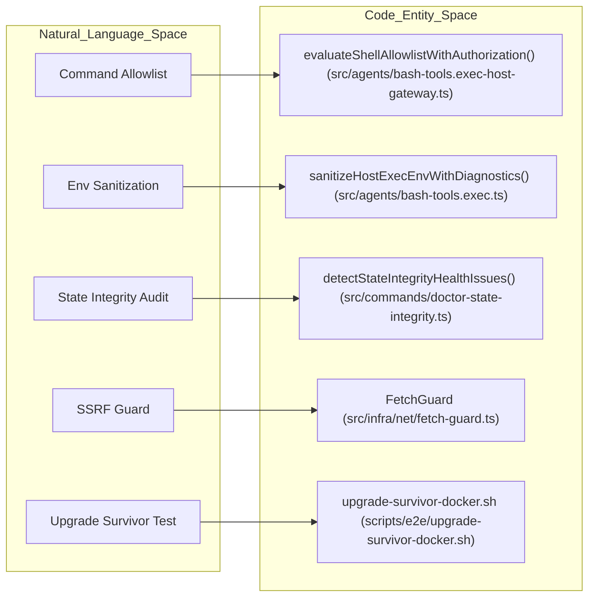

# Sandboxing & Isolation

Relevant source files

The following files were used as context for generating this wiki page:

- [docs/gateway/cloud-workers.md](docs/gateway/cloud-workers.md)
- [docs/plugins/architecture.md](docs/plugins/architecture.md)
- [docs/plugins/sdk-overview.md](docs/plugins/sdk-overview.md)
- [extensions/acpx/doctor-contract-api.test.ts](extensions/acpx/doctor-contract-api.test.ts)
- [extensions/acpx/src/session-owner-migration.test.ts](extensions/acpx/src/session-owner-migration.test.ts)
- [extensions/acpx/src/session-owner-migration.ts](extensions/acpx/src/session-owner-migration.ts)
- [extensions/crabbox/index.test.ts](extensions/crabbox/index.test.ts)
- [extensions/crabbox/index.ts](extensions/crabbox/index.ts)
- [extensions/crabbox/openclaw.plugin.json](extensions/crabbox/openclaw.plugin.json)
- [extensions/crabbox/src/crabbox-worker-command-error.ts](extensions/crabbox/src/crabbox-worker-command-error.ts)
- [extensions/crabbox/src/crabbox-worker-command.ts](extensions/crabbox/src/crabbox-worker-command.ts)
- [extensions/crabbox/src/crabbox-worker-desktop-setup.ts](extensions/crabbox/src/crabbox-worker-desktop-setup.ts)
- [extensions/crabbox/src/crabbox-worker-heartbeat.ts](extensions/crabbox/src/crabbox-worker-heartbeat.ts)
- [extensions/crabbox/src/crabbox-worker-machine-options.ts](extensions/crabbox/src/crabbox-worker-machine-options.ts)
- [extensions/crabbox/src/crabbox-worker-node-enrollment.test.ts](extensions/crabbox/src/crabbox-worker-node-enrollment.test.ts)
- [extensions/crabbox/src/crabbox-worker-node-enrollment.ts](extensions/crabbox/src/crabbox-worker-node-enrollment.ts)
- [extensions/crabbox/src/crabbox-worker-profile.ts](extensions/crabbox/src/crabbox-worker-profile.ts)
- [extensions/crabbox/src/crabbox-worker-project.test.ts](extensions/crabbox/src/crabbox-worker-project.test.ts)
- [extensions/crabbox/src/crabbox-worker-provider.test.ts](extensions/crabbox/src/crabbox-worker-provider.test.ts)
- [extensions/crabbox/src/crabbox-worker-provider.ts](extensions/crabbox/src/crabbox-worker-provider.ts)
- [extensions/crabbox/src/crabbox-worker-stop-lifetime.test.ts](extensions/crabbox/src/crabbox-worker-stop-lifetime.test.ts)
- [extensions/crabbox/src/crabbox-worker-timeouts.ts](extensions/crabbox/src/crabbox-worker-timeouts.ts)
- [extensions/crabbox/src/crabbox-worker-warm-image-cli.test.ts](extensions/crabbox/src/crabbox-worker-warm-image-cli.test.ts)
- [extensions/crabbox/src/crabbox-worker-warm-image-cli.ts](extensions/crabbox/src/crabbox-worker-warm-image-cli.ts)
- [extensions/crabbox/src/crabbox-worker-warm-image-lifecycle.test.ts](extensions/crabbox/src/crabbox-worker-warm-image-lifecycle.test.ts)
- [extensions/crabbox/src/crabbox-worker-warm-image-recovery.test.ts](extensions/crabbox/src/crabbox-worker-warm-image-recovery.test.ts)
- [extensions/crabbox/src/crabbox-worker-warm-image-retirement.test.ts](extensions/crabbox/src/crabbox-worker-warm-image-retirement.test.ts)
- [extensions/crabbox/src/crabbox-worker-warm-image-store.ts](extensions/crabbox/src/crabbox-worker-warm-image-store.ts)
- [extensions/crabbox/src/crabbox-worker-warm-image.test-support.ts](extensions/crabbox/src/crabbox-worker-warm-image.test-support.ts)
- [extensions/crabbox/src/crabbox-worker-warm-image.test.ts](extensions/crabbox/src/crabbox-worker-warm-image.test.ts)
- [extensions/crabbox/src/crabbox-worker-warm-image.ts](extensions/crabbox/src/crabbox-worker-warm-image.ts)
- [scripts/e2e/lib/clawhub-fixture-server.cjs](scripts/e2e/lib/clawhub-fixture-server.cjs)
- [scripts/e2e/lib/upgrade-survivor/assertions.mjs](scripts/e2e/lib/upgrade-survivor/assertions.mjs)
- [scripts/e2e/lib/upgrade-survivor/config-parking.mjs](scripts/e2e/lib/upgrade-survivor/config-parking.mjs)
- [scripts/e2e/lib/upgrade-survivor/config-recipe.mts](scripts/e2e/lib/upgrade-survivor/config-recipe.mts)
- [scripts/e2e/lib/upgrade-survivor/diagnostics.mjs](scripts/e2e/lib/upgrade-survivor/diagnostics.mjs)
- [scripts/e2e/lib/upgrade-survivor/run.sh](scripts/e2e/lib/upgrade-survivor/run.sh)
- [scripts/e2e/lib/upgrade-survivor/systemd-fixture.mjs](scripts/e2e/lib/upgrade-survivor/systemd-fixture.mjs)
- [scripts/e2e/lib/upgrade-survivor/update-restart-auth.sh](scripts/e2e/lib/upgrade-survivor/update-restart-auth.sh)
- [scripts/e2e/lib/upgrade-survivor/update-run-package-self-upgrade.sh](scripts/e2e/lib/upgrade-survivor/update-run-package-self-upgrade.sh)
- [scripts/e2e/update-run-package-self-upgrade-docker.sh](scripts/e2e/update-run-package-self-upgrade-docker.sh)
- [scripts/e2e/upgrade-survivor-docker.sh](scripts/e2e/upgrade-survivor-docker.sh)
- [scripts/lib/docker-e2e-plan.mts](scripts/lib/docker-e2e-plan.mts)
- [scripts/lib/docker-e2e-scenarios.mts](scripts/lib/docker-e2e-scenarios.mts)
- [scripts/lib/upgrade-survivor-diagnostics.sh](scripts/lib/upgrade-survivor-diagnostics.sh)
- [scripts/lib/upgrade-survivor-policy.d.mts](scripts/lib/upgrade-survivor-policy.d.mts)
- [scripts/lib/upgrade-survivor-policy.mjs](scripts/lib/upgrade-survivor-policy.mjs)
- [src/gateway/server-worker-environment-startup.test.ts](src/gateway/server-worker-environment-startup.test.ts)
- [src/gateway/server-worker-environment-startup.ts](src/gateway/server-worker-environment-startup.ts)
- [src/gateway/server.node-pairing-rate-limit.test.ts](src/gateway/server.node-pairing-rate-limit.test.ts)
- [src/gateway/server/ws-connection/connect-admission.ts](src/gateway/server/ws-connection/connect-admission.ts)
- [src/gateway/worker-environments/environment-access.test.ts](src/gateway/worker-environments/environment-access.test.ts)
- [src/gateway/worker-environments/environment-access.ts](src/gateway/worker-environments/environment-access.ts)
- [src/gateway/worker-environments/node-enrollment.test.ts](src/gateway/worker-environments/node-enrollment.test.ts)
- [src/gateway/worker-environments/node-enrollment.ts](src/gateway/worker-environments/node-enrollment.ts)
- [src/gateway/worker-environments/placement-dispatch-recovery.test.ts](src/gateway/worker-environments/placement-dispatch-recovery.test.ts)
- [src/gateway/worker-environments/provider-lifecycle.ts](src/gateway/worker-environments/provider-lifecycle.ts)
- [src/gateway/worker-environments/provider-provisioning-node.test.ts](src/gateway/worker-environments/provider-provisioning-node.test.ts)
- [src/gateway/worker-environments/provider-provisioning.shutdown-replay.test.ts](src/gateway/worker-environments/provider-provisioning.shutdown-replay.test.ts)
- [src/gateway/worker-environments/provider-reconciliation.test.ts](src/gateway/worker-environments/provider-reconciliation.test.ts)
- [src/gateway/worker-environments/service.test-support.ts](src/gateway/worker-environments/service.test-support.ts)
- [src/gateway/worker-environments/service.ts](src/gateway/worker-environments/service.ts)
- [src/plugins/capability-provider.types.ts](src/plugins/capability-provider.types.ts)
- [src/plugins/inspect-shape.ts](src/plugins/inspect-shape.ts)
- [src/test-helpers/state-dir-env.ts](src/test-helpers/state-dir-env.ts)
- [test/e2e/qa-lab/runtime/update-run-package-self-upgrade.test.ts](test/e2e/qa-lab/runtime/update-run-package-self-upgrade.test.ts)
- [test/scripts/clawhub-fixture-server.test.ts](test/scripts/clawhub-fixture-server.test.ts)
- [test/scripts/docker-build-helper.test.ts](test/scripts/docker-build-helper.test.ts)
- [test/scripts/docker-e2e-plan.test.ts](test/scripts/docker-e2e-plan.test.ts)
- [test/scripts/upgrade-survivor-assertions.test.ts](test/scripts/upgrade-survivor-assertions.test.ts)
- [test/scripts/upgrade-survivor-baseline-order.test.ts](test/scripts/upgrade-survivor-baseline-order.test.ts)
- [test/scripts/upgrade-survivor-config-parking.test.ts](test/scripts/upgrade-survivor-config-parking.test.ts)
- [test/scripts/upgrade-survivor-config-recipe.test.ts](test/scripts/upgrade-survivor-config-recipe.test.ts)
- [test/scripts/upgrade-survivor-systemd.test.ts](test/scripts/upgrade-survivor-systemd.test.ts)
- [test/scripts/upgrade-survivor-update-result.test.ts](test/scripts/upgrade-survivor-update-result.test.ts)

OpenClaw employs a multi-layered sandboxing and isolation system to securely execute agent tools, primarily utilizing Docker containers, environment sanitization, network controls, and granular execution approval workflows. This page details the implementation of OpenClaw’s Docker sandbox configuration, security profiles, workspace bind mount validation, and the execution isolation logic used during development and production.

---

## Sandbox Architecture Overview

OpenClaw supports multiple sandbox and execution backends, determining where commands run based on tool policy and sandbox availability.

- **Local Docker Sandbox:** Containerized runtime with hardened images and strict execution policies.
- **Node Host (Device Nodes):** Remote execution on paired devices (e.g., iOS, Android, or macOS clients) via the `node.invoke` RPC.
- **OpenShell / Crabbox:** A managed cloud sandbox backend offering remote isolated execution. OpenClaw uses a worker-provider model to provision ephemeral cloud machines [extensions/crabbox/src/crabbox-worker-provider.ts:8-10]().

The system uses a target resolution phase to decide if a command should run on the host, in a local sandbox, or on a remote node.

| Component | Role | Code Symbol(s) & Location |
| --------- | ---- | ------------------------- |
| Sandbox Target Resolver | Determines if exec runs on host, sandbox, or remote node | `resolveExecTarget()` [src/agents/bash-tools.exec-runtime.ts:71-72]() |
| Execution Coordinator | Orchestrates approval, analysis, and dispatch | `executeNodeHostCommand()` [src/agents/bash-tools.exec-host-node.ts:111-113]() |
| Exec Approval System | Requests user confirmation on risky exec commands | `registerExecApprovalRequestForHostOrThrow()` [src/agents/bash-tools.exec-approval-request.ts:138-140]() |
| Docker Build & Runtime | Hardened, multi-stage build producing minimal container image | `Dockerfile` [Dockerfile:1-133]() |
| Docker E2E Planning | Resolves concrete lane plans for isolated testing | `resolveDockerE2ePlan()` [scripts/lib/docker-e2e-plan.mts:12-13]() |
| Cloud Worker Service | Manages ephemeral cloud environment lifecycles | `createWorkerEnvironmentService()` [src/gateway/worker-environments/service.ts:150-151]() |

### Tool Execution Isolation Flow

```mermaid
graph TD
  subgraph "Agent_Runtime_Space"
    Agent["Agent Execution Loop"]
    Tool["bash_tools.exec"]
  end

  subgraph "Security_Layer"
    Target["resolveExecTarget()"]
    Analysis["analyzeNodeApprovalRequirement()"]
    Approval["registerExecApprovalRequestForHostOrThrow()"]
  end

  subgraph "Execution_Target"
    Host["Host Process (Gateway)"]
    Docker["Docker Sandbox Container"]
    Crabbox["Crabbox (Remote Cloud Sandbox)"]
    Node["Remote Device Node (node.invoke)"]
  end

  Agent --> Tool
  Tool --> Target
  Target --> Analysis
  Analysis -->|Needs Approval| Approval
  Approval -->|User Allowed| Host
  Target -->|Sandbox Mode| Docker
  Target -->|Remote Sandbox| Crabbox
  Target -->|Remote Target| Node
```

Sources:
[src/agents/bash-tools.exec-host-node.ts:111-204](), [src/agents/bash-tools.exec-runtime.ts:71-72](), [src/agents/bash-tools.exec-approval-request.ts:138-140](), [src/gateway/worker-environments/service.ts:150-151]()

---

## Docker Sandbox Implementation

Docker provides the primary isolation layer for untrusted code and E2E testing. OpenClaw’s Docker setup emphasizes security, reproducibility, and a minimal runtime footprint.

### Dockerfile Build Strategy and Hardening

- **Multi-stage build**: The Dockerfile uses multi-stage builds to produce a minimal runtime image, stripping away build tools like `pnpm` and source code [Dockerfile:5-8]().
- **Init system**: `tini` is utilized as the ENTRYPOINT to handle signal forwarding and prevent zombie process accumulation [Dockerfile:82-82]().
- **Permission normalization**: The build process explicitly normalizes permissions for extensions and agent directories [Dockerfile:125-130]().
- **Base Image Pinning**: Images are pinned to SHA256 digests for reproducible builds [Dockerfile:16-21]().

### Docker E2E Orchestration & Planning

OpenClaw uses a sophisticated E2E planning system to run tests in isolated Docker lanes:
- **Lane Selection**: The `resolveDockerE2ePlan` function maps scenarios to specific Docker resource requirements [scripts/lib/docker-e2e-plan.mts:12-13]().
- **Resource Weighting**: Test lanes are assigned weights (e.g., `weight: 3` for upgrade survivor lanes) to manage concurrency and prevent resource exhaustion [test/scripts/docker-e2e-plan.test.ts:108-109]().
- **Image Kinds**: The system distinguishes between `bare` images (minimal) and `functional` images (with full toolsets) for different isolation requirements [test/scripts/docker-e2e-plan.test.ts:102-131]().

Sources:
[Dockerfile:1-133](), [scripts/lib/docker-e2e-plan.mts:1-13](), [test/scripts/docker-e2e-plan.test.ts:90-138]()

---

## Cloud Sandboxing: Crabbox & OpenShell

For cloud-based isolation, OpenClaw utilizes the **Crabbox** provider. This moves a session's coding work onto an ephemeral cloud machine while the Gateway retains ownership of the transcript [docs/gateway/cloud-workers.md:10-10]().

### Worker Turn vs. Remote Exec
OpenClaw supports two primary modes for cloud isolation [docs/gateway/cloud-workers.md:26-33]():
- **Worker Turn**: The agent runtime loop runs entirely on the cloud box (`openclaw worker`).
- **Remote Exec**: The agent runtime stays on the Gateway, but command, filesystem, and HTTP work are dispatched to the cloud node.

### Provisioning & Lifecycle
The `CrabboxWorkerProvider` manages the lifecycle of these environments [extensions/crabbox/src/crabbox-worker-provider.ts:8-10]():
- **Provisioning**: Creates a machine, runs setup, and starts `openclaw connect --ephemeral` [docs/gateway/cloud-workers.md:10-10]().
- **Heartbeats**: The `createCrabboxHeartbeatManager` ensures the Gateway maintains a connection to the sandbox and cleans up if the machine becomes unresponsive [extensions/crabbox/src/crabbox-worker-provider.ts:24-24]().
- **Cleanup**: Ephemeral machines are discarded after work is completed or the lease expires, ensuring no persistent state remains on the untrusted host [docs/gateway/cloud-workers.md:14-14]().

### Network & Security in Cloud Workers
- **Outbound Only**: Cloud nodes dial the Gateway's public TLS endpoint via outbound WebSocket, avoiding the need for inbound ports or reverse tunnels [docs/gateway/cloud-workers.md:36-36]().
- **Portals**: HTTP/WebSocket traffic can be proxied through the Gateway to the worker's loopback ports via the `portal` tool, maintaining isolation while allowing UI access [docs/gateway/cloud-workers.md:38-38]().
- **Artifact Security**: Proxies must protect the `/__openclaw__/worker-bootstrap/artifacts/` route, ensuring only authorized nodes can download the runtime [docs/gateway/cloud-workers.md:42-42]().

Sources:
[docs/gateway/cloud-workers.md:1-47](), [extensions/crabbox/src/crabbox-worker-provider.ts:1-96](), [src/gateway/worker-environments/service.ts:47-66]()

---

## Exec Approval & Security Profiles

OpenClaw implements a "Human-in-the-loop" security model for shell execution. Commands are analyzed before execution to determine if they violate safety boundaries.

### Approval Analysis Logic
The system evaluates commands against a shell allowlist and checks for durable approvals [src/agents/bash-tools.exec-host-gateway.ts:24-25](). Risk assessment is performed to detect dangerous patterns like inline evaluation [src/agents/bash-tools.exec-host-gateway.ts:9-9]().

### State Integrity and Permission Audits
The `openclaw doctor` command performs critical security audits [docs/gateway/doctor.md:10-16]():
- **Directory Permissions**: Recommendations for `chmod 700` on sensitive state directories [src/commands/doctor-state-integrity.ts:107-115]().
- **Path Validation**: Ensuring state is not on volatile or cloud-synced paths [src/commands/doctor-state-integrity.ts:80-96]().

Sources:
[src/agents/bash-tools.exec-host-gateway.ts:1-132](), [src/commands/doctor-state-integrity.ts:107-115](), [docs/gateway/doctor.md:10-16]()

---

## Secret & Environment Isolation

OpenClaw isolates secrets from the execution environment through several mechanisms:
- **Environment Sanitization**: The `sanitizeHostExecEnvWithDiagnostics` function ensures that dangerous host environment variables are not leaked to subprocesses [src/agents/bash-tools.exec.ts:37-37]().
- **Secret Management**: OpenClaw uses a `SecretRef` system and environment variable resolution to handle credentials securely [src/agents/bash-tools.exec.ts:102-115]().
- **SSRF Protection**: Network requests are passed through a `FetchGuard` to prevent Server-Side Request Forgery [src/infra/net/fetch-guard.ts:15-30]().

Sources:
[src/agents/bash-tools.exec.ts:32-38](), [src/infra/net/fetch-guard.ts:15-30]()

---

## Bridge Diagrams: Code Entity Mapping

### Cloud Sandbox Component Map

Sources:
[extensions/crabbox/src/crabbox-worker-provider.ts:127-135](), [extensions/crabbox/src/crabbox-worker-heartbeat.ts:1-10](), [extensions/crabbox/src/crabbox-worker-node-enrollment.ts:28-31](), [src/gateway/worker-environments/service.ts:150-151]()

### Security & Validation Map

Sources:
[src/agents/bash-tools.exec-host-gateway.ts:24-24](), [src/agents/bash-tools.exec.ts:37-37](), [src/commands/doctor-state-integrity.ts:174-204](), [src/infra/net/fetch-guard.ts:15-30](), [scripts/e2e/upgrade-survivor-docker.sh:1-50]()