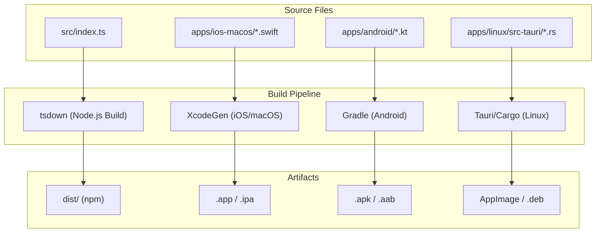
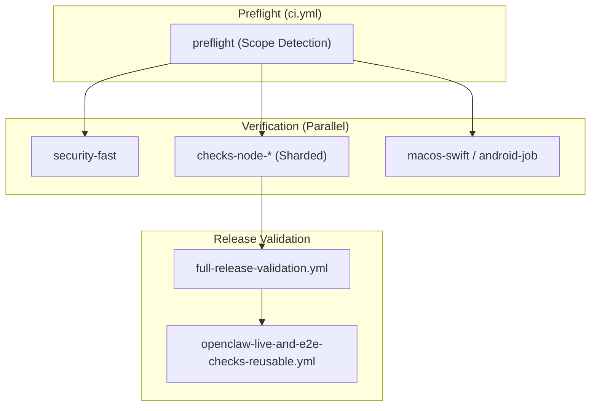
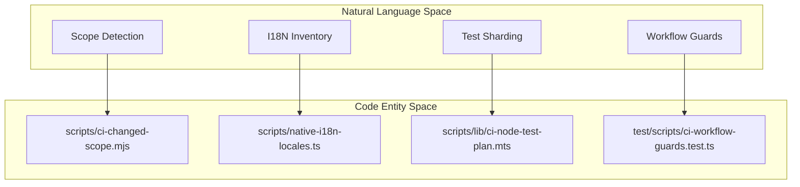
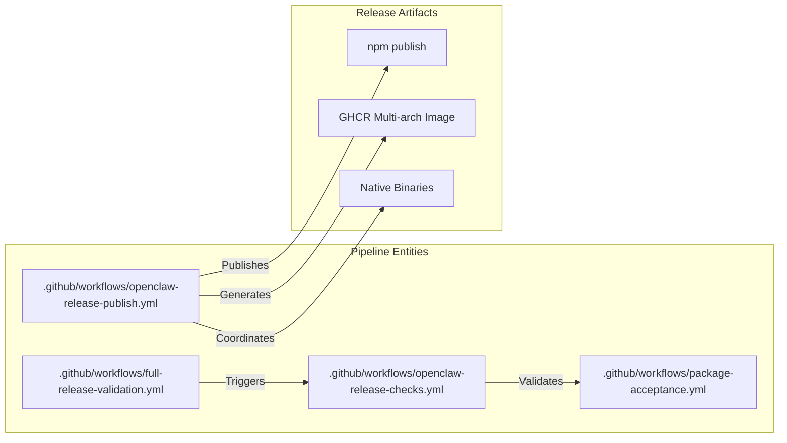

# Build & Release

Relevant source files

The following files were used as context for generating this wiki page:

- [.agents/skills/openclaw-ci-limits/SKILL.md](.agents/skills/openclaw-ci-limits/SKILL.md)
- [.agents/skills/release-openclaw-ci/SKILL.md](.agents/skills/release-openclaw-ci/SKILL.md)
- [.github/actions/publish-generated-pr/action.yml](.github/actions/publish-generated-pr/action.yml)
- [.github/actions/publish-generated-pr/policy.py](.github/actions/publish-generated-pr/policy.py)
- [.github/workflows/ci-test-timings-refit.yml](.github/workflows/ci-test-timings-refit.yml)
- [.github/workflows/ci.yml](.github/workflows/ci.yml)
- [.github/workflows/full-release-candidate.yml](.github/workflows/full-release-candidate.yml)
- [.github/workflows/full-release-validation.yml](.github/workflows/full-release-validation.yml)
- [.github/workflows/maturity-scorecard.yml](.github/workflows/maturity-scorecard.yml)
- [.github/workflows/openclaw-live-and-e2e-checks-reusable.yml](.github/workflows/openclaw-live-and-e2e-checks-reusable.yml)
- [.github/workflows/openclaw-release-checks.yml](.github/workflows/openclaw-release-checks.yml)
- [.github/workflows/openclaw-release-publish.yml](.github/workflows/openclaw-release-publish.yml)
- [.github/workflows/openclaw-release-telegram-qa.yml](.github/workflows/openclaw-release-telegram-qa.yml)
- [.github/workflows/openclaw-repo-e2e-reusable.yml](.github/workflows/openclaw-repo-e2e-reusable.yml)
- [.github/workflows/plugin-prerelease.yml](.github/workflows/plugin-prerelease.yml)
- [.github/workflows/qa-profile-evidence.yml](.github/workflows/qa-profile-evidence.yml)
- [config/ci-test-timings.json](config/ci-test-timings.json)
- [config/knip.all-exports.config.ts](config/knip.all-exports.config.ts)
- [docs/ci.md](docs/ci.md)
- [docs/reference/RELEASING.md](docs/reference/RELEASING.md)
- [docs/reference/full-release-validation.md](docs/reference/full-release-validation.md)
- [package.json](package.json)
- [scripts/check-deadcode-exports.mts](scripts/check-deadcode-exports.mts)
- [scripts/check-deadcode-unused-files.mts](scripts/check-deadcode-unused-files.mts)
- [scripts/ci-changed-scope.mjs](scripts/ci-changed-scope.mjs)
- [scripts/ci-refit-test-timings.mts](scripts/ci-refit-test-timings.mts)
- [scripts/ci-run-node-test-shard.mts](scripts/ci-run-node-test-shard.mts)
- [scripts/full-release-validation-at-sha.mts](scripts/full-release-validation-at-sha.mts)
- [scripts/full-release-validation-policy.d.mts](scripts/full-release-validation-policy.d.mts)
- [scripts/full-release-validation-policy.mjs](scripts/full-release-validation-policy.mjs)
- [scripts/full-release-validation-state.mjs](scripts/full-release-validation-state.mjs)
- [scripts/github/find-reusable-release-validation.sh](scripts/github/find-reusable-release-validation.sh)
- [scripts/lib/ci-changed-node-test-plan.mts](scripts/lib/ci-changed-node-test-plan.mts)
- [scripts/lib/ci-node-test-plan.mts](scripts/lib/ci-node-test-plan.mts)
- [scripts/lib/ci-test-timings-schema.mts](scripts/lib/ci-test-timings-schema.mts)
- [scripts/lib/ci-test-timings.mts](scripts/lib/ci-test-timings.mts)
- [scripts/lib/local-check-runtime.mts](scripts/lib/local-check-runtime.mts)
- [scripts/lib/release-publish-children.sh](scripts/lib/release-publish-children.sh)
- [scripts/lib/tsdown-declaration-writer.mts](scripts/lib/tsdown-declaration-writer.mts)
- [scripts/lib/vitest-shard-metadata.mts](scripts/lib/vitest-shard-metadata.mts)
- [scripts/plan-release-workflow-matrix.mjs](scripts/plan-release-workflow-matrix.mjs)
- [scripts/release-ci-summary.mjs](scripts/release-ci-summary.mjs)
- [scripts/release-telegram-provenance.sh](scripts/release-telegram-provenance.sh)
- [scripts/repo-e2e-artifacts.mts](scripts/repo-e2e-artifacts.mts)
- [scripts/test-projects.test-support.mts](scripts/test-projects.test-support.mts)
- [src/scripts/ci-changed-scope.test.ts](src/scripts/ci-changed-scope.test.ts)
- [src/scripts/ci-changed-scope.windows.test.ts](src/scripts/ci-changed-scope.windows.test.ts)
- [src/test-utils/vitest-spies.ts](src/test-utils/vitest-spies.ts)
- [test/e2e/qa-lab/runtime/doctor-auth-secretref-checks.e2e.test.ts](test/e2e/qa-lab/runtime/doctor-auth-secretref-checks.e2e.test.ts)
- [test/fixtures/plugin-prerelease-frozen-target/scripts/lib/extension-test-plan.mjs](test/fixtures/plugin-prerelease-frozen-target/scripts/lib/extension-test-plan.mjs)
- [test/fixtures/plugin-prerelease-frozen-target/test/vitest/vitest.extension-telegram.config.mjs](test/fixtures/plugin-prerelease-frozen-target/test/vitest/vitest.extension-telegram.config.mjs)
- [test/helpers/openclaw-test-instance.cli.test-support.mjs](test/helpers/openclaw-test-instance.cli.test-support.mjs)
- [test/helpers/openclaw-test-instance.test.ts](test/helpers/openclaw-test-instance.test.ts)
- [test/helpers/openclaw-test-instance.ts](test/helpers/openclaw-test-instance.ts)
- [test/package-scripts.test.ts](test/package-scripts.test.ts)
- [test/scripts/check-deadcode-reporting.test.ts](test/scripts/check-deadcode-reporting.test.ts)
- [test/scripts/check-deadcode-unused-files.test.ts](test/scripts/check-deadcode-unused-files.test.ts)
- [test/scripts/ci-changed-node-test-plan.test.ts](test/scripts/ci-changed-node-test-plan.test.ts)
- [test/scripts/ci-checkout.test-support.ts](test/scripts/ci-checkout.test-support.ts)
- [test/scripts/ci-git-owner.test-support.ts](test/scripts/ci-git-owner.test-support.ts)
- [test/scripts/ci-linux-git.test.ts](test/scripts/ci-linux-git.test.ts)
- [test/scripts/ci-node-test-plan.test.ts](test/scripts/ci-node-test-plan.test.ts)
- [test/scripts/ci-platform-checkout.test.ts](test/scripts/ci-platform-checkout.test.ts)
- [test/scripts/ci-run-node-test-shard.test.ts](test/scripts/ci-run-node-test-shard.test.ts)
- [test/scripts/ci-workflow-guards.test.ts](test/scripts/ci-workflow-guards.test.ts)
- [test/scripts/find-reusable-release-validation.test.ts](test/scripts/find-reusable-release-validation.test.ts)
- [test/scripts/fixtures/ci-platform-checkout.mjs](test/scripts/fixtures/ci-platform-checkout.mjs)
- [test/scripts/full-release-validation-at-sha.test.ts](test/scripts/full-release-validation-at-sha.test.ts)
- [test/scripts/full-release-validation-continuation-workflow.test.ts](test/scripts/full-release-validation-continuation-workflow.test.ts)
- [test/scripts/full-release-validation-state.test.ts](test/scripts/full-release-validation-state.test.ts)
- [test/scripts/mac-script-fixture.test-support.ts](test/scripts/mac-script-fixture.test-support.ts)
- [test/scripts/openclaw-release-telegram-qa-workflow.test.ts](test/scripts/openclaw-release-telegram-qa-workflow.test.ts)
- [test/scripts/package-acceptance-workflow.test.ts](test/scripts/package-acceptance-workflow.test.ts)
- [test/scripts/plugin-prerelease-telegram-shards.test.ts](test/scripts/plugin-prerelease-telegram-shards.test.ts)
- [test/scripts/plugin-prerelease-test-plan.test.ts](test/scripts/plugin-prerelease-test-plan.test.ts)
- [test/scripts/qa-candidate-install-workflows.test.ts](test/scripts/qa-candidate-install-workflows.test.ts)
- [test/scripts/release-ci-summary.test.ts](test/scripts/release-ci-summary.test.ts)
- [test/scripts/release-no-push-workflow.test.ts](test/scripts/release-no-push-workflow.test.ts)
- [test/scripts/release-workflow-matrix-plan.test.ts](test/scripts/release-workflow-matrix-plan.test.ts)
- [test/scripts/test-projects.test.ts](test/scripts/test-projects.test.ts)
- [test/scripts/test-report-utils.test.ts](test/scripts/test-report-utils.test.ts)
- [test/scripts/vitest-shard-timings.test.ts](test/scripts/vitest-shard-timings.test.ts)
- [test/scripts/vitest-worker-artifacts.test.ts](test/scripts/vitest-worker-artifacts.test.ts)
- [test/scripts/write-unified-entry-dts.test.ts](test/scripts/write-unified-entry-dts.test.ts)

This page documents OpenClaw's multi-platform build system, continuous integration and delivery (CI/CD) infrastructure, and release processes. It offers a high-level perspective on building TypeScript into distributable JavaScript, producing native iOS/macOS/Android/Linux apps, validating builds through CI pipelines, and publishing releases to npm, Docker registries, and app distribution platforms.

For development workflows and local environment setup, refer to [Development Workflow](#9.3).

---

## Purpose and Scope

OpenClaw builds and releases software artifacts across multiple platforms and channels to support diverse deployment targets and end-user environments:

- **Node.js package** (`openclaw` on npm): Contains the CLI and Gateway server runtime [[package.json:22-24]]().
- **Docker images** on GitHub Container Registry (GHCR): For server deployments with multi-architecture support (amd64, arm64) [[test/scripts/package-acceptance-workflow.test.ts:38-39]]().
- **macOS app**: Menubar application featuring Sparkle-based auto-update functionality [[.github/workflows/ci.yml:110-110]]().
- **iOS/watchOS apps**: Native mobile and wearable clients [[.github/workflows/ci.yml:58-62]]().
- **Android app**: Native Android client delivered via APK/AAB [[.github/workflows/ci.yml:111-111]]().
- **Linux app**: Tauri-based companion app with system tray and canvas support [[test/scripts/package-acceptance-workflow.test.ts:36-37]]().

The build system fulfills key roles:
1. Compile TypeScript source into optimized JavaScript bundles for Node.js and Docker runtimes using `tsdown` [[package.json:68-68]]().
2. Generate native app binaries for iOS/macOS (Swift/Xcode-based) and Android (Kotlin/Gradle-based) [[.github/workflows/ci.yml:110-111]]().
3. Validate build and release artifacts before publication using comprehensive smoke tests [[.github/workflows/openclaw-release-checks.yml:1-3]]().
4. Support incremental CI builds with intelligent code scope detection to reduce cycle times via `preflight` [[.github/workflows/ci.yml:88-125]]().

---

## 8.1 Multi-Platform Build System

OpenClaw utilizes tailored build toolchains per platform, all coordinated under a pnpm workspace. The Node.js build is orchestrated by `tsdown`, while native platforms utilize their respective ecosystem tools. `XcodeGen` is used to manage iOS/macOS project structures [[scripts/ci-changed-scope.mjs:58-62]](), and `Gradle` handles Android compilation [[test/scripts/ci-workflow-guards.test.ts:57-57]](). For Linux, Tauri and Cargo manage the Rust-based backend and frontend bundling. Dependency hygiene is enforced across the monorepo using `knip` [[docs/ci.md:47-47]]().

**Build Flow: Source to Artifacts**

Sources: [[.github/workflows/ci.yml:110-115]](), [[scripts/ci-changed-scope.mjs:45-63]]()

For detailed platform-specific build documentation, see [Multi-Platform Build System](#8.1).

---

## 8.2 CI/CD Pipeline

OpenClaw leverages GitHub Actions workflows integrated with custom scripts to maintain code quality and release readiness.

### Workflow Structure
- **Admission & Concurrency**: A concurrency group logic for canonical `main` pushes to allow two non-canceling slots [[.github/workflows/ci.yml:70-74]]().
- **Preflight**: Detects changed scopes (e.g., `run_android`, `run_macos`, `run_node`) via `scripts/ci-changed-scope.mjs` to skip unnecessary jobs [[scripts/ci-changed-scope.mjs:9-41]]().
- **Security & Quality**: Includes `CodeQL` critical quality gates, private key detection via `trufflehog` [[test/scripts/ci-workflow-guards.test.ts:68-68]](), and changed-workflow audit via `zizmor` [[docs/ci.md:37-37]]().
- **Locale Refresh**: Automated workflows for refreshing native app and Control UI translations [[test/scripts/ci-workflow-guards.test.ts:72-73]]().

**High-Level CI/CD Pipeline**

Sources: [[.github/workflows/ci.yml:88-125]](), [[docs/ci.md:32-47]](), [[.github/workflows/full-release-validation.yml:1-10]]()

For detailed CI/CD documentation, see [CI/CD Pipeline](#8.2).

---

## 8.3 Release Process

OpenClaw follows a disciplined versioning and multi-channel publication process based on Calendar Versioning (CalVer).

### Versioning & Promotion
Releases conform to CalVer in `YYYY.M.D` format [[package.json:3-3]]().
1. **Release Branching**: Work happens on `main` or specific release-candidate refs [[.github/workflows/ci.yml:47-51]]().
2. **Validation**: The `Full Release Validation` workflow must be green for the exact candidate SHA [[.github/workflows/full-release-validation.yml:1-10]]().
3. **Publication**: `openclaw-release-publish.yml` handles npm publication and coordinates multi-platform releases [[test/scripts/package-acceptance-workflow.test.ts:54-54]]().

For detailed release documentation, see [Release Process](#8.3).

---

## 8.4 Testing Strategy

OpenClaw employs comprehensive testing layers emphasizing correctness and upgrade safety.

- **Unit & Integration**: Powered by Vitest, sharded by `scripts/lib/ci-node-test-plan.mts` for optimized execution [[scripts/lib/ci-node-test-plan.mts:1-10]]().
- **Test Sharding**: Shard planning handles core, plugin, and channel contracts separately [[.github/workflows/ci.yml:124-125]]().
- **E2E Smoke Tests**: Validates behavior across OS environments using `openclaw-live-and-e2e-checks-reusable.yml` [[test/scripts/package-acceptance-workflow.test.ts:34-34]]().
- **Upgrade Path**: Specifically tests migration safety using `upgrade-survivor` logic [[.github/workflows/full-release-validation.mts:57-58]]().

For comprehensive testing details, see [Testing Strategy](#8.4).

---

## 8.5 QA Lab & Scenario Packs

The QA Lab provides high-fidelity validation using real-world scenarios and messaging platforms.

- **Scenario Packs**: Structured test assets under `./qa` including manual and executable suites [[test/scripts/ci-workflow-guards.test.ts:97-101]]().
- **QA Live Matrix**: Validates transports like Telegram, Discord, and Slack against live provider backends [[.github/workflows/openclaw-release-checks.yml:106-108]]().
- **Live Credential Leasing**: Uses a `Convex` credential broker to manage shared secrets during parallel runs [[test/scripts/package-acceptance-workflow.test.ts:156-156]]().
- **Plugin Prerelease**: Dedicated validation for ClawHub and npm plugin publication [[test/scripts/package-acceptance-workflow.test.ts:55-59]]().

---

# Bridging Natural Language to Code Entities

**CI/CD Logic Mapping**

Sources: [[scripts/ci-changed-scope.mjs:1-8]](), [[test/scripts/ci-workflow-guards.test.ts:32-32]](), [[scripts/lib/ci-node-test-plan.mts:1-15]](), [[test/scripts/ci-workflow-guards.test.ts:1-50]]()

---

**Release Workflow Mapping**

Sources: [[.github/workflows/openclaw-release-checks.yml:1-35]](), [[test/scripts/package-acceptance-workflow.test.ts:33-65]](), [[.github/workflows/full-release-validation.yml:1-10]](), [[.github/workflows/openclaw-release-publish.yml:1-20]]()

---

- [Multi-Platform Build System](#8.1)
- [CI/CD Pipeline](#8.2)
- [Release Process](#8.3)
- [Testing Strategy](#8.4)
- [QA Lab & Scenario Packs](#8.5)

Sources: [[.github/workflows/ci.yml:1-125]](), [[docs/ci.md:1-47]](), [[test/scripts/package-acceptance-workflow.test.ts:1-150]](), [[.github/workflows/full-release-validation.yml:1-178]]()