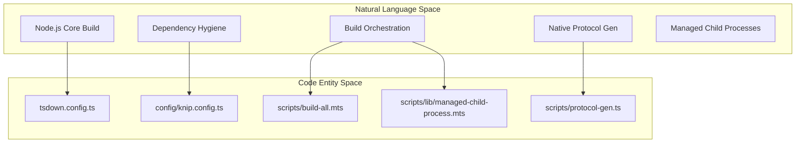
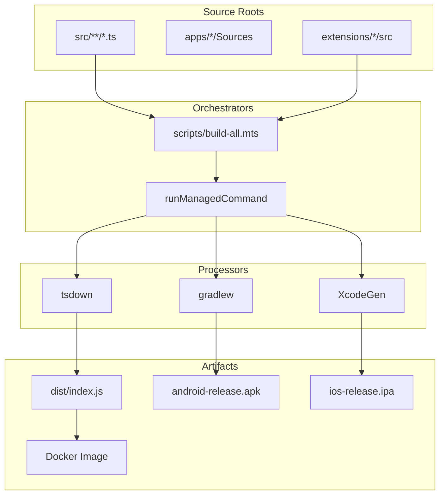

# Multi-Platform Build System

Relevant source files

The following files were used as context for generating this wiki page:

- [.github/actions/setup-node-env/action.yml](.github/actions/setup-node-env/action.yml)
- [.github/actions/setup-node-env/dependency-fingerprint.mjs](.github/actions/setup-node-env/dependency-fingerprint.mjs)
- [.github/release/vercel-cli/package-lock.json](.github/release/vercel-cli/package-lock.json)
- [.github/release/vercel-cli/package.json](.github/release/vercel-cli/package.json)
- [.github/retired-sticky-disks.json](.github/retired-sticky-disks.json)
- [.github/workflows/authorized-beta-focused-validation.yml](.github/workflows/authorized-beta-focused-validation.yml)
- [.github/workflows/docker-image-refresh.yml](.github/workflows/docker-image-refresh.yml)
- [.github/workflows/docker-release.yml](.github/workflows/docker-release.yml)
- [.github/workflows/vercel-container-registry-publish.yml](.github/workflows/vercel-container-registry-publish.yml)
- [.github/workflows/vitest-cache-warm.yml](.github/workflows/vitest-cache-warm.yml)
- [Dockerfile](Dockerfile)
- [config/knip.config.ts](config/knip.config.ts)
- [config/knip.scripts-exports.config.ts](config/knip.scripts-exports.config.ts)
- [docs/gateway/security/secure-file-operations.md](docs/gateway/security/secure-file-operations.md)
- [docs/start/setup.md](docs/start/setup.md)
- [extensions/canvas/openclaw.plugin.json](extensions/canvas/openclaw.plugin.json)
- [extensions/canvas/src/config.test.ts](extensions/canvas/src/config.test.ts)
- [extensions/canvas/src/config.ts](extensions/canvas/src/config.ts)
- [extensions/google-meet/index.create.test.ts](extensions/google-meet/index.create.test.ts)
- [extensions/google-meet/index.test.ts](extensions/google-meet/index.test.ts)
- [extensions/google-meet/src/plugin-schema.ts](extensions/google-meet/src/plugin-schema.ts)
- [extensions/google-meet/src/runtime.owner-selection.test.ts](extensions/google-meet/src/runtime.owner-selection.test.ts)
- [extensions/google-meet/src/runtime.ts](extensions/google-meet/src/runtime.ts)
- [extensions/google-meet/src/test-support/fixtures.test-helpers.ts](extensions/google-meet/src/test-support/fixtures.test-helpers.ts)
- [extensions/google-meet/src/transports/chrome.test.ts](extensions/google-meet/src/transports/chrome.test.ts)
- [extensions/google-meet/src/transports/chrome.ts](extensions/google-meet/src/transports/chrome.ts)
- [extensions/google-meet/test-api.ts](extensions/google-meet/test-api.ts)
- [extensions/linux-node/src/config.test.ts](extensions/linux-node/src/config.test.ts)
- [extensions/linux-node/src/config.ts](extensions/linux-node/src/config.ts)
- [extensions/matrix/src/matrix/send.test.ts](extensions/matrix/src/matrix/send.test.ts)
- [extensions/matrix/src/matrix/send/client.ts](extensions/matrix/src/matrix/send/client.ts)
- [extensions/memory-lancedb/config.test.ts](extensions/memory-lancedb/config.test.ts)
- [extensions/openai/test-support/provider-catalog.contract-test-support.ts](extensions/openai/test-support/provider-catalog.contract-test-support.ts)
- [extensions/qa-lab/package.json](extensions/qa-lab/package.json)
- [extensions/synology-chat/src/test-http-utils.ts](extensions/synology-chat/src/test-http-utils.ts)
- [packages/gateway-protocol/src/schema/frames.build-id.test.ts](packages/gateway-protocol/src/schema/frames.build-id.test.ts)
- [pnpm-lock.yaml](pnpm-lock.yaml)
- [pnpm-workspace.yaml](pnpm-workspace.yaml)
- [scripts/authorized-beta-focused-policy.json](scripts/authorized-beta-focused-policy.json)
- [scripts/build-all.mts](scripts/build-all.mts)
- [scripts/check-cli-bootstrap-imports.mts](scripts/check-cli-bootstrap-imports.mts)
- [scripts/docker-channel-promote.mjs](scripts/docker-channel-promote.mjs)
- [scripts/lib/build-artifact-cache.mts](scripts/lib/build-artifact-cache.mts)
- [scripts/lib/declaration-stage.mts](scripts/lib/declaration-stage.mts)
- [scripts/lib/dist-artifact-ownership.mts](scripts/lib/dist-artifact-ownership.mts)
- [scripts/lib/docker-manifest-error.mjs](scripts/lib/docker-manifest-error.mjs)
- [scripts/lib/docker-release-policy.mjs](scripts/lib/docker-release-policy.mjs)
- [scripts/lib/managed-child-process.mts](scripts/lib/managed-child-process.mts)
- [scripts/lib/repo-root.mjs](scripts/lib/repo-root.mjs)
- [scripts/lib/state-schema-inline-plugin.mts](scripts/lib/state-schema-inline-plugin.mts)
- [scripts/lib/tsdown-declaration-generator-inputs.mts](scripts/lib/tsdown-declaration-generator-inputs.mts)
- [scripts/lib/tsdown-declaration-inputs.mts](scripts/lib/tsdown-declaration-inputs.mts)
- [scripts/lib/vitest-resource-reporter.mts](scripts/lib/vitest-resource-reporter.mts)
- [scripts/lib/windows-cmd-helpers-runtime.mts](scripts/lib/windows-cmd-helpers-runtime.mts)
- [scripts/lib/worker-deploy-build-plugin.mts](scripts/lib/worker-deploy-build-plugin.mts)
- [scripts/materialize-vercel-cli.sh](scripts/materialize-vercel-cli.sh)
- [scripts/prepare-extension-package-boundary-artifacts.mts](scripts/prepare-extension-package-boundary-artifacts.mts)
- [scripts/prune-docker-plugin-dist.mjs](scripts/prune-docker-plugin-dist.mjs)
- [scripts/run-lint.mts](scripts/run-lint.mts)
- [scripts/run-node.mts](scripts/run-node.mts)
- [scripts/run-stylelint.mts](scripts/run-stylelint.mts)
- [scripts/runtime-postbuild.mts](scripts/runtime-postbuild.mts)
- [scripts/tsdown-build.mts](scripts/tsdown-build.mts)
- [scripts/validate-authorized-beta-focused-evidence.d.mts](scripts/validate-authorized-beta-focused-evidence.d.mts)
- [scripts/validate-authorized-beta-focused-evidence.mts](scripts/validate-authorized-beta-focused-evidence.mts)
- [scripts/vercel-container-registry-publish.mjs](scripts/vercel-container-registry-publish.mjs)
- [scripts/verify-authorized-beta-focused-candidate.mjs](scripts/verify-authorized-beta-focused-candidate.mjs)
- [scripts/write-build-info.ts](scripts/write-build-info.ts)
- [scripts/write-plugin-sdk-entry-dts.ts](scripts/write-plugin-sdk-entry-dts.ts)
- [scripts/write-unified-entry-dts.ts](scripts/write-unified-entry-dts.ts)
- [src/agents/embedded-agent-runner/model-resolution.ts](src/agents/embedded-agent-runner/model-resolution.ts)
- [src/agents/embedded-agent-runner/run/model-setup.ts](src/agents/embedded-agent-runner/run/model-setup.ts)
- [src/agents/mcp-tool-metadata.test.ts](src/agents/mcp-tool-metadata.test.ts)
- [src/agents/mcp-tool-metadata.ts](src/agents/mcp-tool-metadata.ts)
- [src/agents/tools-effective-inventory.cold-provider.test.ts](src/agents/tools-effective-inventory.cold-provider.test.ts)
- [src/agents/tools-effective-inventory.runtime-model.test.ts](src/agents/tools-effective-inventory.runtime-model.test.ts)
- [src/agents/tools-effective-inventory.ts](src/agents/tools-effective-inventory.ts)
- [src/dockerfile.test.ts](src/dockerfile.test.ts)
- [src/infra/run-node.test.ts](src/infra/run-node.test.ts)
- [src/node-host/invoke-mcp-result.test.ts](src/node-host/invoke-mcp-result.test.ts)
- [src/node-host/invoke-mcp-result.ts](src/node-host/invoke-mcp-result.ts)
- [src/node-host/invoke.test-support.ts](src/node-host/invoke.test-support.ts)
- [src/plugins/prune-docker-plugin-dist.test.ts](src/plugins/prune-docker-plugin-dist.test.ts)
- [src/shared/json-schema-defaults.test.ts](src/shared/json-schema-defaults.test.ts)
- [src/shared/json-schema-defaults.ts](src/shared/json-schema-defaults.ts)
- [test/helpers/fixture-lifetime.ts](test/helpers/fixture-lifetime.ts)
- [test/helpers/mac-native.ts](test/helpers/mac-native.ts)
- [test/helpers/mac-signing.ts](test/helpers/mac-signing.ts)
- [test/scripts/authorized-beta-focused-evidence.test.ts](test/scripts/authorized-beta-focused-evidence.test.ts)
- [test/scripts/build-all.test.ts](test/scripts/build-all.test.ts)
- [test/scripts/check-deadcode-exports.test.ts](test/scripts/check-deadcode-exports.test.ts)
- [test/scripts/declaration-stage.test.ts](test/scripts/declaration-stage.test.ts)
- [test/scripts/dist-artifact-ownership.test.ts](test/scripts/dist-artifact-ownership.test.ts)
- [test/scripts/docker-channel-promote.test.ts](test/scripts/docker-channel-promote.test.ts)
- [test/scripts/docker-release-policy.test.ts](test/scripts/docker-release-policy.test.ts)
- [test/scripts/fixture-lifetime.test.ts](test/scripts/fixture-lifetime.test.ts)
- [test/scripts/mac-elevation-artifact.test-support.ts](test/scripts/mac-elevation-artifact.test-support.ts)
- [test/scripts/mac-elevation-artifact.test.ts](test/scripts/mac-elevation-artifact.test.ts)
- [test/scripts/mac-native-fixtures.test-support.ts](test/scripts/mac-native-fixtures.test-support.ts)
- [test/scripts/mac-native-fixtures.test.ts](test/scripts/mac-native-fixtures.test.ts)
- [test/scripts/mac-node-worker.test.ts](test/scripts/mac-node-worker.test.ts)
- [test/scripts/managed-child-process.test.ts](test/scripts/managed-child-process.test.ts)
- [test/scripts/prepare-extension-package-boundary-artifacts.test.ts](test/scripts/prepare-extension-package-boundary-artifacts.test.ts)
- [test/scripts/tsdown-build.test.ts](test/scripts/tsdown-build.test.ts)
- [test/scripts/tsdown-config.test.ts](test/scripts/tsdown-config.test.ts)
- [test/scripts/tsdown-declaration-fixture.ts](test/scripts/tsdown-declaration-fixture.ts)
- [test/scripts/vercel-container-registry-publish.test.ts](test/scripts/vercel-container-registry-publish.test.ts)
- [test/scripts/worker-deploy-build-plugin.test.ts](test/scripts/worker-deploy-build-plugin.test.ts)
- [test/scripts/write-plugin-sdk-entry-dts.test.ts](test/scripts/write-plugin-sdk-entry-dts.test.ts)
- [test/tsconfig/tsconfig.core.test.ui-e2e.json](test/tsconfig/tsconfig.core.test.ui-e2e.json)
- [test/tsconfig/tsconfig.core.test.ui-pages.json](test/tsconfig/tsconfig.core.test.ui-pages.json)
- [test/vitest-performance-config.test.ts](test/vitest-performance-config.test.ts)
- [test/vitest/vitest.performance-config.ts](test/vitest/vitest.performance-config.ts)
- [tsdown.config.ts](tsdown.config.ts)
- [ui/package.json](ui/package.json)

This document details the OpenClaw multi-platform build system which compiles, packages, and produces distributable artifacts for the Node.js core, iOS/macOS native apps, Android native app, Linux companion app, and Docker containers. It covers the platform-specific tools and configurations employed: `tsdown` for Node.js builds, `XcodeGen` for iOS/macOS, Gradle for Android, and Tauri/Cargo for Linux.

---

## Build Target Matrix

OpenClaw supports several build targets. Each platform uses specialized build tools aligned with its environment and language requirements:

| Platform | Build Tool | Primary Language(s) | Output Artifacts | Config / Script Files |
| :------------- | :---------- | :------------------ | :---------------------------- | :------------------------------ |
| Node.js / CLI | `tsdown` | TypeScript | `dist/` JavaScript bundles | [tsdown.config.ts:1-10]() |
| iOS | `XcodeGen` | Swift 6.0 | `.ipa` installers | [scripts/ios-release-cut.ts:1-10]() |
| macOS | SwiftPM + Shell | Swift 6.0, Shell | `.app` bundles | [config/knip.config.ts:25-25]() |
| Android | Gradle | Kotlin | `.apk`, `.aab` | [config/knip.config.ts:21-21]() |
| Linux | Tauri / Cargo | Rust / TypeScript | `.AppImage`, `.deb` | `apps/linux/src-tauri/tauri.conf.json` |
| Docker | `docker buildx` | Node.js | Multi-arch Docker images | [Dockerfile:1-21]() |

**Sources:** [tsdown.config.ts:1-10](), [config/knip.config.ts:21-25](), [scripts/ios-release-cut.ts:1-10](), [Dockerfile:1-21]()

---

## Node.js Build Pipeline: `tsdown`

### Overview
OpenClaw uses `tsdown` to bundle the Node.js core, Plugin SDK, and bundled extensions into optimized output roots. The build configuration is defined in `tsdown.config.ts` [tsdown.config.ts:1-5]().

### Build Orchestration: `build-all.mts`
The root build process is orchestrated by `scripts/build-all.mts`, which manages a sequence of cache-aware steps [scripts/build-all.mts:74-167]().
- **Caching**: It uses `resolveBuildStepCacheState` to determine if a step can be skipped based on input hashes [scripts/build-all.mts:8-12]().
- **Parallelism**: The `runNodeStepsInParallel` function in `scripts/prepare-extension-package-boundary-artifacts.mts` allows concurrent execution of disjoint build tasks while maintaining prefix-tagged logs [scripts/prepare-extension-package-boundary-artifacts.mts:172-181]().
- **Memory Management**: The system dynamically calculates `max-old-space-size` based on cgroup limits (v1/v2) and physical RAM to prevent OOMs in constrained environments like Docker [scripts/tsdown-build.mts:52-71]().

### Build Configuration and Entrypoints
The `tsdown.config.ts` file defines the primary build parameters:
- **Dependency Handling**: Heavy or native dependencies like `sharp` and `node-pty` are excluded from bundling [tsdown.config.ts:145-150]().
- **Unified Worker Build**: A specialized `workerDeployBuildConfig` bundles the Gateway worker into `dist/worker/worker.js`, using `createStateSchemaInlinePlugin` to embed Zod schemas [tsdown.config.ts:180-201]().
- **Plugin SDK**: Canonical type definitions are generated and verified for the public SDK surface [scripts/build-all.mts:140-143]().

### Tooling and Hygiene
- **Knip**: Configuration in `config/knip.config.ts` audits the repository for unused files and exports, specifically tracking repository scripts and bundled plugins [config/knip.config.ts:1-133]().
- **Oxlint**: Enforces architectural boundaries (e.g., preventing illegal imports across package boundaries) via `scripts/oxlint-boundary-guards.mjs` [config/knip.config.ts:102-103]().
- **CI Environment**: `.github/actions/setup-node-env/action.yml` prepares the runner with Node, pnpm, and optional Bun, utilizing a `dependency-cache` to speed up `pnpm install` [.github/actions/setup-node-env/action.yml:1-55]().

**Sources:** [scripts/build-all.mts:1-167](), [tsdown.config.ts:1-201](), [scripts/tsdown-build.mts:52-71](), [config/knip.config.ts:1-133](), [.github/actions/setup-node-env/action.yml:1-55]()

---

## Native & Mobile Build Systems

### iOS and macOS (XcodeGen)
iOS and macOS builds rely on `XcodeGen` to generate `.xcodeproj` files from declarative specifications. 
- **Protocol Generation**: `scripts/protocol-gen.ts` generates Swift models from the TypeScript protocol definition to ensure type safety between the Node.js Gateway and native clients [config/knip.config.ts:106-107]().
- **Release Automation**: `scripts/ios-release-cut.ts` and `scripts/ios-release-signing.mts` manage the preparation and code-signing of Apple release artifacts [config/knip.config.ts:87-89]().

### Android (Gradle)
The Android app build is driven by Gradle. Release artifacts are generated via `apps/android/scripts/build-release-artifacts.ts`, which is tracked as a repository script root [config/knip.config.ts:21-21]().

### Linux (Tauri)
The Linux companion app uses Tauri v2. It includes a Rust-based backend and a TypeScript frontend. The build process integrates Gateway discovery via Bonjour and provides a bridge for the `linux-canvas` plugin.

**Sources:** [config/knip.config.ts:21-107](), [scripts/ios-release-cut.ts:1-10]()

---

## Docker Build System

The `Dockerfile` implements a multi-stage build to produce a minimal runtime image based on `bookworm-slim` [Dockerfile:1-18]().
- **Stage `workspace-deps`**: Extracts only `package.json` files to optimize layer caching [Dockerfile:30-63]().
- **Stage `build`**: Performs the full TypeScript build using `pnpm` and `tsdown` [Dockerfile:101-115]().
- **Plugin Selection**: The `OPENCLAW_EXTENSIONS` build argument allows including or excluding specific bundled plugins during the image build [Dockerfile:11-15]().

**Sources:** [Dockerfile:1-124]()

---

## Build System Architecture Mapping

### Build Entity Relationship Map

This diagram associates build requirements with the specific code entities responsible for them.

**Sources:** [tsdown.config.ts:1-10](), [config/knip.config.ts:1-10](), [scripts/build-all.mts:1-22](), [config/knip.config.ts:106-107](), [scripts/lib/managed-child-process.mts:1-20]()

---

### Multi-Platform Artifact Flow

This diagram illustrates the data flow from source to the final distributable artifacts across platforms, highlighting the role of the managed process supervisor.

**Sources:** [scripts/build-all.mts:74-167](), [scripts/lib/managed-child-process.mts:110-136](), [tsdown.config.ts:1-10](), [Dockerfile:1-124]()