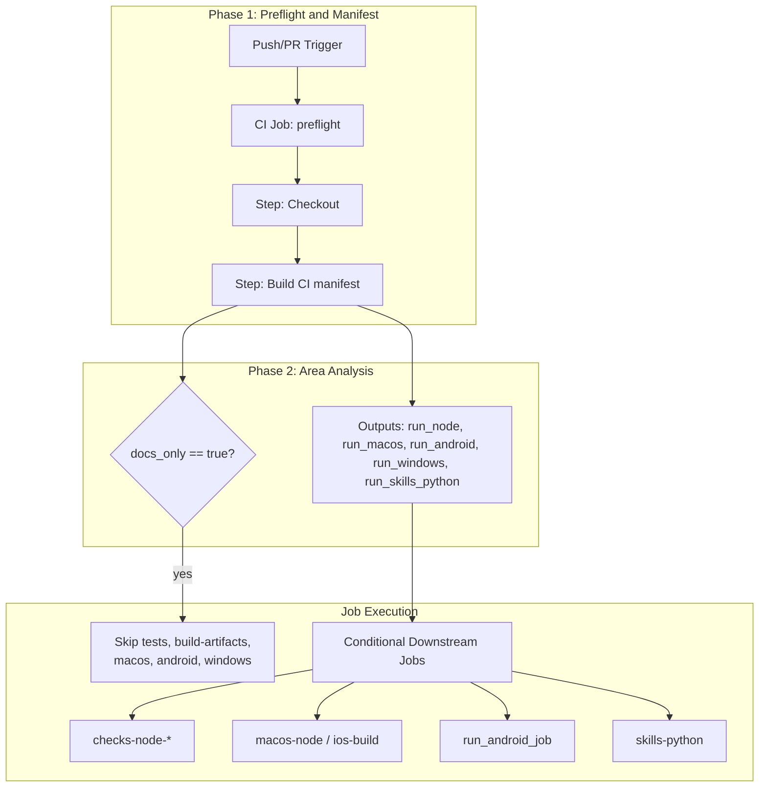
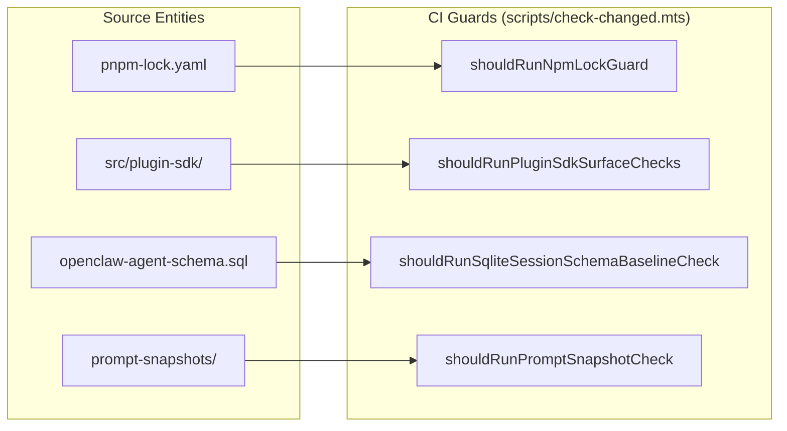

# CI/CD Pipeline

Relevant source files

The following files were used as context for generating this wiki page:

- [.agents/skills/openclaw-ci-limits/SKILL.md](.agents/skills/openclaw-ci-limits/SKILL.md)
- [.github/workflows/ci-test-timings-refit.yml](.github/workflows/ci-test-timings-refit.yml)
- [.github/workflows/ci.yml](.github/workflows/ci.yml)
- [config/ci-test-timings.json](config/ci-test-timings.json)
- [config/env-var-count-budget.txt](config/env-var-count-budget.txt)
- [config/knip.all-exports.config.ts](config/knip.all-exports.config.ts)
- [docs/ci.md](docs/ci.md)
- [docs/reference/test.md](docs/reference/test.md)
- [extensions/telegram/src/bot-message-dispatch-draft.ts](extensions/telegram/src/bot-message-dispatch-draft.ts)
- [extensions/telegram/src/bot-message-dispatch.draft-finalization.test.ts](extensions/telegram/src/bot-message-dispatch.draft-finalization.test.ts)
- [extensions/telegram/src/button-types.test.ts](extensions/telegram/src/button-types.test.ts)
- [extensions/telegram/src/button-types.ts](extensions/telegram/src/button-types.ts)
- [extensions/telegram/src/reasoning-lane-coordinator.ts](extensions/telegram/src/reasoning-lane-coordinator.ts)
- [package.json](package.json)
- [scripts/changed-lanes.mts](scripts/changed-lanes.mts)
- [scripts/check-assertion-safety-ratchet.mts](scripts/check-assertion-safety-ratchet.mts)
- [scripts/check-changed.mts](scripts/check-changed.mts)
- [scripts/check-env-var-count.mts](scripts/check-env-var-count.mts)
- [scripts/check-max-lines-ratchet.mts](scripts/check-max-lines-ratchet.mts)
- [scripts/check-script-erasability.mjs](scripts/check-script-erasability.mjs)
- [scripts/check.mts](scripts/check.mts)
- [scripts/ci-changed-scope.mjs](scripts/ci-changed-scope.mjs)
- [scripts/ci-refit-test-timings.mts](scripts/ci-refit-test-timings.mts)
- [scripts/ci-run-node-test-shard.mts](scripts/ci-run-node-test-shard.mts)
- [scripts/dev/tui-pty-test-watch.ts](scripts/dev/tui-pty-test-watch.ts)
- [scripts/e2e/parallels/macos-discord.ts](scripts/e2e/parallels/macos-discord.ts)
- [scripts/e2e/parallels/phase-runner.ts](scripts/e2e/parallels/phase-runner.ts)
- [scripts/lib/changed-path-facts.mjs](scripts/lib/changed-path-facts.mjs)
- [scripts/lib/ci-changed-node-test-plan.mts](scripts/lib/ci-changed-node-test-plan.mts)
- [scripts/lib/ci-node-test-plan.mts](scripts/lib/ci-node-test-plan.mts)
- [scripts/lib/ci-test-timings-schema.mts](scripts/lib/ci-test-timings-schema.mts)
- [scripts/lib/ci-test-timings.mts](scripts/lib/ci-test-timings.mts)
- [scripts/lib/extension-test-plan.mts](scripts/lib/extension-test-plan.mts)
- [scripts/lib/local-check-runtime.mts](scripts/lib/local-check-runtime.mts)
- [scripts/lib/shrink-ratchet.mts](scripts/lib/shrink-ratchet.mts)
- [scripts/lib/test-projects-delegation.mts](scripts/lib/test-projects-delegation.mts)
- [scripts/lib/tsdown-declaration-writer.mts](scripts/lib/tsdown-declaration-writer.mts)
- [scripts/lib/vitest-batch-runner.mts](scripts/lib/vitest-batch-runner.mts)
- [scripts/lib/vitest-build-prerequisites.mts](scripts/lib/vitest-build-prerequisites.mts)
- [scripts/lib/vitest-process.mts](scripts/lib/vitest-process.mts)
- [scripts/lib/vitest-report-capture.mts](scripts/lib/vitest-report-capture.mts)
- [scripts/lib/vitest-report-owner.mts](scripts/lib/vitest-report-owner.mts)
- [scripts/lib/vitest-shard-metadata.mts](scripts/lib/vitest-shard-metadata.mts)
- [scripts/lib/vitest-unhandled-errors.mts](scripts/lib/vitest-unhandled-errors.mts)
- [scripts/run-vitest-profile.mts](scripts/run-vitest-profile.mts)
- [scripts/run-vitest.mts](scripts/run-vitest.mts)
- [scripts/test-extension-batch.mts](scripts/test-extension-batch.mts)
- [scripts/test-live-shard.mts](scripts/test-live-shard.mts)
- [scripts/test-live.mts](scripts/test-live.mts)
- [scripts/test-projects-run.mts](scripts/test-projects-run.mts)
- [scripts/test-projects.mts](scripts/test-projects.mts)
- [scripts/test-projects.test-support.mts](scripts/test-projects.test-support.mts)
- [scripts/test-report-utils.mts](scripts/test-report-utils.mts)
- [scripts/vitest-process-group.mts](scripts/vitest-process-group.mts)
- [src/gateway/server.auth.control-ui.bootstrap-lifecycle.suite.ts](src/gateway/server.auth.control-ui.bootstrap-lifecycle.suite.ts)
- [src/gateway/server.auth.control-ui.device-token.suite.ts](src/gateway/server.auth.control-ui.device-token.suite.ts)
- [src/gateway/server.auth.control-ui.fixtures.test-support.ts](src/gateway/server.auth.control-ui.fixtures.test-support.ts)
- [src/gateway/server.auth.control-ui.mobile-bootstrap.suite.ts](src/gateway/server.auth.control-ui.mobile-bootstrap.suite.ts)
- [src/gateway/server.auth.control-ui.owner-bootstrap.suite.ts](src/gateway/server.auth.control-ui.owner-bootstrap.suite.ts)
- [src/gateway/server.auth.control-ui.pairing.suite.ts](src/gateway/server.auth.control-ui.pairing.suite.ts)
- [src/gateway/server.auth.control-ui.test.ts](src/gateway/server.auth.control-ui.test.ts)
- [src/gateway/server.auth.control-ui.trusted-proxy.suite.ts](src/gateway/server.auth.control-ui.trusted-proxy.suite.ts)
- [src/gateway/server.silent-scope-upgrade-reconnect.poc.test.ts](src/gateway/server.silent-scope-upgrade-reconnect.poc.test.ts)
- [src/node-host/node-worker-supervisor.lifetime.test.ts](src/node-host/node-worker-supervisor.lifetime.test.ts)
- [src/scripts/ci-changed-scope.test.ts](src/scripts/ci-changed-scope.test.ts)
- [src/scripts/ci-changed-scope.windows.test.ts](src/scripts/ci-changed-scope.windows.test.ts)
- [src/test-utils/vitest-spies.ts](src/test-utils/vitest-spies.ts)
- [test/e2e/qa-lab/runtime/doctor-auth-secretref-checks.e2e.test.ts](test/e2e/qa-lab/runtime/doctor-auth-secretref-checks.e2e.test.ts)
- [test/helpers/openclaw-test-instance.cli.test-support.mjs](test/helpers/openclaw-test-instance.cli.test-support.mjs)
- [test/helpers/openclaw-test-instance.test.ts](test/helpers/openclaw-test-instance.test.ts)
- [test/helpers/openclaw-test-instance.ts](test/helpers/openclaw-test-instance.ts)
- [test/package-scripts.test.ts](test/package-scripts.test.ts)
- [test/scripts/changed-lanes.test.ts](test/scripts/changed-lanes.test.ts)
- [test/scripts/changed-path-facts.test.ts](test/scripts/changed-path-facts.test.ts)
- [test/scripts/check-assertion-safety-ratchet.test.ts](test/scripts/check-assertion-safety-ratchet.test.ts)
- [test/scripts/check-env-var-count.test.ts](test/scripts/check-env-var-count.test.ts)
- [test/scripts/check-max-lines-ratchet.test.ts](test/scripts/check-max-lines-ratchet.test.ts)
- [test/scripts/check.test.ts](test/scripts/check.test.ts)
- [test/scripts/ci-changed-node-test-plan.test.ts](test/scripts/ci-changed-node-test-plan.test.ts)
- [test/scripts/ci-checkout.test-support.ts](test/scripts/ci-checkout.test-support.ts)
- [test/scripts/ci-git-owner.test-support.ts](test/scripts/ci-git-owner.test-support.ts)
- [test/scripts/ci-linux-git.test.ts](test/scripts/ci-linux-git.test.ts)
- [test/scripts/ci-node-test-plan.test.ts](test/scripts/ci-node-test-plan.test.ts)
- [test/scripts/ci-platform-checkout.test.ts](test/scripts/ci-platform-checkout.test.ts)
- [test/scripts/ci-run-node-test-shard.test.ts](test/scripts/ci-run-node-test-shard.test.ts)
- [test/scripts/ci-workflow-guards.test.ts](test/scripts/ci-workflow-guards.test.ts)
- [test/scripts/fixtures/ci-platform-checkout.mjs](test/scripts/fixtures/ci-platform-checkout.mjs)
- [test/scripts/mac-script-fixture.test-support.ts](test/scripts/mac-script-fixture.test-support.ts)
- [test/scripts/openclaw-performance-git-lifecycle.test.ts](test/scripts/openclaw-performance-git-lifecycle.test.ts)
- [test/scripts/openclaw-performance-workflow.test-support.ts](test/scripts/openclaw-performance-workflow.test-support.ts)
- [test/scripts/oxlint-config.test.ts](test/scripts/oxlint-config.test.ts)
- [test/scripts/run-vitest-bounded.test.ts](test/scripts/run-vitest-bounded.test.ts)
- [test/scripts/run-vitest-state-cleanup.test.ts](test/scripts/run-vitest-state-cleanup.test.ts)
- [test/scripts/run-vitest.test.ts](test/scripts/run-vitest.test.ts)
- [test/scripts/shrink-ratchet.test.ts](test/scripts/shrink-ratchet.test.ts)
- [test/scripts/test-extension.test.ts](test/scripts/test-extension.test.ts)
- [test/scripts/test-live.test.ts](test/scripts/test-live.test.ts)
- [test/scripts/test-projects-build-admission.test.ts](test/scripts/test-projects-build-admission.test.ts)
- [test/scripts/test-projects-empty-native.test.ts](test/scripts/test-projects-empty-native.test.ts)
- [test/scripts/test-projects.test.ts](test/scripts/test-projects.test.ts)
- [test/scripts/vitest-process-diagnostics.test.ts](test/scripts/vitest-process-diagnostics.test.ts)
- [test/scripts/vitest-process-group.test.ts](test/scripts/vitest-process-group.test.ts)
- [test/scripts/vitest-report-fixture.ts](test/scripts/vitest-report-fixture.ts)
- [test/scripts/vitest-report-owner.test.ts](test/scripts/vitest-report-owner.test.ts)
- [test/scripts/vitest-shard-timings.test.ts](test/scripts/vitest-shard-timings.test.ts)
- [test/scripts/vitest-worker-artifacts.test.ts](test/scripts/vitest-worker-artifacts.test.ts)
- [test/scripts/write-unified-entry-dts.test.ts](test/scripts/write-unified-entry-dts.test.ts)
- [test/tsconfig.json](test/tsconfig.json)

## Purpose and Scope

This document describes the OpenClaw continuous integration and deployment infrastructure, detailing its GitHub Actions workflows, the intelligent scope detection mechanism used to optimize job execution, test sharding strategies, platform-specific validation processes, and release automation. The CI/CD pipeline is designed to maintain high quality across Node.js, Android, iOS, macOS, and Linux components while minimizing build times through aggressive conditional execution and test parallelism.

Sources: [.github/workflows/ci.yml:1-12](), [docs/ci.md:1-9]()

## Overview

The OpenClaw CI pipeline is triggered on every push to `main` (ignoring documentation paths) and every non-draft pull request [[.github/workflows/ci.yml:57-63]](). It incorporates a multi-stage execution model, where lightweight "preflight" jobs identify whether subsequent resource-intensive platform-specific jobs should run.

The main workflows include:

*   **CI (`ci.yml`)**: The primary validation workflow running linting, tests, builds, and platform-specific tests [[.github/workflows/ci.yml:1-125]]().
*   **Workflow Sanity**: Ensures that workflow definitions themselves are valid and follow security best practices, such as pinning external actions to full commit SHAs (e.g., `actions/checkout@3d3c42e5...`) [[test/scripts/ci-workflow-guards.test.ts:54-62]]().
*   **Mantis Proofs**: Specialized workflows for messaging channel status reactions, attachments, and proof-of-delivery validation [[test/scripts/ci-workflow-guards.test.ts:63-67]]().
*   **Maturity Scorecard**: Automated validation of project maturity metrics and taxonomy [[test/scripts/ci-workflow-guards.test.ts:77-80]]().

Sources: [[.github/workflows/ci.yml:1-125]](), [[test/scripts/ci-workflow-guards.test.ts:1-86]](), [[docs/ci.md:11-31]]()

---

## Scope Detection System

To conserve CI resources and reduce turnaround times, OpenClaw implements a multi-phase detection system. It distinguishes documentation-only changes from code changes and further determines which parts of the system are affected.

### Scope Analysis Data Flow

Title: "CI Scope Detection and Manifest Generation"

Sources: [[.github/workflows/ci.yml:88-125]](), [[docs/ci.md:11-22]](), [[scripts/ci-changed-scope.mjs:16-41]]()

### Phase 1: Preflight and Routing

The `preflight` job establishes the routing truth for the entire run [[.github/workflows/ci.yml:88-94]](). It identifies `docs_only` changes, which allows the pipeline to bypass heavy platform tests [[docs/ci.md:11-12]](). The `preflight` job runs on `ubuntu-24.04` or `blacksmith-4vcpu-ubuntu-2404` depending on the repository context, author association, and runner availability [[.github/workflows/ci.yml:92]]().

### Phase 2: Area and Extension Detection

The preflight logic uses `detectChangedScope` from `scripts/ci-changed-scope.mjs` to inspect the git diff and set boolean flags for different platform lanes [[scripts/ci-changed-scope.mjs:25-41]]().

*   **Node Scope**: Triggered by changes to `src/`, `test/`, `extensions/`, `packages/`, or core config files like `package.json` [[scripts/ci-changed-scope.mjs:67-68]]().
*   **Native Scopes**: 
    *   `run_macos` is triggered by changes in `apps/macos/`, `apps/shared/`, or related Swift scripts [[scripts/ci-changed-scope.mjs:49-54]](). 
    *   `run_android` is triggered by `apps/android/` or `apps/shared/` [[scripts/ci-changed-scope.mjs:63]]().
*   **Windows Scope**: Specific triggers for Windows-only logic such as SQLite state handling [[scripts/ci-changed-scope.mjs:69]]() or Windows process identity proofs [[scripts/ci-changed-scope.mjs:75-76]]().
*   **Policy Test Targets**: The system resolves policy tests (e.g., `cursor-policy.node.test.ts`) whose scanned source surface intersects the diff using `resolvePolicyTestTargets`, even if the test file itself didn't change [[scripts/lib/ci-node-test-plan.mts:132-141]]().

Sources: [[.github/workflows/ci.yml:88-125]](), [[scripts/ci-changed-scope.mjs:1-79]](), [[scripts/lib/ci-node-test-plan.mts:86-150]]()

---

## Test Sharding and Validation Strategies

OpenClaw employs aggressive sharding and specialized validation scripts to maintain high coverage across a complex multi-platform codebase.

### Vitest Sharding and Execution

The repository uses a custom test planning system to manage `vitest` execution with specific watchdogs and environment normalization.

*   **Test Planning**: The CI manifest generates matrices for shards using `scripts/lib/ci-node-test-plan.mts` [[scripts/lib/ci-node-test-plan.mts:1-72]]().
*   **Shard Weighting**: Shards are assigned specific runners based on complexity. For example, `GATEWAY_STARTUP_CORE_RUNNER` uses `blacksmith-8vcpu-ubuntu-2404` to avoid module import stalls [[scripts/lib/ci-node-test-plan.mts:171-176]]().
*   **Contract Shards**: Weighted shards are dedicated to plugin and channel contracts to ensure messaging reliability [[docs/ci.md:43-44]]().
*   **Test Projects Selection**: The `buildVitestRunPlans` function in `scripts/test-projects.test-support.mts` resolves which specific project configurations and include patterns to run based on the changed files [[scripts/test-projects.test-support.mts:130-135]]().

### Remote Proof via Crabbox

For environment-sensitive tests (clean-machine, Docker, E2E), the pipeline supports delegation to `Crabbox` [[docs/reference/test.md:15-21]]().
*   **Hydration**: The Testbox workflow hydrates credentials for trusted runs [[docs/reference/test.md:19]]().
*   **Untrusted Proof**: Fork PRs use secretless CI or sanitized AWS Crabbox instances to prevent credential leakage [[docs/reference/test.md:39-56]]().

Sources: [[scripts/lib/ci-node-test-plan.mts:1-177]](), [[scripts/test-projects.test-support.mts:1-135]](), [[docs/reference/test.md:1-129]]()

---

## Quality Gates and Audits

### Security Gates
The CI incorporates security scanning via `zizmor` for GitHub Actions workflow auditing and production lockfile audit [[docs/ci.md:37]](). Secret detection is handled via `trufflehog` [[test/scripts/ci-workflow-guards.test.ts:68]]().

### CodeQL Critical Gates
Static analysis via CodeQL is integrated to enforce critical quality gates, ensuring that no high-severity vulnerabilities or logic regressions are introduced to the core gateway.

### Knip Dependency Audit
The `check-dependencies` job runs a production `Knip` dependency-only pass to maintain a clean dependency tree [[docs/ci.md:47]]().

### Change Guards
The `scripts/check-changed.mts` script orchestrates specific "owner" checks that must run when critical files change, such as:
*   **NPM Lock Guard**: Triggered by `pnpm-lock.yaml` changes [[scripts/check-changed.mts:88-89]]().
*   **Plugin SDK Surface**: Validates changes to the public API surface in `src/plugin-sdk/` [[scripts/check-changed.mts:104-105]]().
*   **Prompt Snapshots**: Ensures agent prompt behavior remains consistent when snapshot files or generation scripts change [[scripts/check-changed.mts:90-93]]().

Title: "Code Entity to CI Guard Mapping"

Sources: [[scripts/check-changed.mts:88-113]](), [[test/scripts/changed-lanes.test.ts:27-50]]()

---

## Performance & Infrastructure Optimization

OpenClaw CI leverages several advanced GitHub Actions features to optimize performance:

*   **Custom Runner Routing**: Pull requests from trusted authors (OWNER, MEMBER, COLLABORATOR, CONTRIBUTOR) are routed to high-performance Blacksmith runners [[.github/workflows/ci.yml:92]]().
*   **Two-Slot Main Pipeline**: Canonical `main` pushes use a non-canceling two-slot pipeline keyed by run-number parity (slots 'a' and 'b'), allowing two integration runs to overlap without canceling each other [[.github/workflows/ci.yml:71-73]](), [[docs/ci.md:13-16]]().
*   **Matrix Plan Optimization**: The `preflight` job generates a `qa_smoke_ci_matrix` and `checks_fast_core_matrix` to parallelize execution based on the specific changes detected [[.github/workflows/ci.yml:121-124]]().

Sources: [[.github/workflows/ci.yml:71-125]](), [[docs/ci.md:11-20]](), [[scripts/lib/ci-node-test-plan.mts:160-177]]()