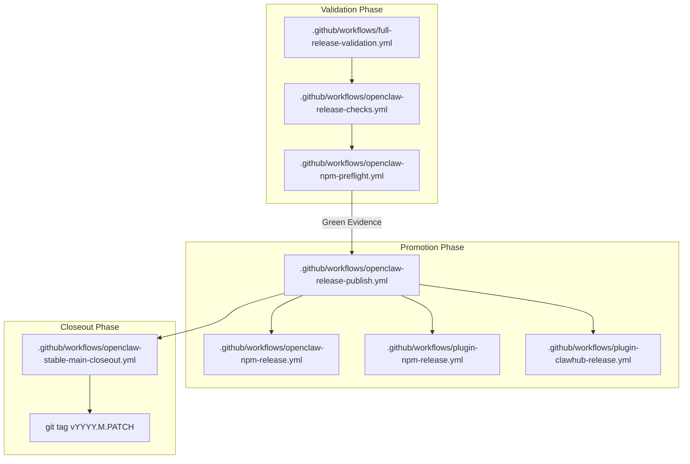
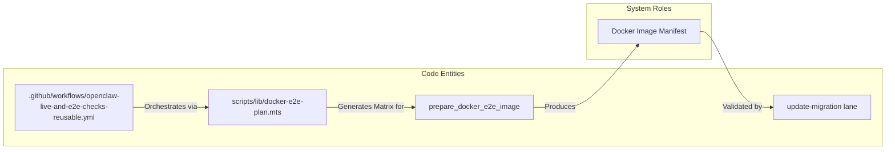

# Release Process

Relevant source files

The following files were used as context for generating this wiki page:

- [.agents/skills/openclaw-update/SKILL.md](.agents/skills/openclaw-update/SKILL.md)
- [.agents/skills/openclaw-update/agents/openai.yaml](.agents/skills/openclaw-update/agents/openai.yaml)
- [.agents/skills/release-openclaw-ci/SKILL.md](.agents/skills/release-openclaw-ci/SKILL.md)
- [.agents/skills/update-team-server/SKILL.md](.agents/skills/update-team-server/SKILL.md)
- [.github/actions/git-owner/release-ancestry.py](.github/actions/git-owner/release-ancestry.py)
- [.github/actions/publish-generated-pr/action.yml](.github/actions/publish-generated-pr/action.yml)
- [.github/actions/publish-generated-pr/policy.py](.github/actions/publish-generated-pr/policy.py)
- [.github/dependabot.yml](.github/dependabot.yml)
- [.github/labeler.yml](.github/labeler.yml)
- [.github/workflows/full-release-candidate.yml](.github/workflows/full-release-candidate.yml)
- [.github/workflows/full-release-validation.yml](.github/workflows/full-release-validation.yml)
- [.github/workflows/maturity-scorecard.yml](.github/workflows/maturity-scorecard.yml)
- [.github/workflows/openclaw-live-and-e2e-checks-reusable.yml](.github/workflows/openclaw-live-and-e2e-checks-reusable.yml)
- [.github/workflows/openclaw-npm-preflight.yml](.github/workflows/openclaw-npm-preflight.yml)
- [.github/workflows/openclaw-npm-release.yml](.github/workflows/openclaw-npm-release.yml)
- [.github/workflows/openclaw-release-checks.yml](.github/workflows/openclaw-release-checks.yml)
- [.github/workflows/openclaw-release-publish.yml](.github/workflows/openclaw-release-publish.yml)
- [.github/workflows/openclaw-release-telegram-qa.yml](.github/workflows/openclaw-release-telegram-qa.yml)
- [.github/workflows/openclaw-repo-e2e-reusable.yml](.github/workflows/openclaw-repo-e2e-reusable.yml)
- [.github/workflows/plugin-clawhub-new.yml](.github/workflows/plugin-clawhub-new.yml)
- [.github/workflows/plugin-clawhub-release.yml](.github/workflows/plugin-clawhub-release.yml)
- [.github/workflows/plugin-npm-release.yml](.github/workflows/plugin-npm-release.yml)
- [.github/workflows/plugin-prerelease.yml](.github/workflows/plugin-prerelease.yml)
- [.github/workflows/qa-profile-evidence.yml](.github/workflows/qa-profile-evidence.yml)
- [.npmrc](.npmrc)
- [CHANGELOG.md](CHANGELOG.md)
- [appcast.xml](appcast.xml)
- [docs/.i18n/glossary.zh-CN.json](docs/.i18n/glossary.zh-CN.json)
- [docs/.i18n/zh-Hans-navigation.json](docs/.i18n/zh-Hans-navigation.json)
- [docs/cli/attach.md](docs/cli/attach.md)
- [docs/concepts/memory-architecture.md](docs/concepts/memory-architecture.md)
- [docs/docs.json](docs/docs.json)
- [docs/plugins/reference/opencode-go.md](docs/plugins/reference/opencode-go.md)
- [docs/reference/RELEASING.md](docs/reference/RELEASING.md)
- [docs/reference/full-release-validation.md](docs/reference/full-release-validation.md)
- [docs/releases/2026.8.1.md](docs/releases/2026.8.1.md)
- [docs/releases/2026.8.2.md](docs/releases/2026.8.2.md)
- [docs/releases/2026.9.1.md](docs/releases/2026.9.1.md)
- [docs/releases/index.md](docs/releases/index.md)
- [extensions/opencode-go/README.md](extensions/opencode-go/README.md)
- [extensions/opencode-go/package.json](extensions/opencode-go/package.json)
- [scripts/check-deadcode-exports.mts](scripts/check-deadcode-exports.mts)
- [scripts/check-deadcode-unused-files.mts](scripts/check-deadcode-unused-files.mts)
- [scripts/full-release-validation-at-sha.mts](scripts/full-release-validation-at-sha.mts)
- [scripts/full-release-validation-policy.d.mts](scripts/full-release-validation-policy.d.mts)
- [scripts/full-release-validation-policy.mjs](scripts/full-release-validation-policy.mjs)
- [scripts/full-release-validation-state.mjs](scripts/full-release-validation-state.mjs)
- [scripts/generate-npm-package-lock.mts](scripts/generate-npm-package-lock.mts)
- [scripts/github/barnacle-auto-response.mjs](scripts/github/barnacle-auto-response.mjs)
- [scripts/github/find-reusable-release-validation.sh](scripts/github/find-reusable-release-validation.sh)
- [scripts/lib/bounded-command.mjs](scripts/lib/bounded-command.mjs)
- [scripts/lib/bounded-command.mts](scripts/lib/bounded-command.mts)
- [scripts/lib/openclaw-release-clawhub-plan.ts](scripts/lib/openclaw-release-clawhub-plan.ts)
- [scripts/lib/plugin-clawhub-release.ts](scripts/lib/plugin-clawhub-release.ts)
- [scripts/lib/plugin-npm-release.ts](scripts/lib/plugin-npm-release.ts)
- [scripts/lib/release-publish-children.sh](scripts/lib/release-publish-children.sh)
- [scripts/npm-preflight-tooling-identity.mjs](scripts/npm-preflight-tooling-identity.mjs)
- [scripts/npm-trusted-publisher-preflight.mjs](scripts/npm-trusted-publisher-preflight.mjs)
- [scripts/package-manifest.d.mts](scripts/package-manifest.d.mts)
- [scripts/package-manifest.mjs](scripts/package-manifest.mjs)
- [scripts/plan-release-workflow-matrix.mjs](scripts/plan-release-workflow-matrix.mjs)
- [scripts/plugin-clawhub-publish.sh](scripts/plugin-clawhub-publish.sh)
- [scripts/plugin-npm-publish.sh](scripts/plugin-npm-publish.sh)
- [scripts/release-candidate-checklist.mts](scripts/release-candidate-checklist.mts)
- [scripts/release-ci-summary.mjs](scripts/release-ci-summary.mjs)
- [scripts/release-plan-producer-core.mts](scripts/release-plan-producer-core.mts)
- [scripts/release-plan-producer.mts](scripts/release-plan-producer.mts)
- [scripts/release-telegram-provenance.sh](scripts/release-telegram-provenance.sh)
- [scripts/release-tooling-identity.d.mts](scripts/release-tooling-identity.d.mts)
- [scripts/release-tooling-identity.mjs](scripts/release-tooling-identity.mjs)
- [scripts/repo-e2e-artifacts.mts](scripts/repo-e2e-artifacts.mts)
- [scripts/validate-full-release-validation-evidence.mjs](scripts/validate-full-release-validation-evidence.mjs)
- [scripts/validate-release-publish-approval.mjs](scripts/validate-release-publish-approval.mjs)
- [src/agents/github-exec-credential.test.ts](src/agents/github-exec-credential.test.ts)
- [src/agents/internal-runtime-context.test.ts](src/agents/internal-runtime-context.test.ts)
- [src/agents/internal-runtime-context.ts](src/agents/internal-runtime-context.ts)
- [src/auto-reply/tokens.test.ts](src/auto-reply/tokens.test.ts)
- [src/auto-reply/tokens.ts](src/auto-reply/tokens.ts)
- [src/boards/board-generated-identity.test.ts](src/boards/board-generated-identity.test.ts)
- [src/boards/board-notices.ts](src/boards/board-notices.ts)
- [src/boards/board-store.test-support.ts](src/boards/board-store.test-support.ts)
- [src/infra/restart-handoff.test.ts](src/infra/restart-handoff.test.ts)
- [test/fixtures/plugin-prerelease-frozen-target/scripts/lib/extension-test-plan.mjs](test/fixtures/plugin-prerelease-frozen-target/scripts/lib/extension-test-plan.mjs)
- [test/fixtures/plugin-prerelease-frozen-target/test/vitest/vitest.extension-telegram.config.mjs](test/fixtures/plugin-prerelease-frozen-target/test/vitest/vitest.extension-telegram.config.mjs)
- [test/helpers/publishable-plugin-fixture.ts](test/helpers/publishable-plugin-fixture.ts)
- [test/package-manager-config.test.ts](test/package-manager-config.test.ts)
- [test/plugin-clawhub-release.test.ts](test/plugin-clawhub-release.test.ts)
- [test/plugin-npm-release.test.ts](test/plugin-npm-release.test.ts)
- [test/scripts/barnacle-auto-response.test.ts](test/scripts/barnacle-auto-response.test.ts)
- [test/scripts/check-deadcode-reporting.test.ts](test/scripts/check-deadcode-reporting.test.ts)
- [test/scripts/check-deadcode-unused-files.test.ts](test/scripts/check-deadcode-unused-files.test.ts)
- [test/scripts/ci-git-owner.test.ts](test/scripts/ci-git-owner.test.ts)
- [test/scripts/clawhub-parent-authorization.test.ts](test/scripts/clawhub-parent-authorization.test.ts)
- [test/scripts/docs-sync-publish.test.ts](test/scripts/docs-sync-publish.test.ts)
- [test/scripts/find-reusable-release-validation.test.ts](test/scripts/find-reusable-release-validation.test.ts)
- [test/scripts/full-release-validation-at-sha.test.ts](test/scripts/full-release-validation-at-sha.test.ts)
- [test/scripts/full-release-validation-continuation-workflow.test.ts](test/scripts/full-release-validation-continuation-workflow.test.ts)
- [test/scripts/full-release-validation-state.test.ts](test/scripts/full-release-validation-state.test.ts)
- [test/scripts/generate-npm-package-lock.test.ts](test/scripts/generate-npm-package-lock.test.ts)
- [test/scripts/npm-trusted-publisher-preflight.test.ts](test/scripts/npm-trusted-publisher-preflight.test.ts)
- [test/scripts/openclaw-npm-extended-stable-workflow.test.ts](test/scripts/openclaw-npm-extended-stable-workflow.test.ts)
- [test/scripts/openclaw-release-clawhub-runtime-state.test.ts](test/scripts/openclaw-release-clawhub-runtime-state.test.ts)
- [test/scripts/openclaw-release-telegram-qa-workflow.test.ts](test/scripts/openclaw-release-telegram-qa-workflow.test.ts)
- [test/scripts/package-acceptance-workflow.test.ts](test/scripts/package-acceptance-workflow.test.ts)
- [test/scripts/plugin-clawhub-new-workflow.test.ts](test/scripts/plugin-clawhub-new-workflow.test.ts)
- [test/scripts/plugin-npm-extended-stable-workflow.test.ts](test/scripts/plugin-npm-extended-stable-workflow.test.ts)
- [test/scripts/plugin-npm-publish.test.ts](test/scripts/plugin-npm-publish.test.ts)
- [test/scripts/plugin-prerelease-telegram-shards.test.ts](test/scripts/plugin-prerelease-telegram-shards.test.ts)
- [test/scripts/plugin-prerelease-test-plan.test.ts](test/scripts/plugin-prerelease-test-plan.test.ts)
- [test/scripts/plugin-release-git-lifecycle.test.ts](test/scripts/plugin-release-git-lifecycle.test.ts)
- [test/scripts/plugin-release-pretag-pack-check.test.ts](test/scripts/plugin-release-pretag-pack-check.test.ts)
- [test/scripts/qa-candidate-install-workflows.test.ts](test/scripts/qa-candidate-install-workflows.test.ts)
- [test/scripts/release-candidate-checklist.test.ts](test/scripts/release-candidate-checklist.test.ts)
- [test/scripts/release-ci-summary.test.ts](test/scripts/release-ci-summary.test.ts)
- [test/scripts/release-no-push-workflow.test.ts](test/scripts/release-no-push-workflow.test.ts)
- [test/scripts/release-plan-producer.test.ts](test/scripts/release-plan-producer.test.ts)
- [test/scripts/release-tooling-identity.test.ts](test/scripts/release-tooling-identity.test.ts)
- [test/scripts/release-workflow-matrix-plan.test.ts](test/scripts/release-workflow-matrix-plan.test.ts)
- [test/scripts/test-report-utils.test.ts](test/scripts/test-report-utils.test.ts)
- [test/scripts/validate-full-release-validation-evidence.test.ts](test/scripts/validate-full-release-validation-evidence.test.ts)
- [test/scripts/validate-release-publish-approval.test.ts](test/scripts/validate-release-publish-approval.test.ts)

This document describes the versioning strategy, release validation, and distribution process for OpenClaw releases across npm, Docker, and native platform channels (macOS, iOS, Android, and Linux).

## Purpose and Scope

The OpenClaw release process ensures coordinated delivery of the Node.js Gateway core and its various client implementations. This page covers:
- **CalVer Versioning**: The calendar-based scheme used for all project components.
- **npm Publication**: Validation and automated delivery via trusted publishing workflows.
- **Docker Delivery**: Creation of multi-architecture Docker images with manifest lists.
- **Native Releases**: Coordination of macOS/iOS app packaging and distribution.
- **Full Release Validation**: The umbrella process that orchestrates CI, Docker, and QA Lab validation before final promotion.

## CalVer Versioning Scheme

OpenClaw adopts **calendar versioning (CalVer)** following a monthly release-train pattern: `YYYY.M.PATCH[-beta.N]`.

### Version Components
- **YYYY.M**: Year and Month (non-zero-padded).
- **PATCH**: A sequential monthly release-train number, not a calendar day. Alpha-only tags do not advance this number.
- **Suffixes**: Supports `-beta.N` for prerelease, `-alpha.N` for nightlies, and `-N` for stable corrections.

### Release Lanes

| Lane | npm Tag | Description |
|---|---|---|
| **stable** | `latest` | Promoted regular release. |
| **extended-stable** | `extended-stable` | Trailing month's maintenance line. |
| **beta** | `beta` | Prerelease tags on npm. |
| **dev** | N/A | The moving head of `main` branch. |

Sources: [.github/workflows/openclaw-release-publish.yml:6-9](), [.github/workflows/openclaw-release-publish.yml:59-68](), [CHANGELOG.md:4-6]()

## Release Validation and Preflight

Before publication, the codebase undergoes "preflight" checks to ensure artifacts, changelogs, and version metadata are synchronized.

### Release Preflight Tasks
- **`prepare_openclaw_npm`**: A job in `openclaw-npm-preflight.yml` that ensures the Control UI release artifact is built and present [[test/scripts/openclaw-npm-extended-stable-workflow.test.ts:107-110]]().
- **Tideclaw Alpha Guard**: Specialized validation for alpha targets to ensure they maintain ancestry with their respective alpha branches [[test/scripts/openclaw-npm-extended-stable-workflow.test.ts:149-152]]().
- **Plugin SDK API Audit**: When a release changes the SDK, an 8-character digest from the Plugin SDK API diff report is required for acknowledgement [[.github/workflows/openclaw-release-publish.yml:14-18]]().
- **macOS Notarization Persistence**: macOS releases now retain signed artifacts and Apple submission IDs to allow interrupted notarization to resume without rebuilding [[CHANGELOG.md:10]]().

### Full Release Validation (FRV)
The `Full Release Validation` workflow acts as the release product-validation umbrella, utilizing child workflows to allow granular reruns [[docs/reference/full-release-validation.md:11-13]]().
- **Profiles**: Supports `beta`, `stable`, and `full` coverage profiles [[.github/workflows/full-release-validation.yml:61-67]]().
- **Execution Plan**: The parent run writes an immutable `full-release-execution-plan-<run-id>` artifact to track required coverage and child run attempts [[docs/reference/full-release-validation.md:60-65]]().
- **Evidence Reuse**: Can reuse matching green product validation for the same target or a changelog-only Release SHA [[.github/workflows/full-release-validation.yml:100-104]]().

Sources: [[.github/workflows/full-release-validation.yml:1-120]](), [[docs/reference/full-release-validation.md:1-126]](), [[.github/workflows/openclaw-release-publish.yml:1-30]](), [[CHANGELOG.md:10-12]]()

## npm and Plugin Publication

Publication is a structured CI/CD workflow requiring explicit evidence from validation gates.

### Release Coordination Workflow

### Release Guards
- **Evidence Requirements**: Core publication requires `preflight_run_id` and `full_release_validation_run_id` [[.github/workflows/openclaw-release-publish.yml:10-22]]().
- **Plugin Scopes**: Supports `selected` or `all-publishable` scopes for plugin npm distribution [[.github/workflows/openclaw-release-publish.yml:69-76]]().
- **Validation Decision**: The `Release Decision` logic verifies that target SHAs, evidence SHAs, and child tuples match before permitting a reused run to pass [[docs/reference/full-release-validation.md:73-76]]().

Sources: [[.github/workflows/openclaw-release-publish.yml:1-165]](), [[test/scripts/package-acceptance-workflow.test.ts:45-51]](), [[docs/reference/full-release-validation.md:73-92]]()

## Docker Release Process

OpenClaw produces official Docker images validated via the `OpenClaw Live And E2E Checks (Reusable)` workflow [[.github/workflows/openclaw-live-and-e2e-checks-reusable.yml:1-10]]().

### Image Lifecycle and Verification
- **Multi-arch Manifests**: Images are tested against multiple Docker scheduler lanes [[.github/workflows/openclaw-live-and-e2e-checks-reusable.yml:25-29]]().
- **Upgrade Survivor**: Validates state persistence and migration success (e.g., `update-migration` Docker lanes) [[.github/workflows/openclaw-live-and-e2e-checks-reusable.yml:35-39]]().
- **Live Media Runner**: The `ghcr.io/openclaw/openclaw-live-media-runner:ubuntu-24.04` image is utilized for live-media E2E testing [[test/scripts/package-acceptance-workflow.test.ts:38-39]]().

### Docker Release Entities

Sources: [[.github/workflows/openclaw-live-and-e2e-checks-reusable.yml:1-132]](), [[test/scripts/package-acceptance-workflow.test.ts:26-39]](), [[test/scripts/plugin-prerelease-test-plan.test.ts:8-14]]()

## Native Platform Releases

Native clients follow core versioning but utilize platform-specific distribution channels and verification requirements.

### Platform-Specific Assets
- **Windows Node**: Stable OpenClaw publication requires an exact `windows_node_tag` and a compact JSON map of pinned `windows_node_installer_digests` [[.github/workflows/openclaw-release-publish.yml:43-50]]().
- **Android**: Releases include specific chat agent selector improvements and chat code highlighting validated in the `android-release.yml` workflow [[CHANGELOG.md:20, 32]](), [[test/scripts/package-acceptance-workflow.test.ts:60]]().
- **macOS/iOS**: Managed via coordinated dispatch that ensures signed artifacts and Apple submission IDs are preserved [[CHANGELOG.md:10]]().

### QA Lab Verification
The `OpenClaw Release Checks` workflow provides a final check for live transports, including a `qa-live` matrix for Telegram, Discord, and Slack [[.github/workflows/openclaw-release-checks.yml:107-108]]().
- **Telegram Waiver**: A specific `telegram_waiver` input exists for approved integration exceptions in the stable 2026.8.1 lane [[.github/workflows/openclaw-release-checks.yml:74-78]]().
- **Live Suite Filters**: Allows focused recovery of failed shards by specifying exact suite IDs like `qa-live-discord` or `qa-live-slack` [[.github/workflows/openclaw-release-checks.yml:107-111]]().

Sources: [[.github/workflows/openclaw-release-publish.yml:43-50]](), [[.github/workflows/openclaw-release-checks.yml:1-137]](), [[test/scripts/package-acceptance-workflow.test.ts:45-65]](), [[CHANGELOG.md:10-33]]()