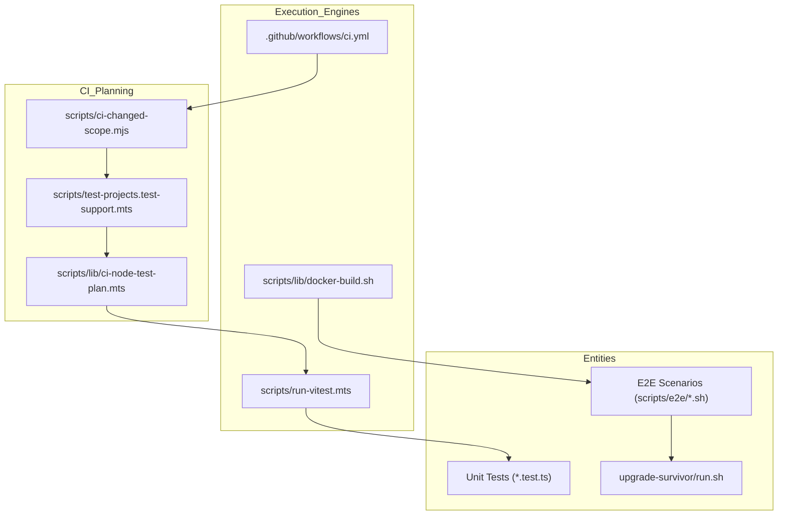
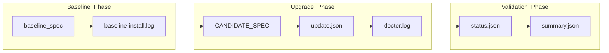

# Testing Strategy

Relevant source files

The following files were used as context for generating this wiki page:

- [.agents/skills/openclaw-ci-limits/SKILL.md](.agents/skills/openclaw-ci-limits/SKILL.md)
- [.github/workflows/ci-test-timings-refit.yml](.github/workflows/ci-test-timings-refit.yml)
- [.github/workflows/ci.yml](.github/workflows/ci.yml)
- [config/ci-test-timings.json](config/ci-test-timings.json)
- [config/knip.all-exports.config.ts](config/knip.all-exports.config.ts)
- [docs/ci.md](docs/ci.md)
- [package.json](package.json)
- [scripts/ci-changed-scope.mjs](scripts/ci-changed-scope.mjs)
- [scripts/ci-refit-test-timings.mts](scripts/ci-refit-test-timings.mts)
- [scripts/ci-run-node-test-shard.mts](scripts/ci-run-node-test-shard.mts)
- [scripts/dev/tui-pty-test-watch.ts](scripts/dev/tui-pty-test-watch.ts)
- [scripts/e2e/lib/clawhub-fixture-server.cjs](scripts/e2e/lib/clawhub-fixture-server.cjs)
- [scripts/e2e/lib/upgrade-survivor/assertions.mjs](scripts/e2e/lib/upgrade-survivor/assertions.mjs)
- [scripts/e2e/lib/upgrade-survivor/config-parking.mjs](scripts/e2e/lib/upgrade-survivor/config-parking.mjs)
- [scripts/e2e/lib/upgrade-survivor/config-recipe.mts](scripts/e2e/lib/upgrade-survivor/config-recipe.mts)
- [scripts/e2e/lib/upgrade-survivor/diagnostics.mjs](scripts/e2e/lib/upgrade-survivor/diagnostics.mjs)
- [scripts/e2e/lib/upgrade-survivor/run.sh](scripts/e2e/lib/upgrade-survivor/run.sh)
- [scripts/e2e/lib/upgrade-survivor/systemd-fixture.mjs](scripts/e2e/lib/upgrade-survivor/systemd-fixture.mjs)
- [scripts/e2e/lib/upgrade-survivor/update-restart-auth.sh](scripts/e2e/lib/upgrade-survivor/update-restart-auth.sh)
- [scripts/e2e/lib/upgrade-survivor/update-run-package-self-upgrade.sh](scripts/e2e/lib/upgrade-survivor/update-run-package-self-upgrade.sh)
- [scripts/e2e/update-run-package-self-upgrade-docker.sh](scripts/e2e/update-run-package-self-upgrade-docker.sh)
- [scripts/e2e/upgrade-survivor-docker.sh](scripts/e2e/upgrade-survivor-docker.sh)
- [scripts/lib/ci-changed-node-test-plan.mts](scripts/lib/ci-changed-node-test-plan.mts)
- [scripts/lib/ci-node-test-plan.mts](scripts/lib/ci-node-test-plan.mts)
- [scripts/lib/ci-test-timings-schema.mts](scripts/lib/ci-test-timings-schema.mts)
- [scripts/lib/ci-test-timings.mts](scripts/lib/ci-test-timings.mts)
- [scripts/lib/docker-e2e-plan.mts](scripts/lib/docker-e2e-plan.mts)
- [scripts/lib/docker-e2e-scenarios.mts](scripts/lib/docker-e2e-scenarios.mts)
- [scripts/lib/extension-test-plan.mts](scripts/lib/extension-test-plan.mts)
- [scripts/lib/local-check-runtime.mts](scripts/lib/local-check-runtime.mts)
- [scripts/lib/test-projects-delegation.mts](scripts/lib/test-projects-delegation.mts)
- [scripts/lib/tsdown-declaration-writer.mts](scripts/lib/tsdown-declaration-writer.mts)
- [scripts/lib/upgrade-survivor-diagnostics.sh](scripts/lib/upgrade-survivor-diagnostics.sh)
- [scripts/lib/upgrade-survivor-policy.d.mts](scripts/lib/upgrade-survivor-policy.d.mts)
- [scripts/lib/upgrade-survivor-policy.mjs](scripts/lib/upgrade-survivor-policy.mjs)
- [scripts/lib/vitest-batch-runner.mts](scripts/lib/vitest-batch-runner.mts)
- [scripts/lib/vitest-build-prerequisites.mts](scripts/lib/vitest-build-prerequisites.mts)
- [scripts/lib/vitest-process.mts](scripts/lib/vitest-process.mts)
- [scripts/lib/vitest-report-capture.mts](scripts/lib/vitest-report-capture.mts)
- [scripts/lib/vitest-report-owner.mts](scripts/lib/vitest-report-owner.mts)
- [scripts/lib/vitest-shard-metadata.mts](scripts/lib/vitest-shard-metadata.mts)
- [scripts/lib/vitest-unhandled-errors.mts](scripts/lib/vitest-unhandled-errors.mts)
- [scripts/run-vitest-profile.mts](scripts/run-vitest-profile.mts)
- [scripts/run-vitest.mts](scripts/run-vitest.mts)
- [scripts/test-extension-batch.mts](scripts/test-extension-batch.mts)
- [scripts/test-live-shard.mts](scripts/test-live-shard.mts)
- [scripts/test-live.mts](scripts/test-live.mts)
- [scripts/test-projects-run.mts](scripts/test-projects-run.mts)
- [scripts/test-projects.mts](scripts/test-projects.mts)
- [scripts/test-projects.test-support.mts](scripts/test-projects.test-support.mts)
- [scripts/test-report-utils.mts](scripts/test-report-utils.mts)
- [scripts/vitest-process-group.mts](scripts/vitest-process-group.mts)
- [src/node-host/node-worker-supervisor.lifetime.test.ts](src/node-host/node-worker-supervisor.lifetime.test.ts)
- [src/scripts/ci-changed-scope.test.ts](src/scripts/ci-changed-scope.test.ts)
- [src/scripts/ci-changed-scope.windows.test.ts](src/scripts/ci-changed-scope.windows.test.ts)
- [src/test-utils/vitest-spies.ts](src/test-utils/vitest-spies.ts)
- [test/e2e/qa-lab/runtime/doctor-auth-secretref-checks.e2e.test.ts](test/e2e/qa-lab/runtime/doctor-auth-secretref-checks.e2e.test.ts)
- [test/e2e/qa-lab/runtime/update-run-package-self-upgrade.test.ts](test/e2e/qa-lab/runtime/update-run-package-self-upgrade.test.ts)
- [test/helpers/openclaw-test-instance.cli.test-support.mjs](test/helpers/openclaw-test-instance.cli.test-support.mjs)
- [test/helpers/openclaw-test-instance.test.ts](test/helpers/openclaw-test-instance.test.ts)
- [test/helpers/openclaw-test-instance.ts](test/helpers/openclaw-test-instance.ts)
- [test/package-scripts.test.ts](test/package-scripts.test.ts)
- [test/scripts/ci-changed-node-test-plan.test.ts](test/scripts/ci-changed-node-test-plan.test.ts)
- [test/scripts/ci-checkout.test-support.ts](test/scripts/ci-checkout.test-support.ts)
- [test/scripts/ci-git-owner.test-support.ts](test/scripts/ci-git-owner.test-support.ts)
- [test/scripts/ci-linux-git.test.ts](test/scripts/ci-linux-git.test.ts)
- [test/scripts/ci-node-test-plan.test.ts](test/scripts/ci-node-test-plan.test.ts)
- [test/scripts/ci-platform-checkout.test.ts](test/scripts/ci-platform-checkout.test.ts)
- [test/scripts/ci-run-node-test-shard.test.ts](test/scripts/ci-run-node-test-shard.test.ts)
- [test/scripts/ci-workflow-guards.test.ts](test/scripts/ci-workflow-guards.test.ts)
- [test/scripts/clawhub-fixture-server.test.ts](test/scripts/clawhub-fixture-server.test.ts)
- [test/scripts/docker-build-helper.test.ts](test/scripts/docker-build-helper.test.ts)
- [test/scripts/docker-e2e-plan.test.ts](test/scripts/docker-e2e-plan.test.ts)
- [test/scripts/fixtures/ci-platform-checkout.mjs](test/scripts/fixtures/ci-platform-checkout.mjs)
- [test/scripts/mac-script-fixture.test-support.ts](test/scripts/mac-script-fixture.test-support.ts)
- [test/scripts/openclaw-performance-git-lifecycle.test.ts](test/scripts/openclaw-performance-git-lifecycle.test.ts)
- [test/scripts/openclaw-performance-workflow.test-support.ts](test/scripts/openclaw-performance-workflow.test-support.ts)
- [test/scripts/run-vitest-bounded.test.ts](test/scripts/run-vitest-bounded.test.ts)
- [test/scripts/run-vitest-state-cleanup.test.ts](test/scripts/run-vitest-state-cleanup.test.ts)
- [test/scripts/run-vitest.test.ts](test/scripts/run-vitest.test.ts)
- [test/scripts/test-extension.test.ts](test/scripts/test-extension.test.ts)
- [test/scripts/test-live.test.ts](test/scripts/test-live.test.ts)
- [test/scripts/test-projects-build-admission.test.ts](test/scripts/test-projects-build-admission.test.ts)
- [test/scripts/test-projects-empty-native.test.ts](test/scripts/test-projects-empty-native.test.ts)
- [test/scripts/test-projects.test.ts](test/scripts/test-projects.test.ts)
- [test/scripts/upgrade-survivor-assertions.test.ts](test/scripts/upgrade-survivor-assertions.test.ts)
- [test/scripts/upgrade-survivor-baseline-order.test.ts](test/scripts/upgrade-survivor-baseline-order.test.ts)
- [test/scripts/upgrade-survivor-config-parking.test.ts](test/scripts/upgrade-survivor-config-parking.test.ts)
- [test/scripts/upgrade-survivor-config-recipe.test.ts](test/scripts/upgrade-survivor-config-recipe.test.ts)
- [test/scripts/upgrade-survivor-systemd.test.ts](test/scripts/upgrade-survivor-systemd.test.ts)
- [test/scripts/upgrade-survivor-update-result.test.ts](test/scripts/upgrade-survivor-update-result.test.ts)
- [test/scripts/vitest-process-diagnostics.test.ts](test/scripts/vitest-process-diagnostics.test.ts)
- [test/scripts/vitest-process-group.test.ts](test/scripts/vitest-process-group.test.ts)
- [test/scripts/vitest-report-fixture.ts](test/scripts/vitest-report-fixture.ts)
- [test/scripts/vitest-report-owner.test.ts](test/scripts/vitest-report-owner.test.ts)
- [test/scripts/vitest-shard-timings.test.ts](test/scripts/vitest-shard-timings.test.ts)
- [test/scripts/vitest-worker-artifacts.test.ts](test/scripts/vitest-worker-artifacts.test.ts)
- [test/scripts/write-unified-entry-dts.test.ts](test/scripts/write-unified-entry-dts.test.ts)

OpenClaw employs a multi-dimensional testing strategy verifying core logic, platform integration, installer reliability, and upgrade resilience. The system utilizes containerized environments, Parallels VMs for cross-OS validation, and specialized QA scenario packs to ensure high confidence across macOS, Windows, and Linux.

---

## Test Framework & Configuration

OpenClaw uses **Vitest** for unit, integration, and functional testing. The suite is modularized into distinct configurations to balance execution speed and coverage depth.

### Test Configurations and Shards

Tests are organized into logical projects that allow for targeted execution based on the subsystem being modified. The `scripts/test-projects.test-support.mts` file serves as the central planning engine for these projects [test/scripts/test-projects.test.ts:33-35]().

| Configuration | Purpose |
|---------------|---------|
| `vitest.unit.config.ts` | Isolated logic tests for core modules and shared utilities [test/scripts/test-projects.test.ts:54](). |
| `vitest.unit-fast.config.ts` | Performance-optimized subset of unit tests avoiding expensive setup [scripts/test-projects.test-support.mts:82-87](). |
| `vitest.gateway.config.ts` | Umbrella configuration for Gateway server and core runtime tests [test/scripts/test-projects.test.ts:93](). |
| `vitest.extension-codex.config.ts` | Specialized tests for the Codex app-server harness and plugins [test/scripts/test-projects.test.ts:144](). |
| `vitest.tooling-isolated.config.ts` | Tests for repository scripts, build tools, and internal infrastructure [scripts/test-projects.test-support.mts:72-74](). |

### Changed Lane Routing

To optimize developer workflows, the system includes a `resolveChangedTargetPlan` utility that maps modified source files to their corresponding test targets [test/scripts/test-projects.test.ts:29](). This prevents running the entire suite for localized changes.

- **Lane Mapping**: Changes in specific directories trigger associated Vitest projects. For example, changes in `extensions/codex` trigger the `vitest.extension-codex.config.ts` plan [test/scripts/test-projects.test.ts:144-148]().
- **Prerequisite Detection**: The `resolveVitestPretestBuildMode` function determines if a test run requires a specialized private build (e.g., `private-qa` or `runtime`) based on the files modified [test/scripts/test-projects.test.ts:105-111]().
- **Policy Test Targets**: The `resolvePolicyTestTargets` function identifies tests that scan source trees to enforce policies (like CSS token usage or cron failures) even if they aren't directly imported by the changed code [scripts/lib/ci-node-test-plan.mts:132-141]().

**Sources:** [test/scripts/test-projects.test.ts:1-157](), [scripts/test-projects.test-support.mts:1-177](), [scripts/lib/ci-node-test-plan.mts:1-177]()

---

## CI Scope Detection

The CI pipeline uses `ci-changed-scope.mjs` to classify diffs and build the execution manifest. This prevents expensive native lanes (like iOS or Android builds) from running when only documentation or Node.js logic has changed [docs/ci.md:19-21]().

- **Scope Definitions**: Scopes like `runNode`, `runMacos`, `runAndroid`, and `runWindows` are determined by matching changed paths against regular expressions [scripts/ci-changed-scope.mjs:16-41]().
- **Native Triggers**: Changes in `apps/ios/` or `apps/shared/OpenClawKit/` trigger the `runIosBuild` scope [scripts/ci-changed-scope.mjs:57-58]().
- **Windows Specifics**: Changes to SQLite state management [scripts/ci-changed-scope.mjs:69]() or Windows-specific process identity logic [scripts/ci-changed-scope.mjs:75-76]() trigger the `runWindows` lane to prevent regressions in platform-specific behavior.

**Sources:** [docs/ci.md:1-47](), [scripts/ci-changed-scope.mjs:1-79]()

---

## E2E & Smoke Testing

### Docker-Based E2E Scenarios

The codebase contains a vast library of Docker-based E2E tests to simulate complex environment configurations. These are managed by the `scripts/lib/docker-e2e-scenarios.mts` inventory [test/scripts/docker-build-helper.test.ts:30]().

- **Scenario Library**: Coverage includes `openai-web-search-minimal-docker.sh` [test/scripts/docker-build-helper.test.ts:48](), `mcp-code-mode-gateway-docker.sh` [test/scripts/docker-build-helper.test.ts:61](), and `skill-install-docker.sh` [test/scripts/docker-build-helper.test.ts:73]().
- **Service Validation**: Tests often involve checking systemd unit properties for the Gateway daemon, such as `ActiveState` and `TasksCurrent` [test/scripts/docker-build-helper.test.ts:36-42]().

### Upgrade Survivor Testing

The `upgrade-survivor-docker.sh` suite ensures that an OpenClaw installation remains functional after an upgrade [test/scripts/docker-build-helper.test.ts:114]().

- **Harness Setup**: The `scripts/e2e/lib/upgrade-survivor/run.sh` script manages the lifecycle, including installing a baseline version (e.g., `openclaw@latest`) and upgrading to the current candidate [scripts/e2e/lib/upgrade-survivor/run.sh:71-73]().
- **Phase Validation**: The process tracks phases from `setup` through `healthz` and `readyz` checks [scripts/e2e/lib/upgrade-survivor/run.sh:85-100]().
- **Artifact Generation**: Detailed logs are captured for each step, including `gateway.log`, `status.json`, and `doctor.log` [scripts/e2e/lib/upgrade-survivor/run.sh:110-120]().

**Sources:** [test/scripts/docker-build-helper.test.ts:1-115](), [scripts/e2e/lib/upgrade-survivor/run.sh:1-169]()

---

## CI Workflow Guards

OpenClaw uses `ci-workflow-guards.test.ts` to validate the GitHub Actions `ci.yml` file itself, ensuring that security and routing logic remain intact [test/scripts/ci-workflow-guards.test.ts:1]().

- **Expression Evaluation**: The suite includes an `evaluateWorkflowExpression` helper to simulate GitHub Actions expression logic locally [test/scripts/ci-workflow-guards.test.ts:121-162]().
- **Shard Planning**: The `resolveShardPlans` function determines how Node.js tests are distributed across GitHub runners based on predicted execution time and runner capacity [test/scripts/ci-workflow-guards.test.ts:33]().

**Sources:** [test/scripts/ci-workflow-guards.test.ts:1-162]()

---

## Code Entity Mapping

### CI and Testing Orchestration

### Upgrade Survivor Data Flow

**Sources:** [scripts/e2e/lib/upgrade-survivor/run.sh:71-133](), [test/scripts/test-projects.test.ts:33-35](), [scripts/lib/ci-node-test-plan.mts:44-72]()