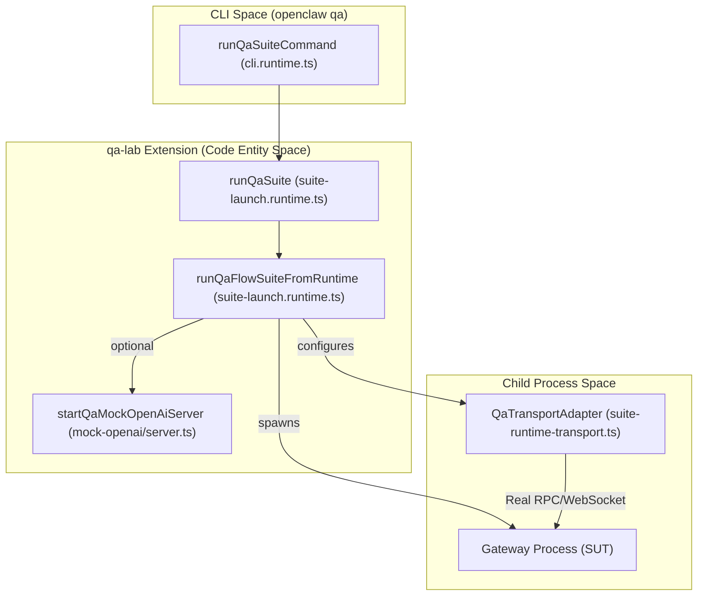
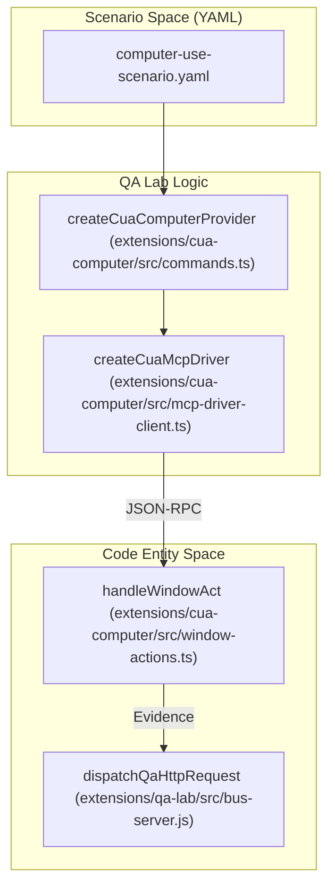

# QA Lab & Scenario Packs

Relevant source files

The following files were used as context for generating this wiki page:

- [docs/nodes/computer-use.md](docs/nodes/computer-use.md)
- [docs/platforms/mac/dev-setup.md](docs/platforms/mac/dev-setup.md)
- [extensions/cua-computer/api.ts](extensions/cua-computer/api.ts)
- [extensions/cua-computer/index.test.ts](extensions/cua-computer/index.test.ts)
- [extensions/cua-computer/index.ts](extensions/cua-computer/index.ts)
- [extensions/cua-computer/openclaw.plugin.json](extensions/cua-computer/openclaw.plugin.json)
- [extensions/cua-computer/package.json](extensions/cua-computer/package.json)
- [extensions/cua-computer/src/action-targets.ts](extensions/cua-computer/src/action-targets.ts)
- [extensions/cua-computer/src/actions.test.ts](extensions/cua-computer/src/actions.test.ts)
- [extensions/cua-computer/src/actions.ts](extensions/cua-computer/src/actions.ts)
- [extensions/cua-computer/src/browser-actions.test.ts](extensions/cua-computer/src/browser-actions.test.ts)
- [extensions/cua-computer/src/browser-actions.ts](extensions/cua-computer/src/browser-actions.ts)
- [extensions/cua-computer/src/commands.modifiers.test.ts](extensions/cua-computer/src/commands.modifiers.test.ts)
- [extensions/cua-computer/src/commands.test-helpers.ts](extensions/cua-computer/src/commands.test-helpers.ts)
- [extensions/cua-computer/src/commands.test.ts](extensions/cua-computer/src/commands.test.ts)
- [extensions/cua-computer/src/commands.ts](extensions/cua-computer/src/commands.ts)
- [extensions/cua-computer/src/cua-driver-contract.test-fixtures.ts](extensions/cua-computer/src/cua-driver-contract.test-fixtures.ts)
- [extensions/cua-computer/src/doctor.test.ts](extensions/cua-computer/src/doctor.test.ts)
- [extensions/cua-computer/src/doctor.ts](extensions/cua-computer/src/doctor.ts)
- [extensions/cua-computer/src/driver-client.test.ts](extensions/cua-computer/src/driver-client.test.ts)
- [extensions/cua-computer/src/driver-client.ts](extensions/cua-computer/src/driver-client.ts)
- [extensions/cua-computer/src/driver-result.test.ts](extensions/cua-computer/src/driver-result.test.ts)
- [extensions/cua-computer/src/driver-result.ts](extensions/cua-computer/src/driver-result.ts)
- [extensions/cua-computer/src/execution-resources.ts](extensions/cua-computer/src/execution-resources.ts)
- [extensions/cua-computer/src/frame.ts](extensions/cua-computer/src/frame.ts)
- [extensions/cua-computer/src/mcp-driver-client.test.ts](extensions/cua-computer/src/mcp-driver-client.test.ts)
- [extensions/cua-computer/src/mcp-driver-client.ts](extensions/cua-computer/src/mcp-driver-client.ts)
- [extensions/cua-computer/src/recording-actions.test.ts](extensions/cua-computer/src/recording-actions.test.ts)
- [extensions/cua-computer/src/window-actions.ts](extensions/cua-computer/src/window-actions.ts)
- [extensions/qa-lab/src/providers/mock-openai/mock-anthropic-messages.ts](extensions/qa-lab/src/providers/mock-openai/mock-anthropic-messages.ts)
- [extensions/qa-lab/src/providers/mock-openai/mock-anthropic-wire.ts](extensions/qa-lab/src/providers/mock-openai/mock-anthropic-wire.ts)
- [extensions/qa-lab/src/providers/mock-openai/mock-openai-assistant-text.ts](extensions/qa-lab/src/providers/mock-openai/mock-openai-assistant-text.ts)
- [extensions/qa-lab/src/providers/mock-openai/mock-openai-contracts.ts](extensions/qa-lab/src/providers/mock-openai/mock-openai-contracts.ts)
- [extensions/qa-lab/src/providers/mock-openai/mock-openai-events.test.ts](extensions/qa-lab/src/providers/mock-openai/mock-openai-events.test.ts)
- [extensions/qa-lab/src/providers/mock-openai/mock-openai-events.ts](extensions/qa-lab/src/providers/mock-openai/mock-openai-events.ts)
- [extensions/qa-lab/src/providers/mock-openai/mock-openai-input.ts](extensions/qa-lab/src/providers/mock-openai/mock-openai-input.ts)
- [extensions/qa-lab/src/providers/mock-openai/mock-openai-responses-websocket.ts](extensions/qa-lab/src/providers/mock-openai/mock-openai-responses-websocket.ts)
- [extensions/qa-lab/src/providers/mock-openai/mock-openai-stream.ts](extensions/qa-lab/src/providers/mock-openai/mock-openai-stream.ts)
- [extensions/qa-lab/src/providers/mock-openai/mock-openai-tooling.ts](extensions/qa-lab/src/providers/mock-openai/mock-openai-tooling.ts)
- [extensions/qa-lab/src/providers/mock-openai/server.anthropic-failure.test.ts](extensions/qa-lab/src/providers/mock-openai/server.anthropic-failure.test.ts)
- [extensions/qa-lab/src/providers/mock-openai/server.progress.test.ts](extensions/qa-lab/src/providers/mock-openai/server.progress.test.ts)
- [extensions/qa-lab/src/providers/mock-openai/server.responses-contract.test.ts](extensions/qa-lab/src/providers/mock-openai/server.responses-contract.test.ts)
- [extensions/qa-lab/src/providers/mock-openai/server.responses-input.test.ts](extensions/qa-lab/src/providers/mock-openai/server.responses-input.test.ts)
- [extensions/qa-lab/src/providers/mock-openai/server.responses-stream.test.ts](extensions/qa-lab/src/providers/mock-openai/server.responses-stream.test.ts)
- [extensions/qa-lab/src/providers/mock-openai/server.test.ts](extensions/qa-lab/src/providers/mock-openai/server.test.ts)
- [extensions/qa-lab/src/providers/mock-openai/server.ts](extensions/qa-lab/src/providers/mock-openai/server.ts)
- [extensions/qa-lab/src/scenario-catalog-channels.test.ts](extensions/qa-lab/src/scenario-catalog-channels.test.ts)
- [extensions/qa-lab/src/scenario-retained-final.test.ts](extensions/qa-lab/src/scenario-retained-final.test.ts)
- [extensions/qa-lab/src/subagent-forked-context.test.ts](extensions/qa-lab/src/subagent-forked-context.test.ts)
- [packages/gateway-client/package.json](packages/gateway-client/package.json)
- [packages/gateway-client/src/session-projection-run-event.ts](packages/gateway-client/src/session-projection-run-event.ts)
- [packages/gateway-protocol/package.json](packages/gateway-protocol/package.json)
- [packages/gateway-protocol/src/clawhub-trust-error-details.ts](packages/gateway-protocol/src/clawhub-trust-error-details.ts)
- [packages/gateway-protocol/src/protocol-value-normalization.ts](packages/gateway-protocol/src/protocol-value-normalization.ts)
- [packages/gateway-protocol/src/system-agent-error-details.ts](packages/gateway-protocol/src/system-agent-error-details.ts)
- [qa/scenarios/agents/subagent-completion-direct-fallback.yaml](qa/scenarios/agents/subagent-completion-direct-fallback.yaml)
- [qa/scenarios/agents/subagent-empty-completion-non-delivery.yaml](qa/scenarios/agents/subagent-empty-completion-non-delivery.yaml)
- [qa/scenarios/agents/subagent-fanout-synthesis.yaml](qa/scenarios/agents/subagent-fanout-synthesis.yaml)
- [qa/scenarios/agents/subagent-forked-context.yaml](qa/scenarios/agents/subagent-forked-context.yaml)
- [qa/scenarios/channels/qa-channel-failed-tool-terminal-finalization.yaml](qa/scenarios/channels/qa-channel-failed-tool-terminal-finalization.yaml)
- [qa/scenarios/channels/system-agent-delegation-generation.yaml](qa/scenarios/channels/system-agent-delegation-generation.yaml)
- [qa/scenarios/channels/telegram-empty-response-after-write-recovery.yaml](qa/scenarios/channels/telegram-empty-response-after-write-recovery.yaml)
- [qa/scenarios/channels/telegram-long-final-reuses-preview.yaml](qa/scenarios/channels/telegram-long-final-reuses-preview.yaml)
- [qa/scenarios/channels/telegram-long-final-three-chunks.yaml](qa/scenarios/channels/telegram-long-final-three-chunks.yaml)
- [qa/scenarios/channels/telegram-stream-final-single-message.yaml](qa/scenarios/channels/telegram-stream-final-single-message.yaml)
- [qa/scenarios/scheduling/cron-failed-tool-terminal-finalization.yaml](qa/scenarios/scheduling/cron-failed-tool-terminal-finalization.yaml)
- [scripts/check-channel-agnostic-boundaries.mts](scripts/check-channel-agnostic-boundaries.mts)
- [scripts/check-openclaw-package-tarball.mts](scripts/check-openclaw-package-tarball.mts)
- [scripts/package-mac-app.sh](scripts/package-mac-app.sh)
- [scripts/package-openclaw-for-docker.mts](scripts/package-openclaw-for-docker.mts)
- [scripts/stage-cua-driver-macos.sh](scripts/stage-cua-driver-macos.sh)
- [scripts/stage-mac-node-worker.sh](scripts/stage-mac-node-worker.sh)
- [src/agents/tools/computer-tool-guidance.test.ts](src/agents/tools/computer-tool-guidance.test.ts)
- [src/agents/tools/computer-tool-guidance.ts](src/agents/tools/computer-tool-guidance.ts)
- [src/agents/tools/computer-tool-node.ts](src/agents/tools/computer-tool-node.ts)
- [src/agents/tools/computer-tool-result.ts](src/agents/tools/computer-tool-result.ts)
- [src/agents/tools/computer-tool.context.test.ts](src/agents/tools/computer-tool.context.test.ts)
- [src/agents/tools/computer-tool.schema.test.ts](src/agents/tools/computer-tool.schema.test.ts)
- [src/agents/tools/computer-tool.test.ts](src/agents/tools/computer-tool.test.ts)
- [src/agents/tools/computer-tool.ts](src/agents/tools/computer-tool.ts)
- [src/agents/tools/computer-tool.v2.test.ts](src/agents/tools/computer-tool.v2.test.ts)
- [src/plugins/computer-use-contract.test.ts](src/plugins/computer-use-contract.test.ts)
- [src/plugins/computer-use-contract.ts](src/plugins/computer-use-contract.ts)
- [test/e2e/qa-lab/runtime/gateway-repeated-request-recovery.e2e.test.ts](test/e2e/qa-lab/runtime/gateway-repeated-request-recovery.e2e.test.ts)
- [test/e2e/qa-lab/runtime/otel-gateway-runtime.e2e.test.ts](test/e2e/qa-lab/runtime/otel-gateway-runtime.e2e.test.ts)
- [test/e2e/qa-lab/runtime/otel-model-call.test-support.ts](test/e2e/qa-lab/runtime/otel-model-call.test-support.ts)
- [test/e2e/qa-lab/runtime/otel-test-support.test.ts](test/e2e/qa-lab/runtime/otel-test-support.test.ts)
- [test/e2e/qa-lab/runtime/otel-test-support.ts](test/e2e/qa-lab/runtime/otel-test-support.ts)
- [test/e2e/qa-lab/runtime/package-openclaw-for-docker.e2e.test.ts](test/e2e/qa-lab/runtime/package-openclaw-for-docker.e2e.test.ts)
- [test/scripts/check-openclaw-package-tarball.test.ts](test/scripts/check-openclaw-package-tarball.test.ts)
- [test/scripts/mac-node-worker-materialization.test-support.ts](test/scripts/mac-node-worker-materialization.test-support.ts)
- [test/scripts/macos-native-test-launch.test.ts](test/scripts/macos-native-test-launch.test.ts)
- [test/scripts/package-mac-app.test.ts](test/scripts/package-mac-app.test.ts)
- [test/scripts/vitest-worker-artifacts.test-support.ts](test/scripts/vitest-worker-artifacts.test-support.ts)

The QA Lab is a specialized testing infrastructure within OpenClaw designed for high-fidelity automation and manual debugging of agent behaviors. Unlike standard unit tests, the QA Lab operates by spawning isolated Gateway instances, simulating real messaging transport layers, and executing complex multi-turn "Scenario Packs" that validate end-to-end agent logic across various model providers.

## Overview & Purpose

OpenClaw employs a multi-tiered testing strategy where the QA Lab serves as the bridge between developer unit tests and full production deployment. It complements existing suites by providing:

*   **Isolated Gateway Runtimes:** Each QA scenario runs in its own ephemeral Gateway environment with unique configuration and credential patches [extensions/qa-lab/src/scenario-catalog-channels.test.ts:147-152]().
*   **Transport Simulation & Realism:** Uses adapters to drive real channels (Telegram, WhatsApp, Discord, Slack) or synthetic ones via specific drivers like `crabline` [extensions/qa-lab/src/scenario-catalog-channels.test.ts:85-86]().
*   **Model Frontier Testing:** Validates agent performance on "frontier" models using real credentials leased via a central broker mechanism.
*   **Shared Live-Credential Leasing:** CI workflows use a credential broker to lease live API keys during CI runs, ensuring safe concurrent access to limited provider quotas.
*   **Mock Provider Backend:** The `qa-lab` includes a high-fidelity `mock-openai` server that simulates complex provider behaviors, including streaming, tool loops, and fault injection [extensions/qa-lab/src/providers/mock-openai/server.ts:1-27]().

### Component Architecture

The QA system is primarily implemented within the `qa-lab` extension, which orchestrates scenario execution, runtime setup, and integration with live transport lanes.

#### Diagram: QA Lab Execution Lifecycle

Sources: [extensions/qa-lab/src/providers/mock-openai/server.ts:108-112](), [extensions/qa-lab/src/scenario-catalog-channels.test.ts:8-10]().

---

## Scenario Packs & Structure

Scenario Packs are collections of structured test cases under the `./qa` directory. These suites describe typical agent interaction flows and expected behavior outcomes.

### Scenario Definition

Key properties for each scenario include:

*   **Coverage ID:** A unique string used for feature coverage tracking (e.g., `media.inbound-media-store`), validated against a two-part pattern `[category].[feature]` [extensions/qa-lab/src/scenario-catalog-channels.test.ts:163-164]().
*   **Execution Kind:** Scenarios can be defined as declarative `flow` steps or specific test files [extensions/qa-lab/src/scenario-catalog-channels.test.ts:17-22]().
*   **Suite Isolation:** Metadata in YAML can specify if a scenario requires an `isolated` worker, often due to gateway session or tool configuration requirements [extensions/qa-lab/src/scenario-catalog-channels.test.ts:130-131]().

### Mock Provider Capabilities

The `mock-openai` server in the QA Lab allows testing edge cases that are difficult to reproduce with live models:
*   **Compaction Retries:** Simulates context overflow and verifies the agent can recover after a context compaction event [extensions/qa-lab/src/providers/mock-openai/server.test.ts:81-86]().
*   **Fault Injection:** Injects specific errors like `QA_EMPTY_RESPONSE_EXHAUSTION` or `QA_REASONING_ONLY_RECOVERY` to test agent robustness [extensions/qa-lab/src/providers/mock-openai/server.test.ts:29-48]().
*   **Tool Search Fixtures:** Simulates tool discovery and execution failures [extensions/qa-lab/src/providers/mock-openai/server.ts:105-106]().

Sources: [extensions/qa-lab/src/providers/mock-openai/server.ts:28-60](), [extensions/qa-lab/src/providers/mock-openai/server.test.ts:1-12]().

---

## Runtime Parity Testing

A critical function of the QA Lab is ensuring parity between different agent runtimes and model provider implementations.

*   **Provider Variants:** The mock server classifies requests into `openai`, `anthropic`, or `unknown` based on the model string to ensure provider-specific wire logic is exercised [extensions/qa-lab/src/providers/mock-openai/mock-openai-contracts.ts:170-199]().
*   **Trajectory Capture:** The system captures `MockOpenAiRequestSnapshot` including prompts, tool outputs, and image inputs for later comparison [extensions/qa-lab/src/providers/mock-openai/mock-openai-contracts.ts:201-217]().
*   **Audio/Media Normalization:** Scenarios like `inbound-media-store-audio-transcription` verify that media assets are correctly handled across the channel-to-agent pipeline [extensions/qa-lab/src/scenario-catalog-channels.test.ts:157-171]().

Sources: [extensions/qa-lab/src/providers/mock-openai/mock-openai-contracts.ts:10-14](), [extensions/qa-lab/src/scenario-catalog-channels.test.ts:157-171]().

---

## Evidence & Reporting

The QA Lab generates rich evidence artifacts used for regression analysis and maturity tracking.

*   **Evidence Collection:** Test runners collect execution metadata, timing, and result status.
*   **Docker Integration:** E2E tests verify that the QA Lab infrastructure is correctly packaged within Docker artifacts, ensuring CI environments match developer setups [test/e2e/qa-lab/runtime/package-openclaw-for-docker.e2e.test.ts:1-30]().
*   **Artifact Inventory:** The build system tracks `package-dist-inventory` to ensure QA assets are present in release candidates [test/e2e/qa-lab/runtime/package-openclaw-for-docker.e2e.test.ts:12-13]().

#### Diagram: Computer Use QA Bridge

This diagram illustrates how the QA Lab validates the `computer-use` extension, bridging high-level scenario definitions to low-level driver RPCs.

Sources: [extensions/cua-computer/src/commands.ts:33-35](), [extensions/cua-computer/src/mcp-driver-client.ts:6-6](), [extensions/qa-lab/src/providers/mock-openai/server.ts:8-10]().

---

## Comparison with Other Test Suites

OpenClaw implements a multi-layered testing approach:

| Suite | Runner | Purpose | Location |
| :--- | :--- | :--- | :--- |
| **Unit Tests** | Vitest | Validation of unit logic and utilities | `*.test.ts` |
| **Scenario Packs** | QA Lab | Agent logic & multi-turn flow parity | `qa/scenarios/` [extensions/qa-lab/src/scenario-catalog-channels.test.ts:4-7]() |
| **Live Transport** | QA Lab | Real-world platform validation (Telegram, WhatsApp, etc.) | `extensions/qa-lab/src/providers/live-frontier/` |
| **Docker E2E** | Vitest | Validation of packaged artifacts and container runtime | `test/e2e/qa-lab/runtime/` [test/e2e/qa-lab/runtime/package-openclaw-for-docker.e2e.test.ts:1-30]() |
| **Mac App Tests** | Bash/Vitest | Validation of macOS Swift build and code signing | `test/scripts/package-mac-app.test.ts` [test/scripts/package-mac-app.test.ts:1-20]() |

Sources: [test/e2e/qa-lab/runtime/package-openclaw-for-docker.e2e.test.ts:1-30](), [test/scripts/package-mac-app.test.ts:1-20](), [extensions/qa-lab/src/scenario-catalog-channels.test.ts:4-7]().