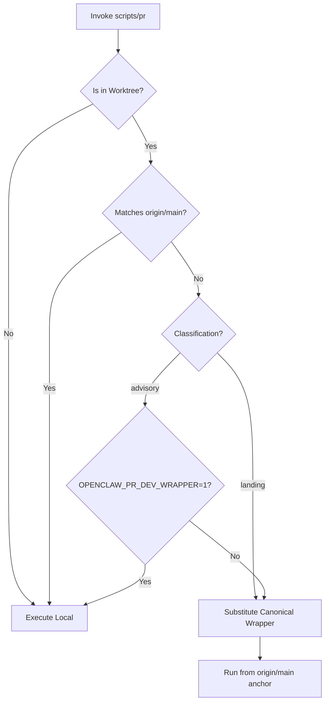
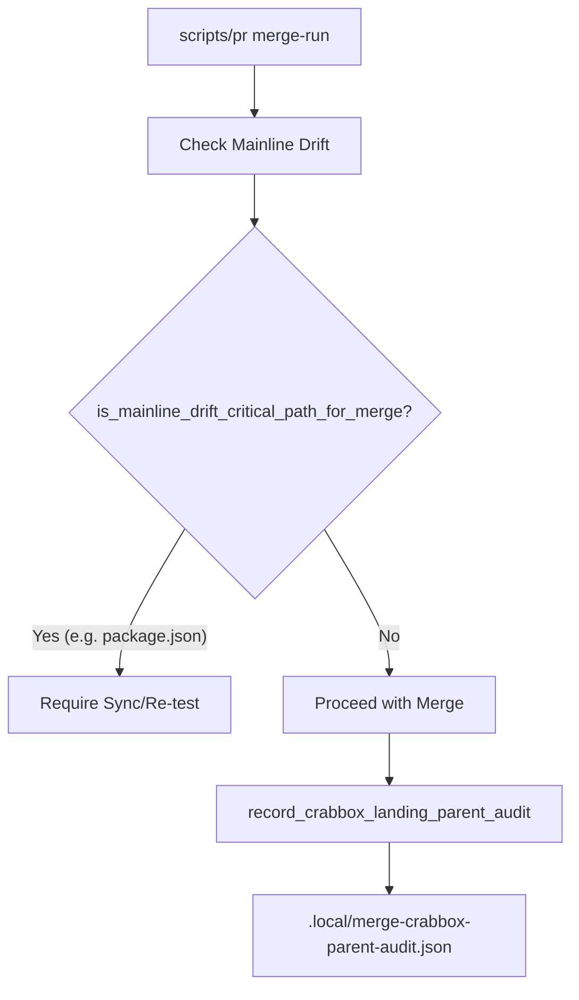

# Contributing

Relevant source files

The following files were used as context for generating this wiki page:

- [.agents/skills/auto-qa/SKILL.md](.agents/skills/auto-qa/SKILL.md)
- [.agents/skills/auto-qa/references/live-proof-routing.md](.agents/skills/auto-qa/references/live-proof-routing.md)
- [.agents/skills/control-ui-e2e/SKILL.md](.agents/skills/control-ui-e2e/SKILL.md)
- [.agents/skills/crabbox/SKILL.md](.agents/skills/crabbox/SKILL.md)
- [.agents/skills/openclaw-debugging/SKILL.md](.agents/skills/openclaw-debugging/SKILL.md)
- [.agents/skills/openclaw-pr-maintainer/SKILL.md](.agents/skills/openclaw-pr-maintainer/SKILL.md)
- [.agents/skills/openclaw-pr-maintainer/scripts/github-activity.sh](.agents/skills/openclaw-pr-maintainer/scripts/github-activity.sh)
- [.agents/skills/openclaw-repair-sweep/SKILL.md](.agents/skills/openclaw-repair-sweep/SKILL.md)
- [.agents/skills/openclaw-test-performance/SKILL.md](.agents/skills/openclaw-test-performance/SKILL.md)
- [.agents/skills/openclaw-testing/SKILL.md](.agents/skills/openclaw-testing/SKILL.md)
- [.agents/skills/openclaw-update/SKILL.md](.agents/skills/openclaw-update/SKILL.md)
- [.agents/skills/openclaw-update/agents/openai.yaml](.agents/skills/openclaw-update/agents/openai.yaml)
- [.agents/skills/release-openclaw-plugin-testing/SKILL.md](.agents/skills/release-openclaw-plugin-testing/SKILL.md)
- [.agents/skills/test-audit/SKILL.md](.agents/skills/test-audit/SKILL.md)
- [.agents/skills/update-team-server/SKILL.md](.agents/skills/update-team-server/SKILL.md)
- [.github/CODEOWNERS](.github/CODEOWNERS)
- [.github/labeler.yml](.github/labeler.yml)
- [AGENTS.md](AGENTS.md)
- [CHANGELOG.md](CHANGELOG.md)
- [CONTRIBUTING.md](CONTRIBUTING.md)
- [appcast.xml](appcast.xml)
- [docs/.i18n/glossary.zh-CN.json](docs/.i18n/glossary.zh-CN.json)
- [docs/.i18n/zh-Hans-navigation.json](docs/.i18n/zh-Hans-navigation.json)
- [docs/concepts/memory-architecture.md](docs/concepts/memory-architecture.md)
- [docs/docs.json](docs/docs.json)
- [docs/releases/2026.8.1.md](docs/releases/2026.8.1.md)
- [docs/releases/2026.8.2.md](docs/releases/2026.8.2.md)
- [docs/releases/2026.9.1.md](docs/releases/2026.9.1.md)
- [docs/releases/index.md](docs/releases/index.md)
- [extensions/memory-wiki/skills/wiki-maintainer/SKILL.md](extensions/memory-wiki/skills/wiki-maintainer/SKILL.md)
- [git-hooks/pre-commit](git-hooks/pre-commit)
- [scripts/AGENTS.md](scripts/AGENTS.md)
- [scripts/README.md](scripts/README.md)
- [scripts/github/barnacle-auto-response.mjs](scripts/github/barnacle-auto-response.mjs)
- [scripts/github/dependency-guard.mjs](scripts/github/dependency-guard.mjs)
- [scripts/github/guard-shared.mjs](scripts/github/guard-shared.mjs)
- [scripts/github/security-sensitive-guard.mjs](scripts/github/security-sensitive-guard.mjs)
- [scripts/pr](scripts/pr)
- [scripts/pr-lib/clawsweeper-review-gate.mjs](scripts/pr-lib/clawsweeper-review-gate.mjs)
- [scripts/pr-lib/common.sh](scripts/pr-lib/common.sh)
- [scripts/pr-lib/gates.sh](scripts/pr-lib/gates.sh)
- [scripts/pr-lib/merge-outcome.sh](scripts/pr-lib/merge-outcome.sh)
- [scripts/pr-lib/merge.sh](scripts/pr-lib/merge.sh)
- [scripts/pr-lib/prepare-core.sh](scripts/pr-lib/prepare-core.sh)
- [scripts/pr-lib/process-group-runner.mjs](scripts/pr-lib/process-group-runner.mjs)
- [scripts/pr-lib/push.sh](scripts/pr-lib/push.sh)
- [scripts/pr-lib/review.sh](scripts/pr-lib/review.sh)
- [scripts/pr-lib/worktree.sh](scripts/pr-lib/worktree.sh)
- [src/agents/internal-runtime-context.test.ts](src/agents/internal-runtime-context.test.ts)
- [src/agents/internal-runtime-context.ts](src/agents/internal-runtime-context.ts)
- [src/auto-reply/tokens.test.ts](src/auto-reply/tokens.test.ts)
- [src/auto-reply/tokens.ts](src/auto-reply/tokens.ts)
- [src/gateway/server/client-presence.test.ts](src/gateway/server/client-presence.test.ts)
- [src/infra/restart-handoff.test.ts](src/infra/restart-handoff.test.ts)
- [src/infra/system-presence.test.ts](src/infra/system-presence.test.ts)
- [src/infra/system-presence.ts](src/infra/system-presence.ts)
- [test/scripts/barnacle-auto-response.test.ts](test/scripts/barnacle-auto-response.test.ts)
- [test/scripts/clawsweeper-review-gate.test.ts](test/scripts/clawsweeper-review-gate.test.ts)
- [test/scripts/dependency-guard-script.test.ts](test/scripts/dependency-guard-script.test.ts)
- [test/scripts/dependency-guard-workflow.test.ts](test/scripts/dependency-guard-workflow.test.ts)
- [test/scripts/docs-sync-publish.test.ts](test/scripts/docs-sync-publish.test.ts)
- [test/scripts/github-activity-helper.test.ts](test/scripts/github-activity-helper.test.ts)
- [test/scripts/pr-cross-checkout.test.ts](test/scripts/pr-cross-checkout.test.ts)
- [test/scripts/pr-git-maintenance.test.ts](test/scripts/pr-git-maintenance.test.ts)
- [test/scripts/pr-main-refresh.test-support.ts](test/scripts/pr-main-refresh.test-support.ts)
- [test/scripts/pr-main-refresh.test.ts](test/scripts/pr-main-refresh.test.ts)
- [test/scripts/pr-merge-hosted.test.ts](test/scripts/pr-merge-hosted.test.ts)
- [test/scripts/pr-merge-outcome.test.ts](test/scripts/pr-merge-outcome.test.ts)
- [test/scripts/pr-merge.test.ts](test/scripts/pr-merge.test.ts)
- [test/scripts/pr-metadata.test.ts](test/scripts/pr-metadata.test.ts)
- [test/scripts/pr-operation-lock.test.ts](test/scripts/pr-operation-lock.test.ts)
- [test/scripts/pr-prepare-gates.test.ts](test/scripts/pr-prepare-gates.test.ts)
- [test/scripts/pr-review-artifact-fixture.ts](test/scripts/pr-review-artifact-fixture.ts)
- [test/scripts/pr-review-artifact-validation.test.ts](test/scripts/pr-review-artifact-validation.test.ts)
- [test/scripts/pr-worktree-containment.test.ts](test/scripts/pr-worktree-containment.test.ts)
- [test/scripts/pr-worktree-evidence.test.ts](test/scripts/pr-worktree-evidence.test.ts)
- [test/scripts/pr-wrappers.test.ts](test/scripts/pr-wrappers.test.ts)
- [test/scripts/security-sensitive-guard-script.test.ts](test/scripts/security-sensitive-guard-script.test.ts)
- [test/scripts/security-sensitive-guard-workflow.test.ts](test/scripts/security-sensitive-guard-workflow.test.ts)

This page covers contribution guidelines, pull request (PR) workflow, label system, and code review process for the OpenClaw project. It consolidates guidance from `CONTRIBUTING.md`, `AGENTS.md`, and the maintainer scripts that enforce these policies.

---

## Overview

OpenClaw is a multi-platform AI gateway. Contributions are welcomed for bug fixes, performance improvements, and new features that align with the core vision of a private, extensible AI assistant.

- **Bugs & small fixes:** Open a PR directly for small patches or bug fixes [CONTRIBUTING.md:19-19]().
- **New features / architecture:** Initiate discussion via GitHub Issue or Discord before large feature work. Most features should be third-party plugins using the SDK [CONTRIBUTING.md:20-20]().
- **Refactor-only PRs:** Generally not accepted unless requested by maintainers for specific fixes [CONTRIBUTING.md:21-21]().
- **CI/Test-only PRs:** Avoid PRs only to fix CI failures on `main`; maintainers will handle these [CONTRIBUTING.md:22-22]().

Sources: [CONTRIBUTING.md:17-24]()

---

## Pull Request Workflow

### Pre-Submission Requirements

Contributors and agents must adhere to the following before submitting or reviewing PRs:

- **Node Version:** The project currently uses **Node 22.22.2** for fresh CLI installs [CHANGELOG.md:73-73]().
- **Test Locally:** Always test changes with a local OpenClaw instance [CONTRIBUTING.md:51-51]().
- **PR Body Content:** External PRs must clearly describe the problem solved in "What Problem This Solves" and include validation evidence. This can include focused tests, CI results, screenshots, recordings, or artifact links [CONTRIBUTING.md:52-53]().
- **Maintainer Edits:** Enable "Allow edits by maintainers" for fork PRs to facilitate urgent fixes or merge preparation [CONTRIBUTING.md:54-54]().
- **Run Tests:** Execute `pnpm build && pnpm check && pnpm test` before submitting [CONTRIBUTING.md:56-56](). For extension changes, use `pnpm test:extension <extension-name>` [CONTRIBUTING.md:59-59]().
- **Verify dependencies:** Read upstream dependency docs/source/types before guessing API behavior [AGENTS.md:13-13]().
- **Use consistent wording:** Use "plugin" or "plugins" in user docs, changelogs, and UI; `extensions/` is kept internal [AGENTS.md:20-20]().
- **Codex Dependency Gate:** Any work touching Codex-related logic requires the acting agent to personally inspect sibling `../codex` source for protocol/runtime behavior before any verdict [AGENTS.md:14-14]().
- **Live Verification:** External API work requires live tests. Never print secrets [AGENTS.md:13-16]().

### Repair Doctrine

The repository follows a strict **Repair Doctrine** for all fixes and triages:
- **Root-cause repair** is the default. Do not mask root causes with consumer-only guards, retries, or larger timeouts [AGENTS.md:26-26](), [AGENTS.md:36-36]().
- **Pathfinder rule:** Leave touched code better than found. Fix unrelated small issues in the same PR or record them as follow-ups [AGENTS.md:34-34]().
- **State Ownership:** Repair invalid or leaked state at its producer or lifecycle owner; do not compensate downstream [AGENTS.md:31-31]().
- **Production LOC:** Production LOC is a first-class constraint. Prefer net-neutral or net-negative production changes [AGENTS.md:37-37](). Bug fixes default to net ≤0 [AGENTS.md:37-37]().

### PR Triage and Labeling

- **Labeler automation:** `.github/labeler.yml` auto-applies labels based on changed files for triage and CI [AGENTS.md:21-21]().
- **Maintainer Triage:** Issues and PRs are triaged using the `openclaw-pr-maintainer` skill. Maintainers decompose requests and assign explicit file ownership [.agents/skills/openclaw-pr-maintainer/SKILL.md:14-14]().
- **Opener Identity:** Triage summaries include the opener's account age and contribution activity across both OpenClaw and global GitHub [.agents/skills/openclaw-pr-maintainer/SKILL.md:3-3]().
- **PR Limits:** A hard limit of **20 open PRs per author** is enforced. Exceeding this triggers the `r: too-many-prs` label and auto-closing [CONTRIBUTING.md:44-44]().

Sources: [AGENTS.md:1-40](), [CONTRIBUTING.md:1-65](), [.agents/skills/openclaw-pr-maintainer/SKILL.md:1-30](), [CHANGELOG.md:73-73]()

---

## Maintainer Tooling & Security Boundaries

Maintainers use specific scripts and wrappers to manage PRs securely, ensuring untrusted code does not compromise the local environment.

### The `scripts/pr` Trust Anchor
The `scripts/pr` entrypoint acts as the single source of truth for the canonical-wrapper trust boundary [scripts/pr:12-14](). It classifies subcommands into two categories [scripts/pr:17-29]():
1.  **Advisory:** Commands like `ls` or `ci-dispatch` which may run from a mismatched local wrapper with explicit developer opt-in (`--dev-wrapper`).
2.  **Landing:** Critical commands like `merge-run`, `prepare-gates`, and `review-init` which **must** always use canonical code from the `origin/main` trust anchor.

### PR Operation Locking
To prevent concurrent mutations in shared worktrees, the system implements an operation lock using Git refs [scripts/AGENTS.md:23-23]().
- **Ref Pattern:** `refs/openclaw/pr-operation-locks/<pr-number>` [test/scripts/pr-operation-lock.test.ts:62-62]().
- **Serialization:** This ref serializes review, prepare, and merge operations per PR across linked worktrees [scripts/AGENTS.md:23-23]().

**PR Wrapper Trust Flow**

Sources: [scripts/pr:1-129](), [scripts/AGENTS.md:23-23](), [test/scripts/pr-operation-lock.test.ts:57-62]()

---

## Automated QA and Testing

### Remote Testbox (Crabbox)
For environment-sensitive proof (Docker, E2E, cross-platform), the system uses **Crabbox**.
- **Remote Execution:** `OPENCLAW_PR_GATES_REMOTE=testbox` runs the full-suite `pnpm test` gate on a Blacksmith Testbox [scripts/AGENTS.md:24-24]().
- **Sanitized Execution:** `crabbox-aws` is used as a fallback for admin-approved credentialed execution [scripts/AGENTS.md:25-25]().
- **Verification:** The `scripts/pr-lib/ci-dispatch.mjs` synchronously dispatches the protected-main publisher and waits for exact-head checks [scripts/AGENTS.md:25-25]().

### Mainline Drift Audit
During the merge process, OpenClaw performs a **Mainline Drift Audit**. If the `main` branch moves between the start of the QA run and the final merge, the system detects this drift [scripts/pr-lib/merge.sh:125-176]().
- **Critical Paths:** Changes to `package.json`, `pnpm-lock.yaml`, `scripts/*`, or `.github/workflows/*` are considered critical and require a mandatory re-sync if drift is detected [scripts/pr-lib/merge.sh:1-9]().
- **Audit Logging:** The system records the result in `.local/merge-crabbox-parent-audit.json` [scripts/pr-lib/merge.sh:32-33]().

**Merge Safety Verification**

Sources: [scripts/AGENTS.md:24-25](), [scripts/pr-lib/merge.sh:1-176](), [test/scripts/pr-merge-outcome.test.ts:120-143]()