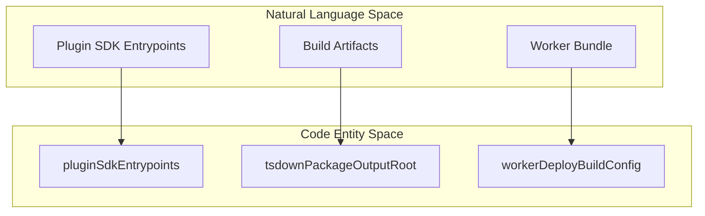

# Project Structure

<details>
<summary>Relevant source files</summary>

The following files were used as context for generating this wiki page:

- [.agents/skills/auto-qa/SKILL.md](.agents/skills/auto-qa/SKILL.md)
- [.agents/skills/auto-qa/references/live-proof-routing.md](.agents/skills/auto-qa/references/live-proof-routing.md)
- [.agents/skills/control-ui-e2e/SKILL.md](.agents/skills/control-ui-e2e/SKILL.md)
- [.agents/skills/crabbox/SKILL.md](.agents/skills/crabbox/SKILL.md)
- [.agents/skills/openclaw-debugging/SKILL.md](.agents/skills/openclaw-debugging/SKILL.md)
- [.agents/skills/openclaw-pr-maintainer/SKILL.md](.agents/skills/openclaw-pr-maintainer/SKILL.md)
- [.agents/skills/openclaw-pr-maintainer/scripts/github-activity.sh](.agents/skills/openclaw-pr-maintainer/scripts/github-activity.sh)
- [.agents/skills/openclaw-repair-sweep/SKILL.md](.agents/skills/openclaw-repair-sweep/SKILL.md)
- [.agents/skills/openclaw-test-performance/SKILL.md](.agents/skills/openclaw-test-performance/SKILL.md)
- [.agents/skills/openclaw-testing/SKILL.md](.agents/skills/openclaw-testing/SKILL.md)
- [.agents/skills/release-openclaw-plugin-testing/SKILL.md](.agents/skills/release-openclaw-plugin-testing/SKILL.md)
- [.agents/skills/test-audit/SKILL.md](.agents/skills/test-audit/SKILL.md)
- [.github/CODEOWNERS](.github/CODEOWNERS)
- [.github/release/vercel-cli/package-lock.json](.github/release/vercel-cli/package-lock.json)
- [.github/release/vercel-cli/package.json](.github/release/vercel-cli/package.json)
- [.github/workflows/authorized-beta-focused-validation.yml](.github/workflows/authorized-beta-focused-validation.yml)
- [.github/workflows/docker-image-refresh.yml](.github/workflows/docker-image-refresh.yml)
- [.github/workflows/docker-release.yml](.github/workflows/docker-release.yml)
- [.github/workflows/vercel-container-registry-publish.yml](.github/workflows/vercel-container-registry-publish.yml)
- [AGENTS.md](AGENTS.md)
- [CONTRIBUTING.md](CONTRIBUTING.md)
- [Dockerfile](Dockerfile)
- [config/knip.config.ts](config/knip.config.ts)
- [config/knip.scripts-exports.config.ts](config/knip.scripts-exports.config.ts)
- [docs/gateway/security/secure-file-operations.md](docs/gateway/security/secure-file-operations.md)
- [extensions/canvas/openclaw.plugin.json](extensions/canvas/openclaw.plugin.json)
- [extensions/canvas/src/config.test.ts](extensions/canvas/src/config.test.ts)
- [extensions/canvas/src/config.ts](extensions/canvas/src/config.ts)
- [extensions/google-meet/index.create.test.ts](extensions/google-meet/index.create.test.ts)
- [extensions/google-meet/index.test.ts](extensions/google-meet/index.test.ts)
- [extensions/google-meet/src/plugin-schema.ts](extensions/google-meet/src/plugin-schema.ts)
- [extensions/google-meet/src/runtime.owner-selection.test.ts](extensions/google-meet/src/runtime.owner-selection.test.ts)
- [extensions/google-meet/src/runtime.ts](extensions/google-meet/src/runtime.ts)
- [extensions/google-meet/src/test-support/fixtures.test-helpers.ts](extensions/google-meet/src/test-support/fixtures.test-helpers.ts)
- [extensions/google-meet/src/transports/chrome.test.ts](extensions/google-meet/src/transports/chrome.test.ts)
- [extensions/google-meet/src/transports/chrome.ts](extensions/google-meet/src/transports/chrome.ts)
- [extensions/google-meet/test-api.ts](extensions/google-meet/test-api.ts)
- [extensions/linux-node/src/config.test.ts](extensions/linux-node/src/config.test.ts)
- [extensions/linux-node/src/config.ts](extensions/linux-node/src/config.ts)
- [extensions/matrix/src/matrix/send.test.ts](extensions/matrix/src/matrix/send.test.ts)
- [extensions/matrix/src/matrix/send/client.ts](extensions/matrix/src/matrix/send/client.ts)
- [extensions/memory-lancedb/config.test.ts](extensions/memory-lancedb/config.test.ts)
- [extensions/memory-wiki/skills/wiki-maintainer/SKILL.md](extensions/memory-wiki/skills/wiki-maintainer/SKILL.md)
- [extensions/openai/test-support/provider-catalog.contract-test-support.ts](extensions/openai/test-support/provider-catalog.contract-test-support.ts)
- [extensions/qa-lab/package.json](extensions/qa-lab/package.json)
- [extensions/synology-chat/src/test-http-utils.ts](extensions/synology-chat/src/test-http-utils.ts)
- [git-hooks/pre-commit](git-hooks/pre-commit)
- [pnpm-lock.yaml](pnpm-lock.yaml)
- [pnpm-workspace.yaml](pnpm-workspace.yaml)
- [scripts/README.md](scripts/README.md)
- [scripts/authorized-beta-focused-policy.json](scripts/authorized-beta-focused-policy.json)
- [scripts/docker-channel-promote.mjs](scripts/docker-channel-promote.mjs)
- [scripts/github/dependency-guard.mjs](scripts/github/dependency-guard.mjs)
- [scripts/github/guard-shared.mjs](scripts/github/guard-shared.mjs)
- [scripts/github/security-sensitive-guard.mjs](scripts/github/security-sensitive-guard.mjs)
- [scripts/lib/docker-manifest-error.mjs](scripts/lib/docker-manifest-error.mjs)
- [scripts/lib/docker-release-policy.mjs](scripts/lib/docker-release-policy.mjs)
- [scripts/lib/state-schema-inline-plugin.mts](scripts/lib/state-schema-inline-plugin.mts)
- [scripts/lib/tsdown-declaration-generator-inputs.mts](scripts/lib/tsdown-declaration-generator-inputs.mts)
- [scripts/lib/tsdown-declaration-inputs.mts](scripts/lib/tsdown-declaration-inputs.mts)
- [scripts/lib/vitest-resource-reporter.mts](scripts/lib/vitest-resource-reporter.mts)
- [scripts/lib/windows-cmd-helpers-runtime.mts](scripts/lib/windows-cmd-helpers-runtime.mts)
- [scripts/lib/worker-deploy-build-plugin.mts](scripts/lib/worker-deploy-build-plugin.mts)
- [scripts/materialize-vercel-cli.sh](scripts/materialize-vercel-cli.sh)
- [scripts/prune-docker-plugin-dist.mjs](scripts/prune-docker-plugin-dist.mjs)
- [scripts/validate-authorized-beta-focused-evidence.d.mts](scripts/validate-authorized-beta-focused-evidence.d.mts)
- [scripts/validate-authorized-beta-focused-evidence.mts](scripts/validate-authorized-beta-focused-evidence.mts)
- [scripts/vercel-container-registry-publish.mjs](scripts/vercel-container-registry-publish.mjs)
- [scripts/verify-authorized-beta-focused-candidate.mjs](scripts/verify-authorized-beta-focused-candidate.mjs)
- [scripts/write-unified-entry-dts.ts](scripts/write-unified-entry-dts.ts)
- [src/agents/embedded-agent-runner/model-resolution.ts](src/agents/embedded-agent-runner/model-resolution.ts)
- [src/agents/embedded-agent-runner/run/model-setup.ts](src/agents/embedded-agent-runner/run/model-setup.ts)
- [src/agents/mcp-tool-metadata.test.ts](src/agents/mcp-tool-metadata.test.ts)
- [src/agents/mcp-tool-metadata.ts](src/agents/mcp-tool-metadata.ts)
- [src/agents/tools-effective-inventory.cold-provider.test.ts](src/agents/tools-effective-inventory.cold-provider.test.ts)
- [src/agents/tools-effective-inventory.runtime-model.test.ts](src/agents/tools-effective-inventory.runtime-model.test.ts)
- [src/agents/tools-effective-inventory.ts](src/agents/tools-effective-inventory.ts)
- [src/dockerfile.test.ts](src/dockerfile.test.ts)
- [src/node-host/invoke-mcp-result.test.ts](src/node-host/invoke-mcp-result.test.ts)
- [src/node-host/invoke-mcp-result.ts](src/node-host/invoke-mcp-result.ts)
- [src/node-host/invoke.test-support.ts](src/node-host/invoke.test-support.ts)
- [src/plugins/prune-docker-plugin-dist.test.ts](src/plugins/prune-docker-plugin-dist.test.ts)
- [src/shared/json-schema-defaults.test.ts](src/shared/json-schema-defaults.test.ts)
- [src/shared/json-schema-defaults.ts](src/shared/json-schema-defaults.ts)
- [test/scripts/authorized-beta-focused-evidence.test.ts](test/scripts/authorized-beta-focused-evidence.test.ts)
- [test/scripts/check-deadcode-exports.test.ts](test/scripts/check-deadcode-exports.test.ts)
- [test/scripts/declaration-stage.test.ts](test/scripts/declaration-stage.test.ts)
- [test/scripts/dependency-guard-script.test.ts](test/scripts/dependency-guard-script.test.ts)
- [test/scripts/dependency-guard-workflow.test.ts](test/scripts/dependency-guard-workflow.test.ts)
- [test/scripts/docker-channel-promote.test.ts](test/scripts/docker-channel-promote.test.ts)
- [test/scripts/docker-release-policy.test.ts](test/scripts/docker-release-policy.test.ts)
- [test/scripts/github-activity-helper.test.ts](test/scripts/github-activity-helper.test.ts)
- [test/scripts/security-sensitive-guard-script.test.ts](test/scripts/security-sensitive-guard-script.test.ts)
- [test/scripts/security-sensitive-guard-workflow.test.ts](test/scripts/security-sensitive-guard-workflow.test.ts)
- [test/scripts/tsdown-config.test.ts](test/scripts/tsdown-config.test.ts)
- [test/scripts/tsdown-declaration-fixture.ts](test/scripts/tsdown-declaration-fixture.ts)
- [test/scripts/vercel-container-registry-publish.test.ts](test/scripts/vercel-container-registry-publish.test.ts)
- [test/scripts/worker-deploy-build-plugin.test.ts](test/scripts/worker-deploy-build-plugin.test.ts)
- [test/tsconfig/tsconfig.core.test.ui-e2e.json](test/tsconfig/tsconfig.core.test.ui-e2e.json)
- [test/tsconfig/tsconfig.core.test.ui-pages.json](test/tsconfig/tsconfig.core.test.ui-pages.json)
- [tsdown.config.ts](tsdown.config.ts)
- [ui/package.json](ui/package.json)

</details>


OpenClaw is architected as a high-density monorepo designed for multi-platform AI gateway operations. This page documents the repository layout, the `pnpm` workspace management strategy, and the specialized subsystems that facilitate agent execution, native client integration, and quality assurance.

---

## Monorepo Organization

The repository uses **pnpm workspaces** to manage the core gateway, shared packages, and a large library of extensions. The workspace configuration includes the root, the UI, and wildcard paths for packages, extensions, and examples. [pnpm-workspace.yaml:1-7]()

### Repository Layout

| Directory | Role | Key Files / Subsystems |
| :--- | :--- | :--- |
| `src/` | Core Runtime | Gateway logic, agent execution pipeline, and session management. |
| `apps/` | Native Clients | iOS, macOS (Swift), Android (Kotlin), and Linux (Tauri) codebases. [config/knip.config.ts:21-25]() |
| `extensions/` | Plugins | Messaging channels, model providers, and internal tools like `qa-lab`. [config/knip.config.ts:8-8](), [pnpm-workspace.yaml:5-5]() |
| `packages/` | Shared Libraries | `@openclaw/ai`, `@openclaw/sdk`, and internal utilities. [pnpm-workspace.yaml:4-4]() |
| `ui/` | Control UI | Browser-based management interface built with Lit and A2UI components. [pnpm-workspace.yaml:3-3](), [ui/package.json:1-49]() |
| `skills/` | Skill Library | Bundled `SKILL.md` definitions for agent capabilities (e.g., `.agents/skills/`). [.agents/skills/openclaw-pr-maintainer/SKILL.md:1-6]() |
| `qa/` | Scenario Packs | Dialogue assets and test suites for the `qa-lab` extension. [config/knip.config.ts:118-119]() |
| `vendor/` | Standards | External standards like `a2ui` (Agent-to-User Interface) consumed for UI rendering. [pnpm-workspace.yaml:43-44]() |
| `.pi/` | Dev Helpers | Harnesses for local agent logic testing and debugging. |
| `config/` | Tooling Config | Shared configurations for `knip`, `oxlint`, `vitest`, and `tsdown`. [config/knip.config.ts:1-6]() |

### Workspace Infrastructure Diagram

```mermaid
graph TD
    subgraph Monorepo_Root["Monorepo Root (pnpm)"]
        [Root] -- "Config" --> [pnpm-workspace.yaml]
        [Root] -- "Core Logic" --> [src/]
        [Root] -- "Tooling Config" --> [config/]
    end

    subgraph Workspaces["Workspaces"]
        [pnpm-workspace.yaml] --> [extensions/*]
        [pnpm-workspace.yaml] --> [apps/*]
        [pnpm-workspace.yaml] --> [packages/*]
        [pnpm-workspace.yaml] --> [ui/]
    end

    subgraph Specialized_Assets["Specialized Assets"]
        [Root] --> [skills/]
        [Root] --> [qa/]
        [Root] -- "Vendor Standards" --> [a2ui]
        [Root] --> [.pi/]
    end

    [extensions/*] -- "Plugin Logic" --> [plugins]
```

Sources: [pnpm-workspace.yaml:1-7](), [config/knip.config.ts:7-15](), [ui/package.json:1-7]()

---

## Build System and Tooling

OpenClaw uses a custom build pipeline powered by `tsdown` to handle the complexity of bundling Node.js modules, workers, and plugin SDKs.

### Distribution and Build
The build process is managed via `tsdown.config.ts`, which defines entrypoints for the core gateway, worker threads, and the plugin SDK. [tsdown.config.ts:1-30]()

Key build features include:
- **Unified Config Groups**: The build system uses `TSDOWN_UNIFIED_CONFIG_GROUP` to coordinate multi-target builds. [tsdown.config.ts:182-182]()
- **Worker Bundling**: Specialized configurations for `worker/worker` ensure that worker scripts are bundled with their dependencies for isolated execution. [tsdown.config.ts:180-183](), [test/scripts/tsdown-config.test.ts:39-40]()
- **DTS Generation**: The system handles declaration file generation unless skipped via `OPENCLAW_RUN_NODE_SKIP_DTS_BUILD`. [tsdown.config.ts:66-67]()

### Dependency Hygiene
The repository uses `knip` to enforce dependency hygiene, ensuring that bundled plugins and core logic do not have unused or missing dependencies. It explicitly tracks repository script entries that are executable roots rather than importable modules. [config/knip.config.ts:1-16]()



Sources: [tsdown.config.ts:13-25](), [config/knip.config.ts:1-16](), [tsdown.config.ts:180-201]()

---

## QA Lab & Scenario Management

The QA system implements a testing harness for end-to-end validation, specifically for messaging channels and agent tools.

### QA Lab Extension
The `extensions/qa-lab` directory contains the logic for running scenario packs. It uses specialized transports to simulate channel interactions.
- **Scenario Management**: The system tracks coverage via `qa-coverage-report.ts` and parity between environments. [config/knip.config.ts:118-119]()
- **Docker E2E**: Comprehensive environment validation is performed via Docker, ensuring the gateway and plugins function correctly in containerized environments. [config/knip.config.ts:37-37](), [Dockerfile:1-10]()

### Testing Strategy
OpenClaw employs a multi-tiered testing strategy:
- **Vitest**: Used for unit and integration tests across core and UI. [ui/package.json:9-9](), [src/dockerfile.test.ts:8-8]()
- **Repair Doctrine**: A strict policy requiring root-cause investigation and regression tests for all bug fixes. [AGENTS.md:24-39]()
- **Untrusted Proof**: A secure process using `crabbox` to validate contributor code in isolated AWS instances. [.agents/skills/openclaw-testing/SKILL.md:21-30]()

```mermaid
graph TD
    subgraph QA_System_Architecture["QA System Architecture"]
        [pnpm_test] -- "invokes" --> [vitest]
        [docker_e2e] -- "validates" --> [Dockerfile]
        [crabbox_run] -- "isolates" --> [untrusted_code]
    end

    subgraph Build_Validation["Build Validation"]
        [tsdown_build] -- "generates" --> [dist_artifacts]
        [knip_audit] -- "checks" --> [dependency_hygiene]
    end
```

Sources: [ui/package.json:50-62](), [AGENTS.md:24-39](), [.agents/skills/openclaw-testing/SKILL.md:77-91]()

---

## Specialized Repository Assets

### Skills Library (`.agents/skills/`)
The skills directory contains bundled logic for the agent runtime. These are standing orders and tools bundled as Markdown and scripts, such as the `openclaw-pr-maintainer`. [.agents/skills/openclaw-pr-maintainer/SKILL.md:1-8]()

### Native Support & Vendor Standards
- **A2UI**: The Agent-to-User Interface open standard is consumed as a dependency for canvas rendering and UI interactions. [pnpm-workspace.yaml:43-44]()
- **Swabble**: Wake-word daemon integration for native clients, facilitating voice-activated assistant features.
- **Crabline**: A specialized messaging bridge used for internal communication and testing. [pnpm-workspace.yaml:18-18](), [pnpm-workspace.yaml:100-100]()

Sources: [pnpm-workspace.yaml:41-53](), [.agents/skills/openclaw-pr-maintainer/SKILL.md:1-20](), [pnpm-workspace.yaml:18-21]()