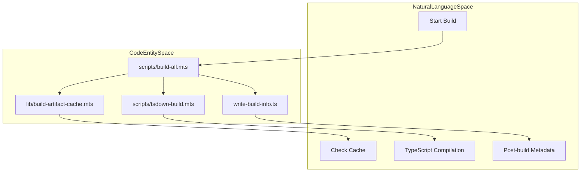
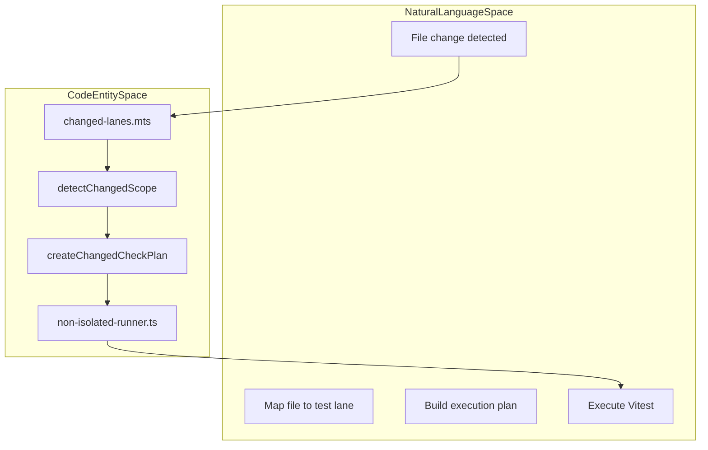

# Development Workflow

<details>
<summary>Relevant source files</summary>

The following files were used as context for generating this wiki page:

- [.github/actions/setup-node-env/action.yml](.github/actions/setup-node-env/action.yml)
- [.github/actions/setup-node-env/dependency-fingerprint.mjs](.github/actions/setup-node-env/dependency-fingerprint.mjs)
- [.github/retired-sticky-disks.json](.github/retired-sticky-disks.json)
- [.github/workflows/vitest-cache-warm.yml](.github/workflows/vitest-cache-warm.yml)
- [config/env-var-count-budget.txt](config/env-var-count-budget.txt)
- [docs/reference/test.md](docs/reference/test.md)
- [docs/start/setup.md](docs/start/setup.md)
- [extensions/telegram/src/bot-message-dispatch-draft.ts](extensions/telegram/src/bot-message-dispatch-draft.ts)
- [extensions/telegram/src/bot-message-dispatch.draft-finalization.test.ts](extensions/telegram/src/bot-message-dispatch.draft-finalization.test.ts)
- [extensions/telegram/src/button-types.test.ts](extensions/telegram/src/button-types.test.ts)
- [extensions/telegram/src/button-types.ts](extensions/telegram/src/button-types.ts)
- [extensions/telegram/src/reasoning-lane-coordinator.ts](extensions/telegram/src/reasoning-lane-coordinator.ts)
- [packages/gateway-protocol/src/schema/frames.build-id.test.ts](packages/gateway-protocol/src/schema/frames.build-id.test.ts)
- [scripts/build-all.mts](scripts/build-all.mts)
- [scripts/changed-lanes.mts](scripts/changed-lanes.mts)
- [scripts/check-assertion-safety-ratchet.mts](scripts/check-assertion-safety-ratchet.mts)
- [scripts/check-changed.mts](scripts/check-changed.mts)
- [scripts/check-cli-bootstrap-imports.mts](scripts/check-cli-bootstrap-imports.mts)
- [scripts/check-env-var-count.mts](scripts/check-env-var-count.mts)
- [scripts/check-max-lines-ratchet.mts](scripts/check-max-lines-ratchet.mts)
- [scripts/check-script-erasability.mjs](scripts/check-script-erasability.mjs)
- [scripts/check.mts](scripts/check.mts)
- [scripts/e2e/parallels/macos-discord.ts](scripts/e2e/parallels/macos-discord.ts)
- [scripts/e2e/parallels/phase-runner.ts](scripts/e2e/parallels/phase-runner.ts)
- [scripts/lib/build-artifact-cache.mts](scripts/lib/build-artifact-cache.mts)
- [scripts/lib/changed-path-facts.mjs](scripts/lib/changed-path-facts.mjs)
- [scripts/lib/declaration-stage.mts](scripts/lib/declaration-stage.mts)
- [scripts/lib/dist-artifact-ownership.mts](scripts/lib/dist-artifact-ownership.mts)
- [scripts/lib/managed-child-process.mts](scripts/lib/managed-child-process.mts)
- [scripts/lib/repo-root.mjs](scripts/lib/repo-root.mjs)
- [scripts/lib/shrink-ratchet.mts](scripts/lib/shrink-ratchet.mts)
- [scripts/prepare-extension-package-boundary-artifacts.mts](scripts/prepare-extension-package-boundary-artifacts.mts)
- [scripts/run-lint.mts](scripts/run-lint.mts)
- [scripts/run-node.mts](scripts/run-node.mts)
- [scripts/run-stylelint.mts](scripts/run-stylelint.mts)
- [scripts/runtime-postbuild.mts](scripts/runtime-postbuild.mts)
- [scripts/tsdown-build.mts](scripts/tsdown-build.mts)
- [scripts/write-build-info.ts](scripts/write-build-info.ts)
- [scripts/write-plugin-sdk-entry-dts.ts](scripts/write-plugin-sdk-entry-dts.ts)
- [src/agents/embedded-agent-runner/run/attempt.model-diagnostic-events.test.ts](src/agents/embedded-agent-runner/run/attempt.model-diagnostic-events.test.ts)
- [src/agents/embedded-agent-runner/run/attempt.model-diagnostic-events.ts](src/agents/embedded-agent-runner/run/attempt.model-diagnostic-events.ts)
- [src/agents/embedded-agent-runner/run/attempt.model-diagnostic-lifecycle.test.ts](src/agents/embedded-agent-runner/run/attempt.model-diagnostic-lifecycle.test.ts)
- [src/agents/embedded-agent-runner/run/attempt.model-diagnostic-lifecycle.ts](src/agents/embedded-agent-runner/run/attempt.model-diagnostic-lifecycle.ts)
- [src/agents/embedded-agent-runner/run/attempt.model-diagnostic-observation.test.ts](src/agents/embedded-agent-runner/run/attempt.model-diagnostic-observation.test.ts)
- [src/agents/embedded-agent-runner/run/attempt.model-diagnostic-observation.ts](src/agents/embedded-agent-runner/run/attempt.model-diagnostic-observation.ts)
- [src/docker-healthcheck.test.ts](src/docker-healthcheck.test.ts)
- [src/docker-healthcheck.ts](src/docker-healthcheck.ts)
- [src/entry.run-main.test.ts](src/entry.run-main.test.ts)
- [src/gateway/server-lanes.hook-group.test.ts](src/gateway/server-lanes.hook-group.test.ts)
- [src/gateway/server.auth.control-ui.bootstrap-lifecycle.suite.ts](src/gateway/server.auth.control-ui.bootstrap-lifecycle.suite.ts)
- [src/gateway/server.auth.control-ui.device-token.suite.ts](src/gateway/server.auth.control-ui.device-token.suite.ts)
- [src/gateway/server.auth.control-ui.fixtures.test-support.ts](src/gateway/server.auth.control-ui.fixtures.test-support.ts)
- [src/gateway/server.auth.control-ui.mobile-bootstrap.suite.ts](src/gateway/server.auth.control-ui.mobile-bootstrap.suite.ts)
- [src/gateway/server.auth.control-ui.owner-bootstrap.suite.ts](src/gateway/server.auth.control-ui.owner-bootstrap.suite.ts)
- [src/gateway/server.auth.control-ui.pairing.suite.ts](src/gateway/server.auth.control-ui.pairing.suite.ts)
- [src/gateway/server.auth.control-ui.test.ts](src/gateway/server.auth.control-ui.test.ts)
- [src/gateway/server.auth.control-ui.trusted-proxy.suite.ts](src/gateway/server.auth.control-ui.trusted-proxy.suite.ts)
- [src/gateway/server.silent-scope-upgrade-reconnect.poc.test.ts](src/gateway/server.silent-scope-upgrade-reconnect.poc.test.ts)
- [src/infra/diagnostic-events.test.ts](src/infra/diagnostic-events.test.ts)
- [src/infra/diagnostic-events.ts](src/infra/diagnostic-events.ts)
- [src/infra/diagnostic-semantic-run-progress-provenance.ts](src/infra/diagnostic-semantic-run-progress-provenance.ts)
- [src/infra/diagnostic-semantic-run-progress.ts](src/infra/diagnostic-semantic-run-progress.ts)
- [src/infra/diagnostic-trace-propagation.test.ts](src/infra/diagnostic-trace-propagation.test.ts)
- [src/infra/diagnostic-trace-propagation.ts](src/infra/diagnostic-trace-propagation.ts)
- [src/infra/run-node.test.ts](src/infra/run-node.test.ts)
- [src/logging/diagnostic-embedded-run-index.ts](src/logging/diagnostic-embedded-run-index.ts)
- [src/logging/diagnostic-run-activity-recovery.ts](src/logging/diagnostic-run-activity-recovery.ts)
- [src/logging/diagnostic-run-activity-snapshot.ts](src/logging/diagnostic-run-activity-snapshot.ts)
- [src/logging/diagnostic-run-activity.test-support.ts](src/logging/diagnostic-run-activity.test-support.ts)
- [src/logging/diagnostic-run-activity.test.ts](src/logging/diagnostic-run-activity.test.ts)
- [src/logging/diagnostic-run-activity.ts](src/logging/diagnostic-run-activity.ts)
- [src/logging/diagnostic-session-state.ts](src/logging/diagnostic-session-state.ts)
- [src/logging/diagnostic.test.ts](src/logging/diagnostic.test.ts)
- [src/logging/diagnostic.ts](src/logging/diagnostic.ts)
- [src/mcp/codex-supervision-tools-serve.test.ts](src/mcp/codex-supervision-tools-serve.test.ts)
- [src/process/command-queue.capacity-groups.test.ts](src/process/command-queue.capacity-groups.test.ts)
- [src/process/command-queue.capacity-groups.ts](src/process/command-queue.capacity-groups.ts)
- [src/process/command-queue.publish-transaction.test.ts](src/process/command-queue.publish-transaction.test.ts)
- [src/process/command-queue.state.ts](src/process/command-queue.state.ts)
- [src/process/command-queue.test.ts](src/process/command-queue.test.ts)
- [src/process/command-queue.ts](src/process/command-queue.ts)
- [src/process/command-queue.types.ts](src/process/command-queue.types.ts)
- [test/fixtures/vitest-fork-shutdown.mjs](test/fixtures/vitest-fork-shutdown.mjs)
- [test/fixtures/vitest-shutdown-cancellation.mjs](test/fixtures/vitest-shutdown-cancellation.mjs)
- [test/gateway-hook-concurrency.e2e.test.ts](test/gateway-hook-concurrency.e2e.test.ts)
- [test/helpers/fixture-lifetime.ts](test/helpers/fixture-lifetime.ts)
- [test/helpers/mac-native.ts](test/helpers/mac-native.ts)
- [test/helpers/mac-signing.ts](test/helpers/mac-signing.ts)
- [test/helpers/vitest-shutdown-command.ts](test/helpers/vitest-shutdown-command.ts)
- [test/jsdom-custom-elements.test.ts](test/jsdom-custom-elements.test.ts)
- [test/jsdom-custom-elements.ts](test/jsdom-custom-elements.ts)
- [test/non-isolated-runner.resolve-mocks.test.ts](test/non-isolated-runner.resolve-mocks.test.ts)
- [test/non-isolated-runner.test-api-fixtures.ts](test/non-isolated-runner.test-api-fixtures.ts)
- [test/non-isolated-runner.test.ts](test/non-isolated-runner.test.ts)
- [test/non-isolated-runner.ts](test/non-isolated-runner.ts)
- [test/scripts/build-all.test.ts](test/scripts/build-all.test.ts)
- [test/scripts/changed-lanes.test.ts](test/scripts/changed-lanes.test.ts)
- [test/scripts/changed-path-facts.test.ts](test/scripts/changed-path-facts.test.ts)
- [test/scripts/check-assertion-safety-ratchet.test.ts](test/scripts/check-assertion-safety-ratchet.test.ts)
- [test/scripts/check-env-var-count.test.ts](test/scripts/check-env-var-count.test.ts)
- [test/scripts/check-max-lines-ratchet.test.ts](test/scripts/check-max-lines-ratchet.test.ts)
- [test/scripts/check.test.ts](test/scripts/check.test.ts)
- [test/scripts/dist-artifact-ownership.test.ts](test/scripts/dist-artifact-ownership.test.ts)
- [test/scripts/fixture-lifetime.test.ts](test/scripts/fixture-lifetime.test.ts)
- [test/scripts/mac-elevation-artifact.test-support.ts](test/scripts/mac-elevation-artifact.test-support.ts)
- [test/scripts/mac-elevation-artifact.test.ts](test/scripts/mac-elevation-artifact.test.ts)
- [test/scripts/mac-native-fixtures.test-support.ts](test/scripts/mac-native-fixtures.test-support.ts)
- [test/scripts/mac-native-fixtures.test.ts](test/scripts/mac-native-fixtures.test.ts)
- [test/scripts/mac-node-worker.test.ts](test/scripts/mac-node-worker.test.ts)
- [test/scripts/managed-child-process.test.ts](test/scripts/managed-child-process.test.ts)
- [test/scripts/oxlint-config.test.ts](test/scripts/oxlint-config.test.ts)
- [test/scripts/prepare-extension-package-boundary-artifacts.test.ts](test/scripts/prepare-extension-package-boundary-artifacts.test.ts)
- [test/scripts/shrink-ratchet.test.ts](test/scripts/shrink-ratchet.test.ts)
- [test/scripts/tsdown-build.test.ts](test/scripts/tsdown-build.test.ts)
- [test/scripts/vitest-fork-shutdown.test.ts](test/scripts/vitest-fork-shutdown.test.ts)
- [test/scripts/write-plugin-sdk-entry-dts.test.ts](test/scripts/write-plugin-sdk-entry-dts.test.ts)
- [test/tsconfig.json](test/tsconfig.json)
- [test/vitest-performance-config.test.ts](test/vitest-performance-config.test.ts)
- [test/vitest/vitest.performance-config.ts](test/vitest/vitest.performance-config.ts)

</details>


This document details the development workflow for OpenClaw contributors, covering local development setup, running the Gateway in development mode, hot reload, debugging, and testing best practices. It includes Windows-specific execution considerations, extension boundary tooling, and the library development consumer.

---

## Local Development Setup

OpenClaw uses a TypeScript-centric monorepo managed with `pnpm`. Development workflows rely on Node.js for the runtime and scripting.

### Setup Steps

Initialize the repository with:

```bash
# 1. Install dependencies
pnpm install

# 2. Build the project (Node.js/tsdown)
pnpm build

# 3. Run linting and type checking
pnpm check
```

- **Dependency Hygiene**: The project uses `knip` to audit for unused dependencies and exports. It identifies executable entry points for repository scripts and GitHub Actions.
- **Extension Boundaries**: To maintain architectural integrity, the system validates that extensions do not leak internal types. The `prepare-extension-package-boundary-artifacts.mts` script generates necessary metadata and shims to enforce these boundaries [scripts/prepare-extension-package-boundary-artifacts.mts:1-22]().
- **Artifact Freshness**: The build system uses `resolveBuildStepCacheState` and `restoreBuildStepCacheOutputs` to skip redundant generation steps during local development [scripts/build-all.mts:8-12]().

Sources: [scripts/prepare-extension-package-boundary-artifacts.mts:1-22](), [scripts/build-all.mts:8-12]()

---

## Running the Gateway in Development Mode

### Build and Compilation
OpenClaw uses `tsdown` for fast TypeScript compilation. The build process is orchestrated by `scripts/build-all.mts`, which manages multiple profiles and cache hits [scripts/build-all.mts:74-167]().

- **Unified Builds**: The `tsdown-unified` step bundles core logic into `dist-runtime/` [scripts/build-all.mts:114-124]().
- **Cache Awareness**: The build system tracks inputs like `tsconfig.json` and `package.json` to avoid unnecessary recompilation [scripts/tsdown-build.mts:100-126]().
- **Memory Management**: On Windows, the build system automatically tunes Node.js memory limits (defaulting to 8GB) to prevent OOM errors during heavy compilation tasks [scripts/tsdown-build.mts:52-54]().

### Local Execution
For library development, the `examples/ai-chat` project serves as a minimal consumer of the `@openclaw/ai` package. This allows developers to verify changes to the SDK and core agent logic in a simplified environment.

Sources: [scripts/build-all.mts:74-167](), [scripts/tsdown-build.mts:52-126]()

---

## Debugging and Testing Best Practices

### Test Lane Detection
OpenClaw uses a "Changed Lanes" strategy to optimize test runs. The `scripts/changed-lanes.mts` script analyzes Git diffs to determine which parts of the system require re-validation [scripts/changed-lanes.mts:18-26]().

- **Targeted Linting**: `createTargetedOxlintCommand` limits linting to only modified files in `src/`, `ui/`, or `extensions/` [scripts/check-changed.mts:120-130]().
- **Owner Tests**: Certain files (like `models.json` or schema definitions) trigger "owner tests" that validate global invariants [scripts/check-changed.mts:90-105]().

### Vitest Execution and Isolation
The test suite uses Vitest, often with a specialized `NonIsolatedRunner` for performance.

- **Non-Isolated Runner**: The `NonIsolatedRunner` (defined in `test/non-isolated-runner.ts`) executes tests without full process isolation to speed up the suite, while manually cleaning up global state like `diagnosticEvents` and `pluginRuntimeStores` between files [test/non-isolated-runner.ts:7-16]().
- **Resource Ownership**: The `createVitestResourceOwner` helper tracks temporary directories and processes, ensuring they are released after test completion [test/scripts/managed-child-process.test.ts:88-105]().

### Diagnostic Monitoring
During development, the Gateway emits diagnostic events that can be monitored to debug agent behavior.
- **Run Activity**: `diagnostic-run-activity.ts` tracks active tools, model calls, and embedded runs [src/logging/diagnostic-run-activity.ts:59-73]().
- **Stuck Session Recovery**: A heartbeat mechanism [src/logging/diagnostic.ts:57-58]() uses `requestStuckSessionRecovery` to detect and abort sessions that have stopped making progress [src/logging/diagnostic.test.ts:65-73]().

Sources: [scripts/changed-lanes.mts:18-26](), [scripts/check-changed.mts:90-130](), [test/non-isolated-runner.ts:7-16](), [src/logging/diagnostic-run-activity.ts:59-73](), [src/logging/diagnostic.ts:57-58]()

---

## Windows-Specific Considerations

Windows development requires specific handling for process trees and binary resolution:

- **Process Management**: The `runManagedCommand` utility handles the differences between POSIX and Windows process groups. On Windows, it uses `taskkill.exe` for reliable cleanup of child process trees [test/scripts/managed-child-process.test.ts:30-31]().
- **Binary Shims**: The build system routes `pnpm` commands through `npm_execpath` on Windows to avoid issues with `.cmd` file resolution in Node.js `spawn` calls [test/scripts/build-all.test.ts:177-182]().
- **Memory Limits**: The system detects Windows and applies a lower default `max-old-space-size` (8192MB vs 12288MB on Linux) to accommodate different memory management behaviors [scripts/tsdown-build.mts:52-54]().

Sources: [test/scripts/managed-child-process.test.ts:30-31](), [test/scripts/build-all.test.ts:177-182](), [scripts/tsdown-build.mts:52-54]()

---

## Implementation Diagrams

### Build and Artifact Pipeline
This diagram bridges the conceptual build process to the code entities that manage artifact generation and caching.



Sources: [scripts/build-all.mts:74-167](), [scripts/lib/build-artifact-cache.mts:8-12](), [scripts/tsdown-build.mts:1-11]()

### Test Discovery and Execution
This diagram associates system names with code entities involved in the test discovery and execution pipeline.



Sources: [scripts/changed-lanes.mts:18-26](), [scripts/check-changed.mts:25-30](), [test/non-isolated-runner.ts:1-7]()

### Development Tooling Matrix

| Tool | File Path | Purpose |
| :--- | :--- | :--- |
| **Build Orchestrator** | `scripts/build-all.mts` | Main entry point for compiling the monorepo [scripts/build-all.mts:1-10]() |
| **Change Detector** | `scripts/changed-lanes.mts` | Logic for determining which tests to run based on Git diffs [scripts/changed-lanes.mts:18-26]() |
| **Process Manager** | `scripts/lib/managed-child-process.mts` | Cross-platform child process lifecycle management [scripts/lib/managed-child-process.mts:1-17]() |
| **Remote Proof** | `docs/reference/test.md` | Documentation for using Crabbox for remote/E2E testing [docs/reference/test.md:61-70]() |
| **Boundary Guard** | `scripts/prepare-extension-package-boundary-artifacts.mts` | Ensures extension plugins stay within SDK boundaries [scripts/prepare-extension-package-boundary-artifacts.mts:1-15]() |

Sources: [scripts/build-all.mts:1-10](), [scripts/changed-lanes.mts:18-26](), [scripts/lib/managed-child-process.mts:1-17](), [docs/reference/test.md:61-70](), [scripts/prepare-extension-package-boundary-artifacts.mts:1-15]()