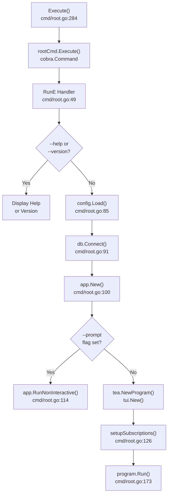
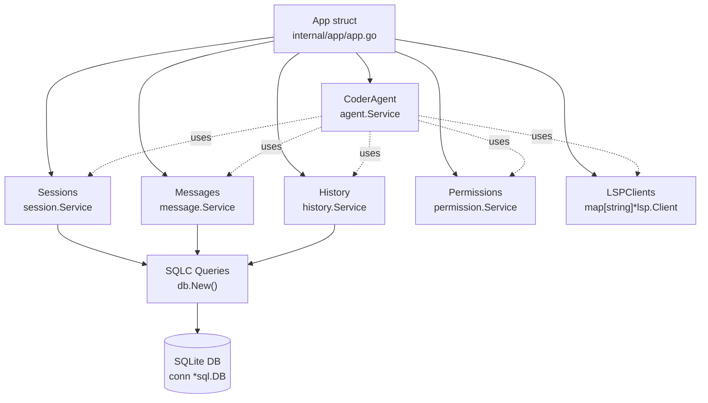
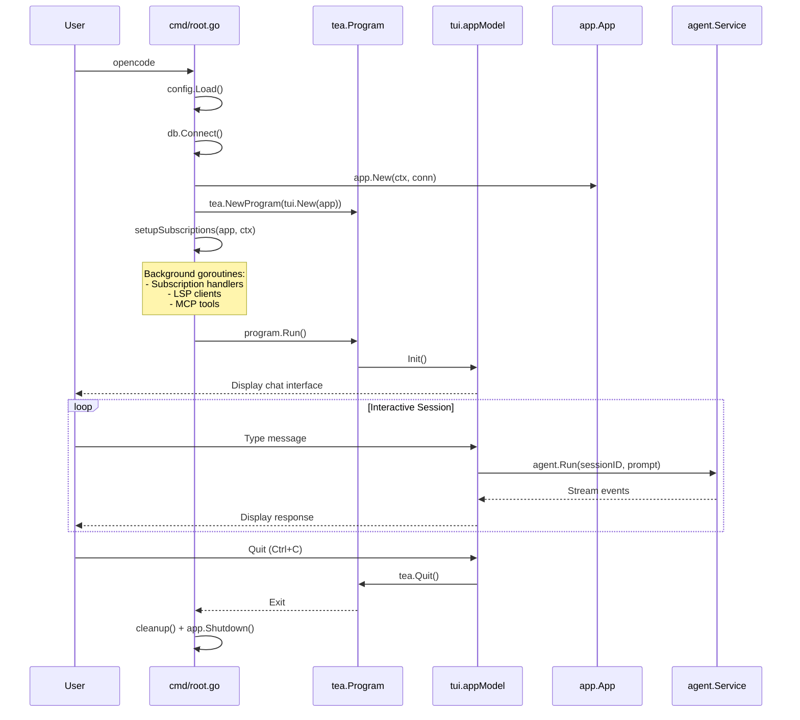
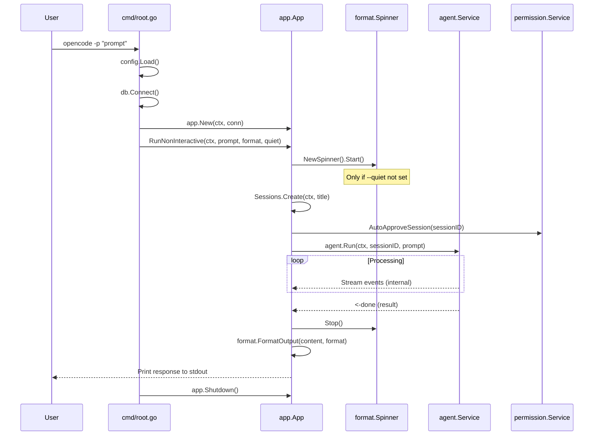
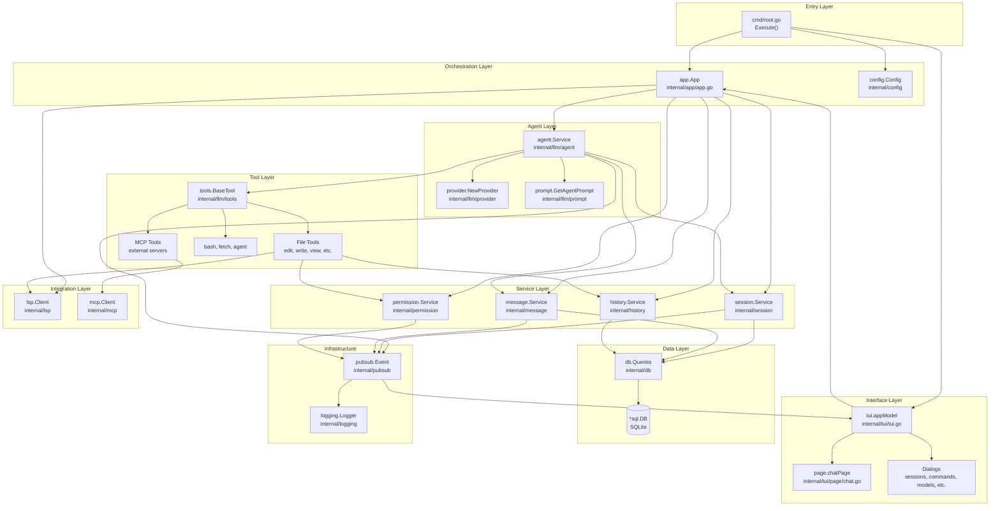
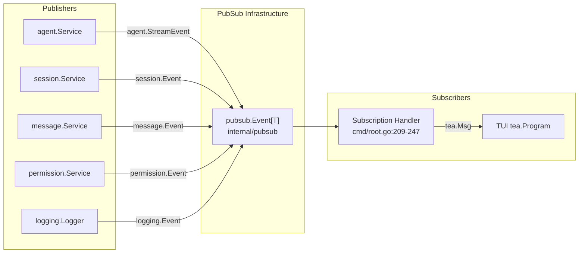

# Overview

Relevant source files

The following files were used as context for generating this wiki page:

- [README.md](README.md)
- [cmd/root.go](cmd/root.go)
- [internal/app/app.go](internal/app/app.go)

## Purpose and Scope

OpenCode is a terminal-based AI coding assistant implemented in Go that provides intelligent code assistance through a Text User Interface (TUI). This document introduces the system's purpose, core capabilities, high-level architecture, and operating modes. It serves as the entry point for understanding how OpenCode components work together to provide AI-powered development assistance.

For detailed information about specific subsystems, see:
- Installation and configuration: [Installation and Configuration](#1.1)
- Detailed architecture: [Architecture Overview](#1.2)
- LLM integration: [LLM Integration](#3)
- Terminal interface: [Terminal UI System](#4)
- Tool system: [Tool System](#6)

**Sources:** [README.md:1-50](), [README.md:428-441]()

## Core Capabilities

OpenCode provides the following primary capabilities:

| Capability | Description | Implementation |
|------------|-------------|----------------|
| **Multi-Provider LLM Support** | Integrates with 11+ LLM providers (Anthropic, OpenAI, Gemini, Bedrock, Azure, Groq, OpenRouter, XAI, VertexAI, Copilot, Local) | Provider abstraction layer with unified interface |
| **Interactive TUI** | Terminal-based chat interface built with Bubble Tea | [internal/tui]() package |
| **Non-Interactive Mode** | CLI-based single-shot execution with output formatting | `-p` flag with optional JSON output |
| **Tool Execution** | AI can execute file operations, shell commands, HTTP requests, and LSP queries | [internal/llm/tools]() package |
| **Permission System** | User approval required for destructive operations | [internal/permission]() package |
| **Session Management** | Persistent conversation sessions with auto-compaction | [internal/session]() package |
| **LSP Integration** | Code diagnostics from language servers (gopls, typescript-language-server, etc.) | [internal/lsp]() package |
| **MCP Protocol** | External tool integration via Model Context Protocol | MCP stdio and SSE server support |
| **History Tracking** | File change versioning and diff generation | [internal/history]() package |

**Sources:** [README.md:29-41](), [README.md:206-278](), [internal/app/app.go:25-40]()

## System Entry Points

### Command Line Interface

The application provides a single `opencode` command with multiple operational modes:

**Command Line Flags:**

| Flag | Short | Type | Description |
|------|-------|------|-------------|
| `--help` | `-h` | bool | Display help information |
| `--version` | `-v` | bool | Show version number |
| `--debug` | `-d` | bool | Enable debug logging |
| `--cwd` | `-c` | string | Set working directory |
| `--prompt` | `-p` | string | Single prompt for non-interactive mode |
| `--output-format` | `-f` | string | Output format: `text` or `json` |
| `--quiet` | `-q` | bool | Suppress spinner in non-interactive mode |

**Sources:** [cmd/root.go:24-48](), [cmd/root.go:291-309](), [README.md:322-331]()

## Core Application Structure

### App Instance Components

The `App` struct ([internal/app/app.go:25-40]()) serves as the central orchestrator, aggregating all core services:

**App Initialization Sequence:**

1. `app.New(ctx, conn)` - Creates App instance ([internal/app/app.go:42-81]())
2. `db.New(conn)` - Creates SQLC query interface
3. Service initialization:
   - `session.NewService(q)` - Session management
   - `message.NewService(q)` - Message persistence
   - `history.NewService(q, conn)` - File history tracking
   - `permission.NewPermissionService()` - Permission handling
4. `app.initTheme()` - Configure TUI theme ([internal/app/app.go:83-97]())
5. `app.initLSPClients(ctx)` - Background LSP initialization
6. `agent.NewAgent()` - Create coder agent with tools ([internal/app/app.go:63-78]())

**Sources:** [internal/app/app.go:42-81](), [internal/app/app.go:25-40]()

## Operating Modes

### Interactive Mode (TUI)

When launched without the `--prompt` flag, OpenCode runs in interactive mode with a full terminal user interface:

**Sources:** [cmd/root.go:112-183](), [cmd/root.go:249-282]()

### Non-Interactive Mode

When the `--prompt` flag is provided, OpenCode executes a single request and exits:

**Non-Interactive Execution Flow:**

1. Session creation with auto-generated title ([internal/app/app.go:112-126]())
2. Auto-approve all permissions for session ([internal/app/app.go:129]())
3. Agent processing with blocking wait on done channel ([internal/app/app.go:131-143]())
4. Output formatting (`text` or `json`) ([internal/app/app.go:150-156]())

**Sources:** [internal/app/app.go:99-161](), [cmd/root.go:112-115](), [README.md:292-320]()

## High-Level Architecture

### Component Layers

**Sources:** [README.md:428-441](), Diagram 1 from system architecture

## Key Data Flows

### Request Processing Pipeline

The following table summarizes how a user request flows through the system:

| Stage | Component | Key Operations | Outputs |
|-------|-----------|----------------|---------|
| **1. Input** | TUI or CLI | Capture user prompt, attachments | Raw prompt string |
| **2. Session** | `session.Service` | Create or retrieve session | Session ID |
| **3. Context** | `message.Service` | Load conversation history | Previous messages |
| **4. Prompt** | `prompt.GetAgentPrompt` | Build system prompt with context | System message |
| **5. Agent** | `agent.Service.Run` | Orchestrate LLM interaction | Event stream |
| **6. Provider** | LLM provider client | Stream LLM response | Content/tool call deltas |
| **7. Tools** | Tool execution | Execute operations with permissions | Tool results |
| **8. Persistence** | Services | Save messages, history | Updated database |
| **9. Output** | TUI or stdout | Display response | User feedback |

### Subscription and Event Flow

OpenCode uses a pub-sub system for event distribution:

The subscription system is initialized in [cmd/root.go:249-282]() using `setupSubscriptions()`, which creates individual goroutines for each event type and forwards them as Bubble Tea messages to the TUI.

**Sources:** [cmd/root.go:209-282](), Diagram 2 from system architecture

## Lifecycle Management

### Application Startup

1. **Parse CLI arguments** - [cmd/root.go:49-77]()
2. **Load configuration** - Hierarchical merge from multiple sources
3. **Connect database** - SQLite with migrations via Goose
4. **Create App instance** - Initialize all services
5. **Initialize background services**:
   - LSP clients in goroutine ([internal/app/app.go:60]())
   - MCP tool discovery ([cmd/root.go:195-207]())
6. **Setup subscriptions** - Event routing to TUI (interactive mode only)
7. **Launch interface** - TUI or execute single prompt

### Application Shutdown

The `app.Shutdown()` method ([internal/app/app.go:163-186]()) performs orderly cleanup:

1. Cancel all file watcher goroutines
2. Wait for watcher goroutines to complete (`watcherWG.Wait()`)
3. Shutdown LSP clients with 5-second timeout
4. Close database connections (deferred in `cmd/root.go`)

In interactive mode, additional cleanup occurs in [cmd/root.go:156-170]():
1. Cancel subscriptions
2. Stop TUI message handler
3. Wait for goroutine completion

**Sources:** [internal/app/app.go:163-186](), [cmd/root.go:156-170]()

## Configuration System Overview

OpenCode uses a hierarchical configuration system with multiple sources merged in priority order:

| Priority | Source | Purpose |
|----------|--------|---------|
| 1 (Highest) | Environment variables | API keys, runtime overrides |
| 2 | `./.opencode.json` | Project-specific settings |
| 3 | `$XDG_CONFIG_HOME/opencode/.opencode.json` | XDG standard location |
| 4 | `~/.opencode.json` | User home directory |
| 5 (Lowest) | Built-in defaults | Fallback values |

Configuration structure includes:
- **Providers**: API keys and model settings for each LLM provider
- **Agents**: Model selection and parameters (coder, task, title agents)
- **Data**: Storage directory for database and history
- **Shell**: Command shell configuration for bash tool
- **LSP**: Language server configurations by language
- **MCP Servers**: External tool server definitions
- **UI**: Theme and display preferences

For detailed configuration documentation, see [Configuration System](#2).

**Sources:** [README.md:76-204](), [cmd/root.go:85-88]()

## Summary

OpenCode provides a comprehensive AI coding assistant with the following key characteristics:

- **Dual-mode operation**: Interactive TUI and non-interactive CLI execution
- **Modular architecture**: Clear separation between orchestration (App), interface (TUI), AI processing (Agent), and tools
- **Provider abstraction**: Support for multiple LLM providers through unified interface
- **Safety-first design**: Permission system for user control over operations
- **Event-driven updates**: Pub-sub system for real-time UI updates
- **Persistent state**: SQLite-based storage for sessions, messages, and file history
- **Extensible tools**: Built-in file/shell/network tools plus MCP protocol for external integrations
- **Code intelligence**: LSP integration for diagnostics and code understanding

The system is designed for both quick one-off queries via CLI flags and extended interactive coding sessions with full conversation history and context management.

**Sources:** [README.md:1-50](), [README.md:428-441](), [cmd/root.go:24-183](), [internal/app/app.go:42-81]()