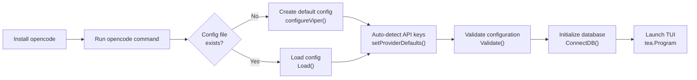
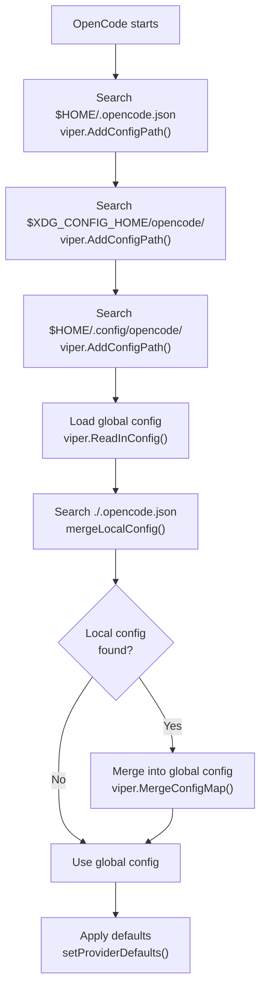
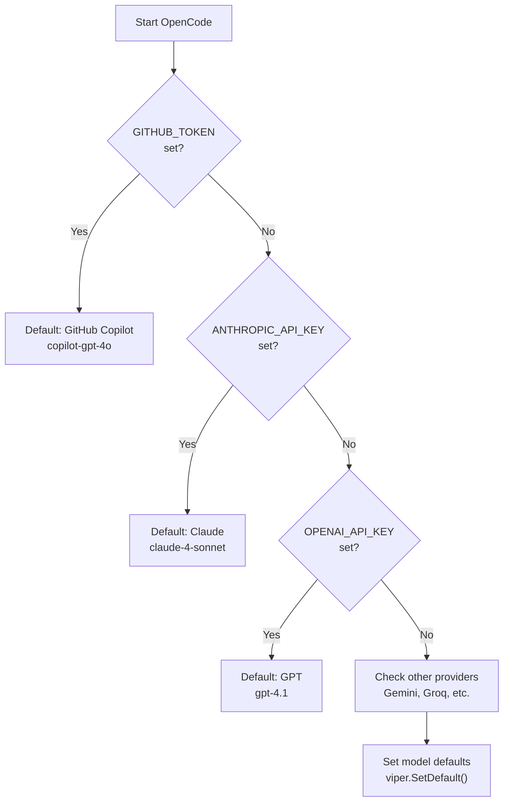
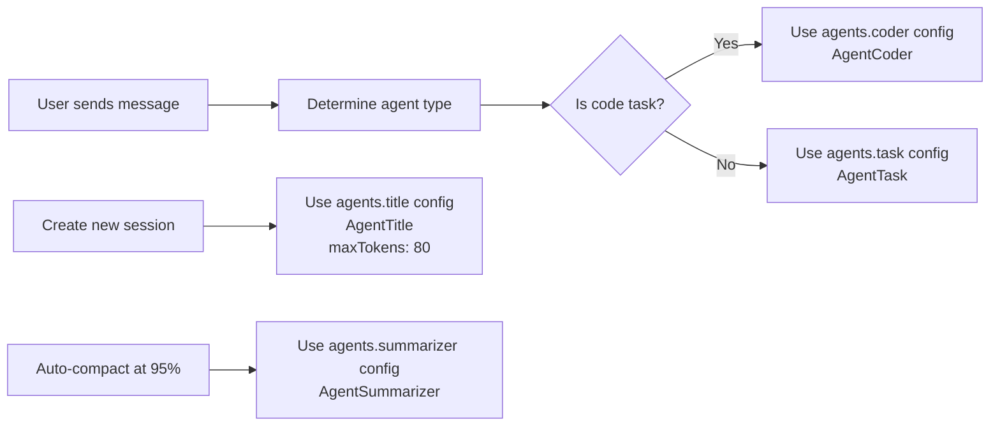

# Installation and Configuration

<details>
<summary>Relevant source files</summary>

The following files were used as context for generating this wiki page:

- [.github/workflows/build.yml](.github/workflows/build.yml)
- [.github/workflows/release.yml](.github/workflows/release.yml)
- [.goreleaser.yml](.goreleaser.yml)
- [README.md](README.md)
- [internal/config/config.go](internal/config/config.go)
- [scripts/release](scripts/release)
- [scripts/snapshot](scripts/snapshot)

</details>


This guide covers installing OpenCode and performing initial setup. You will learn how to install OpenCode using various package managers, configure LLM providers with API keys, and run the application in both interactive and non-interactive modes.

For detailed information about the configuration system internals, see [Configuration System](#2). For LLM provider implementation details, see [LLM Providers](#3.2).

## Installation

OpenCode can be installed using several methods depending on your operating system and preferences.

### Install Script (Recommended)

The install script automatically detects your platform and installs the appropriate binary:

```bash
# Install the latest version
curl -fsSL https://raw.githubusercontent.com/opencode-ai/opencode/refs/heads/main/install | bash

# Install a specific version
curl -fsSL https://raw.githubusercontent.com/opencode-ai/opencode/refs/heads/main/install | VERSION=0.1.0 bash
```

### Homebrew (macOS and Linux)

```bash
brew install opencode-ai/tap/opencode
```

### Arch User Repository (Arch Linux)

Using `yay`:
```bash
yay -S opencode-ai-bin
```

Using `paru`:
```bash
paru -S opencode-ai-bin
```

### Go Install

If you have Go 1.24.0 or higher installed:

```bash
go install github.com/opencode-ai/opencode@latest
```

### Building from Source

```bash
# Clone the repository
git clone https://github.com/opencode-ai/opencode.git
cd opencode

# Build
go build -o opencode

# Run
./opencode
```

Sources: [README.md:42-75](), [README.md:657-676]()

## Quick Start

After installation, run OpenCode to start the interactive terminal UI:

```bash
opencode
```

On first run, OpenCode will:
1. Create the data directory at `.opencode` in your current working directory
2. Initialize the SQLite database for session storage
3. Auto-detect available LLM provider API keys from environment variables
4. Launch the terminal UI

**Installation Flow Diagram**



Sources: [internal/config/config.go:124-216](), [cmd/root.go:1-150]()

## Configuration Files

OpenCode uses JSON configuration files. The system searches multiple locations and merges configurations with the following precedence (highest priority last):

| Location | Purpose | When to Use |
|----------|---------|-------------|
| `$HOME/.opencode.json` | Global user settings | Personal preferences, default API keys |
| `$XDG_CONFIG_HOME/opencode/.opencode.json` | XDG standard location | Linux systems following XDG standards |
| `$HOME/.config/opencode/.opencode.json` | Alternative standard location | Alternative to XDG location |
| `./.opencode.json` | Project-specific overrides | Project-specific models or settings |

Project-specific configurations override global settings, allowing you to use different models or settings per project.

**Configuration Hierarchy**



Sources: [internal/config/config.go:219-227](), [internal/config/config.go:450-461](), [README.md:76-83]()

## Environment Variables

OpenCode automatically detects API keys and credentials from environment variables. This is the recommended way to configure providers.

### Supported Environment Variables

| Variable | Provider | Required | Notes |
|----------|----------|----------|-------|
| `ANTHROPIC_API_KEY` | Anthropic (Claude) | Yes | Get from console.anthropic.com |
| `OPENAI_API_KEY` | OpenAI (GPT) | Yes | Get from platform.openai.com |
| `GEMINI_API_KEY` | Google Gemini | Yes | Get from ai.google.dev |
| `GITHUB_TOKEN` | GitHub Copilot | Yes | Requires Copilot subscription |
| `GROQ_API_KEY` | Groq | Yes | Get from console.groq.com |
| `OPENROUTER_API_KEY` | OpenRouter | Yes | Get from openrouter.ai |
| `XAI_API_KEY` | xAI (Grok) | Yes | Get from x.ai |
| `AZURE_OPENAI_ENDPOINT` | Azure OpenAI | Yes | Azure resource endpoint |
| `AZURE_OPENAI_API_KEY` | Azure OpenAI | Optional | Can use Entra ID instead |
| `AZURE_OPENAI_API_VERSION` | Azure OpenAI | Yes | API version string |
| `AWS_ACCESS_KEY_ID` | AWS Bedrock | Yes* | AWS credentials |
| `AWS_SECRET_ACCESS_KEY` | AWS Bedrock | Yes* | AWS credentials |
| `AWS_REGION` | AWS Bedrock | Yes | AWS region |
| `VERTEXAI_PROJECT` | Google VertexAI | Yes | GCP project ID |
| `VERTEXAI_LOCATION` | Google VertexAI | Yes | GCP location |
| `LOCAL_ENDPOINT` | Self-hosted | Yes | OpenAI-compatible endpoint |
| `SHELL` | Bash tool | Optional | Default shell path |

\* AWS credentials can also be provided via IAM roles or profiles

Sources: [README.md:101-122](), [internal/config/config.go:256-286]()

### Setting Environment Variables

**Linux/macOS (bash/zsh):**
```bash
export ANTHROPIC_API_KEY="your-key-here"
export OPENAI_API_KEY="your-key-here"
```

Add to `~/.bashrc` or `~/.zshrc` to persist across sessions.

**Windows (PowerShell):**
```powershell
$env:ANTHROPIC_API_KEY="your-key-here"
$env:OPENAI_API_KEY="your-key-here"
```

### Provider Auto-Detection

OpenCode automatically selects a default provider and model based on available API keys. The detection order is:

1. GitHub Copilot (`GITHUB_TOKEN`)
2. Anthropic (`ANTHROPIC_API_KEY`)
3. OpenAI (`OPENAI_API_KEY`)
4. Google Gemini (`GEMINI_API_KEY`)
5. Groq (`GROQ_API_KEY`)
6. OpenRouter (`OPENROUTER_API_KEY`)
7. xAI (`XAI_API_KEY`)
8. AWS Bedrock (AWS credentials)
9. Azure OpenAI (`AZURE_OPENAI_ENDPOINT`)
10. Google VertexAI (GCP credentials)

The first available provider becomes the default for all agents.

**Provider Detection Flow**



Sources: [internal/config/config.go:254-386](), [internal/config/config.go:428-434]()

## Basic Configuration

Create a configuration file to customize OpenCode's behavior. Start with this minimal example:

### Minimal Configuration Example

Create `~/.opencode.json`:

```json
{
  "providers": {
    "anthropic": {
      "apiKey": "sk-ant-..."
    }
  }
}
```

This configuration will use Claude 4 Sonnet for all agents. For multiple providers:

```json
{
  "providers": {
    "anthropic": {
      "apiKey": "sk-ant-..."
    },
    "openai": {
      "apiKey": "sk-..."
    }
  },
  "agents": {
    "coder": {
      "model": "claude-4-sonnet",
      "maxTokens": 8000
    },
    "task": {
      "model": "gpt-4.1-mini",
      "maxTokens": 4000
    }
  }
}
```

### Agent Types

OpenCode uses specialized agents for different tasks:

| Agent | Purpose | Default Model | Typical maxTokens |
|-------|---------|---------------|-------------------|
| `coder` | Code generation and file editing | Best available model | 5000-8000 |
| `task` | General task execution | Fast model | 4000-5000 |
| `title` | Session title generation | Fast, cheap model | 80 |
| `summarizer` | Conversation summarization | Medium model | 2000-4000 |

**Agent Selection Mapping**



Sources: [internal/config/config.go:37-44](), [internal/config/config.go:46-51]()

### Common Configuration Options

```json
{
  "data": {
    "directory": ".opencode"
  },
  "autoCompact": true,
  "debug": false,
  "contextPaths": [
    ".cursorrules",
    "opencode.md"
  ],
  "shell": {
    "path": "/bin/zsh",
    "args": ["-l"]
  },
  "tui": {
    "theme": "opencode"
  }
}
```

| Option | Type | Description | Default |
|--------|------|-------------|---------|
| `data.directory` | string | Where to store database and logs | `.opencode` |
| `autoCompact` | boolean | Auto-summarize at 95% context | `true` |
| `debug` | boolean | Enable debug logging | `false` |
| `contextPaths` | string[] | Files to include in context | See below |
| `shell.path` | string | Shell for bash tool | `$SHELL` or `/bin/bash` |
| `shell.args` | string[] | Shell arguments | `["-l"]` |
| `tui.theme` | string | Terminal UI theme | `"opencode"` |

Default context paths: `.github/copilot-instructions.md`, `.cursorrules`, `CLAUDE.md`, `opencode.md`, and variants.

Sources: [internal/config/config.go:83-97](), [internal/config/config.go:108-120](), [internal/config/config.go:229-242](), [README.md:140-204]()

## Advanced Configuration

### Language Server Protocol (LSP)

Enable code intelligence by configuring language servers:

```json
{
  "lsp": {
    "go": {
      "command": "gopls",
      "disabled": false
    },
    "typescript": {
      "command": "typescript-language-server",
      "args": ["--stdio"],
      "disabled": false
    },
    "python": {
      "command": "pylsp",
      "disabled": false
    }
  },
  "debugLSP": false
}
```

Language servers must be installed separately. The AI can access diagnostics through the `diagnostics` tool.

Sources: [internal/config/config.go:64-70](), [README.md:580-608]()

### Model Context Protocol (MCP) Servers

Extend OpenCode with external tools via MCP:

```json
{
  "mcpServers": {
    "filesystem": {
      "type": "stdio",
      "command": "npx",
      "args": ["-y", "@modelcontextprotocol/server-filesystem", "/path/to/allowed/dir"],
      "env": ["PATH=/usr/local/bin:/usr/bin:/bin"]
    },
    "web-api": {
      "type": "sse",
      "url": "https://example.com/mcp",
      "headers": {
        "Authorization": "Bearer token"
      }
    }
  }
}
```

MCP servers can be:
- **stdio**: Communicate via standard input/output
- **sse**: Communicate via Server-Sent Events (HTTP)

Sources: [internal/config/config.go:18-35](), [README.md:529-569]()

### GitHub Copilot Setup

To use GitHub Copilot models:

1. Enable [Copilot chat in your IDE](https://github.com/settings/copilot)
2. Authenticate using one of:
   - VS Code GitHub Copilot extension
   - GitHub CLI: `gh auth login`
   - Neovim copilot plugin
   - Manual token: Set `GITHUB_TOKEN` environment variable

OpenCode automatically detects tokens from:
- `~/.config/github-copilot/hosts.json`
- `~/.config/github-copilot/apps.json`
- `$XDG_CONFIG_HOME/github-copilot/[hosts,apps].json`

Sources: [README.md:609-627](), [internal/config/config.go:933-980]()

### Self-Hosted Models

Use OpenAI-compatible local servers:

```bash
export LOCAL_ENDPOINT=http://localhost:1235/v1
```

Configure model in config file:

```json
{
  "agents": {
    "coder": {
      "model": "local.granite-3.3-2b-instruct@q8_0",
      "maxTokens": 4096
    }
  }
}
```

Sources: [README.md:628-656]()

## Configuration Validation and Troubleshooting

### Validation Process

The configuration system performs comprehensive validation through the `Validate()` function:

```mermaid
graph TB
    subgraph "Validation Steps"
        ValidateAgents["Validate each agent<br/>validateAgent()"]
        CheckModels["Check model exists<br/>models.SupportedModels"]
        CheckProviders["Check provider configured<br/>Provider availability"]
        ValidateTokens["Check maxTokens<br/>Against context window"]
        ValidateReasoning["Check reasoningEffort<br/>For reasoning models"]
        ValidateLSP["Validate LSP configs<br/>Check command existence"]
        ValidateProviderKeys["Check API keys<br/>Mark disabled if missing"]
    end
    
    ValidateAgents --> CheckModels
    CheckModels --> CheckProviders
    CheckProviders --> ValidateTokens
    ValidateTokens --> ValidateReasoning
    ValidateReasoning --> ValidateLSP
    ValidateLSP --> ValidateProviderKeys
```



### Common Configuration Issues

| Issue | Symptoms | Solution |
|-------|----------|----------|
| Missing API Key | Provider marked as disabled | Set appropriate environment variable |
| Invalid Model ID | Agent falls back to default | Use valid model from schema |
| Excessive MaxTokens | Automatically adjusted | Set within context window limits |
| Invalid Reasoning Effort | Reset to "medium" | Use "low", "medium", or "high" |
| Missing LSP Command | LSP marked as disabled | Install language server or fix path |

### Configuration Updates

The system supports runtime configuration updates through functions like `UpdateAgentModel()` and `UpdateTheme()`, which modify both the in-memory configuration and persist changes to the configuration file.

Sources: [internal/config/config.go:571-603](), [internal/config/config.go:829-865](), [internal/config/config.go:867-880]()