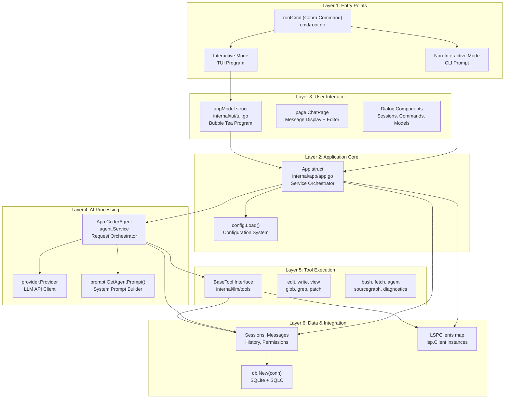
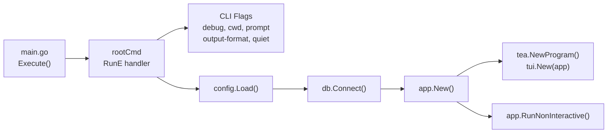
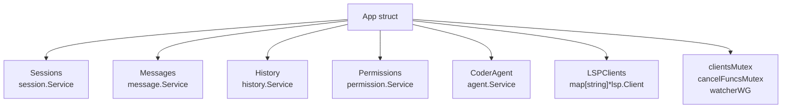
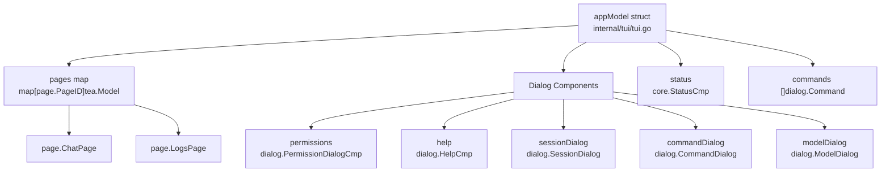
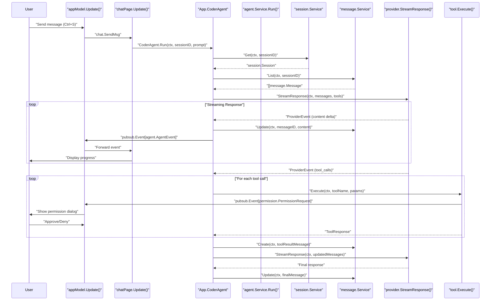
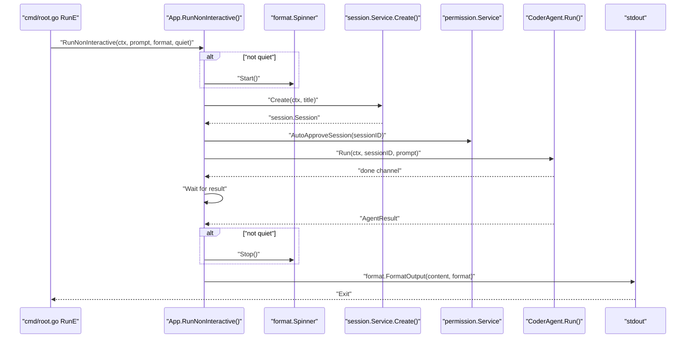
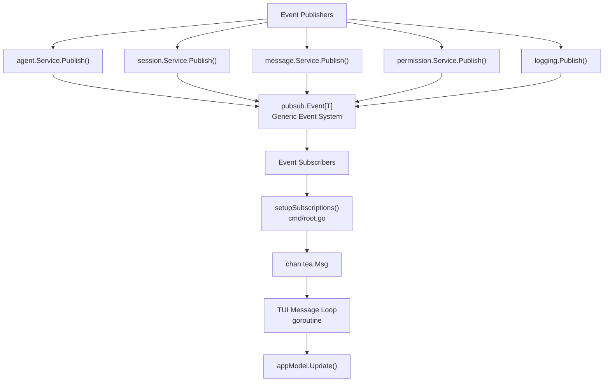
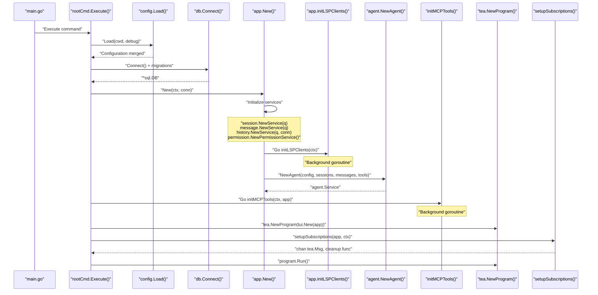

# Architecture Overview

<details>
<summary>Relevant source files</summary>

The following files were used as context for generating this wiki page:

- [README.md](README.md)
- [cmd/root.go](cmd/root.go)
- [internal/app/app.go](internal/app/app.go)
- [internal/tui/tui.go](internal/tui/tui.go)

</details>


## Purpose and Scope

This document provides a comprehensive overview of OpenCode's system architecture, explaining how the major components interact and how data flows through the system from user input to AI response. It covers the layered design, core components, their relationships, and key architectural patterns.

For detailed information about specific subsystems, see:
- Configuration system details: [Configuration System](#2)
- LLM integration specifics: [LLM Integration](#3)
- TUI implementation: [Terminal UI System](#4)
- Tool execution: [Tool System](#6)

**Sources:** [README.md:428-441](), [internal/tui/tui.go:1-966](), [internal/app/app.go:1-187](), [cmd/root.go:1-310]()

---

## System Layers

OpenCode is organized into six distinct architectural layers, each with clearly defined responsibilities. This layered design promotes separation of concerns and makes the system modular and testable.

### Layer Architecture Diagram



**Key Characteristics:**
- **Unidirectional Flow**: Dependencies flow downward through layers
- **Clear Boundaries**: Each layer has well-defined interfaces
- **Service-Oriented**: Core functionality exposed through service interfaces
- **Event-Driven**: Cross-layer communication via pubsub for UI updates

**Sources:** [cmd/root.go:24-184](), [internal/app/app.go:25-81](), [internal/tui/tui.go:98-141]()

---

## Core Components

### Entry Point: CLI Command Structure

The application entry point uses the Cobra command framework with support for both interactive and non-interactive modes.



The `rootCmd` in [cmd/root.go:24-184]() orchestrates initialization:
1. Parse CLI flags
2. Load configuration via `config.Load()`
3. Connect to database via `db.Connect()`
4. Create `App` instance via `app.New()`
5. Route to interactive (TUI) or non-interactive mode

**Sources:** [cmd/root.go:24-184](), [cmd/root.go:291-309]()

### Application Layer: The App Orchestrator

The `App` struct serves as the central orchestrator, managing all services and coordinating interactions between subsystems.



**App Struct Fields** [internal/app/app.go:25-40]():

| Field | Type | Purpose |
|-------|------|---------|
| `Sessions` | `session.Service` | Session lifecycle management |
| `Messages` | `message.Service` | Message persistence and retrieval |
| `History` | `history.Service` | File change tracking |
| `Permissions` | `permission.Service` | Permission request handling |
| `CoderAgent` | `agent.Service` | Main AI agent orchestrator |
| `LSPClients` | `map[string]*lsp.Client` | Language server connections |

**Key Methods:**
- `New()` [internal/app/app.go:42-81]() - Initializes all services and agents
- `RunNonInteractive()` [internal/app/app.go:99-161]() - Handles CLI prompt mode
- `Shutdown()` [internal/app/app.go:163-186]() - Graceful cleanup

**Sources:** [internal/app/app.go:25-187]()

### User Interface Layer: Bubble Tea Architecture

The TUI is built using the Bubble Tea framework, with a central `appModel` that manages pages and dialogs.



**appModel Fields** [internal/tui/tui.go:98-141]():

| Field | Type | Purpose |
|-------|------|---------|
| `pages` | `map[page.PageID]tea.Model` | Page components (Chat, Logs) |
| `currentPage` | `page.PageID` | Active page identifier |
| `app` | `*app.App` | Reference to application services |
| `permissions` | `dialog.PermissionDialogCmp` | Permission approval dialog |
| `sessionDialog` | `dialog.SessionDialog` | Session switcher dialog |
| `commandDialog` | `dialog.CommandDialog` | Command palette |
| `modelDialog` | `dialog.ModelDialog` | Model selector |
| `commands` | `[]dialog.Command` | Registered commands |

**Bubble Tea Methods:**
- `Init()` [internal/tui/tui.go:143-180]() - Initialize components
- `Update()` [internal/tui/tui.go:182-664]() - Handle messages and events
- `View()` [internal/tui/tui.go:702-899]() - Render UI with overlays

**Sources:** [internal/tui/tui.go:98-899]()

---

## Request Processing Flow

This section details the actual function calls and message passing that occurs when processing a user request.

### Interactive Mode Request Flow



**Key Function Calls:**

1. **Initiation** [internal/tui/tui.go:182-664]()
   - User presses Ctrl+S in editor
   - `appModel.Update()` receives `chat.SendMsg`
   - Forwards to `chatPage.Update()`

2. **Agent Processing** [internal/app/app.go:42-81]()
   - `App.CoderAgent.Run(ctx, sessionID, prompt)` starts processing
   - Agent retrieves session and message history
   - Builds context with system prompt

3. **Streaming Response**
   - Provider sends `ProviderEvent` messages
   - Agent forwards via pubsub to TUI
   - Updates message database in real-time

4. **Tool Execution**
   - Agent requests tool execution
   - Permission service publishes request
   - User approves via dialog
   - Tool executes and returns result

**Sources:** [internal/tui/tui.go:182-664](), [internal/app/app.go:25-81]()

### Non-Interactive Mode Request Flow



**Function Sequence** [internal/app/app.go:99-161]():

1. `RunNonInteractive()` creates session with truncated prompt as title
2. `Permissions.AutoApproveSession()` skips permission dialogs
3. `CoderAgent.Run()` processes request
4. Waits on done channel for completion
5. Formats and prints output to stdout

**Sources:** [internal/app/app.go:99-161](), [cmd/root.go:49-184]()

---

## Event-Driven Communication

OpenCode uses a publish-subscribe pattern for cross-layer communication, particularly for updating the TUI with async events.

### PubSub Architecture



**Subscription Setup** [cmd/root.go:249-282]():

The `setupSubscriptions()` function creates subscribers for each service:
- `logging.Subscribe(ctx)` - Log messages
- `app.Sessions.Subscribe(ctx)` - Session updates
- `app.Messages.Subscribe(ctx)` - Message changes
- `app.Permissions.Subscribe(ctx)` - Permission requests
- `app.CoderAgent.Subscribe(ctx)` - Agent events

Each subscription runs in its own goroutine via `setupSubscriber()` [cmd/root.go:209-247](), forwarding events to a central `chan tea.Msg` channel.

**Event Types:**

| Event Type | Payload | Purpose |
|------------|---------|---------|
| `pubsub.Event[agent.AgentEvent]` | Progress, completion, errors | Stream agent processing updates |
| `pubsub.Event[permission.PermissionRequest]` | Tool permission details | Request user approval |
| `pubsub.Event[session.Session]` | Session data | Notify session changes |
| `pubsub.Event[message.Message]` | Message data | Notify message updates |
| `pubsub.Event[logging.LogMessage]` | Log text, level | Display status messages |

**Sources:** [cmd/root.go:209-282](), [internal/tui/tui.go:231-269]()

---

## Initialization Sequence

Understanding the startup sequence helps debug issues and extend functionality.

### Startup Flow Diagram



**Initialization Phases:**

**Phase 1: Configuration & Database** [cmd/root.go:85-94]()
- Parse CLI flags
- Load hierarchical configuration
- Connect to SQLite database
- Run database migrations

**Phase 2: Service Initialization** [internal/app/app.go:42-54]()
- Create `Queries` from SQLC
- Initialize `session.Service`
- Initialize `message.Service`
- Initialize `history.Service`
- Initialize `permission.Service`

**Phase 3: LSP & Agent Setup** [internal/app/app.go:56-78]()
- Start LSP client initialization in background goroutine
- Create agent with tools using `agent.NewAgent()`
- Agent receives references to all services

**Phase 4: TUI & Event System** [cmd/root.go:119-153]()
- Create Bubble Tea program with `tui.New(app)`
- Setup pubsub subscriptions
- Start message forwarding goroutine
- Run TUI main loop

**Shutdown Sequence** [internal/app/app.go:163-186]():
1. Cancel all goroutines via context
2. Wait for watchers with timeout
3. Shutdown LSP clients gracefully
4. Close database connections

**Sources:** [cmd/root.go:49-184](), [internal/app/app.go:42-186]()

---

## Key Architectural Patterns

### Service Interface Pattern

All major subsystems expose themselves through interfaces, enabling testability and loose coupling.

**Example: agent.Service Interface**
```
type Service interface {
    Run(ctx context.Context, sessionID, prompt string) (<-chan AgentResult, error)
    Cancel()
    Summarize(ctx context.Context, sessionID string) error
    Update(agent AgentType, modelID string) error
    Subscribe(ctx context.Context) <-chan pubsub.Event[AgentEvent]
}
```

Other service interfaces:
- `session.Service` - Session CRUD operations
- `message.Service` - Message persistence
- `history.Service` - File change tracking
- `permission.Service` - Permission management

**Sources:** Services defined in `internal/session`, `internal/message`, `internal/history`, `internal/permission`

### Dependency Injection

The `App` struct acts as a dependency injection container, passing service references to components that need them.

**Example:** [internal/app/app.go:63-73]()
```
app.CoderAgent, err = agent.NewAgent(
    config.AgentCoder,
    app.Sessions,      // Injected
    app.Messages,      // Injected
    agent.CoderAgentTools(
        app.Permissions,  // Injected
        app.Sessions,     // Injected
        app.Messages,     // Injected
        app.History,      // Injected
        app.LSPClients,   // Injected
    ),
)
```

**Sources:** [internal/app/app.go:42-81]()

### Context-Based Cancellation

All long-running operations accept `context.Context` for graceful cancellation and timeout handling.

**Example:** [cmd/root.go:96-106]()
```
ctx, cancel := context.WithCancel(context.Background())
defer cancel()

app, err := app.New(ctx, conn)
// Later, cancel() propagates to all goroutines
```

**Sources:** [cmd/root.go:96-169]()

### Type-Safe Database Queries

The system uses SQLC to generate type-safe database query code from SQL, avoiding runtime SQL string construction.

**Example:** [internal/app/app.go:43-46]()
```
q := db.New(conn)                    // SQLC-generated Queries
sessions := session.NewService(q)     // Uses typed queries
messages := message.NewService(q)     // Uses typed queries
files := history.NewService(q, conn)  // Uses typed queries
```

**Sources:** [internal/app/app.go:42-54](), `internal/db` directory

---

## Component Communication Summary

| From | To | Mechanism | Example |
|------|----|-----------| --------|
| CLI | App | Direct call | `app.New(ctx, conn)` |
| TUI | App | Reference | `appModel.app.CoderAgent.Run()` |
| App | Services | Interface calls | `app.Sessions.Create()` |
| Services | TUI | PubSub events | `pubsub.Event[session.Session]` |
| Agent | Tools | Interface calls | `tool.Execute()` |
| Tools | TUI | PubSub events | `pubsub.Event[permission.PermissionRequest]` |
| LSP | Tools | Direct reference | `app.LSPClients["go"].GetDiagnostics()` |

**Sources:** [cmd/root.go:1-310](), [internal/app/app.go:1-187](), [internal/tui/tui.go:1-966]()