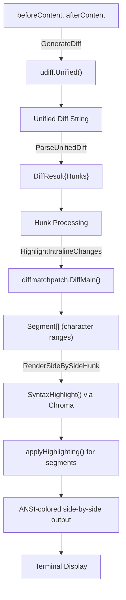
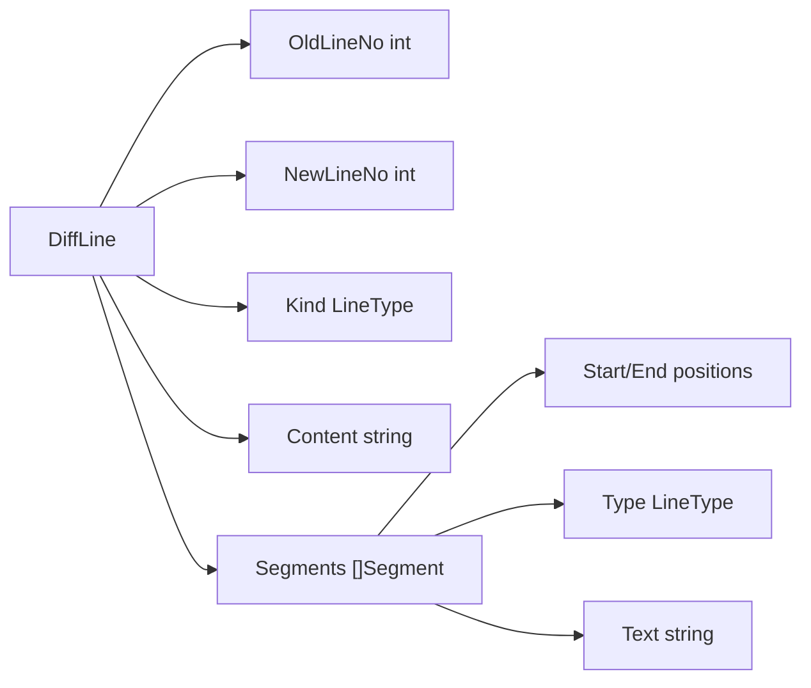
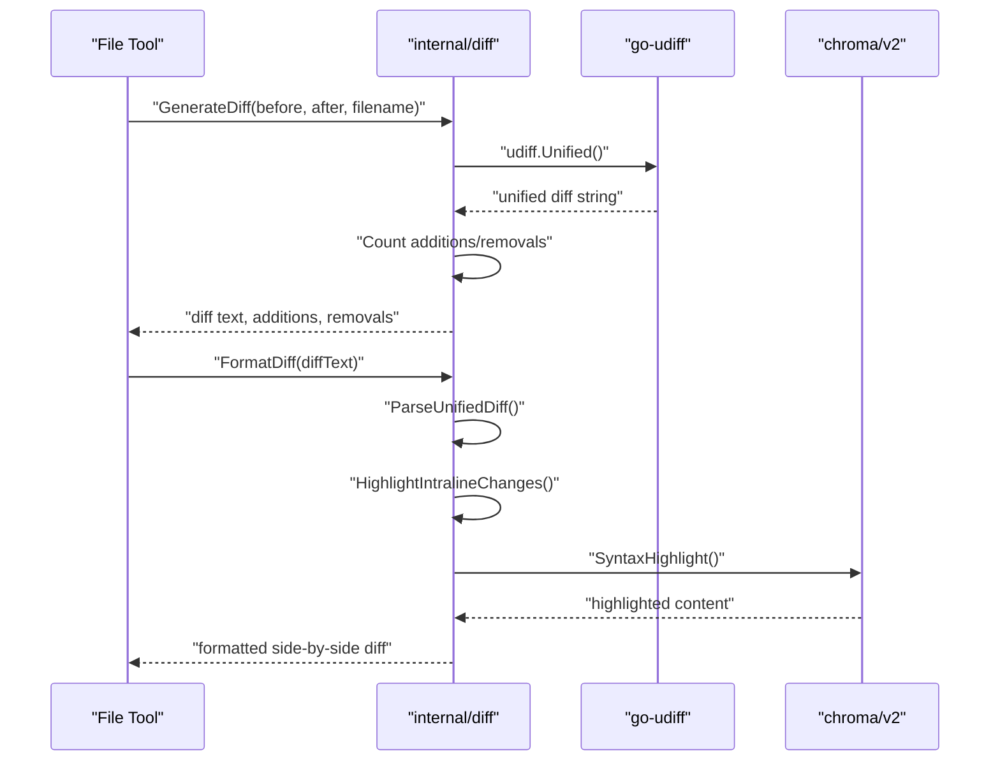
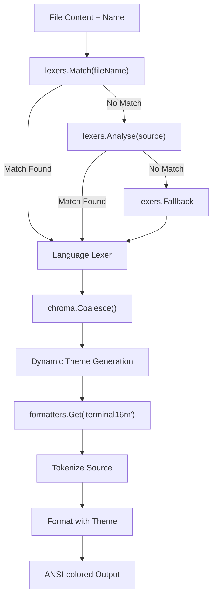
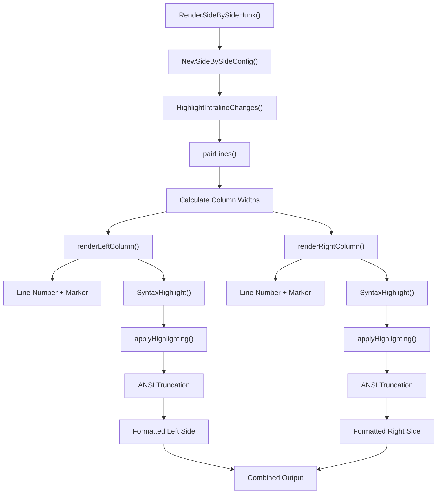
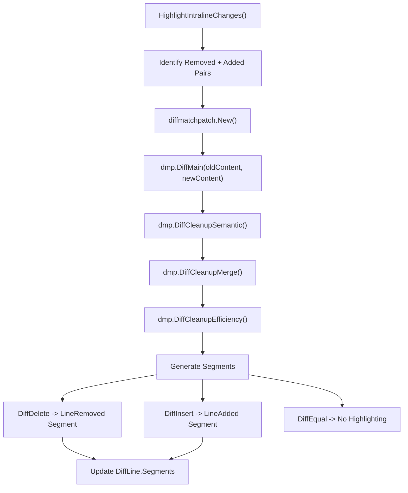
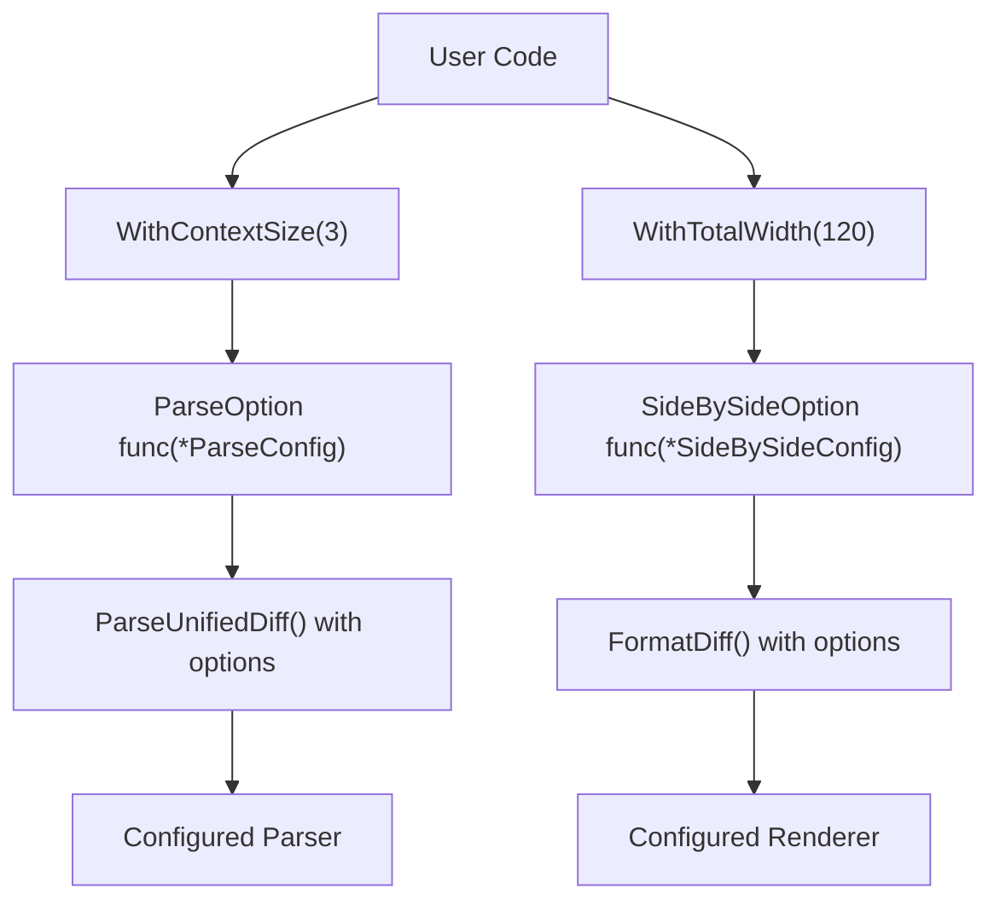
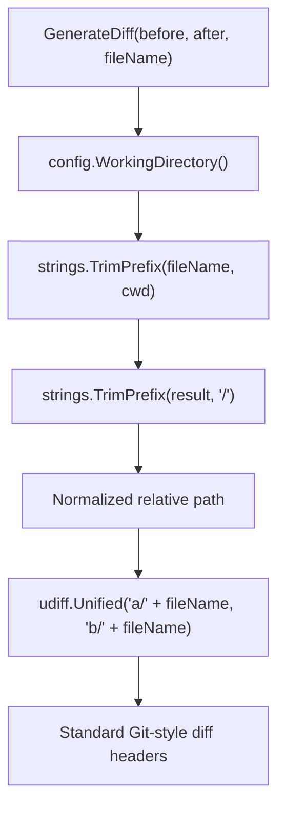
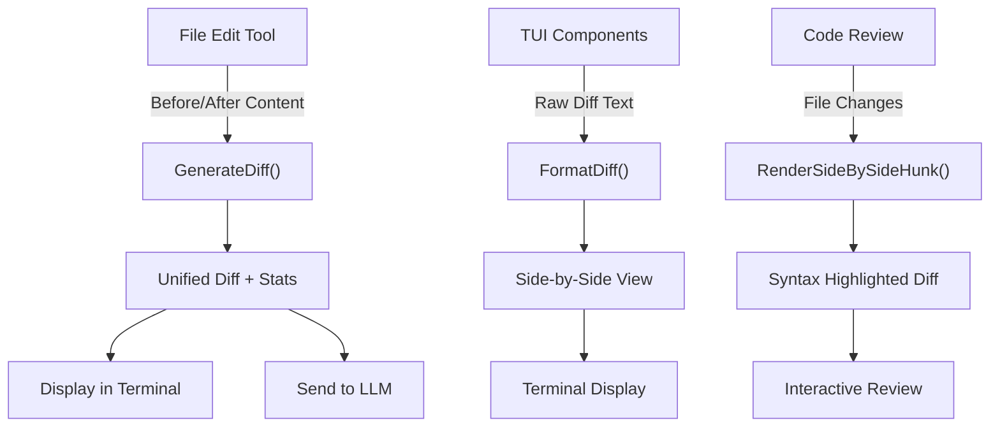

# Dependencies and Utilities

Relevant source files

The following files were used as context for generating this wiki page:

- [README.md](README.md)
- [go.mod](go.mod)
- [go.sum](go.sum)
- [internal/diff/diff.go](internal/diff/diff.go)

## Overview

OpenCode relies on a carefully selected set of external dependencies and internal utilities that provide core functionality across the system. Key dependencies include Bubble Tea for terminal UI, Anthropic/OpenAI/Gemini SDKs for LLM integration, and Chroma for syntax highlighting. The primary utility system is the diff rendering engine in `internal/diff`, which provides sophisticated side-by-side diff visualization with syntax highlighting and theme integration for displaying file changes throughout the application.

## Dependency Categories

OpenCode's dependencies are organized into functional categories:

| Category | Key Dependencies | Purpose |
|----------|------------------|---------|
| **Terminal Interface** | `bubbletea`, `lipgloss`, `bubbles`, `glamour` | Interactive TUI framework, styling, components, markdown rendering |
| **LLM SDKs** | `anthropic-sdk-go`, `openai-go`, `google.golang.org/genai` | Integration with Claude, GPT, and Gemini models |
| **Diff & Syntax** | `chroma/v2`, `go-udiff`, `sergi/go-diff` | Syntax highlighting and diff generation |
| **CLI Framework** | `cobra`, `viper` | Command-line interface and configuration |
| **Database** | `go-sqlite3`, `goose/v3` | SQLite integration and schema migrations |
| **External Integration** | `mcp-go` | Model Context Protocol for external tools |
| **File Operations** | `doublestar/v4`, `fsnotify` | Pattern matching and file system watching |
| **Utilities** | `uuid`, `ansi`, `reflow` | ID generation, ANSI processing, text formatting |

Sources: [go.mod:5-34](), [internal/diff/diff.go:1-21]()

## Key Dependencies Overview

#### Terminal Interface Stack (Charm)
The Charm ecosystem provides OpenCode's terminal UI foundation:

| Package | Version | Purpose |
|---------|---------|---------|
| `bubbletea` | v1.3.5 | Core TUI framework implementing the Elm architecture |
| `lipgloss` | v1.1.0 | Declarative styling and layout for terminal output |
| `bubbles` | v0.21.0 | Reusable TUI components (viewport, list, text input, etc.) |
| `glamour` | v0.9.1 | Markdown rendering with style support |
| `x/ansi` | v0.8.0 | ANSI sequence parsing and manipulation |

#### LLM Provider SDKs
Official SDKs for AI model integration:

| Package | Version | Provider | Usage |
|---------|---------|----------|-------|
| `anthropic-sdk-go` | v1.4.0 | Anthropic | Claude models, streaming, tool calling |
| `openai-go` | v0.1.0-beta.2 | OpenAI | GPT models, O1/O3 reasoning models |
| `google.golang.org/genai` | v1.3.0 | Google | Gemini models with native SDK |

#### Diff and Syntax Highlighting
Core utilities for code visualization:

| Package | Version | Purpose |
|---------|---------|---------|
| `chroma/v2` | v2.15.0 | Syntax highlighting engine with 200+ language lexers |
| `go-udiff` | v0.2.0 | Unified diff generation following Git format |
| `go-diff/diffmatchpatch` | v1.3.2 | Character-level diff algorithm for intra-line changes |

Sources: [go.mod:5-34](), [go.mod:14-18](), [go.mod:10](), [go.mod:28](), [go.mod:124](), [go.mod:9](), [go.mod:11](), [go.mod:30]()

## Diff Rendering Utility (`internal/diff`)

The `internal/diff` package is OpenCode's primary utility for visualizing file changes. It provides unified diff parsing, syntax highlighting, and side-by-side rendering with intra-line change detection.

#### Core Diff Processing Flow

Sources: [internal/diff/diff.go:849-873](), [internal/diff/diff.go:131-230](), [internal/diff/diff.go:232-291](), [internal/diff/diff.go:804-832]()

## Core Diff Data Structures

The diff system uses several key data structures to represent parsed diff information:

#### Primary Types
| Type | Description |
|------|-------------|
| `LineType` | Enumeration for line kinds: `LineContext`, `LineAdded`, `LineRemoved` |
| `DiffLine` | Represents a single line with old/new line numbers, content, and segments |
| `Segment` | Intra-line highlighting segment with start/end positions and type |
| `Hunk` | Section of changes with header and collection of `DiffLine` objects |
| `DiffResult` | Complete parsed diff with old/new file paths and hunks |

#### DiffLine Structure

Sources: [internal/diff/diff.go:27-71](), [internal/diff/diff.go:36-51](), [internal/diff/diff.go:53-64]()

## Diff Generation API

The `internal/diff` package provides several key functions for diff generation and formatting:

#### Core Functions
- `GenerateDiff()`: Creates unified diff from file contents with addition/removal counts
- `ParseUnifiedDiff()`: Parses unified diff text into structured `DiffResult`
- `FormatDiff()`: Creates side-by-side formatted view from diff text
- `RenderSideBySideHunk()`: Renders individual hunk with syntax highlighting
- `HighlightIntralineChanges()`: Adds character-level highlighting using `diffmatchpatch`
- `SyntaxHighlight()`: Applies language-specific syntax highlighting using Chroma

#### Diff Generation Sequence

Sources: [internal/diff/diff.go:849-873](), [internal/diff/diff.go:131-230](), [internal/diff/diff.go:834-847](), [internal/diff/diff.go:804-832](), [internal/diff/diff.go:232-291](), [internal/diff/diff.go:325-532]()

## Syntax Highlighting System

OpenCode implements comprehensive syntax highlighting using the Chroma library. The system dynamically generates theme definitions based on the current terminal theme and supports file type detection.

#### Syntax Highlighting Flow

#### Theme Integration
The syntax highlighting system integrates with OpenCode's theme system by:
- Dynamically generating Chroma XML theme definitions
- Mapping theme colors to syntax token types
- Supporting both light and dark terminal backgrounds
- Preserving ANSI sequences for terminal compatibility

Sources: [internal/diff/diff.go:325-532](), [internal/diff/diff.go:542-550](), [internal/diff/diff.go:534-540](), [internal/diff/diff.go:346-508]()

## Side-by-Side Diff Rendering

The diff system provides sophisticated side-by-side rendering with configurable options and intra-line highlighting. The rendering system handles column layout, line pairing, and visual styling.

#### Rendering Configuration
| Configuration | Description | Default |
|---------------|-------------|---------|
| `SideBySideConfig.TotalWidth` | Total width for side-by-side view | 160 |
| `ParseConfig.ContextSize` | Number of context lines to include | Configurable |

#### Side-by-Side Rendering Architecture

#### Line Pairing Logic
The `pairLines()` function converts flat diff lines into pairs for side-by-side display:
- Removed + Added lines are paired together
- Context lines appear on both sides
- Orphaned additions/removals get paired with empty space

Sources: [internal/diff/diff.go:804-832](), [internal/diff/diff.go:98-125](), [internal/diff/diff.go:293-319](), [internal/diff/diff.go:680-738](), [internal/diff/diff.go:740-798]()

## Intra-line Change Detection

The diff system provides character-level change detection within modified lines using the `diffmatchpatch` algorithm. This enables precise highlighting of exactly what changed within a line.

#### Intra-line Highlighting Process

#### Highlighting Application
The `applyHighlighting()` function processes ANSI-colored content and applies background highlighting to specific segments:
- Preserves existing syntax highlighting
- Applies background colors for changed segments
- Maintains ANSI sequence integrity
- Handles terminal color compatibility

Sources: [internal/diff/diff.go:232-291](), [internal/diff/diff.go:578-678](), [go.mod:30]()

## Configuration and Options System

The diff system provides flexible configuration through option functions that modify configuration structs. This allows customization of parsing behavior and rendering appearance.

#### Configuration Pattern

#### Available Configuration Options
| Option Function | Purpose | Configuration Target |
|----------------|---------|---------------------|
| `WithContextSize(size int)` | Sets number of context lines | `ParseConfig` |
| `WithTotalWidth(width int)` | Sets total width for side-by-side view | `SideBySideConfig` |

#### Default Configurations
- `ParseConfig`: No specific defaults, context size must be provided
- `SideBySideConfig.TotalWidth`: 160 characters

Sources: [internal/diff/diff.go:76-91](), [internal/diff/diff.go:97-125](), [internal/diff/diff.go:105-116](), [internal/diff/diff.go:118-125]()

## Terminal Integration and Dependencies

The diff system integrates with several external libraries to provide comprehensive diff and highlighting capabilities:

#### Key Dependencies
| Library | Purpose | Usage |
|---------|---------|-------|
| `github.com/aymanbagabas/go-udiff` | Unified diff generation | Creates standard unified diff format |
| `github.com/sergi/go-diff/diffmatchpatch` | Character-level diff algorithm | Intra-line change detection |
| `github.com/alecthomas/chroma/v2` | Syntax highlighting | Language-aware code highlighting |
| `github.com/charmbracelet/lipgloss` | Terminal styling | Color and style management |
| `github.com/charmbracelet/x/ansi` | ANSI processing | Text truncation with ANSI preservation |

#### Terminal Color Management
The diff system adapts to terminal capabilities and theme settings:
- Detects dark/light background using `lipgloss.HasDarkBackground()`
- Maps theme colors to hex values for Chroma integration
- Preserves existing ANSI sequences while adding highlights
- Supports 16M color terminals through `terminal16m` formatter

Sources: [go.mod:15](), [go.mod:30](), [go.mod:11](), [go.mod:17](), [go.mod:18](), [internal/diff/diff.go:534-540](), [internal/diff/diff.go:566-576]()

## File Path Handling and Working Directory

The diff system includes intelligent file path handling to ensure consistent diff output across different environments and working directories.

#### Path Normalization in GenerateDiff

This normalization:
- Removes current working directory prefix from file paths
- Ensures relative paths in diff headers
- Prevents absolute path leakage in different environments
- Maintains consistency with Git diff format (`a/` and `b/` prefixes)

Sources: [internal/diff/diff.go:849-873](), [internal/diff/diff.go:851-855]()

## Usage Patterns and Integration

The diff system is designed to be used throughout OpenCode for various development tasks:

#### Common Usage Patterns

#### Integration Points
- **File Tools**: Generate diffs when editing files
- **LLM Communication**: Include diff context in prompts
- **Terminal UI**: Display formatted diffs to users
- **Code Intelligence**: Combine with LSP diagnostics for comprehensive file analysis

Sources: [internal/diff/diff.go:849-873](), [internal/diff/diff.go:834-847](), [internal/diff/diff.go:804-832]()

## Performance and Memory Considerations

The diff system is designed for efficiency when processing code files and displaying results in the terminal:

#### Memory Management
- Diff parsing creates structured data but avoids unnecessary copies
- Syntax highlighting uses streaming tokenization
- ANSI sequence processing minimizes string allocations
- Intra-line highlighting works on character ranges rather than full content duplication

#### Processing Efficiency
- Uses `go-udiff` for efficient unified diff generation
- Leverages Chroma's built-in caching for syntax highlighting
- Applies highlighting selectively based on line types
- Truncates output to terminal width to avoid unnecessary processing

#### Resource Usage Patterns
- Small files: Full processing with all highlighting features
- Large files: Efficient streaming and selective highlighting
- Terminal rendering: Width-aware truncation with ANSI preservation

Sources: [internal/diff/diff.go:849-873](), [internal/diff/diff.go:325-532](), [internal/diff/diff.go:578-678](), [internal/diff/diff.go:731-737]()

## Development Tool Patterns

OpenCode implements several key patterns for development tools:

#### Functional Configuration Pattern
- Uses option functions to modify configuration structs
- Provides sensible defaults with override capabilities
- Enables composable configuration through multiple options

#### Stream Processing Pattern
- Processes content through sequential transformation stages
- Maintains ANSI sequences throughout the pipeline
- Applies highlighting and formatting in coordinated steps

#### Adaptive Theming Pattern
- Detects terminal capabilities and background colors
- Generates dynamic theme definitions based on current settings
- Maintains consistency across different syntax highlighting contexts

#### Structured Data Flow
- Converts between different representations (text → structured → formatted)
- Preserves metadata (line numbers, change types) throughout processing
- Enables flexible rendering based on structured diff data

Sources: [internal/diff/diff.go:76-91](), [internal/diff/diff.go:325-532](), [internal/diff/diff.go:534-540](), [internal/diff/diff.go:131-230]()

## Summary

The logging and diagnostics system in OpenCode provides comprehensive tracking of events, errors, and diagnostic information. It uses a publish-subscribe pattern for real-time updates and provides a user-friendly interface for viewing and analyzing logs. The system also integrates with LSP clients to display diagnostic information for code files and tracks token usage and costs for LLM interactions.