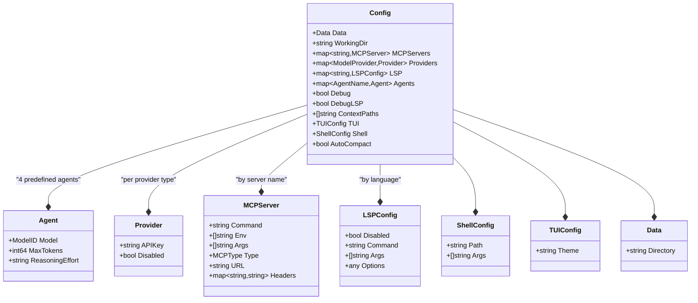
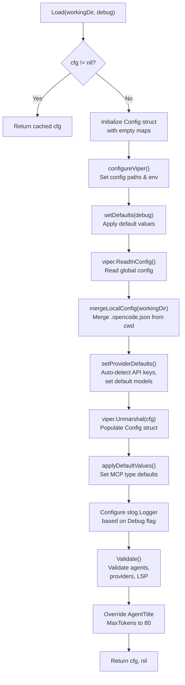
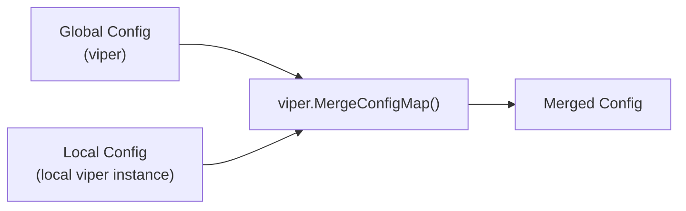
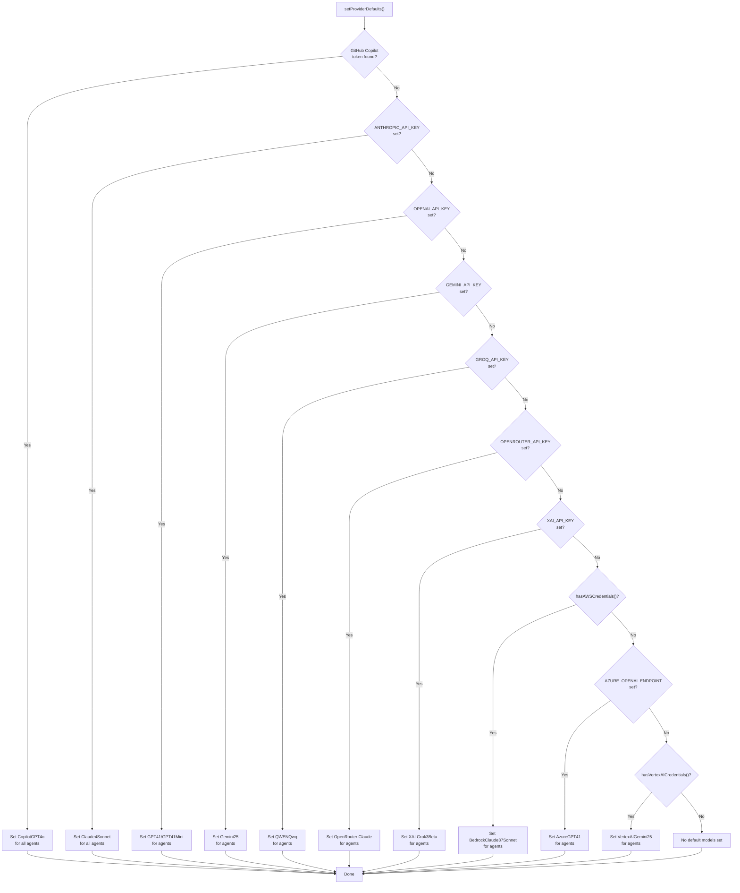
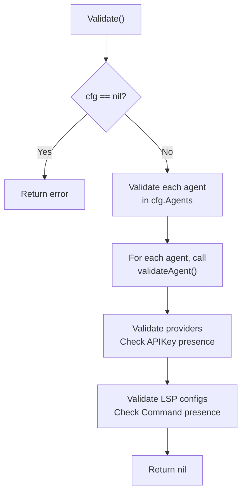
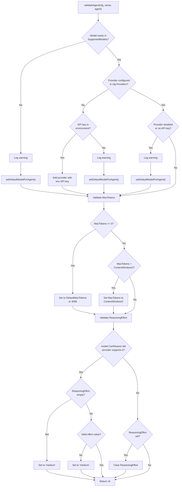
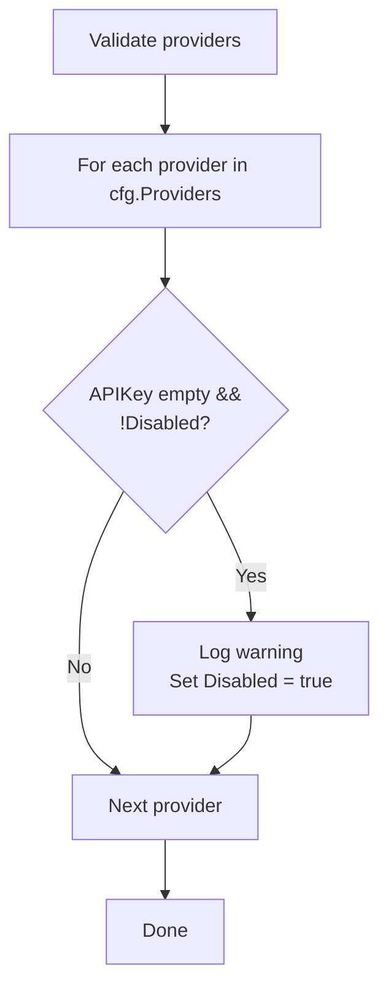
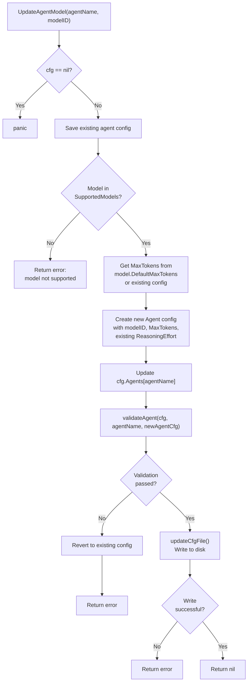
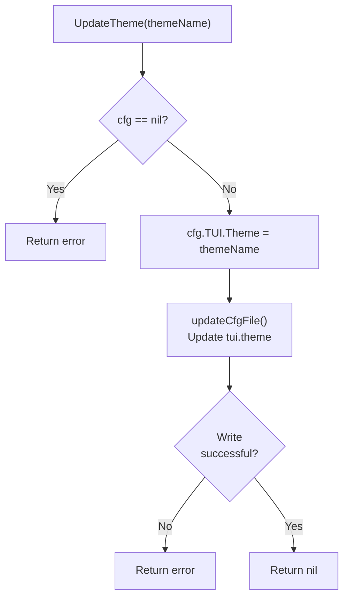
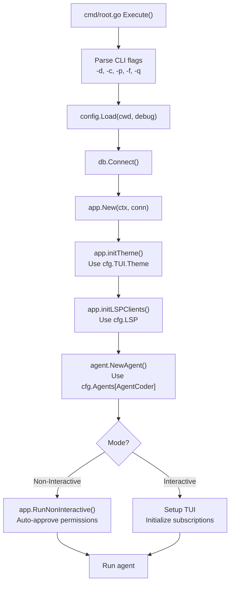

# Configuration System

<details>
<summary>Relevant source files</summary>

The following files were used as context for generating this wiki page:

- [README.md](README.md)
- [cmd/root.go](cmd/root.go)
- [internal/app/app.go](internal/app/app.go)
- [internal/config/config.go](internal/config/config.go)

</details>


The Configuration System manages all application settings for OpenCode, including LLM provider credentials, agent configurations, LSP settings, MCP server definitions, and runtime preferences. It implements a hierarchical configuration merging strategy that combines environment variables, multiple configuration file locations, and intelligent defaults with automatic provider detection. For information about the Agent System that consumes this configuration, see [Agent System](#3.3).

## Configuration Structure

The configuration system is built around several key data structures that organize settings into logical groups.

### Core Configuration Types

The main configuration structure is the `Config` type, which aggregates all configuration domains:

| Field | Type | Purpose |
|-------|------|---------|
| `Data` | `Data` | Storage directory configuration |
| `WorkingDir` | `string` | Current working directory |
| `MCPServers` | `map[string]MCPServer` | MCP server definitions |
| `Providers` | `map[ModelProvider]Provider` | LLM provider credentials |
| `LSP` | `map[string]LSPConfig` | Language server configurations |
| `Agents` | `map[AgentName]Agent` | Agent-specific model settings |
| `Debug` | `bool` | Debug mode flag |
| `DebugLSP` | `bool` | LSP-specific debug flag |
| `ContextPaths` | `[]string` | Project context file paths |
| `TUI` | `TUIConfig` | Terminal UI settings |
| `Shell` | `ShellConfig` | Shell execution settings |
| `AutoCompact` | `bool` | Auto-compaction feature flag |

### Agent Configuration

The `Agent` type defines LLM model selection and token limits for different agent roles:

| Field | Type | Description |
|-------|------|-------------|
| `Model` | `models.ModelID` | Selected model identifier |
| `MaxTokens` | `int64` | Maximum output tokens |
| `ReasoningEffort` | `string` | Reasoning level ("low", "medium", "high") for supported models |

Four agent names are predefined as constants:
- `AgentCoder` - Main coding assistant
- `AgentSummarizer` - Session summarization
- `AgentTask` - Sub-task execution
- `AgentTitle` - Session title generation

### Provider Configuration

The `Provider` type configures individual LLM providers:

| Field | Type | Description |
|-------|------|-------------|
| `APIKey` | `string` | Provider API key or credentials |
| `Disabled` | `bool` | Whether provider is disabled |

Sources: [internal/config/config.go:47-97]()

**Configuration Types Diagram**



Sources: [internal/config/config.go:28-97]()

## Configuration Loading Flow

The configuration loading process follows a multi-stage pipeline that reads from multiple sources, merges them hierarchically, applies defaults, and validates the result.

### Loading Pipeline



Sources: [internal/config/config.go:128-216]()

### Configuration File Locations

The system searches for configuration files in multiple locations, merging them in order of precedence:

1. **Global home directory**: `$HOME/.opencode.json`
2. **XDG config directory**: `$XDG_CONFIG_HOME/opencode/.opencode.json` (or `$HOME/.config/opencode/.opencode.json`)
3. **Local working directory**: `./.opencode.json` (project-specific)

The local configuration file overrides settings from global files, allowing project-specific customization.

**Viper Configuration Setup**

The `configureViper()` function sets up the configuration search paths:

```
SetConfigName(".opencode")
SetConfigType("json")
AddConfigPath("$HOME")
AddConfigPath("$XDG_CONFIG_HOME/opencode")
AddConfigPath("$HOME/.config/opencode")
SetEnvPrefix("OPENCODE")
AutomaticEnv()
```

Sources: [internal/config/config.go:219-227]()

### Local Configuration Merging

The `mergeLocalConfig()` function creates a separate Viper instance to load the local `.opencode.json` file and merges its settings into the global configuration:



Sources: [internal/config/config.go:451-461]()

## Default Values and Provider Auto-detection

The configuration system sets intelligent defaults and automatically detects available LLM providers based on environment variables.

### Default Values

The `setDefaults()` function establishes baseline configuration values:

| Setting | Default Value |
|---------|---------------|
| `data.directory` | `.opencode` |
| `contextPaths` | `.cursorrules`, `CLAUDE.md`, `opencode.md`, etc. |
| `tui.theme` | `opencode` |
| `autoCompact` | `true` |
| `shell.path` | `$SHELL` environment variable or `/bin/bash` |
| `shell.args` | `["-l"]` |
| `debug` | Passed from CLI flag |

The default context paths array includes:
- `.github/copilot-instructions.md`
- `.cursorrules`
- `.cursor/rules/`
- `CLAUDE.md`, `CLAUDE.local.md`
- `opencode.md`, `opencode.local.md`
- `OpenCode.md`, `OpenCode.local.md`
- `OPENCODE.md`, `OPENCODE.local.md`

Sources: [internal/config/config.go:108-120](), [internal/config/config.go:230-251]()

### Provider Auto-detection and Default Model Selection

The `setProviderDefaults()` function implements a sophisticated provider detection system that:

1. Scans environment variables for API keys
2. Checks for cloud provider credentials (AWS, GCP)
3. Selects default models based on provider priority

**Provider Detection Priority**

The system checks providers in this order and sets default models for the first available provider:



Sources: [internal/config/config.go:255-387]()

### Environment Variable Detection

| Environment Variable | Provider | Detection Function |
|---------------------|----------|-------------------|
| `ANTHROPIC_API_KEY` | Anthropic | Direct environment check |
| `OPENAI_API_KEY` | OpenAI | Direct environment check |
| `GEMINI_API_KEY` | Google Gemini | Direct environment check |
| `GROQ_API_KEY` | Groq | Direct environment check |
| `OPENROUTER_API_KEY` | OpenRouter | Direct environment check |
| `XAI_API_KEY` | xAI | Direct environment check |
| `AZURE_OPENAI_ENDPOINT` | Azure OpenAI | Direct environment check |
| `AWS_ACCESS_KEY_ID`, `AWS_SECRET_ACCESS_KEY` | AWS Bedrock | `hasAWSCredentials()` |
| `VERTEXAI_PROJECT`, `VERTEXAI_LOCATION` | Google Cloud VertexAI | `hasVertexAICredentials()` |
| `GITHUB_TOKEN` or copilot config files | GitHub Copilot | `LoadGitHubToken()` |

The `hasAWSCredentials()` function checks for AWS credentials through multiple methods:
- Explicit access keys (`AWS_ACCESS_KEY_ID`, `AWS_SECRET_ACCESS_KEY`)
- AWS profile (`AWS_PROFILE`, `AWS_DEFAULT_PROFILE`)
- AWS region (`AWS_REGION`, `AWS_DEFAULT_REGION`)
- EC2 instance profile (`AWS_CONTAINER_CREDENTIALS_RELATIVE_URI`)

The `hasVertexAICredentials()` function checks for:
- Explicit VertexAI parameters (`VERTEXAI_PROJECT`, `VERTEXAI_LOCATION`)
- Google Cloud project and region (`GOOGLE_CLOUD_PROJECT`, `GOOGLE_CLOUD_REGION`)

Sources: [internal/config/config.go:258-387](), [internal/config/config.go:390-426]()

### GitHub Copilot Token Loading

The `LoadGitHubToken()` function searches multiple locations for GitHub Copilot authentication:

1. `GITHUB_TOKEN` environment variable
2. `~/.config/github-copilot/hosts.json` (or `$XDG_CONFIG_HOME/github-copilot/hosts.json`)
3. `~/.config/github-copilot/apps.json`

It parses the JSON files to extract `oauth_token` from entries containing `github.com`.

Sources: [internal/config/config.go:933-980]()

## Validation System

The validation system ensures that all configuration settings are valid and consistent before the application starts.

### Validation Pipeline



Sources: [internal/config/config.go:609-641]()

### Agent Validation

The `validateAgent()` function performs comprehensive validation for each agent configuration:

**Agent Validation Flow**



Sources: [internal/config/config.go:475-606]()

### Validation Rules

| Validation Type | Rule | Action on Failure |
|----------------|------|-------------------|
| Model Existence | Model ID must exist in `models.SupportedModels` | Set default model for agent |
| Provider Configuration | Provider must be configured with API key | Attempt to use environment variable or set default |
| Provider Status | Provider must not be disabled | Set default model from available providers |
| Max Tokens | Must be > 0 | Set to `model.DefaultMaxTokens` or 4096 |
| Context Window | Must be ≤ `model.ContextWindow / 2` | Adjust to half context window |
| Reasoning Effort | Must be "low", "medium", or "high" for reasoning models | Set to "medium" |
| LSP Command | Must be specified if not disabled | Mark as disabled |

Sources: [internal/config/config.go:475-641]()

### Provider Validation

After agent validation, the system validates provider configurations:



Sources: [internal/config/config.go:622-629]()

## Runtime Configuration Updates

The configuration system supports runtime updates for certain settings, allowing changes without restarting the application.

### Updatable Configuration

Two configuration domains support runtime updates:

1. **Agent Model Selection** - `UpdateAgentModel()`
2. **Theme Selection** - `UpdateTheme()`

### Update Agent Model

The `UpdateAgentModel()` function allows switching an agent's model at runtime:



The update process:
1. Validates that the new model exists
2. Creates a new agent configuration with appropriate max tokens
3. Validates the new configuration
4. If valid, writes to the config file on disk
5. If validation fails, reverts the in-memory configuration

Sources: [internal/config/config.go:879-915]()

### Update Theme

The `UpdateTheme()` function changes the TUI theme:



Sources: [internal/config/config.go:918-930]()

### Configuration File Update Mechanism

The `updateCfgFile()` function provides a safe way to update the configuration file:

1. Determines the config file path (uses `viper.ConfigFileUsed()` or creates `~/.opencode.json`)
2. Reads the existing file content
3. Parses JSON into a `Config` struct
4. Applies the update function provided by the caller
5. Marshals back to JSON with indentation
6. Writes to disk with 0644 permissions

This approach ensures that:
- Only the specified fields are updated
- Other user configuration is preserved
- The file format remains valid JSON
- Default values are not unnecessarily written

Sources: [internal/config/config.go:819-863]()

## Environment Variables

The configuration system supports extensive environment variable integration for sensitive data and runtime configuration.

### Supported Environment Variables

| Variable | Purpose | Used By |
|----------|---------|---------|
| `ANTHROPIC_API_KEY` | Anthropic API authentication | Provider auto-detection, `setProviderDefaults()` |
| `OPENAI_API_KEY` | OpenAI API authentication | Provider auto-detection, `setProviderDefaults()` |
| `GEMINI_API_KEY` | Google Gemini API authentication | Provider auto-detection, `setProviderDefaults()` |
| `GROQ_API_KEY` | Groq API authentication | Provider auto-detection, `setProviderDefaults()` |
| `OPENROUTER_API_KEY` | OpenRouter API authentication | Provider auto-detection, `setProviderDefaults()` |
| `XAI_API_KEY` | xAI API authentication | Provider auto-detection, `setProviderDefaults()` |
| `AZURE_OPENAI_ENDPOINT` | Azure OpenAI endpoint URL | Azure provider detection |
| `AZURE_OPENAI_API_KEY` | Azure OpenAI API key | Azure provider configuration |
| `AZURE_OPENAI_API_VERSION` | Azure OpenAI API version | Azure provider configuration |
| `AWS_ACCESS_KEY_ID` | AWS access key | Bedrock provider detection |
| `AWS_SECRET_ACCESS_KEY` | AWS secret key | Bedrock provider detection |
| `AWS_REGION` | AWS region | Bedrock provider detection |
| `AWS_PROFILE` | AWS profile name | Bedrock provider detection |
| `VERTEXAI_PROJECT` | Google Cloud project | VertexAI provider detection |
| `VERTEXAI_LOCATION` | Google Cloud location | VertexAI provider detection |
| `GITHUB_TOKEN` | GitHub authentication token | Copilot provider detection |
| `SHELL` | Default shell path | Shell configuration |
| `XDG_CONFIG_HOME` | XDG config directory | Config file location |
| `OPENCODE_DEV_DEBUG` | Development debug mode | Special debug file logging |
| `LOCAL_ENDPOINT` | Self-hosted model endpoint | Local provider configuration |

Sources: [internal/config/config.go:258-387](), [README.md:101-122]()

### Environment Variable Priority

Environment variables are processed at multiple stages with different priorities:

1. **Viper Auto Environment** - `viper.AutomaticEnv()` with `OPENCODE_` prefix enables automatic environment variable binding
2. **Provider Defaults** - `setProviderDefaults()` explicitly checks environment variables to set defaults
3. **Validation** - `validateAgent()` uses `getProviderAPIKey()` to check environment variables if provider is not configured

The provider API key resolution follows this priority:
1. Configuration file value (if present and non-empty)
2. Viper default from environment (set by `setProviderDefaults()`)
3. Direct environment check during validation (fallback)

Sources: [internal/config/config.go:219-227](), [internal/config/config.go:255-387](), [internal/config/config.go:644-668]()

## Integration with Application Initialization

The configuration system is tightly integrated with the application startup sequence.

### Configuration Usage in Application



Sources: [cmd/root.go:49-183]()

### Configuration Access Patterns

The application accesses configuration through two primary patterns:

**Global Configuration Access**

The `Get()` function returns the global configuration instance:

```
cfg := config.Get()
// Access configuration fields
dataDir := cfg.Data.Directory
theme := cfg.TUI.Theme
```

**Working Directory Access**

The `WorkingDirectory()` function provides quick access to the working directory:

```
wd := config.WorkingDirectory()
```

This function panics if configuration is not loaded, enforcing that configuration must be initialized before use.

Sources: [internal/config/config.go:867-877]()

### Configuration in Service Initialization

Services use configuration during initialization:

| Service | Configuration Used |
|---------|-------------------|
| `app.New()` | Creates services, initializes theme from `cfg.TUI.Theme` |
| `app.initLSPClients()` | Iterates `cfg.LSP` to initialize language servers |
| `agent.NewAgent()` | Uses `cfg.Agents[agentName]` for model and token configuration |
| `db.Connect()` | Uses `cfg.Data.Directory` for database location |
| `theme.SetTheme()` | Uses `cfg.TUI.Theme` |

Sources: [internal/app/app.go:42-97](), [cmd/root.go:85-114]()

## Configuration Schema

The complete configuration schema in JSON format:

```json
{
  "data": {
    "directory": ".opencode"
  },
  "providers": {
    "openai": {
      "apiKey": "sk-...",
      "disabled": false
    },
    "anthropic": {
      "apiKey": "sk-ant-...",
      "disabled": false
    },
    "gemini": {
      "apiKey": "...",
      "disabled": false
    }
  },
  "agents": {
    "coder": {
      "model": "claude-4-sonnet",
      "maxTokens": 8192,
      "reasoningEffort": "medium"
    },
    "task": {
      "model": "gpt-4.1-mini",
      "maxTokens": 4096
    },
    "title": {
      "model": "gpt-4.1-mini",
      "maxTokens": 80
    },
    "summarizer": {
      "model": "claude-4-sonnet",
      "maxTokens": 8192
    }
  },
  "mcpServers": {
    "filesystem": {
      "type": "stdio",
      "command": "/path/to/mcp-server",
      "args": [],
      "env": []
    },
    "web-service": {
      "type": "sse",
      "url": "https://example.com/mcp",
      "headers": {
        "Authorization": "Bearer token"
      }
    }
  },
  "lsp": {
    "go": {
      "disabled": false,
      "command": "gopls",
      "args": [],
      "options": {}
    },
    "typescript": {
      "disabled": false,
      "command": "typescript-language-server",
      "args": ["--stdio"]
    }
  },
  "shell": {
    "path": "/bin/bash",
    "args": ["-l"]
  },
  "tui": {
    "theme": "opencode"
  },
  "contextPaths": [
    ".cursorrules",
    "CLAUDE.md",
    "opencode.md"
  ],
  "debug": false,
  "debugLSP": false,
  "autoCompact": true
}
```

Sources: [README.md:141-204](), [internal/config/config.go:84-97]()