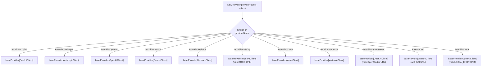
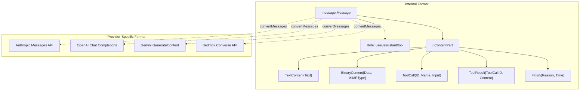
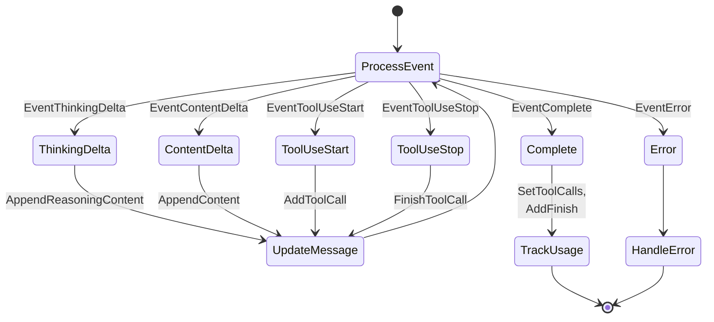
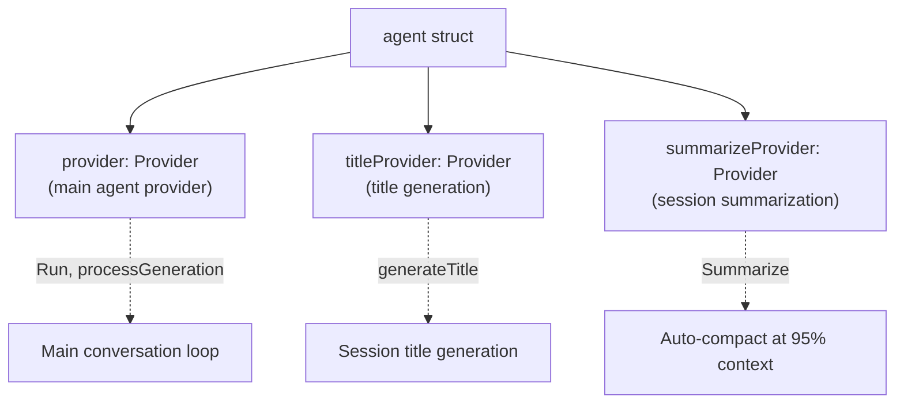

# LLM Integration

<details>
<summary>Relevant source files</summary>

The following files were used as context for generating this wiki page:

- [README.md](README.md)
- [internal/llm/agent/agent.go](internal/llm/agent/agent.go)
- [internal/llm/models/models.go](internal/llm/models/models.go)
- [internal/llm/provider/provider.go](internal/llm/provider/provider.go)

</details>


## Purpose and Scope

This document describes how OpenCode integrates with Large Language Models through a unified abstraction layer. The LLM integration system provides a common interface for interacting with multiple AI providers (Anthropic, OpenAI, Gemini, AWS Bedrock, etc.) while handling provider-specific message conversion, streaming responses, error handling, and rate limiting.

For details on specific provider implementations, see [LLM Providers](#3.2). For information on how the agent orchestrates LLM interactions with tools, see [Agent System](#3.3). For model selection and registry details, see [Model Registry](#3.1). For prompt construction, see [Prompt Generation](#3.4).

**Sources:** [internal/llm/provider/provider.go:1-248](), [internal/llm/agent/agent.go:1-759](), [README.md:428-441]()

## Provider Abstraction Layer

The system abstracts all LLM providers behind a unified `Provider` interface defined in [internal/llm/provider/provider.go:53-59](). This interface specifies three core methods that all providers must implement:

| Method | Purpose | Return Type |
|--------|---------|-------------|
| `SendMessages` | Synchronous request/response | `*ProviderResponse, error` |
| `StreamResponse` | Asynchronous streaming responses | `<-chan ProviderEvent` |
| `Model` | Get current model metadata | `models.Model` |

The `Provider` interface enables the application to switch between different LLM providers without changing business logic. The factory pattern is used to instantiate providers based on configuration.

**Sources:** [internal/llm/provider/provider.go:53-59](), [internal/llm/provider/provider.go:86-168]()

### Provider Factory

The `NewProvider` factory function instantiates the appropriate provider implementation based on the `ModelProvider` type:



The factory supports provider reuse through base URL configuration. For example, GROQ, OpenRouter, XAI, and local providers all use the `OpenAIClient` implementation with different base URLs configured through `WithOpenAIBaseURL` option.

**Sources:** [internal/llm/provider/provider.go:86-168]()

### Provider Client Options

Provider instantiation uses the functional options pattern. The `ProviderClientOption` type allows flexible configuration:

| Option | Purpose | Usage |
|--------|---------|-------|
| `WithAPIKey` | Set authentication key | All providers |
| `WithModel` | Set model metadata | All providers |
| `WithMaxTokens` | Set output token limit | All providers |
| `WithSystemMessage` | Set system prompt | All providers |
| `WithAnthropicOptions` | Provider-specific options | Anthropic only |
| `WithOpenAIOptions` | Provider-specific options | OpenAI, GROQ, etc. |
| `WithGeminiOptions` | Provider-specific options | Gemini, VertexAI |
| `WithBedrockOptions` | Provider-specific options | Bedrock only |
| `WithCopilotOptions` | Provider-specific options | Copilot only |

The `providerClientOptions` struct aggregates all configuration, and provider implementations extract their relevant options during initialization.

**Sources:** [internal/llm/provider/provider.go:61-72](), [internal/llm/provider/provider.go:195-247]()

## Agent-Provider Integration

The agent system creates and manages provider instances through the `createAgentProvider` function. This function performs configuration-driven provider instantiation:

```mermaid
sequenceDiagram
    participant Agent as agent.NewAgent
    participant Create as createAgentProvider
    participant Config as config.Get
    participant Models as SupportedModels
    participant Factory as provider.NewProvider
    participant Prompt as prompt.GetAgentPrompt
    
    Agent->>Create: createAgentProvider(agentName)
    Create->>Config: Get agent config
    Config-->>Create: AgentConfig{Model, MaxTokens}
    
    Create->>Models: Lookup model by ID
    Models-->>Create: Model metadata
    
    Create->>Config: Get provider config
    Config-->>Create: ProviderConfig{APIKey, Disabled}
    
    Create->>Create: Validate provider enabled
    
    Create->>Prompt: GetAgentPrompt(agentName, provider)
    Prompt-->>Create: System message
    
    Create->>Factory: NewProvider(provider, opts...)
    Note over Create,Factory: opts include: APIKey, Model,<br/>MaxTokens, SystemMessage,<br/>ReasoningEffort, etc.
    
    Factory-->>Create: Provider instance
    Create-->>Agent: Provider
```

The function performs several validation steps:
1. Retrieves agent configuration from config file
2. Looks up model metadata in `SupportedModels` registry
3. Retrieves provider configuration (API key, enabled status)
4. Validates provider is enabled
5. Generates appropriate system prompt for the agent
6. Builds provider options including reasoning parameters
7. Instantiates provider through factory

**Sources:** [internal/llm/agent/agent.go:706-758](), [internal/llm/agent/agent.go:73-111]()

## Message Flow

### Request Processing

The agent invokes the provider through the `StreamResponse` method, which returns a channel of `ProviderEvent` structs. The agent processes these events to build the assistant's response incrementally:

```mermaid
flowchart LR
    Agent["agent.streamAndHandleEvents"]
    Provider["provider.StreamResponse"]
    EventChan["<-chan ProviderEvent"]
    Process["agent.processEvent"]
    Database["message.Service.Update"]
    
    Agent -->|"messages, tools"| Provider
    Provider -->|"returns"| EventChan
    EventChan -->|"for event := range"| Process
    Process -->|"update message"| Database
```



The `ProviderEvent` struct carries different types of events during streaming:

| Event Type | Purpose | Content Fields |
|------------|---------|----------------|
| `EventContentDelta` | Text content chunk | `Content` |
| `EventThinkingDelta` | Reasoning content chunk | `Thinking` |
| `EventToolUseStart` | Tool call initiated | `ToolCall.ID, Name` |
| `EventToolUseDelta` | Tool input chunk | `ToolCall.Input` |
| `EventToolUseStop` | Tool call complete | `ToolCall.ID` |
| `EventComplete` | Response finished | `Response` |
| `EventError` | Error occurred | `Error` |

**Sources:** [internal/llm/provider/provider.go:13-28](), [internal/llm/provider/provider.go:44-52](), [internal/llm/agent/agent.go:322-438]()

### Message Conversion

Each provider implementation handles conversion between OpenCode's internal message format and the provider's API format. The internal format uses `message.Message` with `message.ContentPart` types:



The `baseProvider` type cleans messages before sending by removing empty messages through the `cleanMessages` method. Provider-specific clients then convert the cleaned messages to their API format.

**Sources:** [internal/llm/provider/provider.go:170-179](), [internal/llm/provider/provider.go:181-193]()

## Streaming Event Processing

The agent processes streaming events in a loop, updating the assistant message incrementally and persisting changes to the database. The event processing flow handles different event types:



Key aspects of event processing:

1. **Content Streaming**: Text and reasoning content are appended incrementally through `AppendContent` and `AppendReasoningContent` methods
2. **Tool Call Tracking**: Tool calls are added as they start and marked complete when finished
3. **Database Updates**: After each significant event, the message is persisted through `messages.Update`
4. **Usage Tracking**: When complete, token usage is tracked and session cost is updated
5. **Error Handling**: Errors cancel processing and mark the message as canceled

**Sources:** [internal/llm/agent/agent.go:445-492]()

## Provider Response Structure

The `ProviderResponse` struct aggregates the final response from a provider:

| Field | Type | Purpose |
|-------|------|---------|
| `Content` | `string` | Final text content |
| `ToolCalls` | `[]message.ToolCall` | Tool invocations requested |
| `Usage` | `TokenUsage` | Token consumption metrics |
| `FinishReason` | `message.FinishReason` | Why generation stopped |

Token usage tracks four categories:
- `InputTokens`: Regular input tokens
- `OutputTokens`: Generated output tokens  
- `CacheCreationTokens`: Tokens written to prompt cache
- `CacheReadTokens`: Tokens read from prompt cache

This granular tracking enables accurate cost calculation for providers that support prompt caching (Anthropic, Gemini).

**Sources:** [internal/llm/provider/provider.go:30-42](), [internal/llm/agent/agent.go:494-514]()

## Error Handling and Retries

The provider layer implements exponential backoff for retries. The constant `maxRetries = 8` defines the retry limit. Provider implementations handle:

1. **Rate Limiting**: Exponential backoff for 429 status codes
2. **Network Errors**: Retry transient network failures
3. **Timeout Handling**: Respect context cancellation
4. **API Errors**: Surface non-retryable errors immediately

Context cancellation is checked throughout the streaming loop:

```go
select {
case <-ctx.Done():
    return ctx.Err()
default:
    // Continue processing
}
```

When a request is canceled, the agent marks the message with `FinishReasonCanceled` and returns `ErrRequestCancelled`.

**Sources:** [internal/llm/provider/provider.go:15](), [internal/llm/agent/agent.go:278-283](), [internal/llm/agent/agent.go:344-347]()

## Provider Instance Management

The agent maintains provider instances for different purposes:



Each provider is configured for its specific role:
- **Main Provider**: Configured with full tool access, uses configured model
- **Title Provider**: Uses `AgentTitle` configuration, no tools, short max tokens
- **Summarize Provider**: Uses `AgentSummarizer` configuration, no tools

The `Update` method allows runtime model switching for the main provider after validating no requests are active.

**Sources:** [internal/llm/agent/agent.go:59-71](), [internal/llm/agent/agent.go:73-111](), [internal/llm/agent/agent.go:516-533]()

## Synchronous vs Streaming Requests

The `Provider` interface supports both synchronous and streaming patterns:

### Synchronous: `SendMessages`

Used for title generation and summarization where tool execution is not needed:

```go
response, err := provider.SendMessages(ctx, messages, tools)
// Returns complete ProviderResponse with content, usage, etc.
```

### Streaming: `StreamResponse`  

Used for main agent interactions where real-time updates and tool execution are required:

```go
eventChan := provider.StreamResponse(ctx, messages, tools)
for event := range eventChan {
    // Process events incrementally
}
```

The streaming approach enables:
- Real-time UI updates as content arrives
- Progressive tool execution during generation
- Early cancellation without waiting for full response
- Reduced perceived latency for long responses

**Sources:** [internal/llm/provider/provider.go:53-59](), [internal/llm/agent/agent.go:154-189](), [internal/llm/agent/agent.go:609-613]()