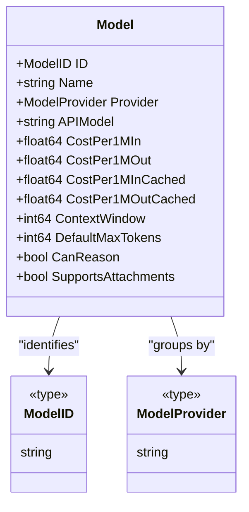
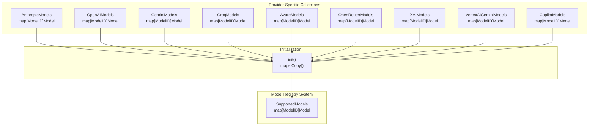
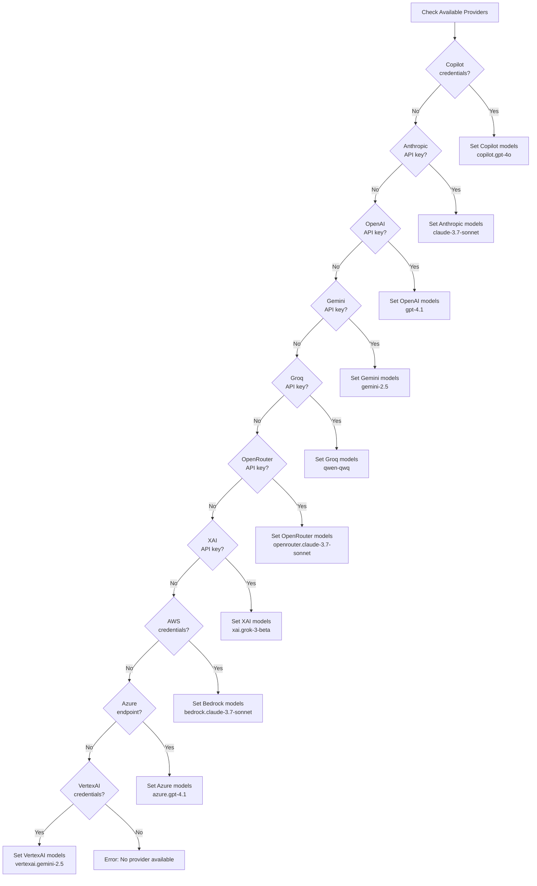
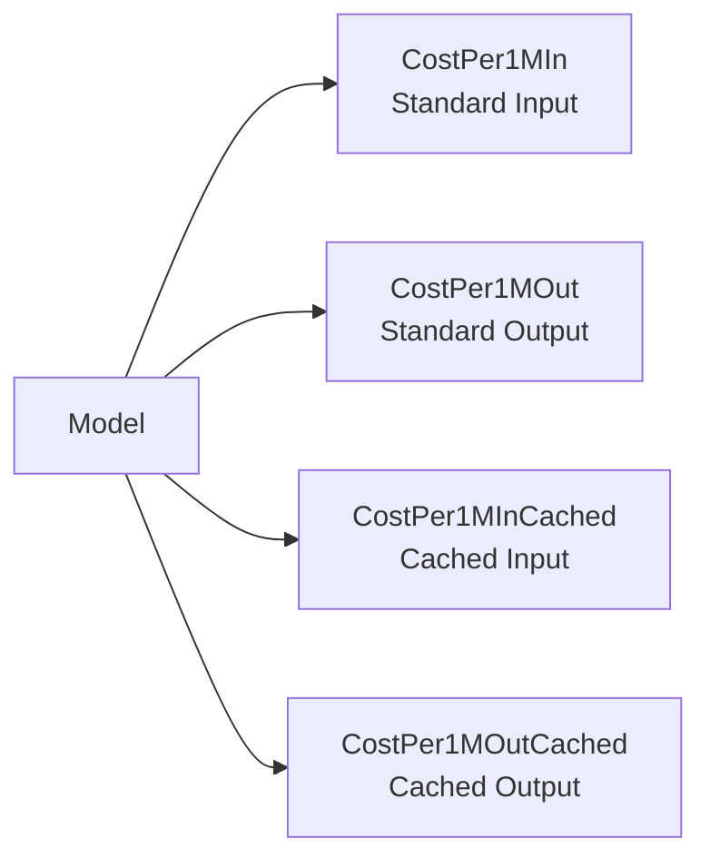
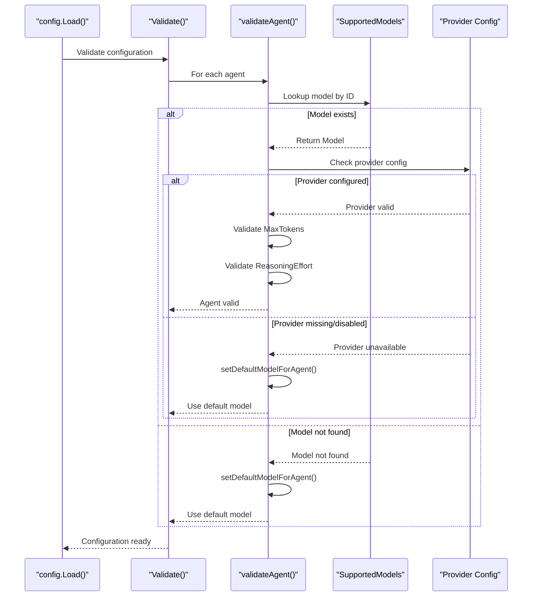
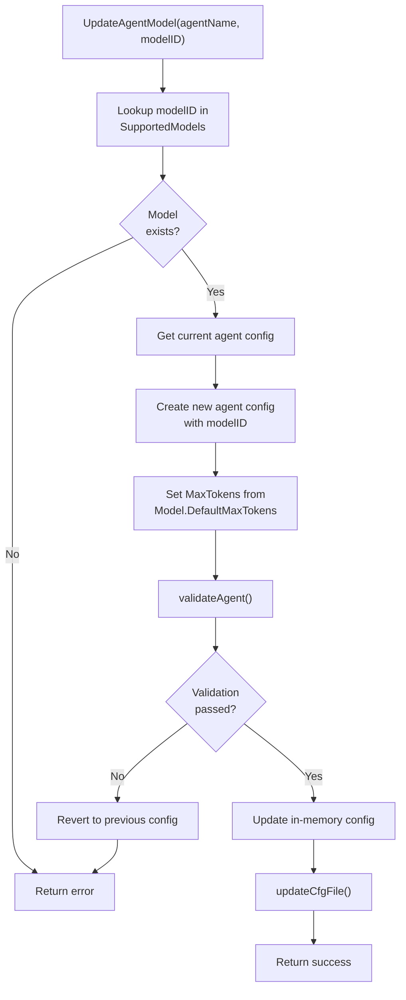

# Model Registry

<details>
<summary>Relevant source files</summary>

The following files were used as context for generating this wiki page:

- [internal/config/config.go](internal/config/config.go)
- [internal/llm/models/models.go](internal/llm/models/models.go)

</details>


## Purpose and Scope

The Model Registry is a centralized system that maintains metadata for all supported Large Language Models (LLMs) across multiple providers. It defines model capabilities (reasoning, attachments), cost structures, context windows, and API-specific identifiers. This registry serves as the single source of truth for model information throughout the application, enabling provider-agnostic model selection, usage tracking, and validation.

For information about how these models are used by LLM providers, see [LLM Providers](#3.2). For information about how models are selected and configured for agents, see [Configuration System](#2).

**Sources:** [internal/llm/models/models.go:1-99]()

---

## Core Data Types

The Model Registry defines two fundamental types that serve as keys and identifiers throughout the system:

### Type Definitions

```go
type ModelID string       // Unique identifier for each model
type ModelProvider string // Provider namespace (anthropic, openai, gemini, etc.)
```

**Sources:** [internal/llm/models/models.go:5-8]()

### ModelID Examples

Model IDs follow a hierarchical naming convention: `[provider-prefix].[model-name]`

| ModelID | Provider | Purpose |
|---------|----------|---------|
| `claude-3.7-sonnet` | Anthropic | General coding tasks |
| `gpt-4.1` | OpenAI | Advanced reasoning |
| `gemini-2.5` | Google Gemini | Multimodal tasks |
| `bedrock.claude-3.7-sonnet` | AWS Bedrock | Claude via AWS |
| `azure.gpt-4.1` | Azure OpenAI | GPT-4 via Azure |
| `copilot.gpt-4o` | GitHub Copilot | Copilot-proxied models |

**Sources:** [internal/llm/models/models.go:26-29](), [internal/config/config.go:309-386]()

### ModelProvider Constants

```go
const (
    ProviderBedrock    ModelProvider = "bedrock"
    ProviderAnthropic  ModelProvider = "anthropic"
    ProviderOpenAI     ModelProvider = "openai"
    ProviderGemini     ModelProvider = "gemini"
    ProviderGROQ       ModelProvider = "groq"
    ProviderOpenRouter ModelProvider = "openrouter"
    ProviderAzure      ModelProvider = "azure"
    ProviderVertexAI   ModelProvider = "vertexai"
    ProviderCopilot    ModelProvider = "copilot"
    ProviderLocal      ModelProvider = "local"
    ProviderXAI        ModelProvider = "xai"
)
```

**Sources:** [internal/llm/models/models.go:32-35]()

---

## Model Definition Structure

Each model in the registry is represented by a `Model` struct that encapsulates all metadata needed for model selection, cost tracking, and capability detection.



**Model Structure Diagram**: Shows the `Model` struct and its relationship with `ModelID` and `ModelProvider` types

**Sources:** [internal/llm/models/models.go:10-23]()

### Field Descriptions

| Field | Type | Purpose |
|-------|------|---------|
| `ID` | `ModelID` | Unique identifier used throughout the application |
| `Name` | `string` | Human-readable display name |
| `Provider` | `ModelProvider` | Provider namespace for grouping and routing |
| `APIModel` | `string` | Actual model identifier sent to the provider's API |
| `CostPer1MIn` | `float64` | Cost per 1 million input tokens (USD) |
| `CostPer1MOut` | `float64` | Cost per 1 million output tokens (USD) |
| `CostPer1MInCached` | `float64` | Cost per 1 million cached input tokens (USD) |
| `CostPer1MOutCached` | `float64` | Cost per 1 million cached output tokens (USD) |
| `ContextWindow` | `int64` | Maximum context size in tokens |
| `DefaultMaxTokens` | `int64` | Recommended max tokens for output |
| `CanReason` | `bool` | Supports reasoning/chain-of-thought features |
| `SupportsAttachments` | `bool` | Supports file attachments in messages |

**Sources:** [internal/llm/models/models.go:10-23]()

### APIModel Mapping

The `APIModel` field maps internal model IDs to provider-specific API identifiers. This abstraction allows OpenCode to use consistent internal identifiers while adapting to each provider's naming conventions.

**Example:**
```go
BedrockClaude37Sonnet: {
    ID:       BedrockClaude37Sonnet,              // "bedrock.claude-3.7-sonnet"
    APIModel: "anthropic.claude-3-7-sonnet-20250219-v1:0",  // AWS Bedrock format
    Provider: ProviderBedrock,
}
```

**Sources:** [internal/llm/models/models.go:76-85]()

---

## SupportedModels Registry

The `SupportedModels` map is the central registry that maps every `ModelID` to its corresponding `Model` definition. This map is populated at initialization from provider-specific model collections.



**SupportedModels Population**: Shows how provider-specific model maps are merged into the central `SupportedModels` registry at initialization

**Sources:** [internal/llm/models/models.go:50-98]()

### Initialization Process

The registry is populated in the `init()` function using Go's `maps.Copy` to merge provider-specific collections:

```go
func init() {
    maps.Copy(SupportedModels, AnthropicModels)
    maps.Copy(SupportedModels, OpenAIModels)
    maps.Copy(SupportedModels, GeminiModels)
    maps.Copy(SupportedModels, GroqModels)
    maps.Copy(SupportedModels, AzureModels)
    maps.Copy(SupportedModels, OpenRouterModels)
    maps.Copy(SupportedModels, XAIModels)
    maps.Copy(SupportedModels, VertexAIGeminiModels)
    maps.Copy(SupportedModels, CopilotModels)
}
```

This approach allows each provider's models to be defined in separate files (e.g., `anthropic.go`, `openai.go`) while maintaining a unified registry for lookup.

**Sources:** [internal/llm/models/models.go:88-98]()

---

## Provider Organization

### Provider Popularity Ranking

The `ProviderPopularity` map defines the preference order for default model selection when multiple providers have valid credentials:

```go
var ProviderPopularity = map[ModelProvider]int{
    ProviderCopilot:    1,  // GitHub Copilot (highest priority)
    ProviderAnthropic:  2,  // Anthropic Claude
    ProviderOpenAI:     3,  // OpenAI GPT
    ProviderGemini:     4,  // Google Gemini
    ProviderGROQ:       5,  // Groq
    ProviderOpenRouter: 6,  // OpenRouter
    ProviderBedrock:    7,  // AWS Bedrock
    ProviderAzure:      8,  // Azure OpenAI
    ProviderVertexAI:   9,  // Google Cloud Vertex AI
}
```

This ranking is used by the configuration system to automatically select default models based on available API keys and credentials.

**Sources:** [internal/llm/models/models.go:38-48]()

### Provider Selection Flow



**Default Provider Selection Flow**: Illustrates the cascading logic used to select default models based on `ProviderPopularity` order and credential availability

**Sources:** [internal/config/config.go:287-387]()

---

## Model Capabilities

### Reasoning Support

Models with `CanReason: true` support advanced reasoning features. For OpenAI and compatible providers, this enables the `reasoning_effort` parameter:

| Model | CanReason | Provider | Reasoning Effort Values |
|-------|-----------|----------|------------------------|
| `o1` | ✓ | OpenAI | low, medium, high |
| `o1-mini` | ✓ | OpenAI | low, medium, high |
| `o3-mini` | ✓ | OpenAI | low, medium, high |
| GPT models | ✗ | OpenAI | N/A |
| Claude models | ✗ | Anthropic | N/A (native reasoning) |

**Sources:** [internal/llm/models/models.go:21](), [internal/config/config.go:566-603]()

### Attachment Support

Models with `SupportsAttachments: true` can accept file attachments as part of the input context. This capability is checked before allowing file uploads:

```go
model, exists := models.SupportedModels[modelID]
if !exists || !model.SupportsAttachments {
    return errors.New("model does not support attachments")
}
```

**Sources:** [internal/llm/models/models.go:22]()

---

## Cost Tracking

The Model Registry maintains comprehensive cost information for usage tracking and budget management.

### Cost Structure

Each model defines four cost parameters:



**Cost Components**: Shows the four cost parameters tracked per model

**Example from Bedrock Claude:**
```go
BedrockClaude37Sonnet: {
    CostPer1MIn:        3.0,    // $3 per 1M input tokens
    CostPer1MOut:       15.0,   // $15 per 1M output tokens
    CostPer1MInCached:  3.75,   // $3.75 per 1M cached input tokens
    CostPer1MOutCached: 0.30,   // $0.30 per 1M cached output tokens
}
```

**Sources:** [internal/llm/models/models.go:15-18](), [internal/llm/models/models.go:81-84]()

### Cache-Aware Pricing

Some providers (Anthropic, Gemini) support prompt caching, which reduces costs for repeated context. The registry tracks both standard and cached token costs to enable accurate usage tracking:

- **Standard tokens**: First-time processing
- **Cached tokens**: Previously processed content reused across requests

**Sources:** [internal/llm/models/models.go:17-18]()

---

## Context Window Management

### Context Window Field

The `ContextWindow` field specifies the maximum number of tokens a model can process in a single request (input + output):

| Model | Context Window | Notes |
|-------|---------------|-------|
| Claude 3.7 Sonnet | 200,000 | ~150K words |
| GPT-4.1 | 128,000 | ~96K words |
| Gemini 2.5 | 1,000,000 | ~750K words |

**Sources:** [internal/llm/models/models.go:19]()

### DefaultMaxTokens

The `DefaultMaxTokens` field provides a recommended output token limit for the model. This is used as a fallback when no explicit limit is configured:

```go
if agent.MaxTokens <= 0 {
    if model.DefaultMaxTokens > 0 {
        agent.MaxTokens = model.DefaultMaxTokens
    } else {
        agent.MaxTokens = MaxTokensFallbackDefault  // 4096
    }
}
```

**Sources:** [internal/llm/models/models.go:20](), [internal/config/config.go:544-550]()

### Context Window Validation

The configuration system validates that `MaxTokens` doesn't exceed half the context window:

```go
if model.ContextWindow > 0 && agent.MaxTokens > model.ContextWindow/2 {
    agent.MaxTokens = model.ContextWindow / 2
}
```

This ensures sufficient space for both input context and output generation.

**Sources:** [internal/config/config.go:551-563]()

---

## Integration with Configuration System

The Model Registry integrates tightly with the configuration system to validate agent configurations and provide intelligent defaults.



**Model Validation Flow**: Shows how the configuration system validates agent models against the registry and falls back to defaults

**Sources:** [internal/config/config.go:474-606]()

### Agent Configuration

Agents reference models by `ModelID` in the configuration:

```go
type Agent struct {
    Model           models.ModelID  `json:"model"`
    MaxTokens       int64           `json:"maxTokens"`
    ReasoningEffort string          `json:"reasoningEffort"`
}
```

**Sources:** [internal/config/config.go:47-51]()

### Validation Process

The `validateAgent()` function performs the following checks:

1. **Model Existence**: Verifies the model exists in `SupportedModels`
2. **Provider Availability**: Ensures the model's provider has valid credentials
3. **MaxTokens Validation**: Sets defaults and validates against context window
4. **Reasoning Effort**: Validates reasoning settings for capable models
5. **Fallback Selection**: Selects default model if validation fails

**Sources:** [internal/config/config.go:475-606]()

### Model Lookup Example

```go
model, modelExists := models.SupportedModels[agent.Model]
if !modelExists {
    // Model not found - fall back to default
    setDefaultModelForAgent(agentName)
}

provider := model.Provider
providerCfg, providerExists := cfg.Providers[provider]
if !providerExists || providerCfg.Disabled || providerCfg.APIKey == "" {
    // Provider not configured - fall back to default
    setDefaultModelForAgent(agentName)
}
```

**Sources:** [internal/config/config.go:480-534]()

---

## Model Update Operations

The configuration system provides runtime model updates through the `UpdateAgentModel()` function:



**Model Update Flow**: Illustrates the process of updating an agent's model at runtime

**Sources:** [internal/config/config.go:879-915]()

### Update Implementation

```go
func UpdateAgentModel(agentName AgentName, modelID models.ModelID) error {
    existingAgentCfg := cfg.Agents[agentName]
    
    // Validate model exists
    model, ok := models.SupportedModels[modelID]
    if !ok {
        return fmt.Errorf("model %s not supported", modelID)
    }
    
    // Create new configuration
    newAgentCfg := Agent{
        Model:           modelID,
        MaxTokens:       model.DefaultMaxTokens,
        ReasoningEffort: existingAgentCfg.ReasoningEffort,
    }
    
    // Validate before committing
    if err := validateAgent(cfg, agentName, newAgentCfg); err != nil {
        return err
    }
    
    // Update configuration file
    return updateCfgFile(func(config *Config) {
        config.Agents[agentName] = newAgentCfg
    })
}
```

**Sources:** [internal/config/config.go:879-915]()

---

## Summary

The Model Registry serves as the authoritative source for LLM model metadata in OpenCode. Key characteristics:

| Aspect | Implementation |
|--------|---------------|
| **Data Structure** | `map[ModelID]Model` with comprehensive metadata |
| **Organization** | Provider-specific maps merged at initialization |
| **Capabilities** | Reasoning support, attachment handling |
| **Cost Tracking** | Per-token costs for standard and cached tokens |
| **Context Management** | Window size and default token limits |
| **Validation** | Integrated with configuration system |
| **Provider Selection** | Popularity-based fallback mechanism |
| **Runtime Updates** | Thread-safe model switching with validation |

The registry enables provider-agnostic model selection while maintaining detailed provider-specific information, supporting OpenCode's flexible multi-provider architecture.

**Sources:** [internal/llm/models/models.go:1-99](), [internal/config/config.go:1-981]()