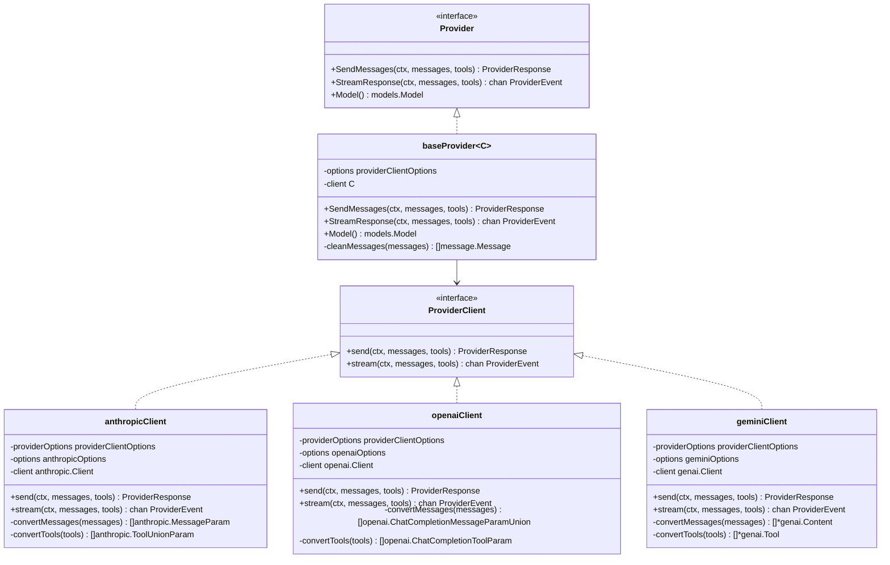
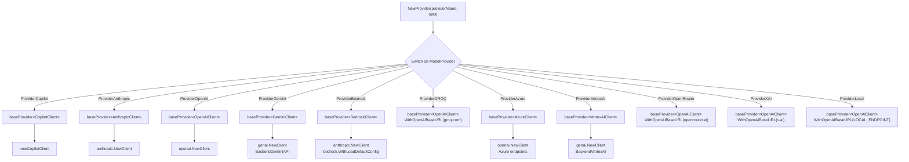
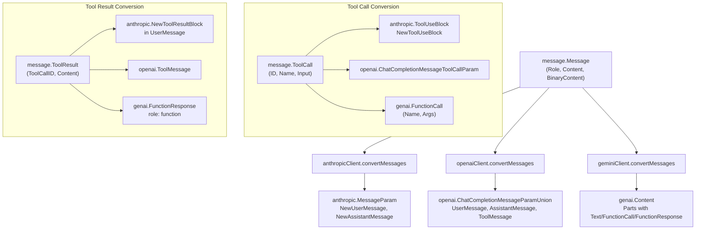
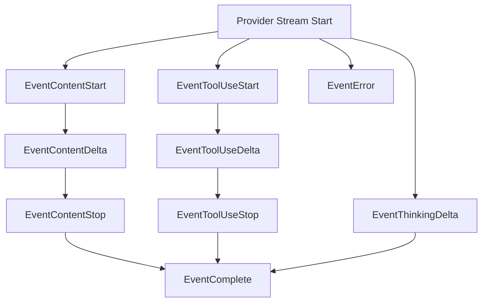
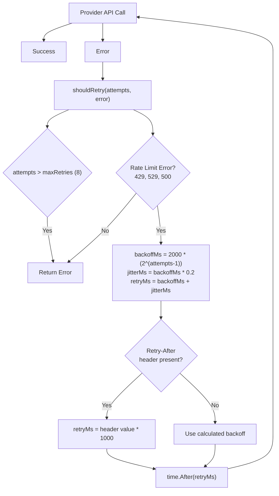
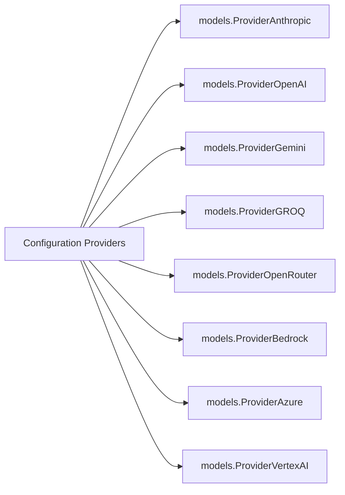

# LLM Providers

Relevant source files

The following files were used as context for generating this wiki page:

- [internal/llm/models/models.go](internal/llm/models/models.go)
- [internal/llm/provider/anthropic.go](internal/llm/provider/anthropic.go)
- [internal/llm/provider/gemini.go](internal/llm/provider/gemini.go)
- [internal/llm/provider/openai.go](internal/llm/provider/openai.go)
- [internal/llm/provider/provider.go](internal/llm/provider/provider.go)

This document covers the LLM provider system in OpenCode, which handles communication with various Large Language Model APIs. The provider system abstracts different LLM services behind a common interface, enabling seamless switching between providers like Anthropic, OpenAI, Gemini, and others.

For information about the agent system that manages LLM interactions and orchestrates tool execution, see [Agent System](#3.2). For details on model definitions and cost tracking, see [LLM Integration](#3).

## Provider Architecture

The LLM provider system uses a two-layer architecture: a public `Provider` interface consumed by the agent system, and an internal `ProviderClient` interface implemented by concrete provider clients. The `baseProvider` wrapper bridges these two layers and handles common concerns like message cleaning.

### Provider Interface Design

**Sources:** [internal/llm/provider/provider.go:53-59](), [internal/llm/provider/provider.go:76-84](), [internal/llm/provider/provider.go:81-193](), [internal/llm/provider/anthropic.go:30-58](), [internal/llm/provider/openai.go:30-66](), [internal/llm/provider/gemini.go:26-51]()

## Provider Factory System

The `NewProvider` factory function creates provider instances based on the `ModelProvider` enum. Each provider has a constructor that initializes the appropriate SDK client with authentication and configuration options. Some providers (GROQ, OpenRouter, XAI, Local) reuse the OpenAI client with custom base URLs.

### Provider Factory Flow

**Sources:** [internal/llm/provider/provider.go:86-168](), [internal/llm/provider/anthropic.go:38-58](), [internal/llm/provider/openai.go:38-66](), [internal/llm/provider/gemini.go:34-51]()

## Message Conversion System

Each provider must convert OpenCode's internal message format to the provider's specific API format. This involves transforming message roles, content types, and handling attachments.

### Message Flow

**Sources:** [internal/llm/provider/anthropic.go:60-119](), [internal/llm/provider/openai.go:68-126](), [internal/llm/provider/gemini.go:53-133]()

### Provider-Specific Message Handling

| Provider | User Messages | Assistant Messages | Tool Results | Binary Content |
|----------|--------------|-------------------|--------------|----------------|
| Anthropic | `anthropic.NewUserMessage` | `anthropic.NewAssistantMessage` | `anthropic.NewToolResultBlock` | Base64 with `anthropic.NewImageBlockBase64` |
| OpenAI | `openai.UserMessage` | `openai.ChatCompletionAssistantMessageParam` | `openai.ToolMessage` | Data URLs with `openai.ChatCompletionContentPartImageParam` |
| Gemini | `genai.Content` with role "user" | `genai.Content` with role "model" | `genai.Content` with role "function" | `genai.Blob` with MIME type |

**Sources:** [internal/llm/provider/anthropic.go:67-116](), [internal/llm/provider/openai.go:74-122](), [internal/llm/provider/gemini.go:56-129]()

## Streaming and Response Handling

All providers support both synchronous and streaming responses. The streaming implementation uses Go channels to provide real-time updates during response generation.

### Streaming Event Types

**Sources:** [internal/llm/provider/anthropic.go:247-393](), [internal/llm/provider/openai.go:241-335](), [internal/llm/provider/gemini.go:256-392]()

## Error Handling and Retry Logic

Each provider implements retry logic with exponential backoff for handling rate limits and transient errors. The system supports up to 8 retry attempts (`maxRetries = 8`) with backoff calculated as `2000ms * (2^(attempts-1))` plus 20% jitter. Providers check API-specific error codes and `Retry-After` headers when available.

### Retry Strategy

### Provider-Specific Error Handling

| Provider | Error Type Check | Status Codes | Retry-After Support |
|----------|-----------------|--------------|---------------------|
| Anthropic | `*anthropic.Error` | 429, 529 | Yes, from header |
| OpenAI | `*openai.Error` | 429, 500 | Yes, from header |
| Gemini | String matching | Check for "rate limit", "quota exceeded" | No, uses calculated backoff |

**Sources:** [internal/llm/provider/provider.go:15](), [internal/llm/provider/anthropic.go:395-421](), [internal/llm/provider/openai.go:337-363](), [internal/llm/provider/gemini.go:394-424]()

## Provider-Specific Features

### Anthropic Features

The Anthropic provider (`anthropicClient`) includes advanced caching capabilities and extended thinking mode support:

| Feature | Implementation | Configuration Option | Details |
|---------|---------------|----------------------|---------|
| Prompt Caching | `CacheControlEphemeralParam` on last 3 messages and last tool | `WithAnthropicDisableCache()` | Caches system message, recent user/assistant messages, and tools |
| Extended Thinking | `ThinkingConfigParamOfEnabled` with 80% of maxTokens | `WithAnthropicShouldThinkFn(fn)` | Triggered when `shouldThink(userMessage)` returns true |
| Bedrock Support | `bedrock.WithLoadDefaultConfig(ctx)` | `WithAnthropicBedrock(true)` | Uses AWS Bedrock for Claude models |
| Temperature Control | Set to 1.0 for thinking mode, 0 otherwise | Automatic | Higher temperature for reasoning tasks |

**Sources:** [internal/llm/provider/anthropic.go:22-26](), [internal/llm/provider/anthropic.go:60-119](), [internal/llm/provider/anthropic.go:162-196](), [internal/llm/provider/anthropic.go:452-472]()

### OpenAI Features

The OpenAI provider (`openaiClient`) supports reasoning models, custom endpoints, and various configuration options:

| Feature | Implementation | Configuration Option | Details |
|---------|---------------|----------------------|---------|
| Reasoning Models | `ReasoningEffort` parameter (low/medium/high) | `WithReasoningEffort(effort)` | Uses `MaxCompletionTokens` instead of `MaxTokens` |
| Custom Base URL | `option.WithBaseURL(url)` | `WithOpenAIBaseURL(url)` | Used by GROQ, OpenRouter, XAI, Local providers |
| Extra Headers | `option.WithHeader(key, value)` | `WithOpenAIExtraHeaders(map)` | For OpenRouter metadata |
| Cache Disable | Configuration flag | `WithOpenAIDisableCache()` | Disables prompt caching |

**Sources:** [internal/llm/provider/openai.go:21-26](), [internal/llm/provider/openai.go:38-66](), [internal/llm/provider/openai.go:162-186](), [internal/llm/provider/openai.go:396-425]()

### Gemini and VertexAI Features

Gemini provider (`geminiClient`) handles Google's API format and supports both standard Gemini API and Google Cloud VertexAI:

| Feature | Implementation | Backend Configuration | Details |
|---------|---------------|----------------------|---------|
| Gemini API | `genai.BackendGeminiAPI` | API key authentication | Standard Google AI API |
| VertexAI | `genai.BackendVertexAI` | Google Cloud credentials | Enterprise Google Cloud API |
| Function Calling | `genai.FunctionCall` and `genai.FunctionResponse` | Native support | Tool definitions in schema format |
| Schema Conversion | `convertSchemaProperties()` | Automatic | Maps JSON schema to `genai.Schema` |
| Cache Support | `CachedContentTokenCount` in usage metadata | Read-only | Reports cached token usage |

**Sources:** [internal/llm/provider/gemini.go:20-24](), [internal/llm/provider/gemini.go:34-51](), [internal/llm/provider/gemini.go:135-155](), [internal/llm/provider/gemini.go:447-458](), [internal/llm/provider/gemini.go:473-545]()

### Bedrock Features

The Bedrock provider (`bedrockClient`) wraps the Anthropic client for AWS Bedrock integration:

| Feature | Implementation | Details |
|---------|---------------|---------|
| AWS Authentication | `bedrock.WithLoadDefaultConfig(ctx)` | Uses AWS SDK default credential chain |
| Model Prefix | Bedrock-specific model IDs | Example: `anthropic.claude-3-7-sonnet-20250219-v1:0` |
| API Compatibility | Reuses `anthropicClient` | Same message/tool conversion as Anthropic |

**Sources:** [internal/llm/provider/anthropic.go:48-50](), [internal/llm/models/models.go:28-29](), [internal/llm/models/models.go:76-85]()

### Copilot Features

GitHub Copilot provider (`copilotClient`) provides integration with GitHub's AI service with special authentication:

| Feature | Implementation | Details |
|---------|---------------|---------|
| Token Authentication | GitHub OAuth token | Requires `GITHUB_TOKEN` environment variable |
| Model Selection | Copilot-specific models | Defined in model registry |

**Sources:** [internal/llm/provider/provider.go:92-96](), [internal/llm/models/models.go:39]()

## Configuration and Supported Providers

The system supports multiple providers as defined in the configuration schema:

**Sources:** [cmd/schema/main.go:194-203](), [internal/llm/models/vertexai.go:4]()