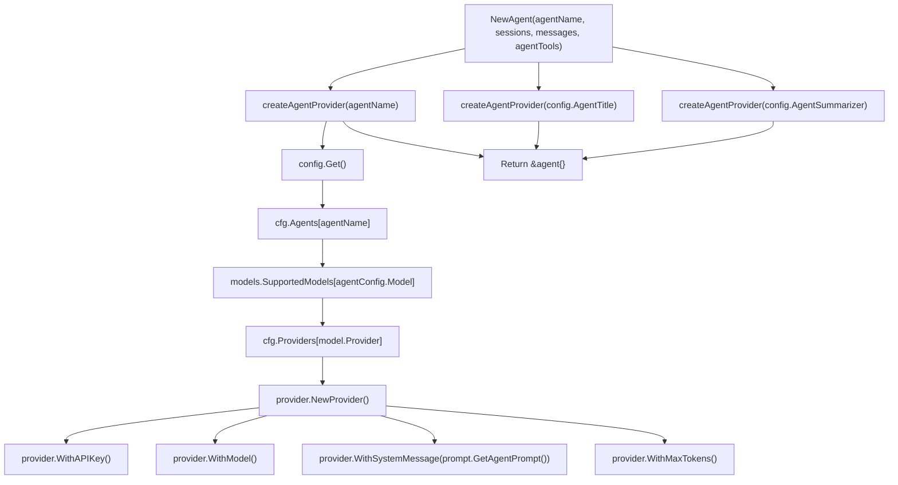
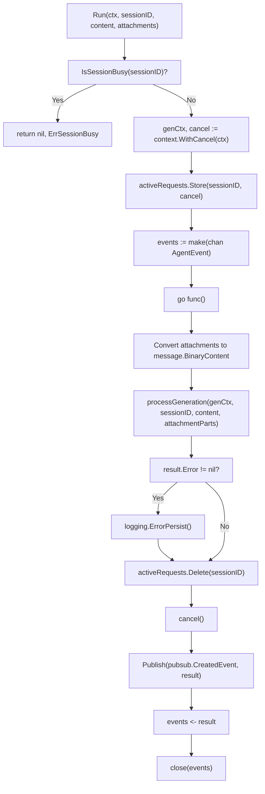
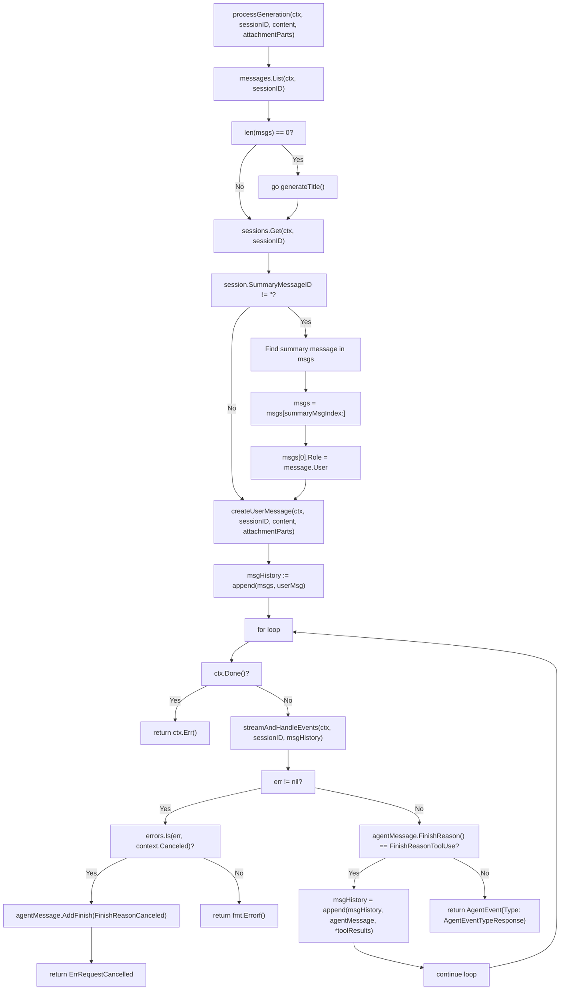
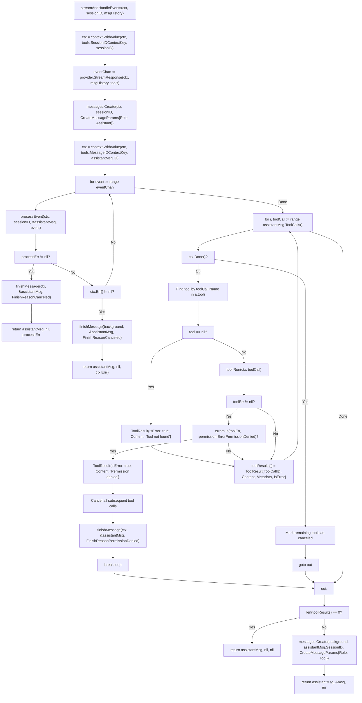
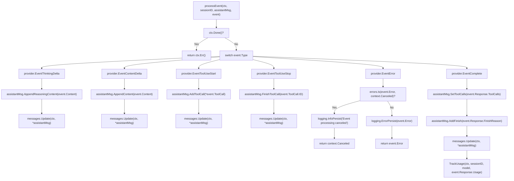
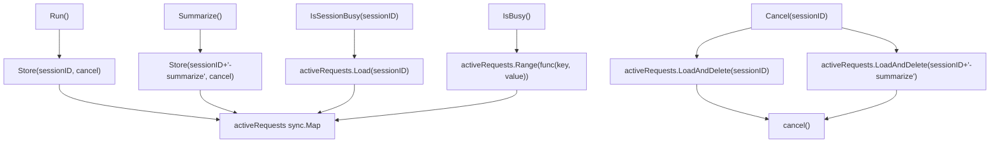
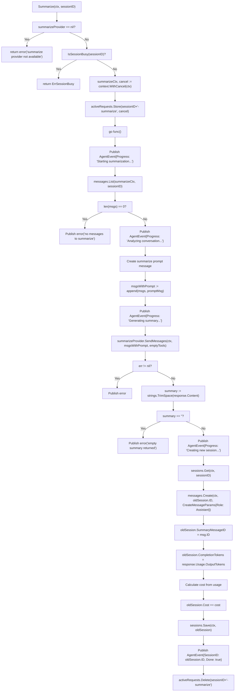
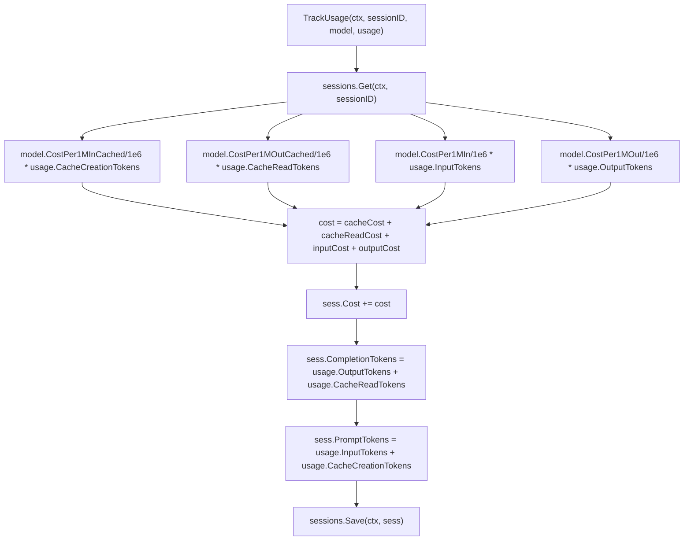
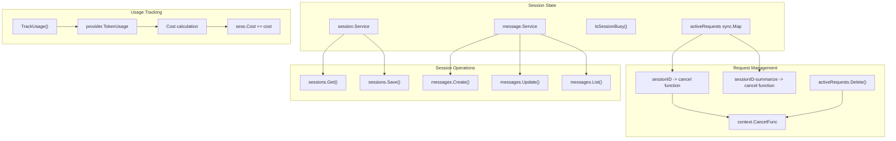

# Agent System

<details>
<summary>Relevant source files</summary>

The following files were used as context for generating this wiki page:

- [cmd/root.go](cmd/root.go)
- [internal/app/app.go](internal/app/app.go)
- [internal/llm/agent/agent.go](internal/llm/agent/agent.go)
- [internal/llm/provider/provider.go](internal/llm/provider/provider.go)

</details>


## Overview

The Agent System provides the core orchestration layer for AI-powered request processing in OpenCode. The primary interface is `agent.Service`, implemented by the `agent` struct in [internal/llm/agent/agent.go](). This system manages the complete lifecycle of AI requests: streaming LLM responses, executing tool calls, tracking usage metrics, and publishing events through a pub/sub broker.

The agent system coordinates between:
- LLM providers (see page 3.2) for model communication
- Tools (see page 6) for code and file operations  
- Session/message services for conversation persistence
- Permission service for user approval flows
- Prompt system (see page 3.4) for context injection

The `agent` struct maintains three specialized providers: a main `provider` for the primary agent, `titleProvider` for session title generation, and `summarizeProvider` for conversation compression.

Sources: [internal/llm/agent/agent.go:1-111](), [internal/app/app.go:62-78]()

## Agent Service Interface

The `agent.Service` interface defines seven methods for agent lifecycle management:

```go
type Service interface {
    pubsub.Subscriber[AgentEvent]
    Model() models.Model
    Run(ctx context.Context, sessionID string, content string, attachments ...message.Attachment) (<-chan AgentEvent, error)
    Cancel(sessionID string)
    IsSessionBusy(sessionID string) bool
    IsBusy() bool
    Update(agentName config.AgentName, modelID models.ModelID) (models.Model, error)
    Summarize(ctx context.Context, sessionID string) error
}
```

**Agent Service Implementation Structure**

```mermaid
graph TB
    ServiceInterface["agent.Service interface"]
    AgentStruct["agent struct"]
    
    BrokerField["*pubsub.Broker[AgentEvent]"]
    SessionsField["sessions session.Service"]
    MessagesField["messages message.Service"]
    ToolsField["tools []tools.BaseTool"]
    ProviderField["provider provider.Provider"]
    TitleProviderField["titleProvider provider.Provider"]
    SummarizeProviderField["summarizeProvider provider.Provider"]
    ActiveRequestsField["activeRequests sync.Map"]
    
    ModelMethod["Model()"]
    RunMethod["Run()"]
    CancelMethod["Cancel()"]
    IsSessionBusyMethod["IsSessionBusy()"]
    IsBusyMethod["IsBusy()"]
    UpdateMethod["Update()"]
    SummarizeMethod["Summarize()"]
    SubscribeMethod["Subscribe()"]
    
    ServiceInterface --> AgentStruct
    AgentStruct --> BrokerField
    AgentStruct --> SessionsField
    AgentStruct --> MessagesField
    AgentStruct --> ToolsField
    AgentStruct --> ProviderField
    AgentStruct --> TitleProviderField
    AgentStruct --> SummarizeProviderField
    AgentStruct --> ActiveRequestsField
    
    ServiceInterface --> ModelMethod
    ServiceInterface --> RunMethod
    ServiceInterface --> CancelMethod
    ServiceInterface --> IsSessionBusyMethod
    ServiceInterface --> IsBusyMethod
    ServiceInterface --> UpdateMethod
    ServiceInterface --> SummarizeMethod
    ServiceInterface --> SubscribeMethod
```



The `agent` struct maintains state through:
- `activeRequests sync.Map`: Maps session IDs to `context.CancelFunc` for cancellation
- `*pubsub.Broker[AgentEvent]`: Publishes events to subscribers (TUI, logging)
- Three provider instances for different agent roles (coder, title, summarizer)

Sources: [internal/llm/agent/agent.go:48-72]()

## Agent Types and Initialization

OpenCode uses three specialized agent configurations via `config.AgentName`:

| Agent Name | Purpose | Tools | Initialization |
|------------|---------|-------|----------------|
| `config.AgentCoder` | Main coding agent | Full tool set passed to `NewAgent()` | Created in `app.New()` |
| `config.AgentTitle` | Session title generation | Empty tool list | Created internally by `NewAgent()` if main agent is `AgentCoder` |
| `config.AgentSummarizer` | Conversation compression | Empty tool list | Created internally by `NewAgent()` if main agent is `AgentCoder` |

**Agent Initialization Flow**



The `createAgentProvider()` function performs model selection and provider configuration:
1. Retrieves agent configuration from `config.Get().Agents[agentName]`
2. Looks up model definition in `models.SupportedModels`
3. Validates provider is enabled in `config.Get().Providers`
4. Creates provider with system prompt via `prompt.GetAgentPrompt()`
5. Configures model-specific options (reasoning effort, thinking function)

Sources: [internal/llm/agent/agent.go:73-111](), [internal/llm/agent/agent.go:706-758](), [internal/app/app.go:62-78]()

## Run Method and Request Processing

The `Run()` method is the primary entry point for processing user requests. It returns a channel of `AgentEvent` and executes asynchronously in a goroutine.

**Run Method Execution Flow**



Key aspects of `Run()`:
- Validates session is not busy via `IsSessionBusy()` before starting
- Creates cancellable context stored in `activeRequests` map with key `sessionID`
- Converts `message.Attachment` to `message.BinaryContent` for model processing
- Delegates to `processGeneration()` for the main processing loop
- Cleans up by calling `activeRequests.Delete()` and context cancellation
- Publishes final result via `pubsub.Broker` and sends to returned channel

Sources: [internal/llm/agent/agent.go:198-231]()

## processGeneration Method

The `processGeneration()` method implements the core request processing logic with an iterative tool execution loop.

**processGeneration Processing Loop**



The `processGeneration()` method handles:
1. **Message History**: Loads existing messages via `messages.List()`
2. **Title Generation**: Launches async title generation if first message in session
3. **Summary Handling**: If `session.SummaryMessageID` exists, truncates history to start from summary
4. **User Message Creation**: Creates new user message with content and attachments
5. **Agentic Loop**: Repeatedly calls `streamAndHandleEvents()` until non-tool response
6. **Tool Continuation**: Appends assistant message and tool results to history for next iteration

Sources: [internal/llm/agent/agent.go:233-311]()

## streamAndHandleEvents Method

The `streamAndHandleEvents()` method processes streaming responses from the LLM provider and executes tool calls.

**streamAndHandleEvents Flow**



Tool execution details:
- **Tool Lookup**: Iterates through `a.tools` to find tool by `toolCall.Name` matching `tool.Info().Name`
- **Permission Handling**: If `permission.ErrorPermissionDenied`, sets remaining tools as "canceled" and breaks loop
- **Context Cancellation**: Checks `ctx.Done()` before each tool execution
- **Tool Results**: Creates `message.ToolResult` for each tool call with `ToolCallID`, `Content`, `Metadata`, `IsError`
- **Message Creation**: Returns tool results as new message with `message.Tool` role

Sources: [internal/llm/agent/agent.go:322-438]()

## processEvent Method

The `processEvent()` method handles individual streaming events from the provider and updates the assistant message accordingly.

**processEvent Event Handling**



Event types and their handling:
- `provider.EventThinkingDelta`: Reasoning content (extended thinking), appended via `AppendReasoningContent()`
- `provider.EventContentDelta`: Streaming text response, appended via `AppendContent()`
- `provider.EventToolUseStart`: New tool call, added via `AddToolCall()`
- `provider.EventToolUseStop`: Tool call complete, marked finished via `FinishToolCall()`
- `provider.EventError`: Error occurred, logged and returned
- `provider.EventComplete`: Stream finished, triggers `TrackUsage()` and sets final finish reason

Each event results in a message update via `messages.Update()` for real-time persistence.

Sources: [internal/llm/agent/agent.go:445-492]()

## Cancel Method and Busy State Management

The `Cancel()` method stops active requests by invoking stored cancellation functions. The agent tracks two types of cancellations:

```go
func (a *agent) Cancel(sessionID string) {
    // Cancel regular requests
    if cancelFunc, exists := a.activeRequests.LoadAndDelete(sessionID); exists {
        cancel()
    }
    // Also check for summarize requests
    if cancelFunc, exists := a.activeRequests.LoadAndDelete(sessionID + "-summarize"); exists {
        cancel()
    }
}
```

**Request State Management**



Busy state checking:
- `IsSessionBusy(sessionID)`: Checks if specific session has active request via `activeRequests.Load(sessionID)`
- `IsBusy()`: Checks if any session has active request via `activeRequests.Range()`
- Used by `Run()` to return `ErrSessionBusy` if session already processing
- Used by `Update()` to prevent model changes during active requests

Sources: [internal/llm/agent/agent.go:117-153]()

## Summarize Method

The `Summarize()` method compresses conversation history into a summary message, enabling context window management at scale.

**Summarize Execution Flow**



The summarization process:
1. **Validation**: Checks `summarizeProvider` exists and session not busy
2. **Message Loading**: Retrieves all messages via `messages.List()`
3. **Prompt Creation**: Appends system prompt: "Provide a detailed but concise summary..."
4. **LLM Call**: Invokes `summarizeProvider.SendMessages()` without tools
5. **Summary Storage**: Creates assistant message with `message.FinishReasonEndTurn`
6. **Session Update**: Sets `session.SummaryMessageID` to new message ID
7. **Cost Tracking**: Calculates and adds summarization cost to session

Subsequent requests to this session will truncate message history to start from the summary message via `processGeneration()`.

Sources: [internal/llm/agent/agent.go:535-704]()

## Update Method and Usage Tracking

The `Update()` method allows dynamic model switching for an agent:

```go
func (a *agent) Update(agentName config.AgentName, modelID models.ModelID) (models.Model, error) {
    if a.IsBusy() {
        return models.Model{}, fmt.Errorf("cannot change model while processing requests")
    }
    config.UpdateAgentModel(agentName, modelID)
    provider, err := createAgentProvider(agentName)
    a.provider = provider
    return a.provider.Model(), nil
}
```

The `TrackUsage()` method records token consumption and costs after each LLM response:

**Usage Tracking and Cost Calculation**



Token usage components from `provider.TokenUsage`:
- `InputTokens`: Non-cached input tokens
- `OutputTokens`: Generated response tokens
- `CacheCreationTokens`: Tokens written to cache (e.g., Anthropic prompt caching)
- `CacheReadTokens`: Tokens read from cache

Cost calculation uses model-specific pricing from `models.Model`:
- `CostPer1MIn`: Price per 1M input tokens
- `CostPer1MOut`: Price per 1M output tokens
- `CostPer1MInCached`: Price per 1M cache creation tokens
- `CostPer1MOutCached`: Price per 1M cache read tokens

Sources: [internal/llm/agent/agent.go:494-514](), [internal/llm/agent/agent.go:516-533]()

## AgentEvent Structure and Publishing

The `AgentEvent` struct provides typed events for agent state changes:

```go
type AgentEvent struct {
    Type    AgentEventType      // error, response, summarize
    Message message.Message     // Final message for response events
    Error   error              // Error details
    SessionID string            // For summarize events
    Progress  string            // Progress updates during summarize
    Done      bool              // Completion flag
}
```

Event types:
- `AgentEventTypeError`: Contains `Error` field with failure details
- `AgentEventTypeResponse`: Contains `Message` field with final assistant message
- `AgentEventTypeSummarize`: Contains `Progress` and `SessionID` for summarization updates

Events are published via the embedded `*pubsub.Broker[AgentEvent]` which the TUI subscribes to for real-time updates.

Sources: [internal/llm/agent/agent.go:29-46](), [cmd/root.go:249-259]()

## Session and State Management

Agents maintain state through session management and active request tracking:



The system tracks:
- **Active Requests**: Using `sync.Map` to store cancellation functions
- **Session Busy State**: Preventing concurrent requests on the same session
- **Usage Metrics**: Token consumption and cost calculation
- **Message History**: Conversation context and summarization state

Sources: [internal/llm/agent/agent.go:117-153](), [internal/llm/agent/agent.go:479-499](), [internal/llm/agent/agent.go:249-265]()