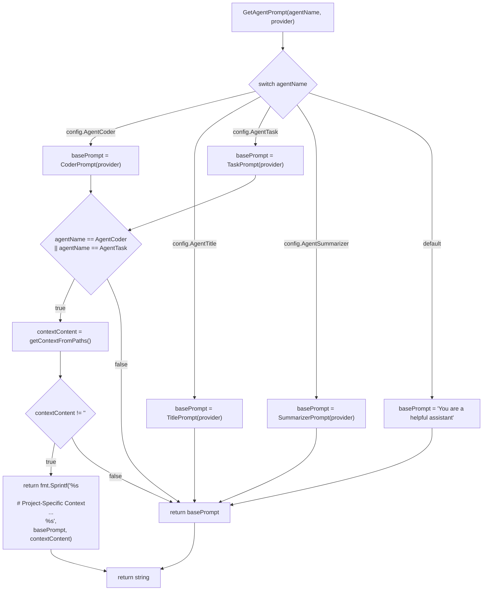
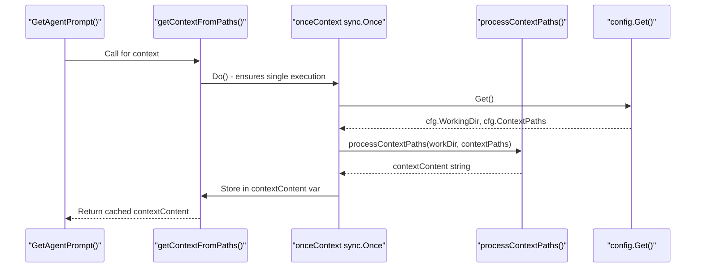
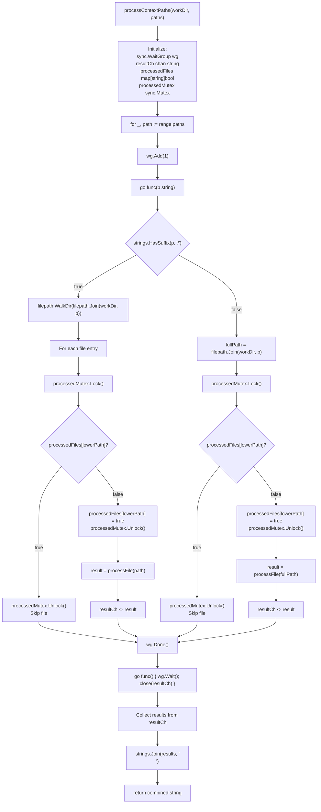
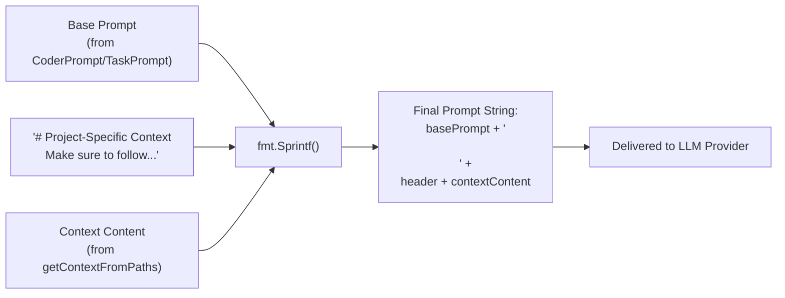
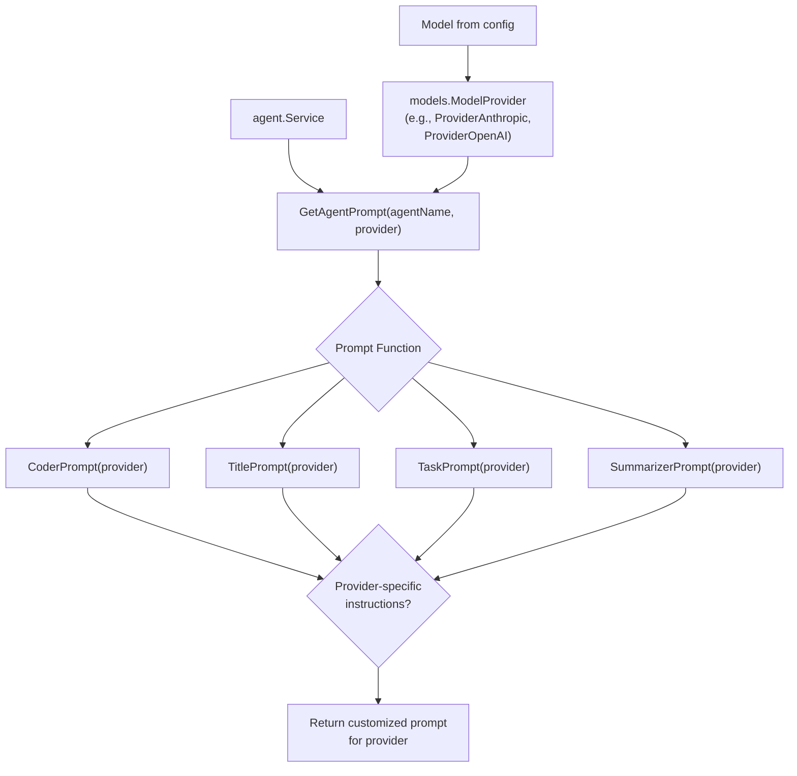

# Prompt Generation

<details>
<summary>Relevant source files</summary>

The following files were used as context for generating this wiki page:

- [README.md](README.md)
- [cmd/schema/main.go](cmd/schema/main.go)
- [internal/config/config.go](internal/config/config.go)
- [internal/llm/models/vertexai.go](internal/llm/models/vertexai.go)
- [internal/llm/prompt/prompt.go](internal/llm/prompt/prompt.go)
- [internal/llm/provider/vertexai.go](internal/llm/provider/vertexai.go)

</details>


The prompt generation system constructs customized system prompts for AI agents by combining base prompt templates with project-specific context files. The system is implemented in [internal/llm/prompt/prompt.go]() and integrates with the configuration system to locate and load context files.

## Overview

The prompt generation system provides the `GetAgentPrompt()` function, which selects agent-specific base prompts and optionally enriches them with project context. For `AgentCoder` and `AgentTask` agents, the system loads content from configured context paths (e.g., `.cursorrules`, `CLAUDE.md`) and appends it to the base prompt. Context loading uses a `sync.Once` pattern for efficient caching across multiple invocations.

*Sources: [internal/llm/prompt/prompt.go:15-39]()*

## GetAgentPrompt Function

The `GetAgentPrompt(agentName config.AgentName, provider models.ModelProvider)` function serves as the main entry point for prompt generation. It performs agent-based prompt selection and conditional context injection.

**Prompt Generation Flow Diagram**



*Sources: [internal/llm/prompt/prompt.go:15-39]()*

### Agent-Specific Base Prompts

Each agent type has a dedicated prompt function that returns provider-specific instructions:

| Agent Type | Function | Context Injection |
|-----------|----------|------------------|
| `config.AgentCoder` | `CoderPrompt(provider)` | Yes |
| `config.AgentTask` | `TaskPrompt(provider)` | Yes |
| `config.AgentTitle` | `TitlePrompt(provider)` | No |
| `config.AgentSummarizer` | `SummarizerPrompt(provider)` | No |

The `provider` parameter allows prompt functions to customize instructions based on the LLM provider (e.g., `models.ProviderAnthropic`, `models.ProviderOpenAI`).

*Sources: [internal/llm/prompt/prompt.go:15-28]()*

## Context Injection System

Context injection loads project-specific instruction files and appends them to base prompts for `AgentCoder` and `AgentTask`. The system uses concurrent file processing and `sync.Once` caching to ensure efficient context loading.

### Context Loading Architecture

**Context Loading Sequence Diagram**



*Sources: [internal/llm/prompt/prompt.go:41-58]()*

### Concurrent Path Processing

The `processContextPaths(workDir string, paths []string)` function uses goroutines to process multiple context paths concurrently, with synchronization to prevent duplicate file processing.

**Path Processing Flow Diagram**



*Sources: [internal/llm/prompt/prompt.go:60-129]()*

### File Processing

The `processFile(filePath string)` function reads file content and formats it with a path header:

```go
func processFile(filePath string) string {
    content, err := os.ReadFile(filePath)
    if err != nil {
        return ""  // Silent error handling - returns empty string
    }
    return "# From:" + filePath + "\n" + string(content)
}
```

Files that cannot be read (permissions, not found, etc.) are silently skipped, allowing the prompt generation to continue with available context files.

*Sources: [internal/llm/prompt/prompt.go:131-137]()*

## Configuration Integration

### Default Context Paths

Context paths are configured via `config.Config.ContextPaths` with defaults defined in `defaultContextPaths`:

| Path Pattern | Description |
|-------------|-------------|
| `.github/copilot-instructions.md` | GitHub Copilot instructions |
| `.cursorrules` | Cursor IDE rules file |
| `.cursor/rules/` | Cursor IDE rules directory |
| `CLAUDE.md` | Claude-specific instructions |
| `CLAUDE.local.md` | Local Claude instructions (gitignored) |
| `opencode.md` | OpenCode instructions (lowercase) |
| `opencode.local.md` | Local OpenCode instructions (lowercase) |
| `OpenCode.md` | OpenCode instructions (title case) |
| `OpenCode.local.md` | Local OpenCode instructions (title case) |
| `OPENCODE.md` | OpenCode instructions (uppercase) |
| `OPENCODE.local.md` | Local OpenCode instructions (uppercase) |

These paths are relative to `config.Config.WorkingDir`. Paths ending with `/` are treated as directories and are recursively walked. Multiple case variants allow cross-platform compatibility and user preference.

*Sources: [internal/config/config.go:108-120]()*

### Configuration Schema

The `contextPaths` configuration field is defined in the JSON schema generated by [cmd/schema/main.go]():

```json
{
  "contextPaths": {
    "type": "array",
    "description": "Context paths for the application",
    "items": {
      "type": "string"
    },
    "default": [
      ".github/copilot-instructions.md",
      ".cursorrules",
      ".cursor/rules/",
      "CLAUDE.md",
      "CLAUDE.local.md",
      "opencode.md",
      "opencode.local.md",
      "OpenCode.md",
      "OpenCode.local.md",
      "OPENCODE.md",
      "OPENCODE.local.md"
    ]
  }
}
```

Users can override `contextPaths` in their configuration file (`~/.opencode.json` or `./.opencode.json`) to customize which files are loaded as context.

*Sources: [cmd/schema/main.go:80-99]()*

## Prompt Assembly

The final prompt combines the base prompt with formatted context content using a specific template format.

**Prompt Assembly Diagram**



The assembly format is:

```
{basePrompt}

# Project-Specific Context
Make sure to follow the instructions in the context below
{contextContent}
```

*Sources: [internal/llm/prompt/prompt.go:30-36]()*

## Provider-Specific Customization

The `models.ModelProvider` parameter passed to prompt functions enables provider-specific prompt customization. This allows different instruction formats for different LLM providers while maintaining a unified interface.

**Provider Integration Diagram**



Provider-specific prompts can adjust instruction style, formatting preferences, and capability descriptions to match each LLM's strengths and expected input format.

*Sources: [internal/llm/prompt/prompt.go:15](), [internal/llm/models/vertexai.go:1-10]()*

## Concurrency and Caching

### Sync.Once Caching

The `getContextFromPaths()` function uses `sync.Once` to ensure context is loaded only once per application lifecycle:

```go
var (
    onceContext    sync.Once
    contextContent string
)

func getContextFromPaths() string {
    onceContext.Do(func() {
        var (
            cfg          = config.Get()
            workDir      = cfg.WorkingDir
            contextPaths = cfg.ContextPaths
        )
        contextContent = processContextPaths(workDir, contextPaths)
    })
    return contextContent
}
```

This pattern provides efficient caching across multiple agent invocations within a single session. The context is loaded once on first call and reused for subsequent prompts.

*Sources: [internal/llm/prompt/prompt.go:41-58]()*

### Concurrent File Processing

The `processContextPaths()` function uses the following concurrency primitives:

| Primitive | Purpose |
|-----------|---------|
| `sync.WaitGroup` | Wait for all path processing goroutines to complete |
| `chan string` | Collect processed file content from goroutines |
| `sync.Mutex` | Protect `processedFiles` map from concurrent access |
| `map[string]bool` | Track processed files (case-insensitive) to avoid duplicates |

Each context path is processed in a separate goroutine. Directory paths use `filepath.WalkDir()` to recursively process all files. The system ensures case-insensitive duplicate detection by storing lowercase file paths in the `processedFiles` map.

*Sources: [internal/llm/prompt/prompt.go:60-129]()*

## Error Handling and Resilience

The system implements graceful error handling for file reading operations and provides fallback behavior when context files are unavailable.

### File Processing Error Handling

The `processFile` function handles file reading errors by returning an empty string, allowing the prompt generation to continue even when some context files are inaccessible.

```go
func processFile(filePath string) string {
    content, err := os.ReadFile(filePath)
    if err != nil {
        return ""
    }
    return "# From:" + filePath + "\n" + string(content)
}
```

*Sources: [internal/llm/prompt/prompt.go:131-137]()*

## Integration with Model Providers

The prompt generation system accepts a `models.ModelProvider` parameter, allowing for provider-specific prompt customization when needed. This enables different prompt strategies for different LLM providers while maintaining a consistent interface.

*Sources: [internal/llm/prompt/prompt.go:15](), [internal/llm/models/vertexai.go:1-10]()*