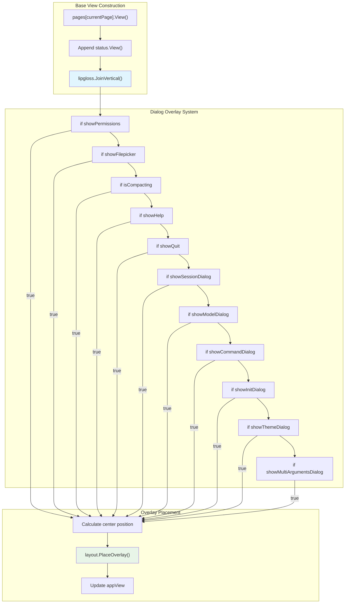
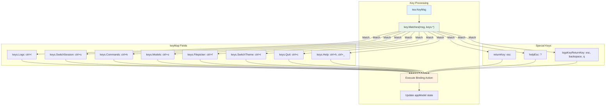
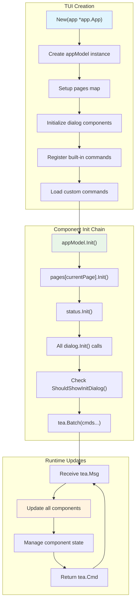

# Terminal UI System

Relevant source files

The following files were used as context for generating this wiki page:

- [README.md](README.md)
- [cmd/root.go](cmd/root.go)
- [internal/app/app.go](internal/app/app.go)
- [internal/tui/tui.go](internal/tui/tui.go)

This document covers the Terminal User Interface (TUI) system, which provides the primary interactive interface for OpenCode. The TUI system is built on the Bubble Tea framework and orchestrates pages, dialogs, and components to create a cohesive terminal-based user experience. For information about specific chat interface components, see [Chat Interface](#5). For details about dialog implementations, see [Dialog System](#5.2).

## Architecture Overview

The TUI system serves as the primary user interface layer in OpenCode's architecture, sitting between the user and the core application logic. It implements the Model-View-Update pattern through the Bubble Tea framework.

### TUI System Architecture

```mermaid
graph TB
    subgraph "TUI Framework Layer"
        BubbleTea["tea.Program"]
        appModel["appModel"]
    end
    
    subgraph "Page Management"
        PageManager["Page System"]
        ChatPage["page.ChatPage"]
        LogsPage["page.LogsPage"]
        currentPage["currentPage PageID"]
        loadedPages["loadedPages map"]
    end
    
    subgraph "Dialog System"
        PermissionDialog["dialog.PermissionDialogCmp"]
        SessionDialog["dialog.SessionDialog"]
        ModelDialog["dialog.ModelDialog"]
        CommandDialog["dialog.CommandDialog"]
        InitDialog["dialog.InitDialogCmp"]
        ThemeDialog["dialog.ThemeDialog"]
        FilepickerDialog["dialog.FilepickerCmp"]
        MultiArgumentsDialog["dialog.MultiArgumentsDialogCmp"]
    end
    
    subgraph "Core Components"
        StatusCmp["core.StatusCmp"]
        HelpCmp["dialog.HelpCmp"]
        QuitDialog["dialog.QuitDialog"]
    end
    
    subgraph "Key Management"
        keyMap["keyMap struct"]
        KeyBindings["Key Bindings"]
    end
    
    subgraph "External Integration"
        AppCore["app.App"]
        PubSubSystem["pubsub.Event"]
        PermissionSystem["permission.PermissionRequest"]
    end

    BubbleTea --> appModel
    appModel --> PageManager
    appModel --> StatusCmp
    appModel --> keyMap
    
    PageManager --> ChatPage
    PageManager --> LogsPage
    PageManager --> currentPage
    PageManager --> loadedPages
    
    appModel --> PermissionDialog
    appModel --> SessionDialog
    appModel --> ModelDialog
    appModel --> CommandDialog
    appModel --> InitDialog
    appModel --> ThemeDialog
    appModel --> FilepickerDialog
    appModel --> MultiArgumentsDialog
    
    appModel --> HelpCmp
    appModel --> QuitDialog
    
    keyMap --> KeyBindings
    
    appModel --> AppCore
    appModel --> PubSubSystem
    PermissionDialog --> PermissionSystem
    
    style appModel fill:#e1f5fe
    style PageManager fill:#e8f5e8
    style StatusCmp fill:#fff3e0
```

Sources: [internal/tui/tui.go:1-966]()

## Core TUI Model

The `appModel` struct serves as the central orchestrator for the entire TUI system, implementing the Bubble Tea `tea.Model` interface with `Init()`, `Update()`, and `View()` methods.

### appModel Structure

```mermaid
graph TB
    subgraph "Core Fields"
        widthHeight["width, height int"]
        currentPage["currentPage page.PageID"]
        previousPage["previousPage page.PageID"] 
        pages["pages map[page.PageID]tea.Model"]
        loadedPages["loadedPages map[page.PageID]bool"]
        app["app *app.App"]
        selectedSession["selectedSession session.Session"]
        status["status core.StatusCmp"]
    end
    
    subgraph "Dialog Boolean Flags"
        showPermissions["showPermissions bool"]
        showHelp["showHelp bool"]
        showQuit["showQuit bool"]
        showSessionDialog["showSessionDialog bool"]
        showCommandDialog["showCommandDialog bool"]
        showModelDialog["showModelDialog bool"]
        showInitDialog["showInitDialog bool"]
        showFilepicker["showFilepicker bool"]
        showThemeDialog["showThemeDialog bool"]
        showMultiArgumentsDialog["showMultiArgumentsDialog bool"]
    end
    
    subgraph "Dialog Component Instances"
        permissions["permissions dialog.PermissionDialogCmp"]
        help["help dialog.HelpCmp"]
        quit["quit dialog.QuitDialog"]
        sessionDialog["sessionDialog dialog.SessionDialog"]
        commandDialog["commandDialog dialog.CommandDialog"]
        modelDialog["modelDialog dialog.ModelDialog"]
        initDialog["initDialog dialog.InitDialogCmp"]
        filepicker["filepicker dialog.FilepickerCmp"]
        themeDialog["themeDialog dialog.ThemeDialog"]
        multiArgumentsDialog["multiArgumentsDialog dialog.MultiArgumentsDialogCmp"]
    end
    
    subgraph "Session Management"
        isCompacting["isCompacting bool"]
        compactingMessage["compactingMessage string"]
        commands["commands []dialog.Command"]
    end

    currentPage --> pages
    previousPage --> pages
    pages --> loadedPages
    
    showPermissions --> permissions
    showHelp --> help
    showQuit --> quit
    showSessionDialog --> sessionDialog
    showCommandDialog --> commandDialog
    showModelDialog --> modelDialog
    showInitDialog --> initDialog
    showFilepicker --> filepicker
    showThemeDialog --> themeDialog
    showMultiArgumentsDialog --> multiArgumentsDialog
    
    isCompacting --> compactingMessage
    
    style app fill:#e1f5fe
    style pages fill:#e8f5e8
    style commands fill:#fff3e0
```

The `appModel` maintains state for all dialogs using boolean flags that control visibility, while keeping instances of each dialog component. This pattern allows for efficient memory usage and state preservation across dialog show/hide cycles.

Sources: [internal/tui/tui.go:98-141]()

## Page System

The TUI uses a page-based navigation system where each page represents a distinct view or functionality area. Pages are managed through the `page.PageID` enumeration and loaded on-demand.

### Page Lifecycle Management

```mermaid
graph TB
    subgraph "Page Initialization"
        NewTUI["New() function"]
        CreatePages["Create pages map"]
        RegisterPages["Register ChatPage, LogsPage"]
        SetStartPage["Set startPage = page.ChatPage"]
    end
    
    subgraph "Page Loading"
        moveToPage["moveToPage(pageID)"]
        CheckLoaded["Check loadedPages[pageID]"]
        InitPage["Call page.Init()"]
        SetLoadedFlag["Set loadedPages[pageID] = true"]
        UpdateCurrentPage["Update currentPage, previousPage"]
        SetSize["Call SetSize() if Sizeable"]
    end
    
    subgraph "Page Update Cycle"
        HandleMessage["Update() receives tea.Msg"]
        UpdateCurrentPage2["Update pages[currentPage]"]
        ReturnCmd["Return tea.Cmd"]
    end
    
    subgraph "Page Rendering"
        ViewCall["View() called"]
        RenderCurrentPage["pages[currentPage].View()"]
        AddStatusBar["Append status.View()"]
        JoinVertical["lipgloss.JoinVertical()"]
    end

    NewTUI --> CreatePages
    CreatePages --> RegisterPages
    RegisterPages --> SetStartPage
    
    moveToPage --> CheckLoaded
    CheckLoaded -->|Not Loaded| InitPage
    CheckLoaded -->|Already Loaded| UpdateCurrentPage
    InitPage --> SetLoadedFlag
    SetLoadedFlag --> UpdateCurrentPage
    UpdateCurrentPage --> SetSize
    
    HandleMessage --> UpdateCurrentPage2
    UpdateCurrentPage2 --> ReturnCmd
    
    ViewCall --> RenderCurrentPage
    RenderCurrentPage --> AddStatusBar
    AddStatusBar --> JoinVertical
    
    style moveToPage fill:#e1f5fe
    style HandleMessage fill:#e8f5e8
    style ViewCall fill:#fff3e0
```

The page system prevents navigation when the `CoderAgent` is busy, ensuring that long-running AI operations don't get interrupted by accidental page switches.

Sources: [internal/tui/tui.go:680-700](), [internal/tui/tui.go:702-708](), [internal/tui/tui.go:901-965]()

## Dialog System

The TUI implements a comprehensive dialog system with multiple overlay dialogs that can be shown simultaneously. Each dialog is managed through boolean state flags and renders as an overlay using the `layout.PlaceOverlay` function.

### Dialog Management Architecture

| Dialog Type | State Flag | Component | Purpose |
|-------------|------------|-----------|---------|
| Permission | `showPermissions` | `dialog.PermissionDialogCmp` | Tool access approval |
| Session | `showSessionDialog` | `dialog.SessionDialog` | Session switching |
| Command | `showCommandDialog` | `dialog.CommandDialog` | Custom command execution |
| Model | `showModelDialog` | `dialog.ModelDialog` | LLM model selection |
| Init | `showInitDialog` | `dialog.InitDialogCmp` | Project initialization |
| Theme | `showThemeDialog` | `dialog.ThemeDialog` | Theme switching |
| Filepicker | `showFilepicker` | `dialog.FilepickerCmp` | File selection |
| Multi-Arguments | `showMultiArgumentsDialog` | `dialog.MultiArgumentsDialogCmp` | Command argument input |
| Help | `showHelp` | `dialog.HelpCmp` | Keyboard shortcuts |
| Quit | `showQuit` | `dialog.QuitDialog` | Quit confirmation |

### Dialog Rendering Pipeline

Each dialog follows a consistent pattern: check the state flag, render the dialog component, calculate center position, and place as overlay using `layout.PlaceOverlay`.

Sources: [internal/tui/tui.go:702-899](), [internal/tui/tui.go:711-896]()

## Event Handling and Message Passing

The TUI system handles various message types through the `Update()` method, implementing a comprehensive event routing system that coordinates between different components and external systems.

### Message Flow Architecture

```mermaid
graph TB
    subgraph "External Messages"
        WindowSizeMsg["tea.WindowSizeMsg"]
        KeyMsg["tea.KeyMsg"]
        PubSubEvents["pubsub.Event[T]"]
        LogMessages["pubsub.Event[logging.LogMessage]"]
        PermissionRequests["pubsub.Event[permission.PermissionRequest]"]
        AgentEvents["pubsub.Event[agent.AgentEvent]"]
        SessionEvents["pubsub.Event[session.Session]"]
    end
    
    subgraph "Internal Messages"
        PageChangeMsg["page.PageChangeMsg"]
        DialogCloseMsg["dialog.Close*Msg"]
        DialogActionMsg["dialog.*ActionMsg"]
        InfoMsg["util.InfoMsg"]
        ClearStatusMsg["util.ClearStatusMsg"]
    end
    
    subgraph "Message Processing"
        UpdateMethod["appModel.Update()"]
        MessageRouter["Message Type Switch"]
        ComponentUpdate["Component.Update()"]
        StateUpdate["Update appModel state"]
        CommandGeneration["Generate tea.Cmd"]
    end
    
    subgraph "Component Propagation"
        StatusUpdate["status.Update()"]
        PageUpdate["pages[currentPage].Update()"]
        DialogUpdates["dialog*.Update()"]
    end

    WindowSizeMsg --> UpdateMethod
    KeyMsg --> UpdateMethod
    PubSubEvents --> UpdateMethod
    LogMessages --> UpdateMethod
    PermissionRequests --> UpdateMethod
    AgentEvents --> UpdateMethod
    SessionEvents --> UpdateMethod
    
    PageChangeMsg --> UpdateMethod
    DialogCloseMsg --> UpdateMethod
    DialogActionMsg --> UpdateMethod
    InfoMsg --> UpdateMethod
    ClearStatusMsg --> UpdateMethod
    
    UpdateMethod --> MessageRouter
    MessageRouter --> ComponentUpdate
    ComponentUpdate --> StateUpdate
    StateUpdate --> CommandGeneration
    
    MessageRouter --> StatusUpdate
    MessageRouter --> PageUpdate
    MessageRouter --> DialogUpdates
    
    style UpdateMethod fill:#e1f5fe
    style MessageRouter fill:#e8f5e8
    style ComponentUpdate fill:#fff3e0
```

### Key Message Handling Patterns

The TUI system implements several key message handling patterns:

1. **Dialog Blocking**: When certain dialogs are active, keyboard messages are intercepted and not passed to underlying components
2. **Event Cascading**: Messages are propagated through multiple components in a specific order
3. **State Synchronization**: Component state changes trigger updates across the system
4. **Command Batching**: Multiple `tea.Cmd` commands are batched together for efficient execution

Sources: [internal/tui/tui.go:182-664](), [internal/tui/tui.go:275-289](), [internal/tui/tui.go:323-344]()

## Key Bindings System

The TUI implements a comprehensive keyboard shortcut system through the `keyMap` struct, providing global shortcuts that work across different contexts and components.

### Global Key Bindings

### Context-Sensitive Key Handling

The key binding system implements context-sensitive behavior where certain keys are only active in specific states:

- Session switching (`Ctrl+S`) only works on the chat page when no dialogs are open
- Command dialog (`Ctrl+K`) is blocked when other dialogs are active
- Help toggle (`?`) is disabled when the `CoderAgent` is busy
- File picker (`Ctrl+F`) toggles its own state independently

Sources: [internal/tui/tui.go:27-96](), [internal/tui/tui.go:445-572]()

## Component Lifecycle

The TUI system manages component lifecycles through a structured initialization and update pattern, ensuring proper resource management and state synchronization.

### Initialization Sequence

### Built-in Command Registration

The TUI system registers two built-in commands during initialization:

1. **Initialize Project** (`"init"`): Creates or updates the `OpenCode.md` memory file with project analysis
2. **Compact Session** (`"compact"`): Summarizes the current session and creates a new one

Custom commands are loaded from external configuration and registered alongside built-in commands.

Sources: [internal/tui/tui.go:143-180](), [internal/tui/tui.go:924-962](), [internal/tui/tui.go:666-678]()