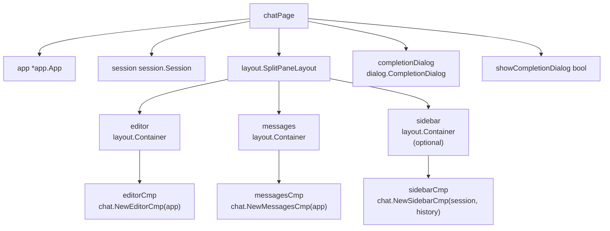
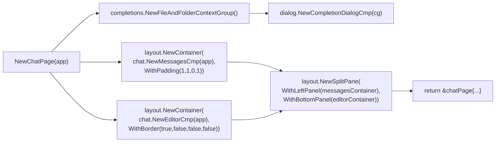
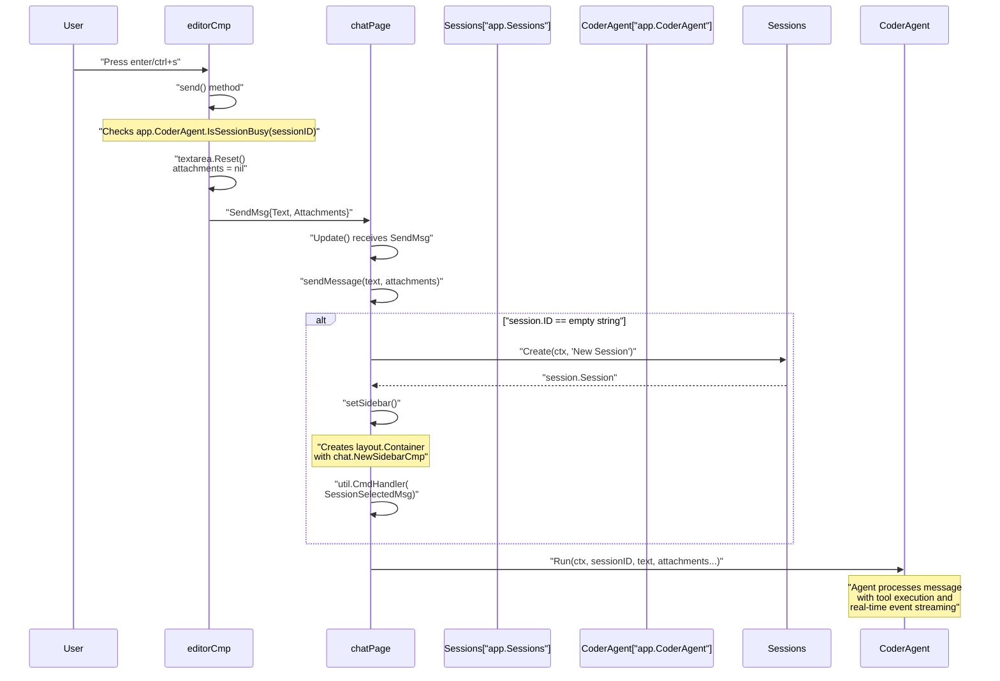
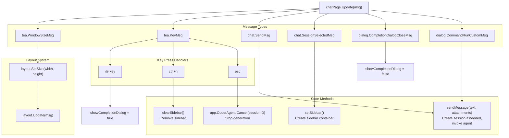
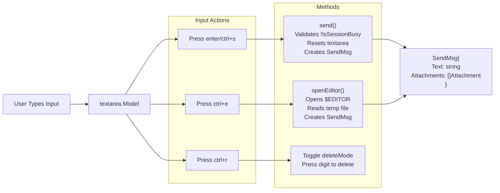
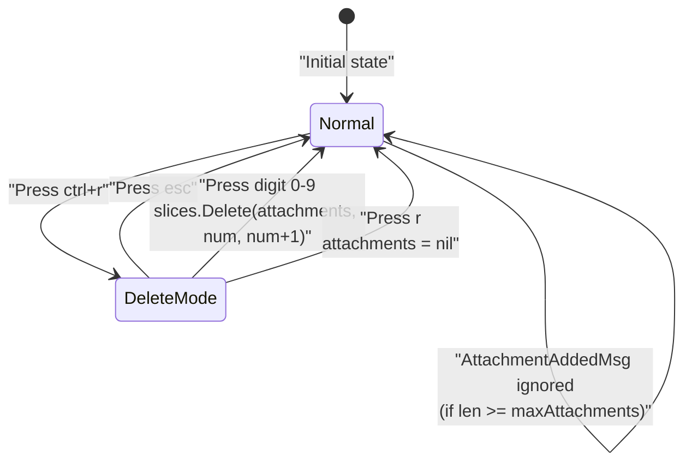
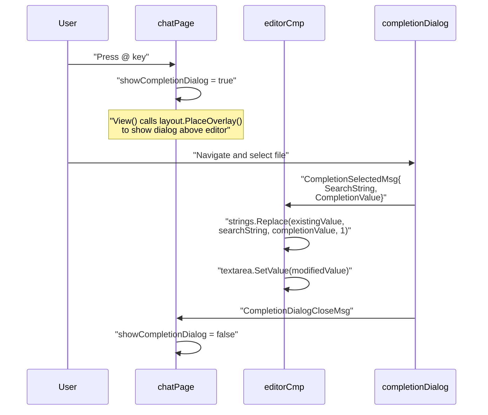
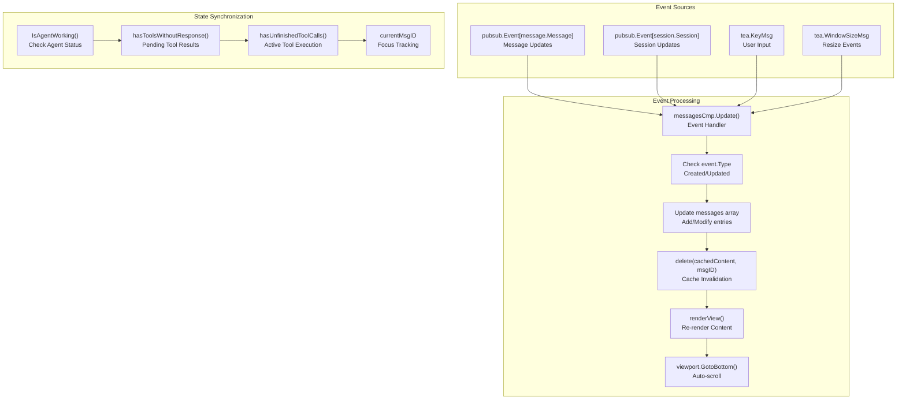

# Chat Interface

Relevant source files

The following files were used as context for generating this wiki page:

- [README.md](README.md)
- [internal/tui/components/chat/editor.go](internal/tui/components/chat/editor.go)
- [internal/tui/page/chat.go](internal/tui/page/chat.go)
- [internal/tui/tui.go](internal/tui/tui.go)

The Chat Interface provides the primary conversational UI in OpenCode, implemented through the `chatPage` struct in [internal/tui/page/chat.go](). This page orchestrates the interaction between users and AI agents within the terminal, managing message input, session lifecycle, and real-time updates through a split-pane layout.

The chat interface operates within the broader TUI application managed by `appModel` in [internal/tui/tui.go](), which coordinates multiple dialogs, global key bindings, and page navigation. The `chatPage` itself manages three core containers: a messages display, an editor for input, and an optional sidebar for session context.

This page provides an overview of how these components fit together. For detailed information on individual components like the editor and message list, see [Chat Components](5.1). For session lifecycle management including auto-compaction, see [Session Management](5.2). For various dialog systems, see [Dialog System](5.3).

Sources: [internal/tui/page/chat.go:1-237](), [internal/tui/tui.go:98-141]()

## Architecture and Component Hierarchy

The Chat Interface is built on the Bubble Tea framework, implementing a layered component architecture with clear separation between page-level orchestration, layout management, and individual UI components.

### chatPage Structure and Dependencies

The `chatPage` struct serves as the main orchestrator for the chat interface:

| Field | Type | Purpose |
|-------|------|---------|
| `app` | `*app.App` | Access to core services (CoderAgent, Sessions, History) |
| `editor` | `layout.Container` | Wraps `chat.NewEditorCmp` for user input |
| `messages` | `layout.Container` | Wraps `chat.NewMessagesCmp` for conversation display |
| `layout` | `layout.SplitPaneLayout` | Manages panel positioning and sizing |
| `session` | `session.Session` | Current active session state |
| `completionDialog` | `dialog.CompletionDialog` | File/folder completion UI |
| `showCompletionDialog` | `bool` | Controls completion overlay visibility |

**Diagram: chatPage Component Hierarchy**

Sources: [internal/tui/page/chat.go:22-30](), [internal/tui/page/chat.go:215-237]()

### Layout Configuration and Initialization

The `NewChatPage()` constructor in [internal/tui/page/chat.go:215-237]() initializes the split-pane layout with specific panel configurations:

| Layout Panel | Component Wrapper | Inner Component | Configuration |
|-------------|------------------|-----------------|---------------|
| Left Panel | `messagesContainer` | `chat.NewMessagesCmp(app)` | `WithPadding(1, 1, 0, 1)` |
| Bottom Panel | `editorContainer` | `chat.NewEditorCmp(app)` | `WithBorder(true, false, false, false)` |
| Right Panel | `sidebarContainer` | `chat.NewSidebarCmp(session, history)` | Shown only when session is active |

**Diagram: NewChatPage() Initialization Flow**

The sidebar is not created during initialization but is dynamically added via `setSidebar()` when a session becomes active (see [internal/tui/page/chat.go:143-149]()).

Sources: [internal/tui/page/chat.go:215-237](), [internal/tui/page/chat.go:143-149]()

## Message Flow and State Management

The Chat Interface coordinates message flow between user input, session management, and agent processing through a series of message passing events handled by the `chatPage.Update()` method.

### Message Processing Flow

**Diagram: Message Flow from User Input to Agent Execution**

The `editorCmp.send()` method in [internal/tui/components/chat/editor.go:122-141]() validates the agent is not busy before creating a `SendMsg`. The `chatPage.sendMessage()` method in [internal/tui/page/chat.go:155-176]() ensures a session exists before invoking the agent.

Sources: [internal/tui/components/chat/editor.go:122-141](), [internal/tui/page/chat.go:155-176](), [internal/tui/page/chat.go:143-149]()

### Event Handling and State Transitions

The `chatPage.Update()` method in [internal/tui/page/chat.go:61-141]() processes multiple message types, delegating to specialized handlers and the layout system:

**Diagram: chatPage.Update() Message Processing**

Custom commands (from the command dialog) are processed via `CommandRunCustomMsg`, which supports argument substitution before calling `sendMessage()` (see [internal/tui/page/chat.go:74-94]()).

Sources: [internal/tui/page/chat.go:61-141](), [internal/tui/page/chat.go:143-153](), [internal/tui/page/chat.go:74-94]()

## User Input and Editor Component

The `editorCmp` in [internal/tui/components/chat/editor.go:26-34]() manages user text input using a `textarea.Model` from the Bubble Tea framework, with additional support for file attachments and external editor integration.

### Editor Component Structure

| Field | Type | Purpose |
|-------|------|---------|
| `app` | `*app.App` | Access to CoderAgent for busy checks |
| `session` | `session.Session` | Current session for session-specific operations |
| `textarea` | `textarea.Model` | Bubble Tea text input widget |
| `attachments` | `[]message.Attachment` | File attachments (max 5) |
| `deleteMode` | `bool` | Flag for attachment deletion mode |

**Diagram: editorCmp Input Processing**

The `CreateTextArea()` function in [internal/tui/components/chat/editor.go:282-310]() applies theme-specific styling to the textarea component.

Sources: [internal/tui/components/chat/editor.go:26-34](), [internal/tui/components/chat/editor.go:122-141](), [internal/tui/components/chat/editor.go:82-116](), [internal/tui/components/chat/editor.go:282-310]()

### External Editor Integration

The `openEditor()` method in [internal/tui/components/chat/editor.go:82-116]() allows users to compose messages in their preferred external editor:

**External Editor Workflow:**

1. **Editor Detection**: `os.Getenv("EDITOR")` with fallback to `nvim`
2. **Temporary File Creation**: `os.CreateTemp("", "msg_*.md")` creates a markdown file
3. **Process Execution**: `tea.ExecProcess(c, func(err error) tea.Msg)` suspends TUI and launches editor
4. **Content Loading**: `os.ReadFile(tmpfile.Name())` reads content after editor closes
5. **Cleanup**: `os.Remove(tmpfile.Name())` deletes temporary file
6. **Message Creation**: Returns `SendMsg` with content and existing attachments

The external editor preserves any attachments added before opening the editor, combining them with the edited text content when returning.

Sources: [internal/tui/components/chat/editor.go:82-116]()

## User Interactions and Key Bindings

The Chat Interface implements keyboard-driven interactions through two key binding structures: `ChatKeyMap` for page-level actions and `EditorKeyMaps` for input-specific actions.

### Key Binding Implementation

**chatPage Key Bindings** (defined in [internal/tui/page/chat.go:32-51]()):

| Key | Binding Name | Action | Implementation |
|-----|-------------|--------|----------------|
| `@` | `ShowCompletionDialog` | Open file/folder completion | `p.showCompletionDialog = true` |
| `ctrl+n` | `NewSession` | Create new session | `p.session = session.Session{}`, `clearSidebar()` |
| `esc` | `Cancel` | Cancel agent generation | `p.app.CoderAgent.Cancel(p.session.ID)` |

**editorCmp Key Bindings** (defined in [internal/tui/components/chat/editor.go:36-76]()):

| Key | Binding Name | Action | Implementation |
|-----|-------------|--------|----------------|
| `enter`, `ctrl+s` | `Send` | Send message | `m.send()` - validates agent not busy, resets textarea |
| `ctrl+e` | `OpenEditor` | Open external editor | `m.openEditor()` - launches `$EDITOR` or `nvim` |
| `ctrl+r` | `AttachmentDeleteMode` | Enter delete mode | `m.deleteMode = true` |
| `esc` | `Escape` | Exit delete mode | `m.deleteMode = false` |
| `r` (in delete mode) | `DeleteAllAttachments` | Clear all attachments | `m.attachments = nil` |

The editor also handles backslash escaping: if the last character of input is `\` when pressing enter, it removes the backslash and adds a newline instead of sending (see [internal/tui/components/chat/editor.go:202-212]()).

Sources: [internal/tui/page/chat.go:32-51](), [internal/tui/components/chat/editor.go:36-76](), [internal/tui/page/chat.go:104-121](), [internal/tui/components/chat/editor.go:202-212]()

### Attachment Management

The `editorCmp` supports up to 5 file attachments (constant `maxAttachments` in [internal/tui/components/chat/editor.go:78-80]()) with a keyboard-driven deletion interface.

**Attachment Deletion Workflow:**

1. **Enter Delete Mode**: Press `ctrl+r` to set `deleteMode = true`
2. **Delete Specific Attachment**: Press digit `0-9` to delete attachment at that index
3. **Delete All**: Press `r` (while in delete mode) to clear all attachments
4. **Exit Delete Mode**: Press `esc` or complete a deletion to set `deleteMode = false`

**Diagram: Attachment Management State Machine**

Attachments are displayed at the top of the editor view with styled document icons, showing the index number when in delete mode (see [internal/tui/components/chat/editor.go:252-273]()).

Sources: [internal/tui/components/chat/editor.go:78-80](), [internal/tui/components/chat/editor.go:159-186](), [internal/tui/components/chat/editor.go:252-273]()

### File Completion System Integration

The Chat Interface provides file and folder completion through the `completionDialog`, which appears as an overlay when triggered by the `@` key.

**Completion Dialog Lifecycle:**

| Phase | Code Location | Details |
|-------|--------------|---------|
| **Initialization** | [internal/tui/page/chat.go:216-217]() | `completions.NewFileAndFolderContextGroup()` creates completion provider |
| **Activation** | [internal/tui/page/chat.go:105-107]() | `@` key sets `p.showCompletionDialog = true` |
| **Selection** | [internal/tui/components/chat/editor.go:148-153]() | `dialog.CompletionSelectedMsg` replaces search string in textarea |
| **Overlay Rendering** | [internal/tui/page/chat.go:189-203]() | `layout.PlaceOverlay()` positions dialog above editor |
| **Closing** | [internal/tui/page/chat.go:67-68]() | `dialog.CompletionDialogCloseMsg` sets flag to false |

**Diagram: Completion Dialog Message Flow**

The completion dialog does not block other messages unless `enter` is pressed (see [internal/tui/page/chat.go:123-134]()), allowing the layout to continue processing events.

Sources: [internal/tui/page/chat.go:215-218](), [internal/tui/page/chat.go:67-68](), [internal/tui/page/chat.go:105-107](), [internal/tui/page/chat.go:189-203](), [internal/tui/page/chat.go:123-134](), [internal/tui/components/chat/editor.go:148-153]()

## Real-time Updates and Event Handling

The Chat Interface maintains real-time synchronization with backend processing through a sophisticated event-driven architecture that handles concurrent message updates and tool executions.

### Event Processing Pipeline

Sources: [internal/tui/components/chat/list.go:72-168](), [internal/tui/components/chat/list.go:312-346](), [internal/tui/components/chat/list.go:171-173]()