# Chat Components

<details>
<summary>Relevant source files</summary>

The following files were used as context for generating this wiki page:

- [README.md](README.md)
- [internal/tui/components/chat/editor.go](internal/tui/components/chat/editor.go)
- [internal/tui/page/chat.go](internal/tui/page/chat.go)

</details>


## Purpose and Scope

This document details the UI components that comprise the chat interface in OpenCode's Terminal UI. The chat interface is where users interact with the AI agent through text input, view conversation history, and manage attachments. This page covers the component architecture, the editor component for text input, message display, and the completion dialog system.

For information about session lifecycle and auto-compaction, see [Session Management](#5.2). For details on other dialogs (sessions, commands, models, permissions), see [Dialog System](#5.3).

---

## Component Architecture

The chat interface is built using the Bubble Tea framework and consists of several layered components that work together to provide the interactive experience.

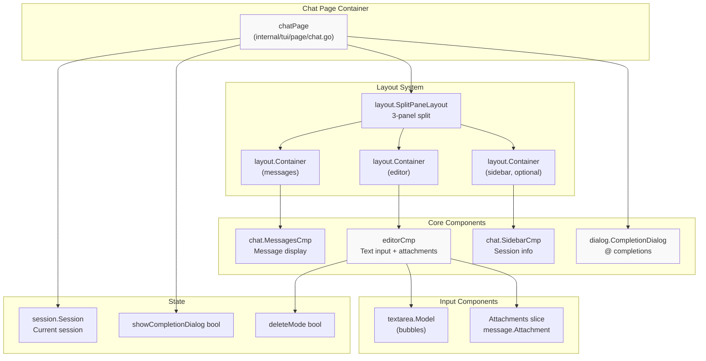

**Sources:** [internal/tui/page/chat.go:22-30](), [internal/tui/components/chat/editor.go:26-34]()

---

## Chat Page Component

The `chatPage` struct is the top-level component that orchestrates all chat interface elements. It manages the layout, handles keyboard shortcuts, and coordinates message sending.

### Structure

| Field | Type | Purpose |
|-------|------|---------|
| `app` | `*app.App` | Reference to application services |
| `editor` | `layout.Container` | Container wrapping editor component |
| `messages` | `layout.Container` | Container wrapping messages component |
| `layout` | `layout.SplitPaneLayout` | 3-panel split layout manager |
| `session` | `session.Session` | Current active session |
| `completionDialog` | `dialog.CompletionDialog` | @ completion dialog |
| `showCompletionDialog` | `bool` | Dialog visibility state |

**Sources:** [internal/tui/page/chat.go:22-30]()

### Message Flow

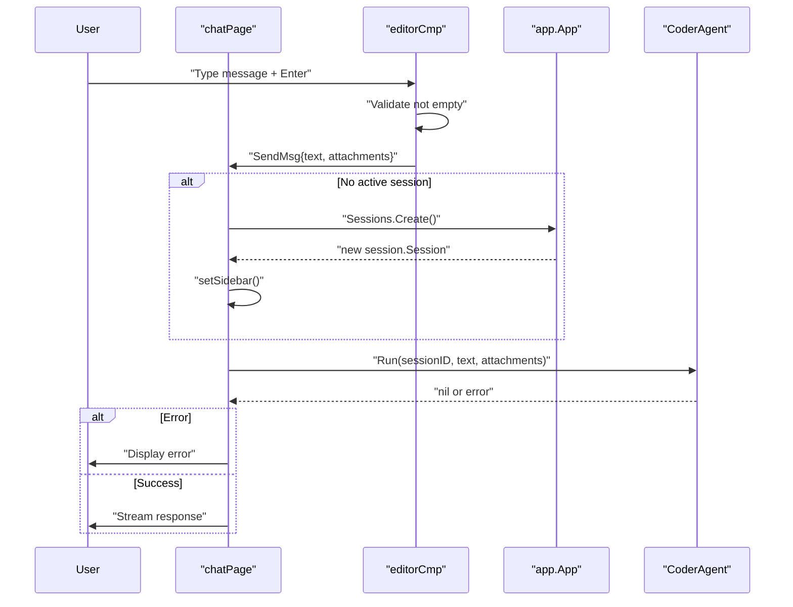

**Sources:** [internal/tui/page/chat.go:155-176](), [internal/tui/page/chat.go:69-94]()

### Keyboard Shortcuts

The chat page defines several keyboard shortcuts through the `ChatKeyMap`:

| Shortcut | Action | Implementation |
|----------|--------|----------------|
| `@` | Show completion dialog | Sets `showCompletionDialog = true` |
| `Ctrl+N` | Create new session | Clears session and sidebar |
| `Esc` | Cancel generation | Calls `CoderAgent.Cancel()` |

**Sources:** [internal/tui/page/chat.go:32-51](), [internal/tui/page/chat.go:104-121]()

### Layout Management

The chat page uses a split pane layout with three configurable panels:

1. **Left Panel (Messages)**: Main conversation display with 1px padding on all sides
2. **Bottom Panel (Editor)**: Text input with top border only
3. **Right Panel (Sidebar, optional)**: Session info, shown when a session exists

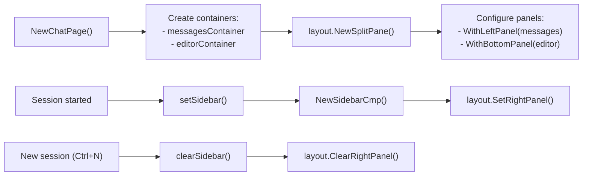

**Sources:** [internal/tui/page/chat.go:215-237](), [internal/tui/page/chat.go:143-153]()

---

## Editor Component

The `editorCmp` is the primary text input component that handles user message composition, attachments, and external editor integration.

### Structure and State

| Field | Type | Purpose |
|-------|------|---------|
| `width`, `height` | `int` | Component dimensions |
| `app` | `*app.App` | Application services reference |
| `session` | `session.Session` | Current session |
| `textarea` | `textarea.Model` | Bubble Tea textarea for input |
| `attachments` | `[]message.Attachment` | Attached files (max 5) |
| `deleteMode` | `bool` | Attachment deletion mode active |

**Sources:** [internal/tui/components/chat/editor.go:26-34]()

### Text Input

The editor uses the Bubble Tea `textarea.Model` with custom styling applied via `CreateTextArea()`:

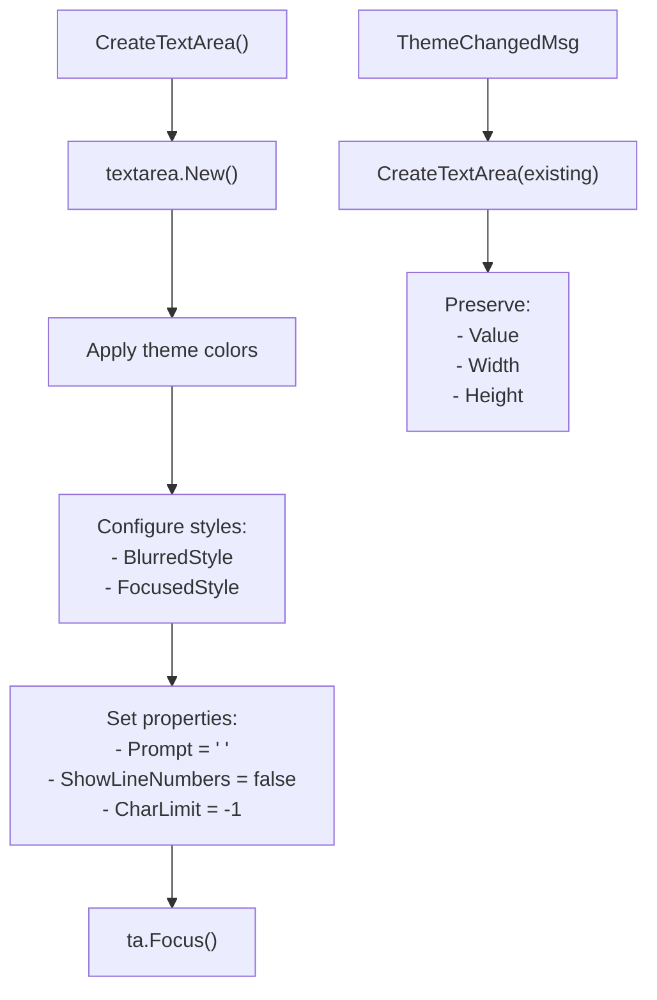

**Sources:** [internal/tui/components/chat/editor.go:282-310]()

#### Styling

The text area applies theme colors to multiple style aspects:

- **Background**: `theme.CurrentTheme().Background()`
- **Text**: `theme.CurrentTheme().Text()`
- **Placeholder**: `theme.CurrentTheme().TextMuted()`
- **Base style**: Applied to both focused and blurred states

**Sources:** [internal/tui/components/chat/editor.go:283-296]()

### Attachment Management

The editor supports up to 5 file attachments with visual indicators and keyboard-based deletion.

#### Adding Attachments

Attachments are added through the `dialog.AttachmentAddedMsg` message:

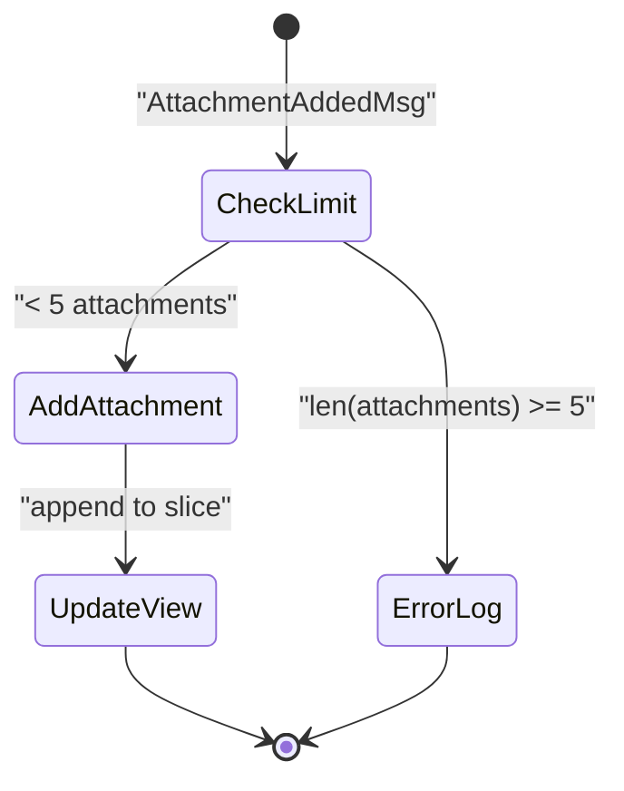

**Sources:** [internal/tui/components/chat/editor.go:159-164](), [internal/tui/components/chat/editor.go:78-80]()

#### Deleting Attachments

The editor implements a two-key deletion mode:

| Key Sequence | Action |
|--------------|--------|
| `Ctrl+R` | Enter delete mode |
| `Ctrl+R` + `R` | Delete all attachments |
| `Ctrl+R` + `{0-9}` | Delete attachment at index |
| `Esc` | Exit delete mode |

**Sources:** [internal/tui/components/chat/editor.go:63-76](), [internal/tui/components/chat/editor.go:166-186]()

#### Visual Rendering

Attachments are displayed above the text input with styled indicators:

```
[0] 📄 file1.txt [1] 📄 docume...
> [cursor here for text input]
```

The `attachmentsContent()` method renders each attachment with:
- Index number (when in delete mode)
- Document icon (`styles.DocumentIcon`)
- Truncated filename (max 10 chars, shows first 7 + "...")
- Background/foreground from theme

**Sources:** [internal/tui/components/chat/editor.go:252-273](), [internal/tui/components/chat/editor.go:228-236]()

### External Editor Support

The editor supports opening the user's preferred external editor via `Ctrl+E`.

#### External Editor Flow

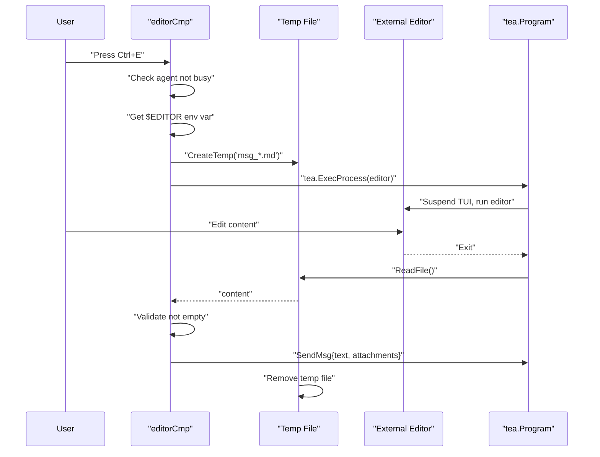

**Sources:** [internal/tui/components/chat/editor.go:82-116](), [internal/tui/components/chat/editor.go:191-195]()

#### Editor Detection

The external editor is determined by:
1. `$EDITOR` environment variable
2. Falls back to `nvim` if not set

Temporary files are created with the pattern `msg_*.md` in the system temp directory.

**Sources:** [internal/tui/components/chat/editor.go:83-86]()

### Sending Messages

The `send()` method handles message submission with validation:

1. **Check agent status**: Prevents sending if agent is busy for the current session
2. **Get textarea value**: Extracts text from textarea
3. **Reset state**: Clears textarea and attachments
4. **Validate**: Returns early if text is empty
5. **Emit message**: Sends `SendMsg` with text and attachments

**Sources:** [internal/tui/components/chat/editor.go:122-141]()

#### Enter Key Behavior

The editor implements special handling for the Enter key:

| Condition | Behavior |
|-----------|----------|
| Last character is `\` | Remove `\`, insert newline (continue editing) |
| Otherwise | Send message |

This allows multi-line input by typing `\` before pressing Enter.

**Sources:** [internal/tui/components/chat/editor.go:202-212]()

### Keyboard Bindings

The editor defines two key binding sets:

#### Standard Editor Bindings

```go
EditorKeyMaps {
    Send: "enter" or "ctrl+s"
    OpenEditor: "ctrl+e"
}
```

#### Attachment Delete Bindings

```go
DeleteAttachmentKeyMaps {
    AttachmentDeleteMode: "ctrl+r"
    Escape: "esc"
    DeleteAllAttachments: "r" (when in delete mode)
}
```

**Sources:** [internal/tui/components/chat/editor.go:36-76]()

---

## Completion Dialog

The completion dialog provides file and folder path completions when the user types `@` in the editor.

### Activation and Display

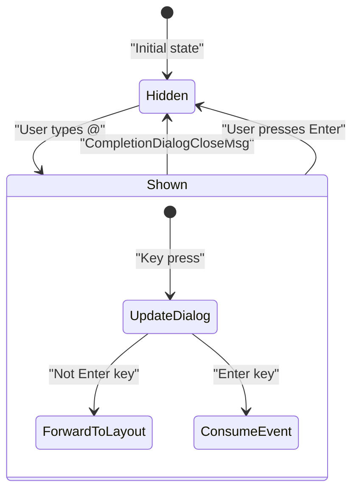

The dialog is displayed as an overlay positioned above the editor panel:

- **X position**: 0 (left-aligned)
- **Y position**: `layoutHeight - editorHeight - overlayHeight`
- **Width**: Matches editor width

**Sources:** [internal/tui/page/chat.go:28-29](), [internal/tui/page/chat.go:105-106](), [internal/tui/page/chat.go:189-203]()

### Completion Selection

When a completion is selected:

1. `dialog.CompletionSelectedMsg` is sent with search string and completion value
2. Editor receives the message
3. Editor replaces the search string with the selected completion
4. Text cursor remains at end of replacement

**Sources:** [internal/tui/components/chat/editor.go:148-153]()

### Integration

The completion dialog is created with a `completions.FileAndFolderContextGroup` that provides file system completions:

**Sources:** [internal/tui/page/chat.go:216-217]()

---

## Message Display Component

The messages component (`chat.MessagesCmp`) displays the conversation history. While the full implementation is not shown in the provided files, the chat page integrates it as follows:

```
messagesContainer = layout.NewContainer(
    chat.NewMessagesCmp(app),
    layout.WithPadding(1, 1, 0, 1)
)
```

The container applies 1px padding on top, right, and left sides (0 on bottom) to provide visual spacing.

**Sources:** [internal/tui/page/chat.go:219-222]()

---

## Layout and Rendering

### Size Management

The chat page implements the `layout.Component` interface for size management:

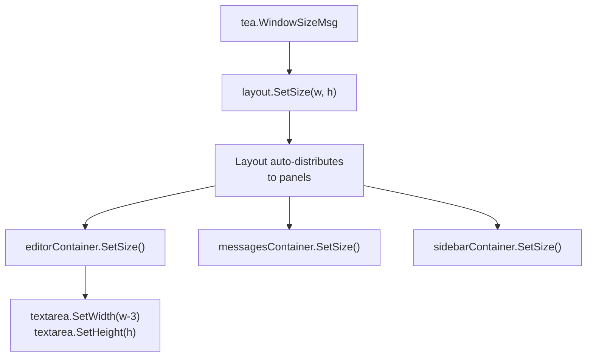

The editor component accounts for:
- **Width**: Subtracts 3 characters for prompt (`>`) and padding
- **Height**: Adjusts based on attachment display (subtracts 1 line when attachments present)

**Sources:** [internal/tui/page/chat.go:64-66](), [internal/tui/components/chat/editor.go:239-246]()

### View Composition

The chat page view is composed in layers:

1. **Base layer**: `layout.View()` renders the 3-panel split
2. **Overlay layer**: Completion dialog (if visible) is positioned above editor

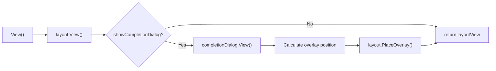

**Sources:** [internal/tui/page/chat.go:186-206]()

---

## Component Lifecycle

### Initialization

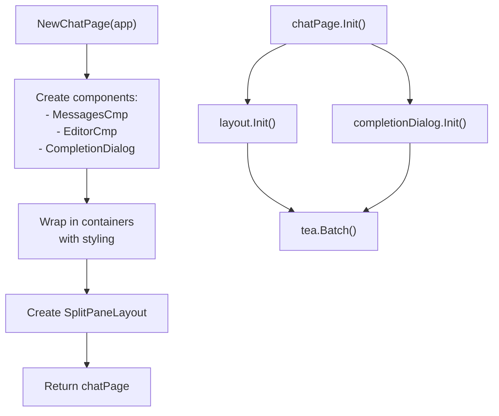

**Sources:** [internal/tui/page/chat.go:215-237](), [internal/tui/page/chat.go:53-59]()

### Update Cycle

The `Update()` method handles various message types:

| Message Type | Handler |
|--------------|---------|
| `tea.WindowSizeMsg` | Resize layout |
| `dialog.CompletionDialogCloseMsg` | Hide completion dialog |
| `chat.SendMsg` | Send message to agent |
| `dialog.CommandRunCustomMsg` | Execute custom command |
| `chat.SessionSelectedMsg` | Update current session, show sidebar |
| `tea.KeyMsg` | Handle keyboard shortcuts |

**Sources:** [internal/tui/page/chat.go:61-141]()

### State Transitions

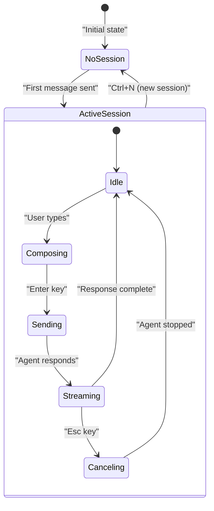

**Sources:** [internal/tui/page/chat.go:108-113](), [internal/tui/page/chat.go:114-120]()

---

## Integration Points

### App Service Dependencies

The chat components interact with several `app.App` services:

| Service | Usage |
|---------|-------|
| `CoderAgent` | Send messages, check busy status, cancel operations |
| `Sessions` | Create new sessions |
| `History` | Display file changes in sidebar |

**Sources:** [internal/tui/page/chat.go:23](), [internal/tui/components/chat/editor.go:29]()

### Message Types

The chat components use several custom message types for communication:

| Message Type | Purpose | Source |
|--------------|---------|--------|
| `chat.SendMsg` | Trigger message send | Editor → Chat Page |
| `chat.SessionSelectedMsg` | Update active session | Chat Page → Editor |
| `chat.SessionClearedMsg` | Clear session UI | Chat Page → Messages |
| `dialog.CompletionSelectedMsg` | Apply completion | Dialog → Editor |
| `dialog.AttachmentAddedMsg` | Add file attachment | External → Editor |
| `dialog.CompletionDialogCloseMsg` | Hide completion dialog | Dialog → Chat Page |

**Sources:** [internal/tui/page/chat.go:69](), [internal/tui/page/chat.go:95](), [internal/tui/components/chat/editor.go:148]()