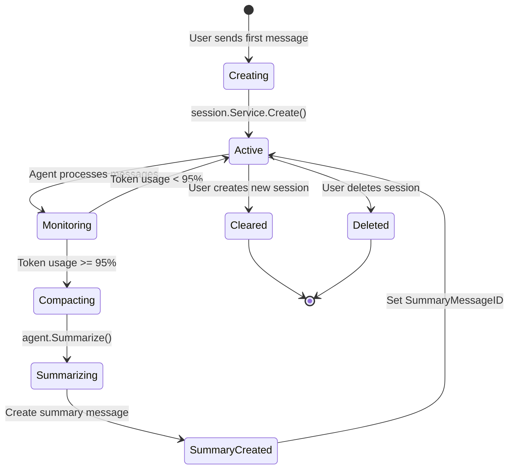
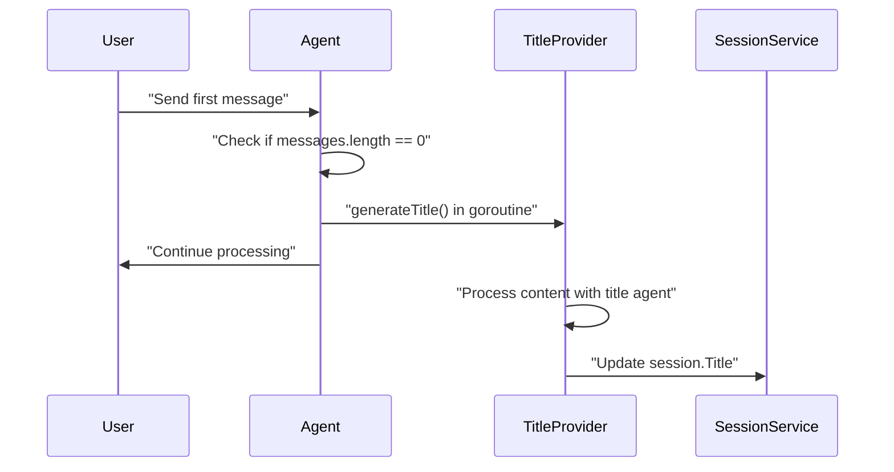
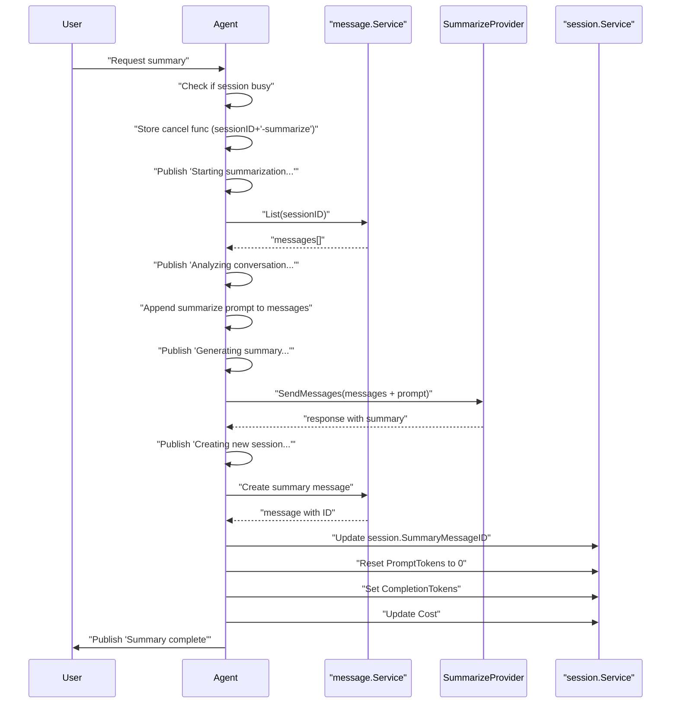
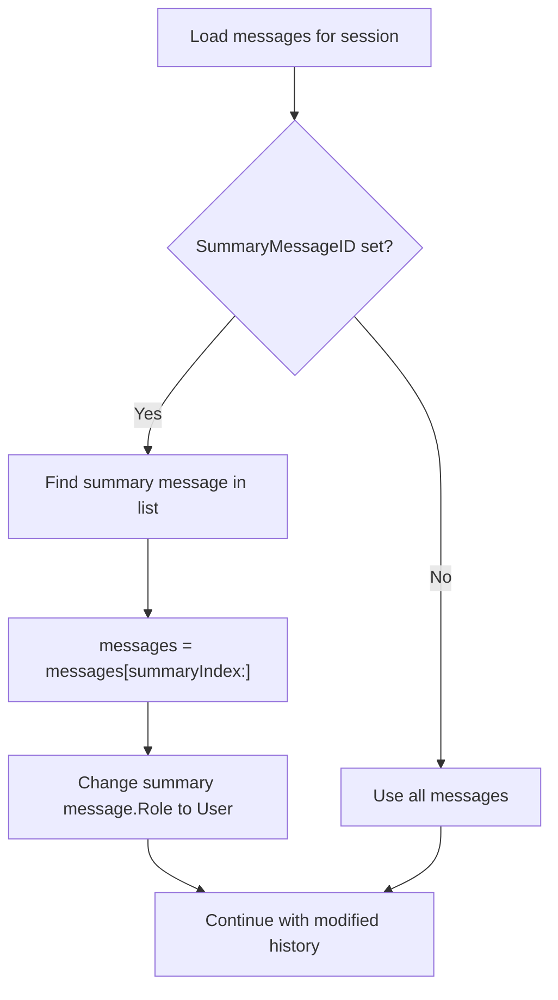
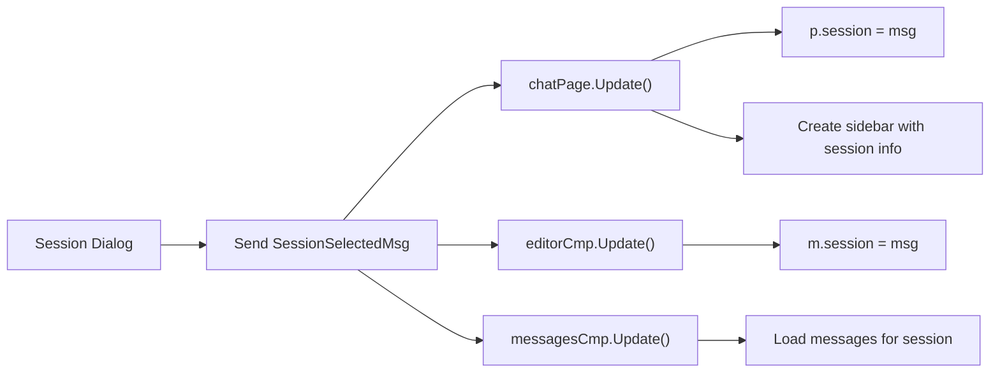
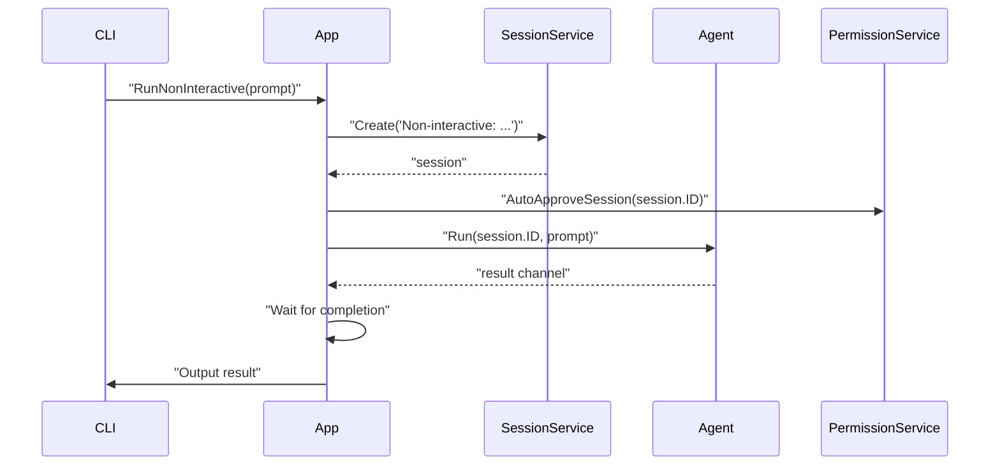

# Session Management

<details>
<summary>Relevant source files</summary>

The following files were used as context for generating this wiki page:

- [README.md](README.md)
- [cmd/root.go](cmd/root.go)
- [internal/app/app.go](internal/app/app.go)
- [internal/llm/agent/agent.go](internal/llm/agent/agent.go)
- [internal/tui/components/chat/editor.go](internal/tui/components/chat/editor.go)
- [internal/tui/page/chat.go](internal/tui/page/chat.go)

</details>


## Purpose and Scope

This document covers the session management system in OpenCode, which organizes conversations into discrete units called sessions. Each session maintains its own message history, token usage tracking, cost accounting, and can be summarized when approaching context limits.

For information about the chat interface and UI components that display sessions, see [5.1 Chat Components](#5.1). For details about message storage and structure, see the Data Persistence Layer documentation. For agent orchestration and request processing that uses sessions, see [3.3 Agent System](#3.3).

---

## Session Data Structure

A session represents a single conversation thread with the AI agent. Each session maintains metadata about the conversation's state, cost, and token usage.

### Core Session Fields

| Field | Type | Purpose |
|-------|------|---------|
| `ID` | string | Unique identifier (UUID) |
| `Title` | string | Display name, auto-generated from first message |
| `CreatedAt` | int64 | Unix timestamp of creation |
| `UpdatedAt` | int64 | Unix timestamp of last modification |
| `Cost` | float64 | Accumulated cost in USD based on token usage |
| `PromptTokens` | int | Current input tokens (resets after compaction) |
| `CompletionTokens` | int | Current output tokens (resets after compaction) |
| `SummaryMessageID` | string | ID of summary message after compaction (empty if not compacted) |

The `SummaryMessageID` field links to a message that contains a summary of all prior conversation when a session has been compacted. This allows the system to maintain context while reducing token usage.

**Sources:** [internal/llm/agent/agent.go:251-267](), [internal/llm/agent/agent.go:640-691](), [README.md:84-99]()

---

## Session Lifecycle



**Diagram: Session State Machine**

### Creation

Sessions are created lazily when the user sends their first message. In the TUI, the chat page checks if a session exists before sending a message, and creates one if needed:

```
1. User enters message in editor
2. Chat page checks if session.ID is empty
3. If empty, calls app.Sessions.Create(ctx, "New Session")
4. Sets the new session as current
5. Proceeds with message sending
```

In non-interactive mode, a session is created immediately with a title derived from the prompt.

**Sources:** [internal/tui/page/chat.go:155-176](), [internal/app/app.go:122-129]()

### Active Usage

During active usage, the session accumulates messages and tracks token consumption. After each agent response, the system updates the session's token counts and cost:

```
Token Cost Calculation:
cost = (model.CostPer1MInCached × cache_creation_tokens +
        model.CostPer1MOutCached × cache_read_tokens +
        model.CostPer1MIn × input_tokens +
        model.CostPer1MOut × output_tokens) / 1,000,000
```

The session stores cumulative token counts in `PromptTokens` and `CompletionTokens` fields, which are used to determine when compaction is needed.

**Sources:** [internal/llm/agent/agent.go:494-514]()

### Title Generation

When a session is created, a title is generated asynchronously using the `titleProvider` agent. This happens in the background after the first user message is sent:



**Diagram: Asynchronous Title Generation**

The title generation uses a separate agent configuration (`config.AgentTitle`) with lower token limits (typically 80 tokens) for efficiency.

**Sources:** [internal/llm/agent/agent.go:154-189](), [internal/llm/agent/agent.go:233-250]()

---

## Auto-Compaction System

The auto-compaction feature prevents sessions from exceeding the model's context window by automatically summarizing conversations when they approach the limit.

### Monitoring and Triggering

The auto-compaction threshold is hardcoded at **95% of the model's context window**. When `PromptTokens + CompletionTokens` reaches this threshold, the system triggers summarization.

The configuration file allows users to enable or disable this feature:

```json
{
  "autoCompact": true
}
```

When enabled (default), the system monitors token usage after each completion event and triggers summarization when the threshold is reached.

**Sources:** [README.md:84-99]()

### Summarization Process



**Diagram: Summarization Sequence**

The summarization process uses a dedicated agent (`config.AgentSummarizer`) and follows these steps:

1. **Validation**: Checks if session is busy or has no messages
2. **Context Loading**: Retrieves all messages from the session
3. **Prompt Addition**: Appends system prompt requesting a detailed summary focused on:
   - What was done
   - Current work in progress
   - Files being worked on
   - Next steps planned
4. **Summary Generation**: Calls the summarize provider with full message history
5. **Message Creation**: Creates an assistant message containing the summary
6. **Session Update**: 
   - Sets `SummaryMessageID` to the new message ID
   - Resets `PromptTokens` to 0
   - Updates `CompletionTokens` with summary tokens
   - Adds summary cost to existing cost
7. **Event Publishing**: Notifies subscribers of completion

The summarize prompt is:
```
"Provide a detailed but concise summary of our conversation above. 
Focus on information that would be helpful for continuing the conversation, 
including what we did, what we're doing, which files we're working on, 
and what we're going to do next."
```

**Sources:** [internal/llm/agent/agent.go:535-704]()

### Summary Message Handling

After summarization, subsequent requests to the agent use a modified message history. When loading messages for a session with a `SummaryMessageID`:



**Diagram: Message History Loading with Summary**

This approach:
- Discards all messages before the summary
- Converts the summary message from `Assistant` role to `User` role
- Presents the summary as user context to the model
- Preserves all messages after the summary

**Sources:** [internal/llm/agent/agent.go:255-267]()

### Cancellation Support

The summarization process can be cancelled by the user. The agent stores a cancel function with a special key (`sessionID + "-summarize"`) that allows interruption:

**Sources:** [internal/llm/agent/agent.go:117-133](), [internal/llm/agent/agent.go:545-549]()

---

## Session Switching in TUI

The TUI provides several mechanisms for switching between sessions:

### Session Dialog

The primary method is through the session dialog (`Ctrl+A`), which displays a list of all sessions sorted by most recent activity. Users can:

- Navigate with `↑`/`↓` or `k`/`j`
- Select with `Enter`
- Close with `Esc`

When a session is selected, the TUI sends a `SessionSelectedMsg`:



**Diagram: Session Selection Message Flow**

**Sources:** [internal/tui/page/chat.go:95-102]()

### New Session Creation

Users can create a new session with `Ctrl+N`, which:

1. Clears the current session (`session.ID = ""`)
2. Removes the sidebar
3. Sends `SessionClearedMsg` to components
4. The next message sent will create a new session

**Sources:** [internal/tui/page/chat.go:108-113]()

### Session Persistence

The current session is maintained in the `chatPage` component's state. When switching pages or dialogs, the session persists. Components that need session information subscribe to `SessionSelectedMsg`:

- `editorCmp`: Needs session ID to check if agent is busy
- `messagesCmp`: Needs session ID to display message history
- `sidebarCmp`: Needs session info to display metadata

**Sources:** [internal/tui/page/chat.go:95-102](), [internal/tui/components/chat/editor.go:154-158]()

---

## Non-Interactive Session Management

In non-interactive mode (CLI with `-p` flag), session management is simplified:



**Diagram: Non-Interactive Session Flow**

Key differences:
- Session title is prefixed with `"Non-interactive: "` plus truncated prompt
- All permissions are auto-approved for the session
- Session is not reused (each CLI invocation creates new session)
- No auto-compaction (session ends immediately after response)

The title creation logic:
```
maxLength = 100
if len(prompt) > maxLength:
    title = "Non-interactive: " + prompt[:maxLength] + "..."
else:
    title = "Non-interactive: " + prompt
```

**Sources:** [internal/app/app.go:99-161]()

---

## Session Busy State

The agent tracks which sessions have active requests to prevent concurrent processing. The `activeRequests` sync.Map stores cancel functions keyed by session ID.

### Busy Checks

Multiple components check if a session is busy:

| Component | Check Location | Purpose |
|-----------|---------------|---------|
| `editorCmp` | Before sending message | Prevents duplicate requests |
| `editorCmp` | Before opening external editor | Prevents editing during processing |
| `chatPage` | Before custom command execution | Prevents concurrent commands |
| `agent` | At request start | Returns `ErrSessionBusy` if already processing |

The agent provides two methods:
- `IsSessionBusy(sessionID string) bool` - Checks specific session
- `IsBusy() bool` - Checks if any session is busy

**Sources:** [internal/llm/agent/agent.go:135-152](), [internal/tui/components/chat/editor.go:123-125](), [internal/tui/page/chat.go:76-78]()

---

## Cost and Token Tracking

Sessions maintain cumulative statistics across their lifetime:

### Token Accumulation

After each agent completion, tokens are added to the session:

```
session.PromptTokens += usage.InputTokens + usage.CacheCreationTokens
session.CompletionTokens += usage.OutputTokens + usage.CacheReadTokens
```

### Cost Calculation

The cost calculation considers different token types with their respective pricing:

```
cost = (model.CostPer1MInCached / 1M) × cache_creation_tokens +
       (model.CostPer1MOutCached / 1M) × cache_read_tokens +
       (model.CostPer1MIn / 1M) × input_tokens +
       (model.CostPer1MOut / 1M) × output_tokens

session.Cost += cost
```

This tracks:
- **Cache creation tokens**: First-time tokens cached by provider
- **Cache read tokens**: Tokens read from provider's cache
- **Input tokens**: Regular input tokens
- **Output tokens**: Generated response tokens

### Post-Summarization Behavior

After summarization:
- `PromptTokens` is reset to 0 (since history is condensed)
- `CompletionTokens` is set to the summary's output tokens
- `Cost` accumulates the summarization cost (not reset)

This allows continued cost tracking across session lifetime while resetting token counts that determine when next compaction is needed.

**Sources:** [internal/llm/agent/agent.go:494-514](), [internal/llm/agent/agent.go:674-683]()

---

## Session Service Interface

The `session.Service` interface provides CRUD operations:

```go
type Service interface {
    Create(ctx context.Context, title string) (Session, error)
    Get(ctx context.Context, id string) (Session, error)
    List(ctx context.Context) ([]Session, error)
    Save(ctx context.Context, session Session) (Session, error)
    Delete(ctx context.Context, id string) error
    Subscribe(ctx context.Context) <-chan pubsub.Event[Session]
}
```

The service uses:
- **SQLC-generated queries** for type-safe database access
- **SQLite database** for persistence
- **Pub-sub pattern** for notifying subscribers of changes

**Sources:** References to session service usage throughout [internal/llm/agent/agent.go]() and [internal/app/app.go]()