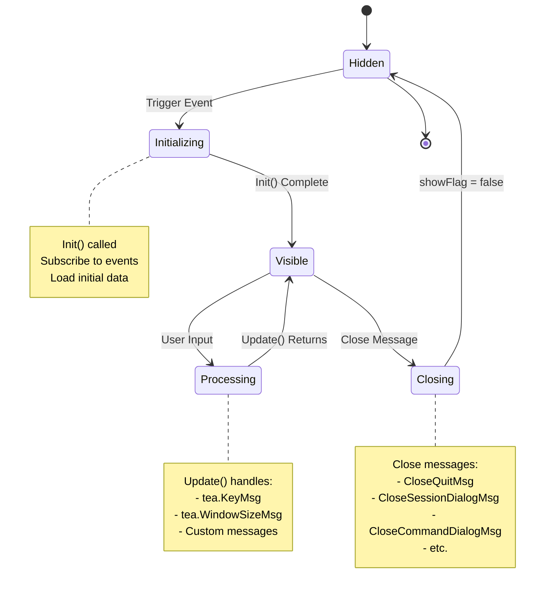
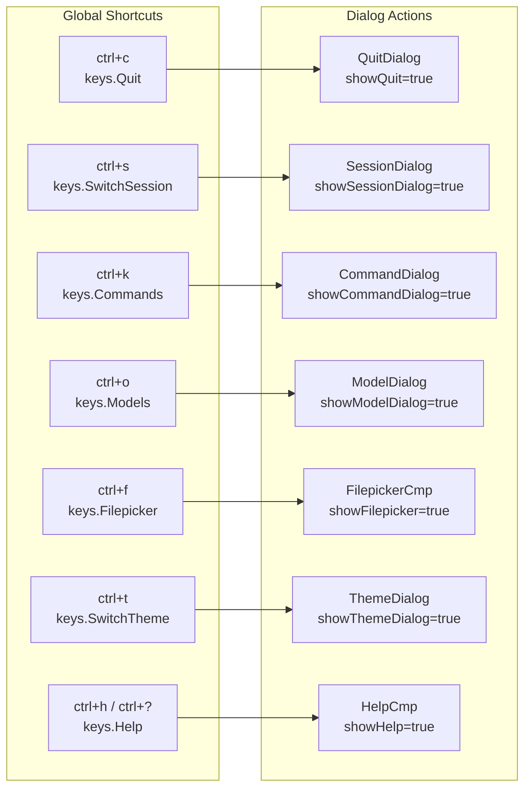
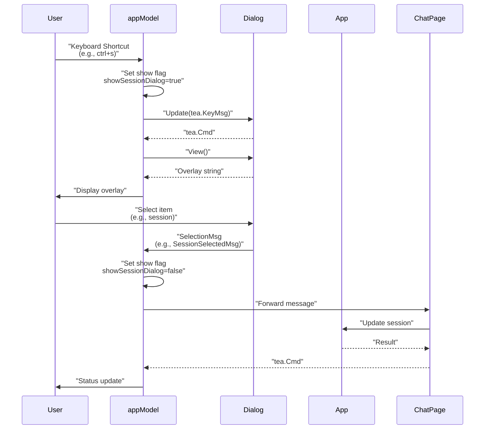

# Dialog System

<details>
<summary>Relevant source files</summary>

The following files were used as context for generating this wiki page:

- [internal/tui/components/chat/editor.go](internal/tui/components/chat/editor.go)
- [internal/tui/page/chat.go](internal/tui/page/chat.go)
- [internal/tui/tui.go](internal/tui/tui.go)

</details>


The Dialog System provides a comprehensive modal overlay mechanism for user interactions in OpenCode's TUI. Dialogs enable users to switch sessions, select models, configure permissions, browse files, execute commands, and manage application settings without leaving the chat interface. This document covers dialog types, lifecycle management, keyboard handling, message flow, and overlay rendering.

For information about the broader TUI architecture, see [Terminal UI System](#4). For specific details about chat interface components, see [Chat Components](#5.1).

---

## System Overview

OpenCode's dialog system implements a modal overlay pattern where dialogs appear centered on top of the main application view. Each dialog is a self-contained Bubble Tea model with its own state, update logic, and view rendering. The system supports multiple concurrent dialogs with priority-based rendering and input blocking.

**Sources:** [internal/tui/tui.go:98-141]()

---

## Dialog Types and Components

The TUI maintains ten distinct dialog types, each serving a specific purpose in the application workflow:

```mermaid
graph TB
    appModel["appModel<br/>(Main TUI State)"]
    
    subgraph "Core Dialogs"
        HelpCmp["dialog.HelpCmp<br/>Keyboard shortcuts help"]
        QuitDialog["dialog.QuitDialog<br/>Quit confirmation"]
    end
    
    subgraph "Navigation Dialogs"
        SessionDialog["dialog.SessionDialog<br/>Session switching"]
        CommandDialog["dialog.CommandDialog<br/>Command palette"]
    end
    
    subgraph "Configuration Dialogs"
        ModelDialog["dialog.ModelDialog<br/>Model selection"]
        ThemeDialog["dialog.ThemeDialog<br/>Theme switching"]
    end
    
    subgraph "File System Dialogs"
        FilepickerCmp["dialog.FilepickerCmp<br/>File attachment picker"]
    end
    
    subgraph "Permission Dialogs"
        PermissionDialogCmp["dialog.PermissionDialogCmp<br/>Tool permission requests"]
    end
    
    subgraph "Setup Dialogs"
        InitDialogCmp["dialog.InitDialogCmp<br/>First-run initialization"]
        MultiArgumentsDialogCmp["dialog.MultiArgumentsDialogCmp<br/>Command argument entry"]
    end
    
    appModel --> HelpCmp
    appModel --> QuitDialog
    appModel --> SessionDialog
    appModel --> CommandDialog
    appModel --> ModelDialog
    appModel --> ThemeDialog
    appModel --> FilepickerCmp
    appModel --> PermissionDialogCmp
    appModel --> InitDialogCmp
    appModel --> MultiArgumentsDialogCmp
```



**Dialog State Management:**

| Dialog Type | State Field | Show Flag | Purpose |
|------------|------------|-----------|---------|
| Permission Dialog | `permissions` | `showPermissions` | Approve/deny tool execution requests |
| Help Dialog | `help` | `showHelp` | Display keyboard shortcuts |
| Quit Dialog | `quit` | `showQuit` | Confirm application exit |
| Session Dialog | `sessionDialog` | `showSessionDialog` | Switch between conversation sessions |
| Command Dialog | `commandDialog` | `showCommandDialog` | Execute predefined commands |
| Model Dialog | `modelDialog` | `showModelDialog` | Select LLM model |
| Init Dialog | `initDialog` | `showInitDialog` | First-run project initialization |
| Filepicker Dialog | `filepicker` | `showFilepicker` | Attach files to messages |
| Theme Dialog | `themeDialog` | `showThemeDialog` | Switch UI themes |
| Multi-Arguments Dialog | `multiArgumentsDialog` | `showMultiArgumentsDialog` | Enter command arguments |

**Sources:** [internal/tui/tui.go:108-137]()

---

## Dialog Lifecycle

Each dialog follows the standard Bubble Tea lifecycle pattern with three phases: initialization, update, and view rendering.



### Initialization Phase

All dialogs are initialized in the `appModel.Init()` method, even if not immediately visible:

[internal/tui/tui.go:143-179]()

```go
func (a appModel) Init() tea.Cmd {
    var cmds []tea.Cmd
    // ... page initialization ...
    cmd = a.help.Init()
    cmds = append(cmds, cmd)
    cmd = a.sessionDialog.Init()
    cmds = append(cmds, cmd)
    cmd = a.commandDialog.Init()
    cmds = append(cmds, cmd)
    // ... other dialog initializations ...
    return tea.Batch(cmds...)
}
```

**Sources:** [internal/tui/tui.go:143-179]()

### Update Phase

Dialogs receive updates when their show flag is true. The `appModel.Update()` method routes messages to active dialogs and blocks keyboard input from propagating to underlying components:

[internal/tui/tui.go:608-627]()

The pattern for dialog updates:

1. Check if dialog is active (`if a.showSessionDialog`)
2. Pass message to dialog's Update method
3. Append returned commands to batch
4. Block KeyMsg propagation if dialog is active
5. Allow other message types to continue

**Sources:** [internal/tui/tui.go:580-657]()

### View Rendering Phase

Dialogs render as centered overlays using `layout.PlaceOverlay()`. The overlay is positioned at the center of the screen with a semi-transparent or styled background:

[internal/tui/tui.go:812-824]()

```go
if a.showSessionDialog {
    overlay := a.sessionDialog.View()
    row := lipgloss.Height(appView) / 2
    row -= lipgloss.Height(overlay) / 2
    col := lipgloss.Width(appView) / 2
    col -= lipgloss.Width(overlay) / 2
    appView = layout.PlaceOverlay(col, row, overlay, appView, true)
}
```

**Sources:** [internal/tui/tui.go:702-899]()

---

## Keyboard Shortcuts

Dialogs are triggered by keyboard shortcuts defined in the global `keyMap`:



### Shortcut Definitions

[internal/tui/tui.go:44-81]()

| Shortcut | Binding | Dialog | Description |
|----------|---------|--------|-------------|
| `ctrl+c` | `keys.Quit` | Quit Dialog | Show quit confirmation |
| `ctrl+s` | `keys.SwitchSession` | Session Dialog | Switch conversation session |
| `ctrl+k` | `keys.Commands` | Command Dialog | Open command palette |
| `ctrl+o` | `keys.Models` | Model Dialog | Select LLM model |
| `ctrl+f` | `keys.Filepicker` | Filepicker | Attach files to messages |
| `ctrl+t` | `keys.SwitchTheme` | Theme Dialog | Switch UI theme |
| `ctrl+h` / `ctrl+?` | `keys.Help` | Help Dialog | Toggle keyboard shortcuts |
| `esc` | `returnKey` | All Dialogs | Close active dialog |

**Sources:** [internal/tui/tui.go:27-96]()

---

## Dialog-Specific Behavior

### Permission Dialog

The Permission Dialog is unique because it's triggered by events from the pub-sub system rather than keyboard shortcuts. When tools require user approval, a `permission.PermissionRequest` event is published:

[internal/tui/tui.go:274-289]()

```go
case pubsub.Event[permission.PermissionRequest]:
    a.showPermissions = true
    return a, a.permissions.SetPermissions(msg.Payload)
case dialog.PermissionResponseMsg:
    switch msg.Action {
    case dialog.PermissionAllow:
        a.app.Permissions.Grant(msg.Permission)
    case dialog.PermissionAllowForSession:
        a.app.Permissions.GrantPersistant(msg.Permission)
    case dialog.PermissionDeny:
        a.app.Permissions.Deny(msg.Permission)
    }
    a.showPermissions = false
```

**Sources:** [internal/tui/tui.go:274-289]()

### Session Dialog

The Session Dialog loads available sessions when opened and tracks the currently selected session:

[internal/tui/tui.go:477-491]()

```go
case key.Matches(msg, keys.SwitchSession):
    if a.currentPage == page.ChatPage && !a.showQuit && !a.showPermissions && !a.showCommandDialog {
        sessions, err := a.app.Sessions.List(context.Background())
        if err != nil {
            return a, util.ReportError(err)
        }
        if len(sessions) == 0 {
            return a, util.ReportWarn("No sessions available")
        }
        a.sessionDialog.SetSessions(sessions)
        a.showSessionDialog = true
        return a, nil
    }
```

When a session is selected, the dialog closes and a `dialog.SessionSelectedMsg` is dispatched:

[internal/tui/tui.go:402-407]()

**Sources:** [internal/tui/tui.go:477-491](), [internal/tui/tui.go:402-407]()

### Command Dialog

The Command Dialog displays registered commands and executes their handlers. Commands are registered using `RegisterCommand()`:

[internal/tui/tui.go:666-678]()

Built-in commands include:

1. **Initialize Project** (`"init"`) - Creates/updates OpenCode.md memory file [internal/tui/tui.go:924-942]()
2. **Compact Session** (`"compact"`) - Triggers session summarization [internal/tui/tui.go:944-953]()

Custom commands are loaded from configuration files at initialization [internal/tui/tui.go:954-962]().

When a command is selected:

[internal/tui/tui.go:409-416]()

```go
case dialog.CommandSelectedMsg:
    a.showCommandDialog = false
    if msg.Command.Handler != nil {
        return a, msg.Command.Handler(msg.Command)
    }
    return a, util.ReportInfo("Command selected: " + msg.Command.Title)
```

**Sources:** [internal/tui/tui.go:409-416](), [internal/tui/tui.go:666-678](), [internal/tui/tui.go:924-962]()

### Multi-Arguments Dialog

Some commands require arguments. The Multi-Arguments Dialog is shown when a command contains placeholders like `$arg_name`:

[internal/tui/tui.go:417-443]()

```go
case dialog.ShowMultiArgumentsDialogMsg:
    a.multiArgumentsDialog = dialog.NewMultiArgumentsDialogCmp(msg.CommandID, msg.Content, msg.ArgNames)
    a.showMultiArgumentsDialog = true
    return a, a.multiArgumentsDialog.Init()

case dialog.CloseMultiArgumentsDialogMsg:
    a.showMultiArgumentsDialog = false
    if msg.Submit {
        content := msg.Content
        for name, value := range msg.Args {
            placeholder := "$" + name
            content = strings.ReplaceAll(content, placeholder, value)
        }
        return a, util.CmdHandler(dialog.CommandRunCustomMsg{
            Content: content,
            Args:    msg.Args,
        })
    }
```

**Sources:** [internal/tui/tui.go:417-443]()

### Model Dialog

The Model Dialog allows users to switch between available LLM models. When a model is selected:

[internal/tui/tui.go:359-367]()

```go
case dialog.ModelSelectedMsg:
    a.showModelDialog = false
    model, err := a.app.CoderAgent.Update(config.AgentCoder, msg.Model.ID)
    if err != nil {
        return a, util.ReportError(err)
    }
    return a, util.ReportInfo(fmt.Sprintf("Model changed to %s", model.Name))
```

**Sources:** [internal/tui/tui.go:359-367](), [internal/tui/tui.go:503-512]()

### Init Dialog

The Init Dialog appears on first run to prompt users to initialize their project:

[internal/tui/tui.go:167-177]()

```go
cmd := func() tea.Msg {
    shouldShow, err := config.ShouldShowInitDialog()
    if err != nil {
        return util.InfoMsg{
            Type: util.InfoTypeError,
            Msg:  "Failed to check init status: " + err.Error(),
        }
    }
    return dialog.ShowInitDialogMsg{Show: shouldShow}
}
```

When closed, the project is marked as initialized:

[internal/tui/tui.go:373-392]()

**Sources:** [internal/tui/tui.go:167-177](), [internal/tui/tui.go:373-392]()

### Theme Dialog

The Theme Dialog allows runtime theme switching. When a theme is changed:

[internal/tui/tui.go:350-353]()

```go
case dialog.ThemeChangedMsg:
    a.pages[a.currentPage], cmd = a.pages[a.currentPage].Update(msg)
    a.showThemeDialog = false
    return a, tea.Batch(cmd, util.ReportInfo("Theme changed to: "+msg.ThemeName))
```

The change propagates to all components that need to update their styling.

**Sources:** [internal/tui/tui.go:350-353](), [internal/tui/tui.go:513-520]()

---

## Message Flow

Dialog interactions generate messages that flow through the application:



### Close Messages

Each dialog type has a corresponding close message:

| Dialog | Close Message |
|--------|--------------|
| Quit Dialog | `dialog.CloseQuitMsg` |
| Session Dialog | `dialog.CloseSessionDialogMsg` |
| Command Dialog | `dialog.CloseCommandDialogMsg` |
| Model Dialog | `dialog.CloseModelDialogMsg` |
| Init Dialog | `dialog.CloseInitDialogMsg` |
| Theme Dialog | `dialog.CloseThemeDialogMsg` |
| Multi-Arguments Dialog | `dialog.CloseMultiArgumentsDialogMsg` |
| Completion Dialog | `dialog.CompletionDialogCloseMsg` |

**Sources:** [internal/tui/tui.go:294-357]()

### Selection Messages

Selection messages carry the user's choice from the dialog:

| Dialog | Selection Message | Payload |
|--------|------------------|---------|
| Session Dialog | `dialog.SessionSelectedMsg` | `session.Session` |
| Command Dialog | `dialog.CommandSelectedMsg` | `dialog.Command` |
| Model Dialog | `dialog.ModelSelectedMsg` | `models.Model` |
| Permission Dialog | `dialog.PermissionResponseMsg` | Permission action + request |
| Theme Dialog | `dialog.ThemeChangedMsg` | Theme name |
| Completion Dialog | `dialog.CompletionSelectedMsg` | Completion value |

**Sources:** [internal/tui/tui.go:274-416](), [internal/tui/components/chat/editor.go:146-153]()

---

## Overlay Rendering

Dialogs render as centered overlays using the `layout.PlaceOverlay()` function. The rendering order determines which dialog appears on top when multiple dialogs are active.

### Rendering Order (Bottom to Top)

1. Main application view (chat page or logs page)
2. Status bar
3. Permission dialog (if active)
4. Filepicker dialog (if active)
5. Compacting status overlay (if compacting)
6. Help dialog (if active)
7. Quit dialog (if active)
8. Session dialog (if active)
9. Model dialog (if active)
10. Command dialog (if active)
11. Init dialog (if active)
12. Theme dialog (if active)
13. Multi-arguments dialog (if active)

[internal/tui/tui.go:702-899]()

### Overlay Positioning

All dialogs use consistent centering logic:

```go
overlay := a.sessionDialog.View()
row := lipgloss.Height(appView) / 2
row -= lipgloss.Height(overlay) / 2
col := lipgloss.Width(appView) / 2
col -= lipgloss.Width(overlay) / 2
appView = layout.PlaceOverlay(col, row, overlay, appView, true)
```

The last parameter (`true`) indicates that the overlay should be rendered with a backdrop effect (darkening/blurring the background).

**Sources:** [internal/tui/tui.go:702-899]()

---

## Dialog Interaction Patterns

### Modal Blocking

When a dialog is active, keyboard messages are blocked from reaching underlying components:

[internal/tui/tui.go:580-657]()

```go
if a.showQuit {
    q, quitCmd := a.quit.Update(msg)
    a.quit = q.(dialog.QuitDialog)
    cmds = append(cmds, quitCmd)
    // Only block key messages send all other messages down
    if _, ok := msg.(tea.KeyMsg); ok {
        return a, tea.Batch(cmds...)
    }
}
```

This ensures that dialogs have exclusive keyboard control while visible, preventing accidental interactions with the chat interface.

**Sources:** [internal/tui/tui.go:580-657]()

### Priority Shortcuts

The quit shortcut (`ctrl+c`) has the highest priority and closes all other dialogs when triggered:

[internal/tui/tui.go:455-476]()

```go
case key.Matches(msg, keys.Quit):
    a.showQuit = !a.showQuit
    if a.showHelp {
        a.showHelp = false
    }
    if a.showSessionDialog {
        a.showSessionDialog = false
    }
    if a.showCommandDialog {
        a.showCommandDialog = false
    }
    if a.showFilepicker {
        a.showFilepicker = false
        a.filepicker.ToggleFilepicker(a.showFilepicker)
    }
    // ... closes all other dialogs ...
```

**Sources:** [internal/tui/tui.go:455-476]()

### Context-Aware Dialog Opening

Some dialogs only open in specific contexts:

```go
case key.Matches(msg, keys.SwitchSession):
    if a.currentPage == page.ChatPage && !a.showQuit && !a.showPermissions && !a.showCommandDialog {
        // Load and show session dialog
    }
```

This prevents dialogs from appearing when:
- Not on the correct page
- Another dialog is already active
- The agent is busy processing

**Sources:** [internal/tui/tui.go:477-520]()

---

## Integration with Chat Interface

The completion dialog in the chat interface operates differently from global dialogs. It's managed by the chat page rather than the app model:

[internal/tui/page/chat.go:22-30]()

```go
type chatPage struct {
    app                  *app.App
    editor               layout.Container
    messages             layout.Container
    layout               layout.SplitPaneLayout
    session              session.Session
    completionDialog     dialog.CompletionDialog
    showCompletionDialog bool
}
```

The completion dialog appears when the user types `@` in the editor:

[internal/tui/page/chat.go:105-107]()

And renders at the bottom of the screen above the editor:

[internal/tui/page/chat.go:189-203]()

**Sources:** [internal/tui/page/chat.go:22-30](), [internal/tui/page/chat.go:105-107](), [internal/tui/page/chat.go:189-203]()

---

## Summary

The Dialog System provides a comprehensive modal interaction layer for OpenCode's TUI. Key characteristics include:

- **Ten dialog types** covering permissions, navigation, configuration, and file operations
- **Lifecycle management** following Bubble Tea's Init/Update/View pattern
- **Keyboard shortcuts** for quick access to common operations
- **Modal blocking** to ensure focused interaction
- **Overlay rendering** with consistent centering and backdrop effects
- **Message-based communication** between dialogs and application components
- **Context-aware behavior** preventing conflicts between dialogs and agent operations

All dialogs integrate seamlessly with the pub-sub event system, theme management, and the main application lifecycle.