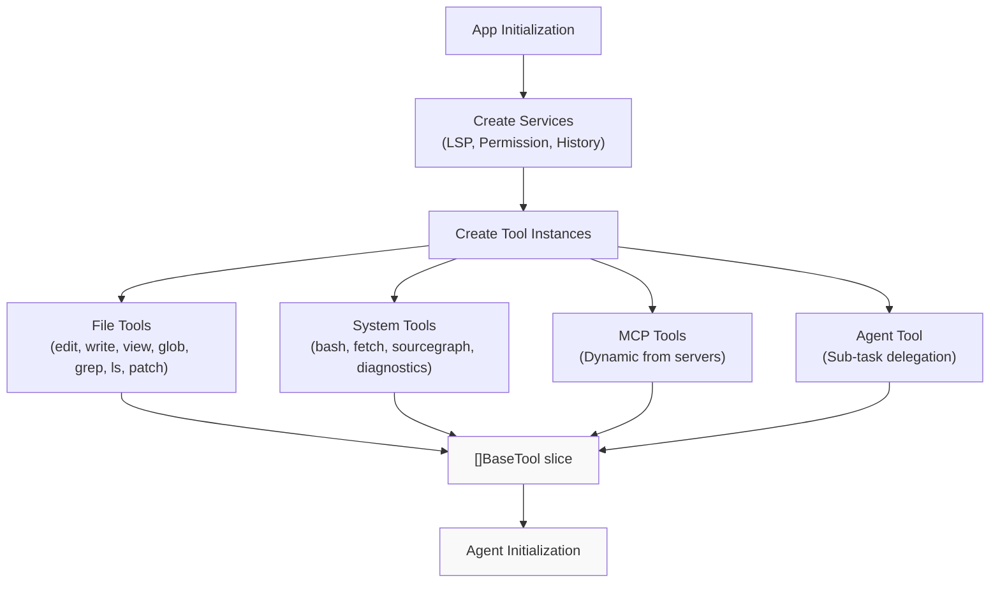
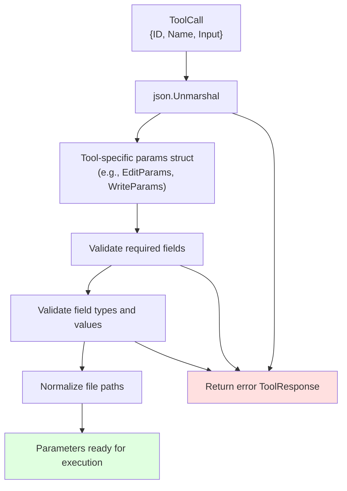
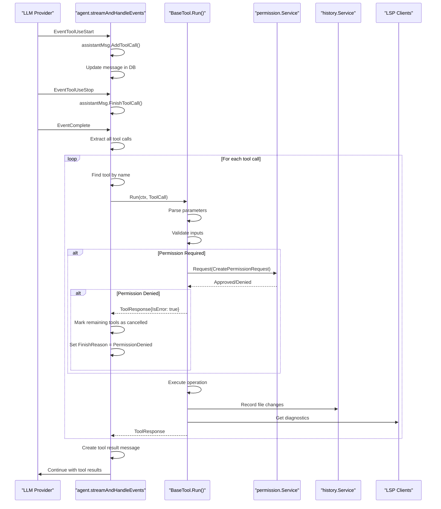
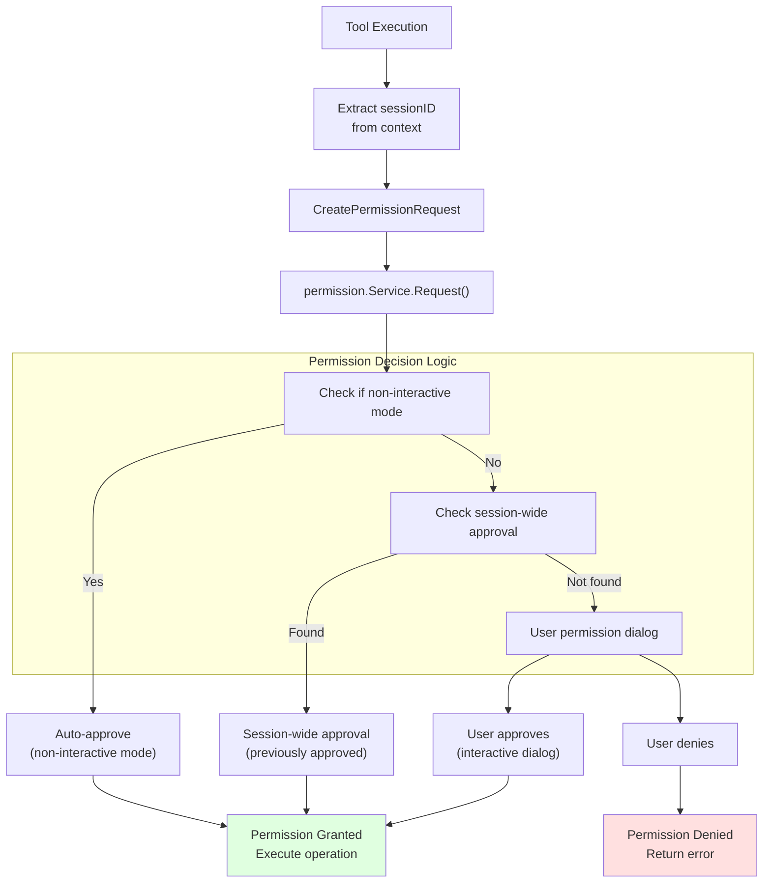
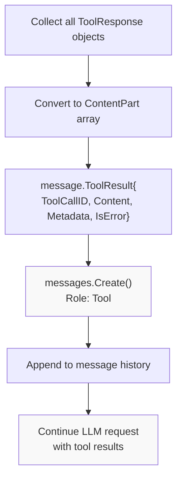
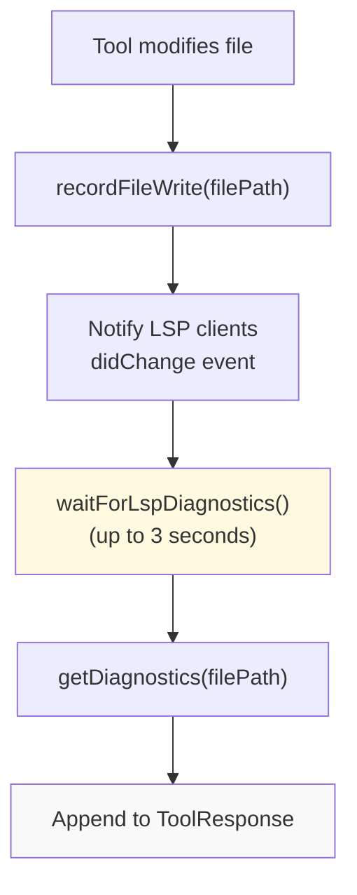

# Tool System

<details>
<summary>Relevant source files</summary>

The following files were used as context for generating this wiki page:

- [README.md](README.md)
- [internal/llm/agent/agent.go](internal/llm/agent/agent.go)
- [internal/llm/tools/edit.go](internal/llm/tools/edit.go)
- [internal/llm/tools/write.go](internal/llm/tools/write.go)

</details>


The Tool System provides a plugin-based framework that allows AI agents to interact with the file system, execute commands, and access external services through a standardized interface. All tool execution flows through a permission system that gates operations requiring user approval. This architecture enables agents to perform complex tasks while maintaining security boundaries and user control.

For specific tool implementations, see [File System Tools](#6.1), [Shell and Network Tools](#6.2), and [MCP and External Tools](#6.3).

## BaseTool Interface

All tools in OpenCode implement the `BaseTool` interface, which defines two core methods for tool metadata and execution:

**BaseTool Interface Structure**

```go
type BaseTool interface {
    Info() ToolInfo
    Run(ctx context.Context, call ToolCall) (ToolResponse, error)
}
```

| Method | Return Type | Purpose |
|--------|-------------|---------|
| `Info()` | `ToolInfo` | Provides tool metadata, parameters schema, and description for the LLM |
| `Run()` | `ToolResponse`, `error` | Executes the tool with validated parameters and returns results |

The interface design enables polymorphic tool handling by the agent, allowing new tools to be added without modifying the core agent logic.

Sources: [internal/llm/tools/edit.go:94-122](), [internal/llm/tools/write.go:74-98]()

### Tool Metadata: ToolInfo Structure

The `ToolInfo` structure provides comprehensive metadata that enables LLMs to understand tool capabilities and usage:

| Field | Type | Purpose |
|-------|------|---------|
| `Name` | `string` | Unique identifier for tool invocation |
| `Description` | `string` | Detailed usage instructions, examples, and constraints |
| `Parameters` | `map[string]any` | JSON schema defining input parameters |
| `Required` | `[]string` | List of mandatory parameter names |

**Example: Edit Tool ToolInfo**

The `edit` tool demonstrates comprehensive parameter schema definition with type specifications and descriptions for each parameter:

[internal/llm/tools/edit.go:102-122]()

The description field is particularly important as it serves as the primary documentation for the LLM, including usage guidelines, requirements, and error conditions.

Sources: [internal/llm/tools/edit.go:44-92](), [internal/llm/tools/write.go:42-72]()

### Tool Execution: ToolCall and ToolResponse

**ToolCall Structure**
```go
type ToolCall struct {
    ID    string
    Name  string
    Input string  // JSON-encoded parameters
}
```

The `ToolCall` encapsulates a tool invocation request from the LLM, including a unique ID for tracking and JSON-encoded input parameters.

**ToolResponse Structure**
```go
type ToolResponse struct {
    Content  string
    Metadata map[string]any
    IsError  bool
}
```

Tools return structured responses that indicate success or failure along with optional metadata. Common response helpers include:

- `NewTextResponse(content string)`: Success response with text content
- `NewTextErrorResponse(message string)`: Error response with error message
- `WithResponseMetadata(response, metadata)`: Attaches execution metadata (diffs, timings, etc.)

Sources: [internal/llm/tools/edit.go:124-171](), [internal/llm/tools/write.go:100-227]()

## Tool Discovery and Registration

The agent initializes with a collection of `BaseTool` implementations that are registered during application startup. Tool discovery occurs through explicit registration rather than dynamic scanning:

**Tool Registration Flow**



Each tool receives dependencies through constructor injection:

**Common Tool Dependencies**

| Dependency | Type | Purpose |
|------------|------|---------|
| `lspClients` | `map[string]*lsp.Client` | LSP integration for diagnostics |
| `permissions` | `permission.Service` | Permission gating for operations |
| `files` | `history.Service` | File version tracking and history |

Tools that require these services receive them during construction, establishing dependency injection patterns that facilitate testing and modularity.

Sources: [internal/llm/tools/edit.go:94-100](), [internal/llm/tools/write.go:74-80]()

## Parameter Validation and Parsing

Tools receive parameters as JSON-encoded strings in the `ToolCall.Input` field. Each tool performs its own parameter validation and parsing using Go's `encoding/json` package:

**Parameter Validation Flow**



**Example: EditParams Structure**

[internal/llm/tools/edit.go:20-24]()

**Validation Steps**

1. **JSON Unmarshaling**: Convert JSON string to typed struct
   ```go
   var params EditParams
   if err := json.Unmarshal([]byte(call.Input), &params); err != nil {
       return NewTextErrorResponse("invalid parameters"), nil
   }
   ```

2. **Required Field Validation**: Check presence of mandatory fields
   ```go
   if params.FilePath == "" {
       return NewTextErrorResponse("file_path is required"), nil
   }
   ```

3. **Path Normalization**: Convert relative paths to absolute paths
   ```go
   if !filepath.IsAbs(params.FilePath) {
       wd := config.WorkingDirectory()
       params.FilePath = filepath.Join(wd, params.FilePath)
   }
   ```

Parameter validation errors return `ToolResponse` with `IsError: true` rather than Go errors, allowing the agent to continue processing with informative feedback to the LLM.

Sources: [internal/llm/tools/edit.go:124-138](), [internal/llm/tools/write.go:100-118]()

## Tool Execution Flow

Tool execution in the agent follows a multi-step pipeline that includes LLM response streaming, tool call extraction, permission checking, and result processing:

**Complete Tool Execution Pipeline**



Sources: [internal/llm/agent/agent.go:322-438]()

### Context Propagation

Tools receive execution context through `context.Context` containing session and message identifiers required for permission tracking and history recording:

**Context Value Extraction**

```go
sessionID, messageID := GetContextValues(ctx)
if sessionID == "" || messageID == "" {
    return ToolResponse{}, fmt.Errorf("session ID and message ID are required")
}
```

| Context Key | Type | Purpose |
|-------------|------|---------|
| `SessionIDContextKey` | `string` | Session tracking for permissions and history |
| `MessageIDContextKey` | `string` | Message correlation for audit logging |

Tools that modify system state or access sensitive resources must extract these context values before requesting permissions or recording changes.

Sources: [internal/llm/tools/edit.go:189-192](), [internal/llm/tools/write.go:153-156]()

### Tool Call Iteration and Error Handling

The agent processes tool calls sequentially, with special handling for permission denials and cancellations:

**Tool Call Processing Logic** [internal/llm/agent/agent.go:350-421]()

1. **Tool Lookup**: Find tool by name in registered tools list
2. **Tool Execution**: Invoke `Run()` with context and parameters
3. **Permission Denial**: If denied, mark all remaining tool calls as cancelled
4. **Cancellation Check**: Check `ctx.Done()` between each tool call
5. **Result Aggregation**: Collect all tool results into `ToolResult` message

When a permission is denied, the agent sets the message finish reason to `FinishReasonPermissionDenied` and creates error responses for all subsequent tool calls in the same batch, preventing partial execution.

Sources: [internal/llm/agent/agent.go:350-421]()

## Permission Gating

All file-modifying and potentially destructive operations flow through the permission system, which implements three approval modes:

**Permission System Architecture**



### CreatePermissionRequest Structure

Tools construct permission requests with detailed operation information:

```go
type CreatePermissionRequest struct {
    SessionID   string
    Path        string
    ToolName    string
    Action      string
    Description string
    Params      interface{}
}
```

**Permission Request Example** [internal/llm/tools/edit.go:204-216]()

The `Params` field contains tool-specific data displayed to the user in the permission dialog, such as file diffs for edit operations.

### Permission Approval Modes

| Mode | Trigger | Behavior | Use Case |
|------|---------|----------|----------|
| Auto-approve | Non-interactive mode (`-p` flag) | Automatically grants all permissions | Scripting and automation |
| Session-wide | User selects "Allow for session" | Stores approval for current session | Repeated operations |
| One-time | User selects "Allow" | Grants permission for single operation | Careful review |

For file operations, the permission dialog displays unified diffs showing exact changes, enabling informed approval decisions.

Sources: [internal/llm/tools/edit.go:204-219](), [internal/llm/tools/write.go:169-184]()

## Safety Mechanisms

File manipulation tools implement multiple safety layers to prevent data loss and unintended modifications:

### Read-Before-Write Enforcement

Tools that modify files require prior read operations to ensure awareness of current content:

[internal/llm/tools/edit.go:266-268]()

The tool tracks file read times using an internal registry and validates that files were read before allowing modifications.

### Modification Time Validation

File modification timestamps are checked to detect concurrent changes by users or other processes:

[internal/llm/tools/edit.go:270-277]()

This prevents tools from overwriting manual user edits that occurred after the LLM last read the file.

### Uniqueness Guarantees for Edits

The `edit` tool requires `old_string` to appear exactly once in the file, preventing ambiguous replacements:

[internal/llm/tools/edit.go:291-294]()

This ensures surgical edits target the intended location and fail safely if multiple matches exist.

### Diff Generation and Preview

Before executing file operations, tools generate unified diffs showing exact changes:

[internal/llm/tools/edit.go:194-198]()

These diffs are displayed in permission dialogs, allowing users to review changes before approval. The diff generation includes line addition/removal counts for quick assessment.

Sources: [internal/llm/tools/edit.go:266-294](), [internal/llm/tools/edit.go:194-198](), [internal/llm/tools/write.go:125-130]()

## Tool Response Handling

After tool execution completes, the agent processes responses and converts them into message history for subsequent LLM requests:

**Tool Result Message Creation**



**Tool Result Structure** [internal/llm/agent/agent.go:425-432]()

Each tool result is converted to a `message.ToolResult` containing:
- `ToolCallID`: Links result to original tool call
- `Content`: Text response from tool execution
- `Metadata`: Optional structured data (diffs, timing, etc.)
- `IsError`: Indicates execution failure

The agent creates a message with role `Tool` containing all results, which is then appended to the conversation history before the next LLM request.

### Response Metadata

Tools can attach structured metadata to responses using `WithResponseMetadata()`:

**EditResponseMetadata Example** [internal/llm/tools/edit.go:31-35]()

Common metadata includes:
- **Diffs**: Unified diff output for file changes
- **Additions/Removals**: Line count statistics
- **Diagnostics**: LSP error and warning information

This metadata is available for display in the TUI but not passed to the LLM, keeping response payloads focused on textual content.

Sources: [internal/llm/agent/agent.go:350-438](), [internal/llm/tools/edit.go:31-35](), [internal/llm/tools/edit.go:243-250]()

## LSP Integration

Tools that modify code files integrate with Language Server Protocol clients to provide real-time diagnostic feedback:

**LSP Diagnostic Flow**



**Diagnostic Integration** [internal/llm/tools/edit.go:166-170]()

The workflow:
1. Tool writes file to disk
2. File write is recorded, triggering LSP notification
3. Tool waits briefly for LSP analysis
4. Diagnostics (errors, warnings) are retrieved
5. Diagnostics are appended to tool response text

This provides the LLM with immediate feedback about code correctness, enabling it to fix issues in subsequent tool calls.

Sources: [internal/llm/tools/edit.go:166-170](), [internal/llm/tools/write.go:215-220]()

## Error Handling and Response Types

Tools return structured responses through the `ToolResponse` type, which supports both success and error conditions with optional metadata.

**Response Types:**
- `NewTextResponse()`: Successful execution with text output
- `NewTextErrorResponse()`: Error condition with descriptive message
- `WithResponseMetadata()`: Adds execution metadata (timing, etc.)

**Error Categories:**
- **Parameter errors**: Invalid or missing input parameters
- **Permission errors**: Access denied by permission system  
- **Execution errors**: Runtime failures during tool execution
- **Resource errors**: Timeout, size limits, or resource exhaustion

Sources: [internal/llm/tools/bash.go:323-326](), [internal/llm/tools/fetch.go:103-104](), [internal/llm/agent/mcp-tools.go:59-83]()