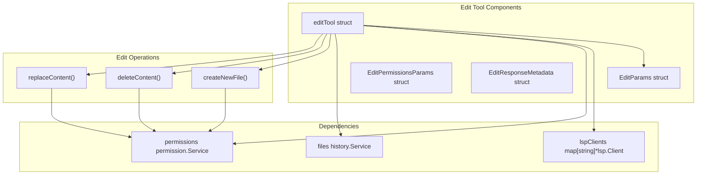
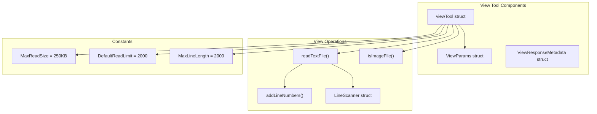
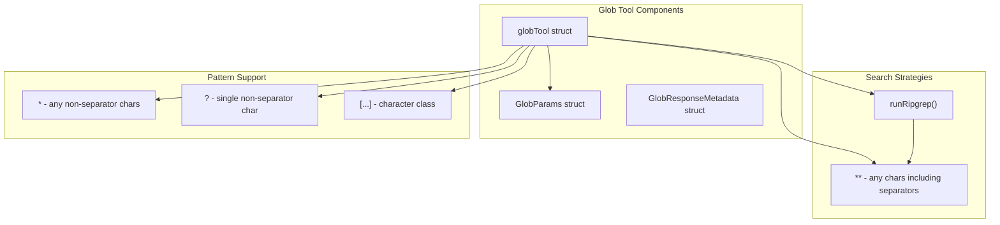
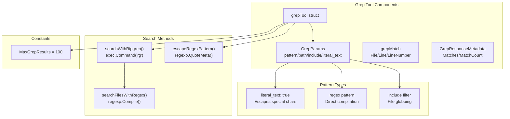
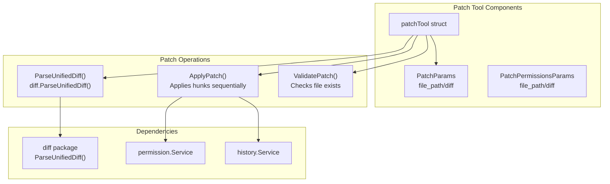
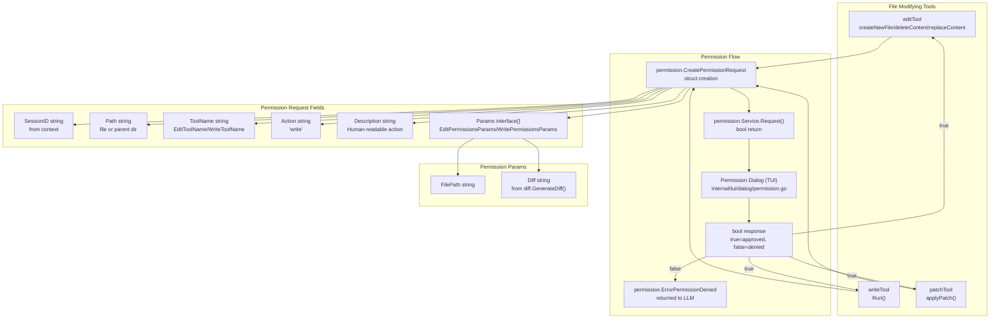
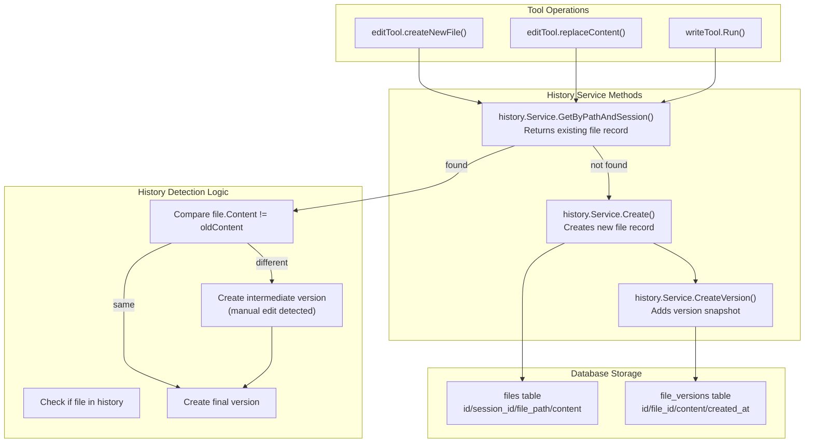
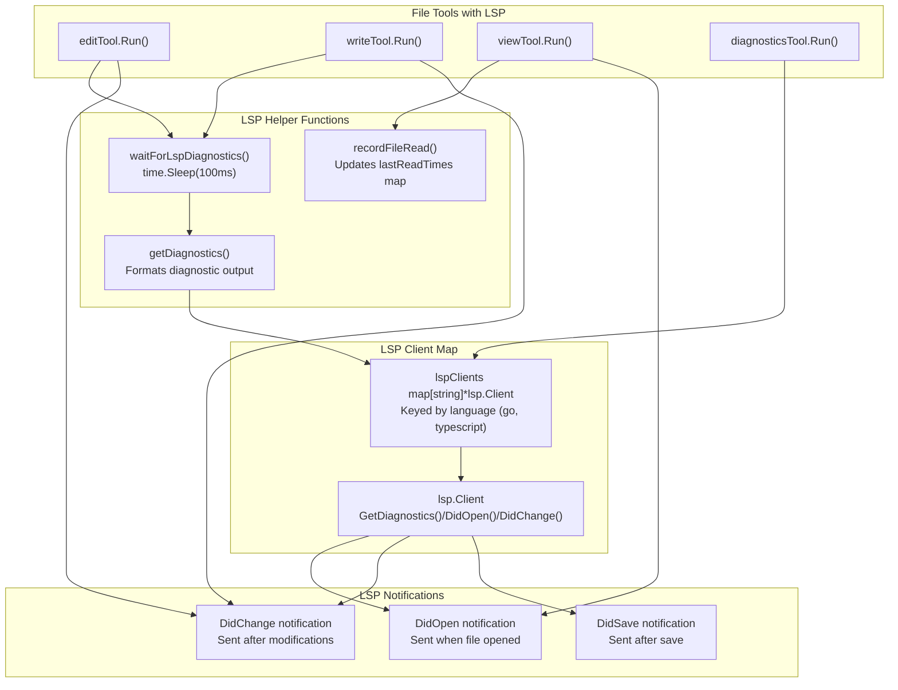
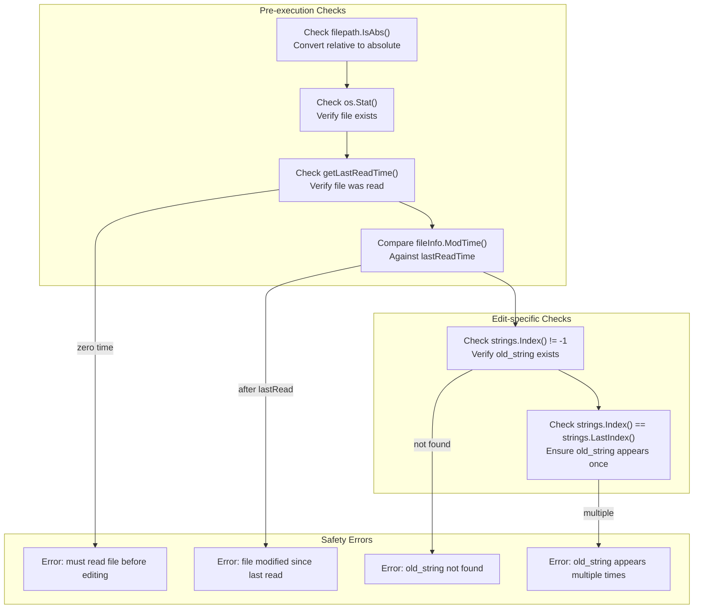

# File System Tools

Relevant source files

The following files were used as context for generating this wiki page:

- [README.md](README.md)
- [go.mod](go.mod)
- [go.sum](go.sum)
- [internal/diff/diff.go](internal/diff/diff.go)
- [internal/llm/tools/edit.go](internal/llm/tools/edit.go)
- [internal/llm/tools/write.go](internal/llm/tools/write.go)

## Purpose and Scope

This document covers the file system manipulation tools available in OpenCode's LLM tool ecosystem. These tools enable the AI assistant to interact with the file system by reading, writing, editing, and searching files. The file system tools are part of the broader LLM Tools system and integrate with OpenCode's permission system, LSP integration, and file history tracking.

For information about system integration tools like bash execution, see [System Integration Tools](#6.2). For details about MCP and external tool connectivity, see [MCP and External Tools](#6.3). For security aspects, see [Security and Permissions](#7).

## Overview of File System Tools

OpenCode provides eight core file system tools that allow the AI assistant to manipulate files and directories:

| Tool | Purpose | Primary Use Case |
|------|---------|------------------|
| `edit` | Replace text in existing files | Precise code modifications with uniqueness validation |
| `write` | Create or overwrite entire files | File creation and bulk content updates |
| `view` | Read file contents with line numbers | File examination with pagination support |
| `glob` | Find files by pattern matching | File discovery using glob patterns |
| `grep` | Search file contents by pattern | Code search with regex or literal text |
| `ls` | List directory contents | Directory exploration with filtering |
| `patch` | Apply unified diff patches | Applying multi-file or complex changes |
| `diagnostics` | Retrieve LSP diagnostics | Getting compiler/linter errors and warnings |

Sources: [README.md:406-417]()

### File System Tools Architecture

**Figure: File System Tools Component Structure**

```mermaid
graph TB
    subgraph "Tool Implementations"
        EditTool["editTool<br/>EditToolName='edit'"]
        WriteTool["writeTool<br/>WriteToolName='write'"] 
        ViewTool["viewTool<br/>ViewToolName='view'"]
        GlobTool["globTool<br/>GlobToolName='glob'"]
        GrepTool["grepTool<br/>GrepToolName='grep'"]
        LsTool["lsTool<br/>LsToolName='ls'"]
        PatchTool["patchTool<br/>PatchToolName='patch'"]
        DiagnosticsTool["diagnosticsTool<br/>DiagnosticsToolName='diagnostics'"]
    end
    
    subgraph "Core Services"
        PermSvc["permission.Service<br/>Request()"]
        HistorySvc["history.Service<br/>Create/CreateVersion()"]
        LSPMap["map[string]*lsp.Client<br/>GetDiagnostics()"]
    end
    
    subgraph "Tool Protocol"
        BaseTool["BaseTool interface<br/>Info()/Run()"]
        ToolInfo["ToolInfo<br/>Name/Description/Parameters"]
        ToolResponse["ToolResponse<br/>Content/IsError/Metadata"]
        ToolCall["ToolCall<br/>Name/Input"]
    end
    
    subgraph "File System Layer"
        OsReadFile["os.ReadFile"]
        OsWriteFile["os.WriteFile"]
        OsStat["os.Stat"]
        OsMkdirAll["os.MkdirAll"]
        OsReadDir["os.ReadDir"]
    end
    
    subgraph "External Dependencies"
        Ripgrep["exec.Command('rg')"]
        Doublestar["doublestar.FilepathGlob()"]
        DiffGen["diff.GenerateDiff()"]
        Patch["patch.Apply()"]
    end
    
    EditTool --> PermSvc
    EditTool --> HistorySvc
    EditTool --> LSPMap
    WriteTool --> PermSvc
    WriteTool --> HistorySvc
    WriteTool --> LSPMap
    ViewTool --> LSPMap
    PatchTool --> PermSvc
    PatchTool --> HistorySvc
    DiagnosticsTool --> LSPMap
    
    EditTool --> BaseTool
    WriteTool --> BaseTool
    ViewTool --> BaseTool
    GlobTool --> BaseTool
    GrepTool --> BaseTool
    LsTool --> BaseTool
    PatchTool --> BaseTool
    DiagnosticsTool --> BaseTool
    
    BaseTool --> ToolInfo
    BaseTool --> ToolCall
    BaseTool --> ToolResponse
    
    EditTool --> OsReadFile
    EditTool --> OsWriteFile
    WriteTool --> OsReadFile
    WriteTool --> OsWriteFile
    ViewTool --> OsReadFile
    LsTool --> OsReadDir
    PatchTool --> OsReadFile
    PatchTool --> OsWriteFile
    
    EditTool --> DiffGen
    WriteTool --> DiffGen
    PatchTool --> Patch
    
    GlobTool --> Ripgrep
    GlobTool --> Doublestar
    GrepTool --> Ripgrep
```

Sources: [internal/llm/tools/edit.go:37-100](), [internal/llm/tools/write.go:30-80](), [internal/diff/diff.go:849-873]()

## Individual Tools

### Edit Tool

The `editTool` provides precise text replacement capabilities within files. It supports three main operations: replacing text, creating new files, and deleting content.

#### Core Structure

The edit tool requires three parameters:
- `file_path`: Absolute path to the target file
- `old_string`: Text to replace (must be unique in the file)
- `new_string`: Replacement text

#### Key Features

- **Uniqueness Validation**: Ensures `old_string` appears exactly once in the file to prevent unintended modifications
- **File Safety**: Checks if files have been modified since last read
- **Permission Integration**: Requests user permission before making changes
- **History Tracking**: Records all file changes for version control
- **LSP Integration**: Updates language servers after modifications

Sources: [internal/llm/tools/edit.go:20-24](), [internal/llm/tools/edit.go:37-41](), [internal/llm/tools/edit.go:94-100]()

### Write Tool

The `writeTool` creates new files or overwrites existing ones with complete content.

#### Core Structure

The write tool uses `WriteParams` with `file_path` and `content` fields. It integrates with the same core services as the edit tool but focuses on complete file operations rather than targeted edits.

#### Key Features

- **Complete File Operations**: Creates or overwrites entire files
- **Directory Creation**: Automatically creates parent directories
- **Content Deduplication**: Avoids unnecessary writes when content is unchanged
- **Safety Checks**: Validates file modification times before writing

Sources: [internal/llm/tools/write.go:20-23](), [internal/llm/tools/write.go:30-34](), [internal/llm/tools/write.go:74-80]()

### View Tool

The `viewTool` reads file contents and displays them with line numbers.

#### Core Structure

#### Key Features

- **Line Numbering**: Displays content with line numbers for easy reference
- **Pagination**: Supports `offset` and `limit` parameters for large files
- **File Type Detection**: Identifies and handles image files appropriately
- **Size Limits**: Enforces maximum file size (250KB) and line length (2000 chars)
- **LSP Integration**: Notifies language servers when files are opened

Sources: [internal/llm/tools/view.go:18-22](), [internal/llm/tools/view.go:24-26](), [internal/llm/tools/view.go:34-37]()

### Glob Tool

The `globTool` finds files using pattern matching with glob syntax.

#### Core Structure

#### Key Features

- **Pattern Matching**: Supports standard glob patterns with wildcards and character classes
- **Performance Optimization**: Uses ripgrep when available, falls back to doublestar
- **Result Limiting**: Limits results to 100 files, sorted by modification time
- **Hidden File Filtering**: Automatically skips hidden files (starting with '.')

Sources: [internal/llm/tools/glob.go:56-59](), [internal/llm/tools/glob.go:66](), [internal/llm/tools/glob.go:129-141]()

### Grep Tool

The `grepTool` searches file contents using regular expressions or literal text matching.

#### Core Structure

**Figure: Grep Tool Implementation**

#### Key Features

- **Dual Search Modes**: Supports both regex and literal text searching via `literal_text` parameter
- **Performance Optimization**: Uses `exec.Command("rg")` when available, falls back to `regexp` package
- **File Filtering**: Supports `include` patterns to limit search scope using glob matching
- **Result Formatting**: Returns matches with file paths, line numbers, and content in `grepMatch` structs
- **Result Limiting**: Limits results to `MaxGrepResults` (100) matches, sorted by modification time

Sources: [internal/llm/tools/grep.go:21-26](), [internal/llm/tools/grep.go:40](), [internal/llm/tools/grep.go:186-205]()

### LS Tool

The `lsTool` lists directory contents with optional filtering capabilities.

#### Core Structure

The `lsTool` accepts a `path` parameter and optional `ignore` patterns. It returns a list of files and directories with metadata including type (file/directory), size, and modification time. The tool supports filtering via glob patterns to exclude specific files or directories from the listing.

#### Key Features

- **Directory Enumeration**: Uses `os.ReadDir()` to list directory contents
- **Type Detection**: Distinguishes between files and directories in output
- **Size Information**: Includes file sizes in human-readable format
- **Ignore Patterns**: Supports glob patterns to filter out unwanted entries
- **Hidden File Handling**: Respects hidden file conventions

Sources: [README.md:412]()

### Patch Tool

The `patchTool` applies unified diff patches to files, enabling complex multi-line or multi-file modifications.

#### Core Structure

**Figure: Patch Tool Implementation**

#### Key Features

- **Unified Diff Support**: Accepts standard unified diff format (output from `diff -u`)
- **Multi-hunk Application**: Applies multiple hunks within a single patch
- **Validation**: Verifies file existence and patch applicability before applying
- **Permission Integration**: Requests approval showing the full diff preview
- **History Tracking**: Records patch application in file history
- **Error Recovery**: Provides detailed error messages for failed patch applications

Sources: [README.md:416](), [internal/diff/diff.go:132-230]()

### Diagnostics Tool

The `diagnosticsTool` retrieves Language Server Protocol diagnostics for files.

#### Core Structure

The `diagnosticsTool` queries LSP clients for diagnostic information (errors, warnings, hints) about specified files. It accepts an optional `file_path` parameter - if omitted, it returns diagnostics for all files with active LSP sessions.

#### Key Features

- **LSP Integration**: Queries `map[string]*lsp.Client` for diagnostic information
- **Multi-language Support**: Works with any configured LSP server (gopls, typescript-language-server, etc.)
- **Diagnostic Types**: Returns errors, warnings, information, and hint-level diagnostics
- **Position Information**: Includes line numbers, column numbers, and ranges for each diagnostic
- **Severity Levels**: Categorizes diagnostics by severity (error, warning, info, hint)
- **Bulk Retrieval**: Can retrieve diagnostics for all tracked files when no file path specified

Sources: [README.md:417](), [internal/llm/tools/edit.go:166-170]()

## Integration Architecture

### Permission System Integration

**Figure: Permission Request Flow for File Operations**

The permission system integration follows these steps:

1. **Context Extraction**: Tool extracts `sessionID` and `messageID` from `context.Context` via `GetContextValues(ctx)`
2. **Diff Generation**: For write operations, calls `diff.GenerateDiff(oldContent, newContent, filePath)` to create a unified diff
3. **Path Scoping**: Determines permission path - uses working directory if file is within it, otherwise uses parent directory
4. **Request Creation**: Constructs `permission.CreatePermissionRequest` with all metadata
5. **Service Invocation**: Calls `permissions.Request()` which blocks until user responds
6. **Response Handling**: Returns `permission.ErrorPermissionDenied` if denied, continues with operation if approved

Sources: [internal/llm/tools/edit.go:189-219](), [internal/llm/tools/write.go:153-184](), [internal/diff/diff.go:849-873]()

### File History Integration

**Figure: File History Tracking Flow**

All file modification tools integrate with the `history.Service` to track changes:

- **File Creation**: Calls `files.Create(ctx, sessionID, filePath, initialContent)` to create new file history entries
- **Version Tracking**: Calls `files.CreateVersion(ctx, sessionID, filePath, content)` to record each modification
- **Content Comparison**: Compares `file.Content` with current file content to detect manual changes between tool invocations
- **Intermediate Versions**: If `file.Content != oldContent`, creates an intermediate version before the new version to preserve manual edits
- **Session Association**: Links file changes to specific user sessions via `sessionID` parameter
- **Error Tolerance**: Logs errors via `logging.Debug()` but doesn't fail operations if history recording fails

Sources: [internal/llm/tools/edit.go:227-238](), [internal/llm/tools/edit.go:338-357](), [internal/llm/tools/edit.go:457-477](), [internal/llm/tools/write.go:191-211]()

### LSP Integration

**Figure: LSP Integration in File Tools**

File system tools integrate with Language Server Protocol clients to provide enhanced development features:

- **File Open Notifications**: `viewTool` calls `recordFileRead()` and sends `DidOpen` notifications to LSP servers when files are viewed
- **File Change Notifications**: `editTool` and `writeTool` send `DidChange` notifications after modifications
- **Diagnostic Retrieval**: Tools call `getDiagnostics(filePath, lspClients)` to fetch and format compiler/linter diagnostics
- **Asynchronous Updates**: `waitForLspDiagnostics()` adds a 100ms sleep to allow LSP servers to process changes before retrieving diagnostics
- **Language Detection**: LSP clients are selected from `lspClients` map based on file extension
- **Diagnostic Formatting**: `getDiagnostics()` formats diagnostic output with file paths, line numbers, severity, and messages
- **Result Integration**: Diagnostic output is appended to tool responses wrapped in `<diagnostics>` tags

Sources: [internal/llm/tools/edit.go:166-170](), [internal/llm/tools/write.go:215-220](), [internal/llm/tools/view.go:177-188]()

## Security and Permissions

### Permission Model

File system tools implement a comprehensive permission model:

1. **Path-based Permissions**: Requests are scoped to specific directories via the `Path` field in `permission.CreatePermissionRequest`
2. **Action-based Control**: Different actions (read, write) have separate permissions tracked by the `Action` field
3. **Diff Preview**: Shows exactly what changes will be made via `diff.GenerateDiff()` before execution
4. **Session Tracking**: Associates permissions with specific user sessions via `SessionID` field
5. **Tool Identification**: Each tool identified by unique name (`EditToolName`, `WriteToolName`, etc.)
6. **Working Directory Scoping**: If file is within `config.WorkingDirectory()`, permission is scoped to entire working directory

### Safety Mechanisms

**Figure: Edit Tool Safety Checks**

The file system tools implement multiple safety mechanisms:

- **File Modification Checks**: Validates files haven't been modified since last read by comparing `fileInfo.ModTime()` against `getLastReadTime(filePath)` stored in `lastReadTimes` map
- **Read-before-write Enforcement**: `editTool` and `writeTool` require files to have been read via `viewTool` before modification
- **Unique Match Validation**: `editTool` uses `strings.Index()` and `strings.LastIndex()` to ensure `old_string` appears exactly once in file content
- **Parent Directory Creation**: Tools call `os.MkdirAll(dir, 0o755)` to safely create necessary directory structure
- **Absolute Path Requirement**: Tools check `filepath.IsAbs()` and convert relative paths using `config.WorkingDirectory()`
- **Directory vs File Validation**: Checks `fileInfo.IsDir()` to prevent operations on directories
- **Permission Denial Handling**: Returns `permission.ErrorPermissionDenied` which propagates to LLM as tool error
- **Error Recovery**: All file system errors wrapped with context using `fmt.Errorf()` for debugging

Sources: [internal/llm/tools/edit.go:266-277](), [internal/llm/tools/edit.go:385-396](), [internal/llm/tools/edit.go:405-413](), [internal/llm/tools/write.go:119-131]()

## Usage Patterns

### Common Tool Combinations

1. **Code Exploration**: `glob` → `view` → `grep` → `edit`
2. **File Creation**: `view` (check location) → `write` (create file)
3. **Bulk Modifications**: `grep` (find targets) → `edit` (modify each)
4. **Project Analysis**: `glob` (find files) → `grep` (search content) → `view` (examine details)

### Best Practices

- Always use `view` before `edit` or `write` to understand file context
- Use `glob` to discover files before searching with `grep`
- Provide sufficient context in `edit` operations for unique matching
- Leverage LSP diagnostics to verify code correctness after modifications

Sources: [internal/llm/tools/edit.go:45-91](), [internal/llm/tools/write.go:44-72](), [internal/llm/tools/view.go:38-68]()