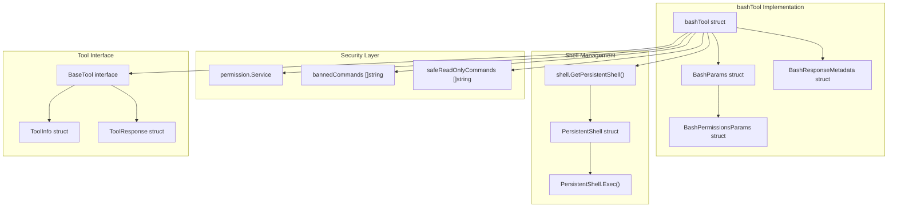
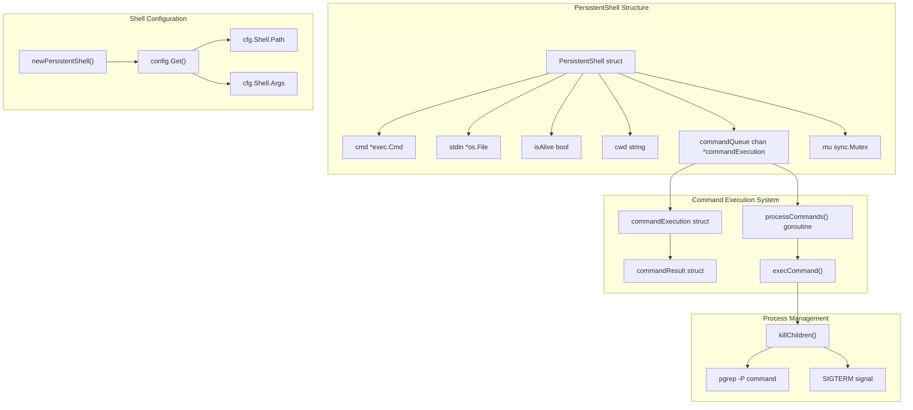
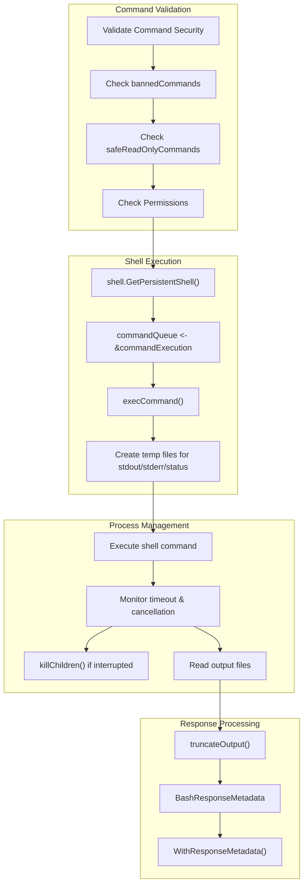
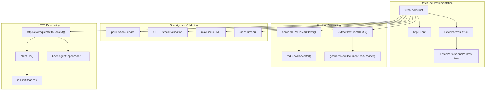
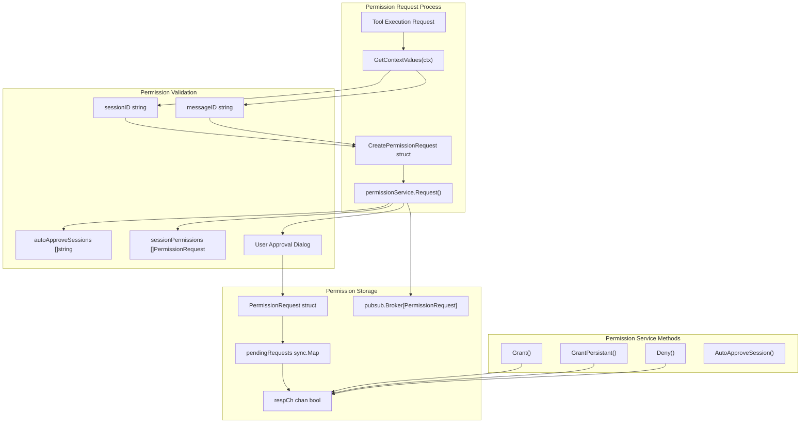
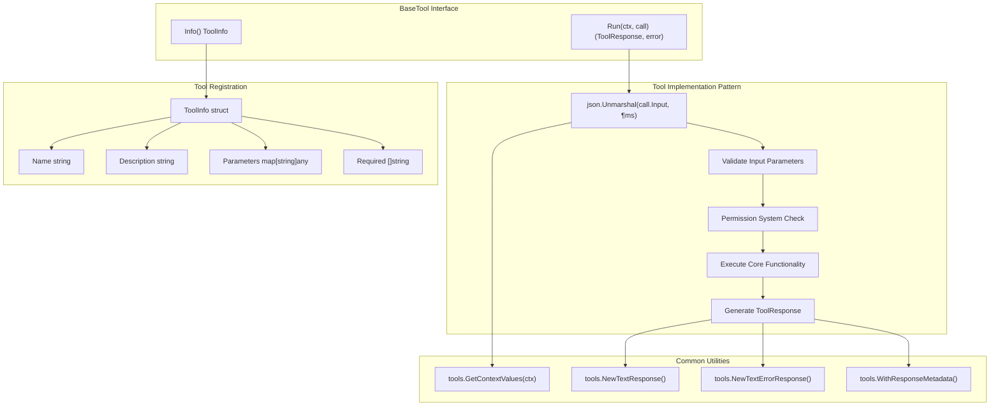

# System Integration Tools

<details>
<summary>Relevant source files</summary>

The following files were used as context for generating this wiki page:

- [README.md](README.md)
- [internal/config/config.go](internal/config/config.go)

</details>


This document covers the system integration tools available to LLM agents in OpenCode, focusing on tools that interact with the operating system, execute shell commands, and fetch external resources. These tools provide agents with capabilities to run system commands, make HTTP requests, and integrate with external services while maintaining proper security controls.

For information about file manipulation tools, see [File System Tools](#6.1). For information about Model Context Protocol (MCP) and other external tool integrations, see [MCP and External Tools](#6.3).

## Bash Tool

The `BashTool` provides LLM agents with the ability to execute shell commands in a persistent shell session. This tool is implemented in the `bashTool` struct and offers comprehensive command execution capabilities with built-in security measures.

### Bash Tool Architecture



Sources: [internal/llm/tools/bash.go:1-348](), [internal/llm/tools/shell/shell.go:1-328]()

### Command Security and Validation

The bash tool implements a multi-layered security approach:

| Security Layer | Description | Implementation |
|---|---|---|
| Banned Commands | Commands that are completely prohibited | `bannedCommands` slice [internal/llm/tools/bash.go:41-45]() |
| Safe Read-Only Commands | Commands that bypass permission checks | `safeReadOnlyCommands` slice [internal/llm/tools/bash.go:47-55]() |
| Permission System | Runtime permission validation | `permission.Service.Request()` [internal/llm/tools/bash.go:270-284]() |
| Output Truncation | Limits output size to prevent resource exhaustion | `MaxOutputLength` constant [internal/llm/tools/bash.go:38]() |

The banned commands include network tools like `curl`, `wget`, and browser commands to prevent unauthorized network access. Safe read-only commands include basic system utilities like `ls`, `pwd`, `git status`, and `go version` that can execute without explicit permission.

Sources: [internal/llm/tools/bash.go:41-55](), [internal/llm/tools/bash.go:246-285]()

### Persistent Shell Implementation

The bash tool maintains a persistent shell session using the `PersistentShell` struct from the `shell` package, which provides stateful command execution with proper session management.

### PersistentShell Architecture



The `PersistentShell` ensures:

- **State Persistence**: Environment variables, current directory, and shell state persist between commands
- **Asynchronous Execution**: Commands execute through a queued system with goroutines
- **Process Management**: Child processes are tracked and can be terminated on timeout
- **Shell Configuration**: Configurable shell path and arguments through the config system

Sources: [internal/llm/tools/shell/shell.go:18-130](), [internal/llm/tools/shell/shell.go:271-302]()

### Command Execution Flow



Sources: [internal/llm/tools/bash.go:287-327](), [internal/llm/tools/shell/shell.go:132-244]()

### Shell Command Execution Implementation

The `PersistentShell.execCommand()` method uses a sophisticated approach to handle command execution:

1. **Temporary File System**: Creates unique temporary files for stdout, stderr, exit status, and working directory tracking [internal/llm/tools/shell/shell.go:151-156]()

2. **Shell Script Generation**: Constructs a shell script that redirects outputs and captures the exit code [internal/llm/tools/shell/shell.go:164-175]()

3. **Concurrent Monitoring**: Uses goroutines to monitor for context cancellation and timeout while polling for completion [internal/llm/tools/shell/shell.go:190-217]()

4. **Process Cleanup**: Terminates child processes using `pgrep` and `SIGTERM` when commands are interrupted [internal/llm/tools/shell/shell.go:246-269]()

Sources: [internal/llm/tools/shell/shell.go:139-244](), [internal/llm/tools/shell/shell.go:246-269]()

### Special Handling for Git Operations

The bash tool includes extensive built-in guidance for git operations, particularly for creating commits and pull requests. The tool description contains detailed workflows for:

- **Git Commits**: Multi-step process including status checks, diff analysis, and commit message generation [internal/llm/tools/bash.go:97-152]()
- **Pull Requests**: Integration with GitHub CLI (`gh` command) for PR creation [internal/llm/tools/bash.go:153-202]()

Sources: [internal/llm/tools/bash.go:97-202]()

## Fetch Tool

The `fetchTool` enables agents to retrieve content from HTTP/HTTPS URLs with support for multiple output formats. This tool is designed for accessing external documentation, APIs, and web content.

### Fetch Tool Architecture



Sources: [internal/llm/tools/fetch.go:1-228]()

### Content Format Support

The fetch tool supports three output formats:

| Format | Use Case | Processing |
|---|---|---|
| `text` | Plain text extraction from HTML | Uses `goquery` to extract text content [internal/llm/tools/fetch.go:178-184]() |
| `markdown` | Formatted content rendering | Converts HTML to Markdown using `html-to-markdown` [internal/llm/tools/fetch.go:188-196]() |
| `html` | Raw HTML structure | Returns content as-is [internal/llm/tools/fetch.go:198-199]() |

### Security Controls

The fetch tool implements several security measures:

- **Protocol Restriction**: Only HTTP/HTTPS URLs are allowed [internal/llm/tools/fetch.go:115-117]()
- **Size Limiting**: Responses are limited to 5MB [internal/llm/tools/fetch.go:167-168]()
- **Timeout Control**: Configurable timeouts with a 2-minute maximum [internal/llm/tools/fetch.go:140-148]()
- **Permission Integration**: Requires explicit permission for each fetch operation [internal/llm/tools/fetch.go:124-137]()

Sources: [internal/llm/tools/fetch.go:115-148](), [internal/llm/tools/fetch.go:167-168]()

## Permission System Integration

Both system integration tools rely heavily on the permission system to control access and ensure security. The permission system provides a unified approach to access control across all tools.

### Permission Request Flow



Sources: [internal/permission/permission.go:74-108](), [internal/llm/tools/bash.go:265-284](), [internal/llm/tools/fetch.go:119-137]()

### Permission Request Structure

The `CreatePermissionRequest` struct standardizes permission requests across all tools:

```go
type CreatePermissionRequest struct {
    SessionID   string `json:"session_id"`
    ToolName    string `json:"tool_name"` 
    Description string `json:"description"`
    Action      string `json:"action"`
    Params      any    `json:"params"`
    Path        string `json:"path"`
}
```

Each tool creates specific parameter structures for permission tracking:
- `BashPermissionsParams` for bash commands [internal/llm/tools/bash.go:20-23]()
- `FetchPermissionsParams` for HTTP requests [internal/llm/tools/fetch.go:24-28]()

Sources: [internal/permission/permission.go:16-23](), [internal/llm/tools/bash.go:20-23](), [internal/llm/tools/fetch.go:24-28]()

## Tool Interface Implementation

All system integration tools implement the `BaseTool` interface, providing a consistent API for the agent system.

### Common Tool Implementation Pattern



Sources: [internal/llm/tools/bash.go:206-327](), [internal/llm/tools/fetch.go:68-204]()

### Tool Registration and Discovery

System integration tools are registered through the agent system and made available to LLM providers. The `ToolInfo` structure provides metadata for tool discovery:

- **Name**: Unique identifier for the tool
- **Description**: Comprehensive usage documentation
- **Parameters**: JSON schema for input validation
- **Required**: List of mandatory parameters

Sources: [internal/llm/tools/bash.go:212-228](), [internal/llm/tools/fetch.go:77-98]()