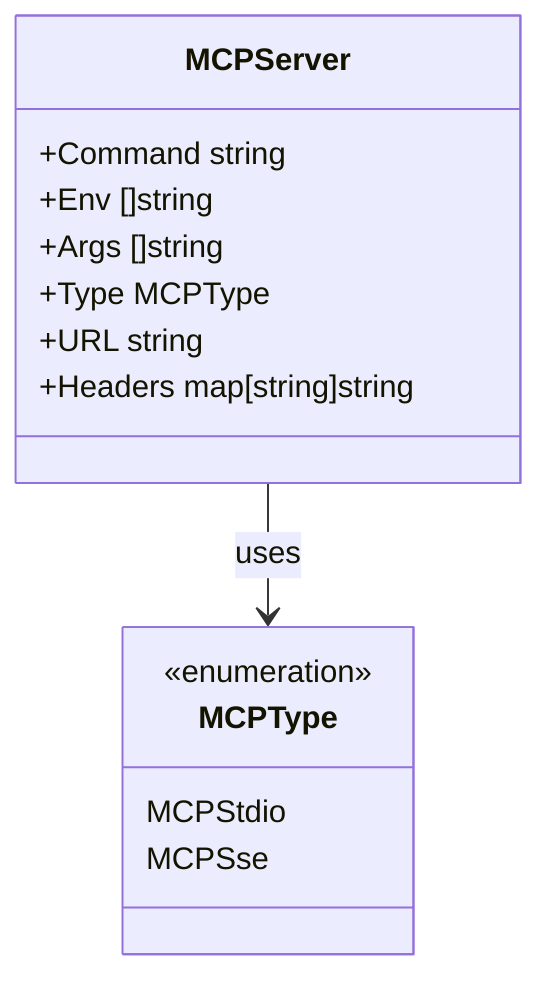
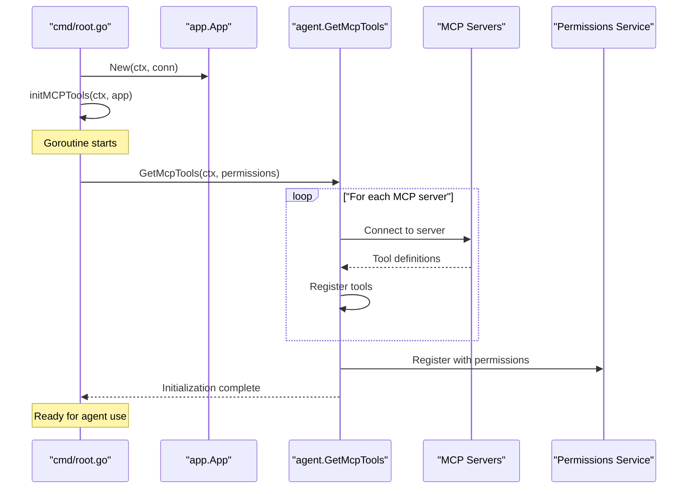
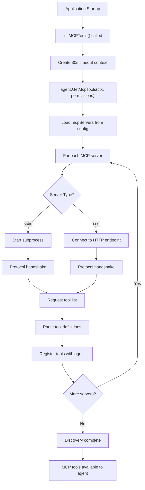
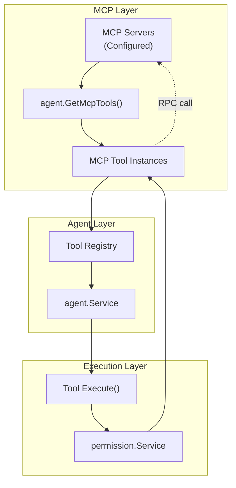
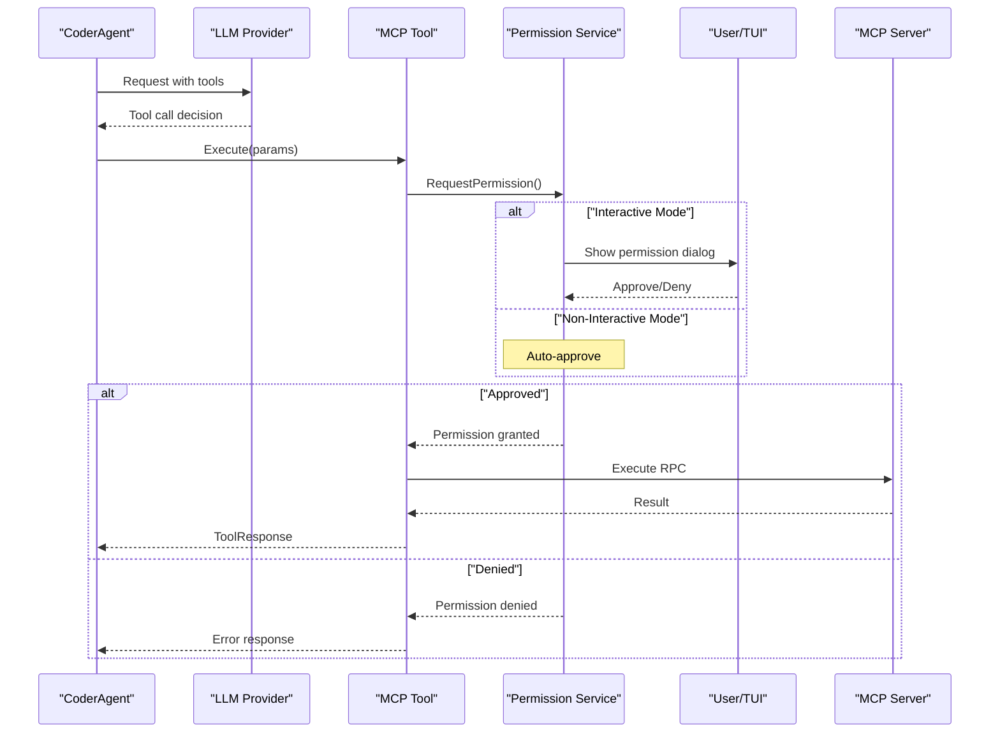
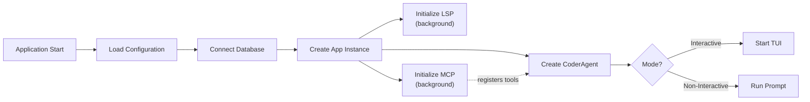

# MCP and External Tools

<details>
<summary>Relevant source files</summary>

The following files were used as context for generating this wiki page:

- [README.md](README.md)
- [cmd/root.go](cmd/root.go)
- [internal/app/app.go](internal/app/app.go)
- [internal/config/config.go](internal/config/config.go)

</details>


## Purpose and Scope

This document describes the Model Context Protocol (MCP) integration in OpenCode, which enables the AI assistant to connect to external tools and services through a standardized protocol. MCP extends OpenCode's capabilities beyond built-in tools by allowing communication with external server processes.

For information about built-in file system tools (edit, write, view, etc.), see [File System Tools](#6.1). For shell execution and network requests, see [Shell and Network Tools](#6.2). For the overall tool system architecture, see [Tool System](#6).

---

## MCP Protocol Overview

The Model Context Protocol (MCP) provides a standardized interface for AI assistants to interact with external tools and services. In OpenCode, MCP enables the agent to:

- Discover tools from external MCP servers
- Execute tool operations through standardized communication channels
- Extend functionality without modifying core code
- Integrate with third-party services and custom tool implementations

OpenCode supports two MCP communication protocols:
- **stdio**: Communication via standard input/output with subprocess
- **SSE**: Communication via Server-Sent Events over HTTP

**Sources:** [README.md:529-541](), [internal/config/config.go:18-35]()

---

## MCP Configuration

### MCPServer Configuration Structure

MCP servers are configured in the `mcpServers` section of the configuration file. Each server has a unique name (map key) and configuration properties:

| Field | Type | Description | Required |
|-------|------|-------------|----------|
| `type` | `MCPType` | Communication protocol: `stdio` or `sse` | No (defaults to `stdio`) |
| `command` | `string` | Executable path for stdio servers | For stdio |
| `args` | `[]string` | Command-line arguments | No |
| `env` | `[]string` | Environment variables | No |
| `url` | `string` | Endpoint URL for SSE servers | For SSE |
| `headers` | `map[string]string` | HTTP headers for SSE servers | No |

**Sources:** [internal/config/config.go:28-35]()

### Configuration Example

```json
{
  "mcpServers": {
    "filesystem": {
      "type": "stdio",
      "command": "/usr/local/bin/mcp-filesystem",
      "args": ["--root", "/workspace"],
      "env": ["MCP_LOG_LEVEL=info"]
    },
    "web-search": {
      "type": "sse",
      "url": "https://api.example.com/mcp",
      "headers": {
        "Authorization": "Bearer YOUR_TOKEN",
        "X-API-Version": "1.0"
      }
    }
  }
}
```

**Sources:** [README.md:546-564](), [internal/config/config.go:466-471]()

---

## MCP Server Types

### MCPType Enum



**Diagram: MCPType enumeration and MCPServer structure**

The `MCPType` constant defines the communication protocol:
- `MCPStdio` = `"stdio"` - Process-based communication
- `MCPSse` = `"sse"` - HTTP Server-Sent Events

**Sources:** [internal/config/config.go:18-35]()

### Default Type Application

When the `type` field is omitted from configuration, it defaults to `stdio`:

```go
// Set default MCP type if not specified
for k, v := range cfg.MCPServers {
    if v.Type == "" {
        v.Type = MCPStdio
        cfg.MCPServers[k] = v
    }
}
```

**Sources:** [internal/config/config.go:466-471]()

---

## MCP Initialization Process

### Initialization Sequence



**Diagram: MCP initialization sequence during application startup**

**Sources:** [cmd/root.go:195-207](), [internal/app/app.go:42-80]()

### Initialization Function

The `initMCPTools` function runs in a background goroutine during application startup:

```go
func initMCPTools(ctx context.Context, app *app.App) {
    go func() {
        defer logging.RecoverPanic("MCP-goroutine", nil)
        
        // Create a context with timeout for the initial MCP tools fetch
        ctxWithTimeout, cancel := context.WithTimeout(ctx, 30*time.Second)
        defer cancel()
        
        // Set this up once with proper error handling
        agent.GetMcpTools(ctxWithTimeout, app.Permissions)
        logging.Info("MCP message handling goroutine exiting")
    }()
}
```

Key characteristics:
- Runs asynchronously to avoid blocking application startup
- 30-second timeout for tool discovery
- Panic recovery to prevent crashes
- Initialized early for both interactive and non-interactive modes

**Sources:** [cmd/root.go:195-207](), [cmd/root.go:108-109]()

---

## Tool Discovery Process

### Discovery Flow



**Diagram: MCP tool discovery process flow**

**Sources:** [cmd/root.go:195-207](), [internal/config/config.go:87-96]()

---

## Communication Protocols

### Stdio Protocol

The stdio protocol communicates with MCP servers by spawning a subprocess and using standard input/output streams for message exchange.

**Configuration fields for stdio:**
- `command`: Path to the executable
- `args`: Command-line arguments array
- `env`: Environment variables array

**Communication characteristics:**
- Synchronous request/response model
- JSON-formatted messages over stdin/stdout
- Process lifecycle managed by OpenCode
- Isolated process per MCP server

**Example stdio server configuration:**

| Field | Value |
|-------|-------|
| `type` | `"stdio"` |
| `command` | `"npx"` |
| `args` | `["-y", "@modelcontextprotocol/server-filesystem", "/workspace"]` |
| `env` | `["NODE_ENV=production"]` |

**Sources:** [README.md:546-555](), [internal/config/config.go:28-35]()

### SSE Protocol

The SSE (Server-Sent Events) protocol communicates with MCP servers over HTTP using server-sent events for streaming responses.

**Configuration fields for SSE:**
- `url`: HTTP endpoint URL
- `headers`: Optional HTTP headers map

**Communication characteristics:**
- HTTP-based communication
- Server-sent events for streaming responses
- Stateless or session-based depending on server implementation
- Custom headers support for authentication

**Example SSE server configuration:**

| Field | Value |
|-------|-------|
| `type` | `"sse"` |
| `url` | `"https://api.example.com/mcp"` |
| `headers` | `{"Authorization": "Bearer token"}` |

**Sources:** [README.md:555-563](), [internal/config/config.go:28-35]()

---

## Integration with Tool System

### Tool Registration Architecture



**Diagram: MCP tool integration with agent tool system**

MCP tools are registered alongside built-in tools (edit, write, bash, etc.) and follow the same execution pattern:
1. Agent selects tool based on LLM decision
2. Permission system validates operation
3. Tool executes via appropriate MCP protocol
4. Result returned to agent

**Sources:** [cmd/root.go:195-207](), [internal/app/app.go:63-74]()

### Agent Tool Integration

When creating the coder agent, MCP tools are included in the tool set:

```go
app.CoderAgent, err = agent.NewAgent(
    config.AgentCoder,
    app.Sessions,
    app.Messages,
    agent.CoderAgentTools(
        app.Permissions,
        app.Sessions,
        app.Messages,
        app.History,
        app.LSPClients,
    ), // This includes MCP tools
)
```

The `CoderAgentTools` function returns all available tools, including those discovered from MCP servers.

**Sources:** [internal/app/app.go:63-74]()

---

## Permission System Integration

### Permission Flow for MCP Tools



**Diagram: Permission flow for MCP tool execution**

**Sources:** [README.md:540-541](), [internal/app/app.go:129]()

### Auto-Approval in Non-Interactive Mode

In non-interactive mode (when using the `-p` flag), all permissions are automatically approved for the session:

```go
// Automatically approve all permission requests for this non-interactive session
a.Permissions.AutoApproveSession(sess.ID)
```

This ensures that MCP tools can execute without blocking when running OpenCode as a command-line utility.

**Sources:** [internal/app/app.go:129](), [README.md:307]()

---

## Error Handling and Recovery

### Panic Recovery

MCP initialization includes panic recovery to prevent crashes from misbehaving external servers:

```go
defer logging.RecoverPanic("MCP-goroutine", nil)
```

If an MCP server crashes or behaves unexpectedly during initialization:
- Error is logged but doesn't crash OpenCode
- Other MCP servers continue initialization
- Agent operates with available tools only

**Sources:** [cmd/root.go:197]()

### Timeout Protection

Tool discovery has a 30-second timeout to prevent indefinite blocking:

```go
ctxWithTimeout, cancel := context.WithTimeout(ctx, 30*time.Second)
defer cancel()

agent.GetMcpTools(ctxWithTimeout, app.Permissions)
```

If discovery exceeds this timeout:
- Context cancellation propagates to MCP servers
- Partial tool discovery is acceptable
- Application startup continues

**Sources:** [cmd/root.go:200-201]()

---

## Lifecycle Management

### Initialization Timing



**Diagram: MCP initialization in application startup sequence**

MCP tools are initialized:
1. **Early in startup**: Before TUI or prompt execution
2. **In parallel**: Alongside LSP client initialization
3. **Before agent use**: Tools registered before first agent invocation
4. **For both modes**: Interactive and non-interactive

**Sources:** [cmd/root.go:108-115](), [internal/app/app.go:42-80]()

### Shutdown

While MCP servers are initialized at startup, the codebase does not show explicit MCP server shutdown logic in the provided files. The subprocess-based stdio servers would be terminated when the parent process exits.

**Sources:** [internal/app/app.go:164-186]()

---

## Configuration Validation

### Default Type Assignment

During configuration validation, missing type specifications default to stdio:

```go
func applyDefaultValues() {
    // Set default MCP type if not specified
    for k, v := range cfg.MCPServers {
        if v.Type == "" {
            v.Type = MCPStdio
            cfg.MCPServers[k] = v
        }
    }
}
```

This ensures backward compatibility when type is not specified in older configurations.

**Sources:** [internal/config/config.go:464-472]()

### Configuration Loading Order

MCP server configuration follows the standard config hierarchy:

1. Environment variables (`OPENCODE_*`)
2. Global config: `~/.opencode.json`
3. XDG config: `$XDG_CONFIG_HOME/opencode/.opencode.json`
4. Local config: `./.opencode.json` (project-specific)

Local project configurations can override global MCP server definitions or add project-specific MCP servers.

**Sources:** [internal/config/config.go:140-149](), [internal/config/config.go:451-461]()

---

## Usage Patterns

### Extending Agent Capabilities

MCP enables extending OpenCode's agent without modifying core code:

1. **Custom file systems**: Integrate with cloud storage, version control, or specialized file systems
2. **External APIs**: Connect to web services, databases, or proprietary systems
3. **Domain-specific tools**: Add industry-specific analysis or generation tools
4. **Development tools**: Integrate with build systems, test runners, or deployment pipelines

### Example Use Cases

| Use Case | MCP Server Type | Example |
|----------|----------------|---------|
| Cloud storage access | stdio | Google Drive, Dropbox MCP server |
| Database queries | sse | SQL database HTTP gateway |
| API integration | sse | REST API proxy server |
| Build system | stdio | Make, Gradle, or custom build tool wrapper |
| Testing framework | stdio | Test runner with result parsing |

**Sources:** [README.md:534-541]()

---

## Summary

MCP integration in OpenCode provides:

- **Extensibility**: Add tools without core modifications
- **Standardization**: Common protocol for external integrations
- **Flexibility**: Support for both subprocess (stdio) and HTTP (SSE) communication
- **Safety**: Permission system controls tool execution
- **Reliability**: Timeout protection and panic recovery
- **Configurability**: Per-project and global MCP server definitions

MCP tools appear to the agent as first-class tools alongside built-in capabilities, enabling seamless integration with external services and custom tool implementations.

**Sources:** [README.md:529-569](), [internal/config/config.go:18-35](), [cmd/root.go:195-207](), [internal/app/app.go:42-80]()