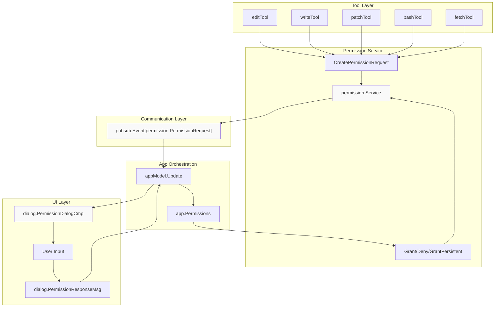
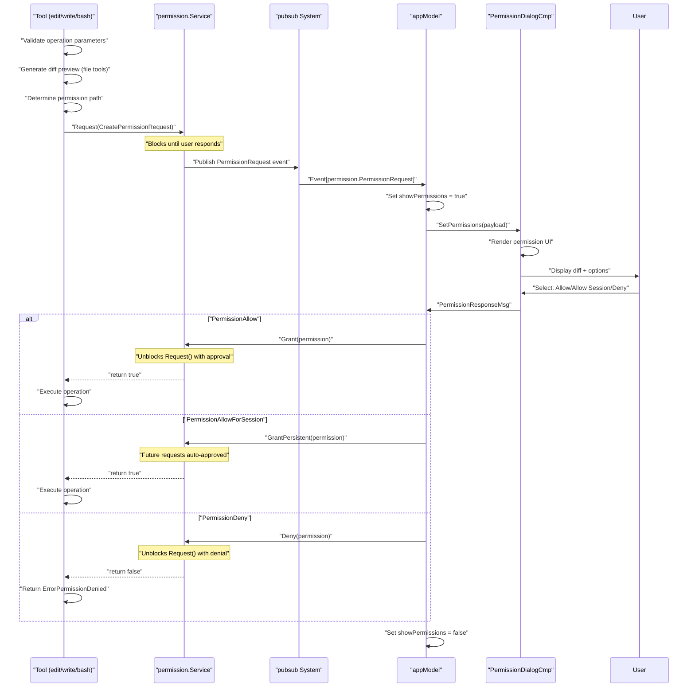
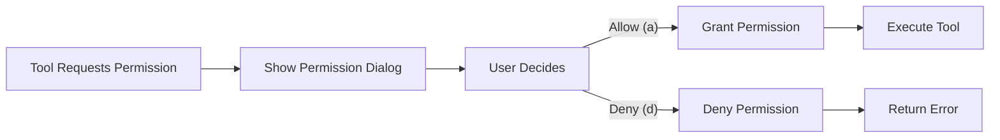
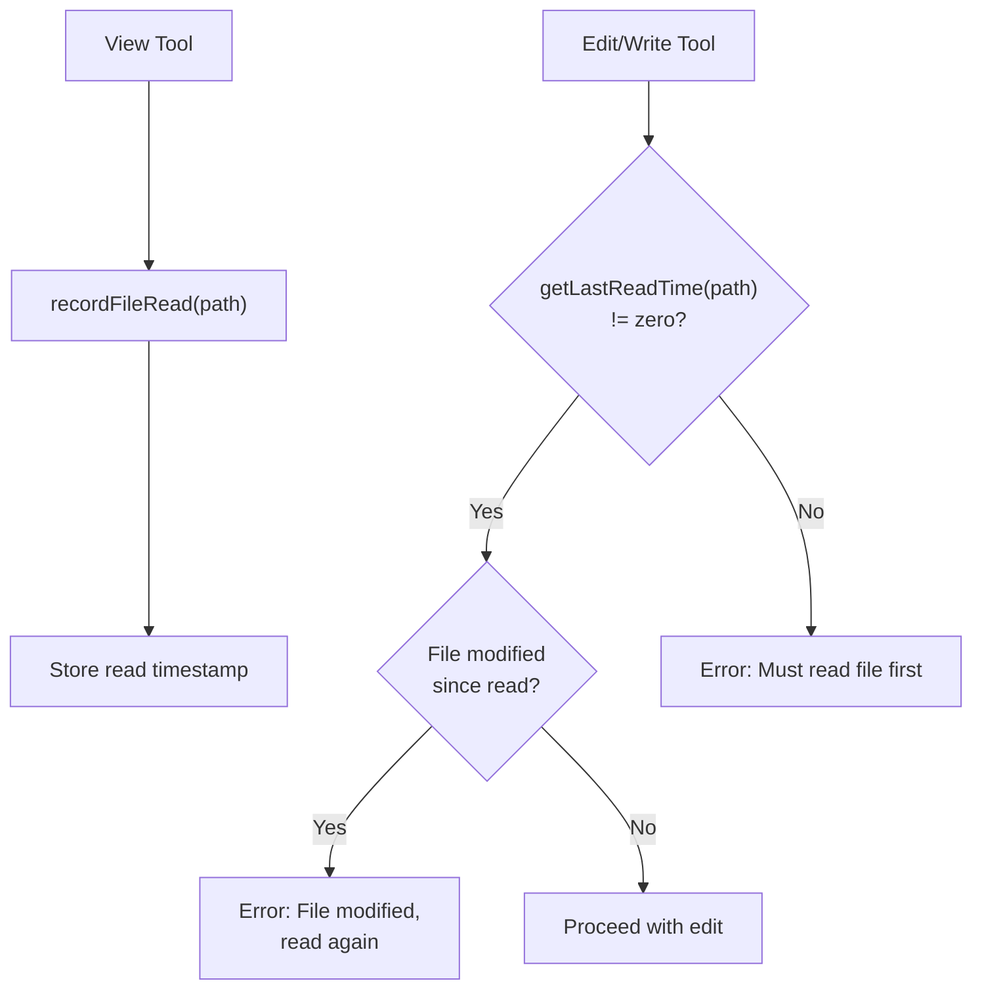
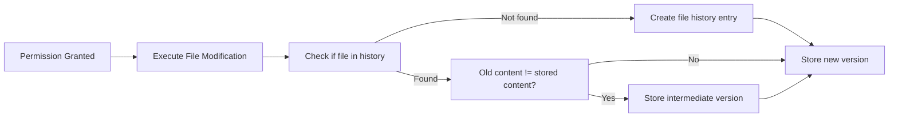

# Security and Permissions

<details>
<summary>Relevant source files</summary>

The following files were used as context for generating this wiki page:

- [README.md](README.md)
- [internal/llm/tools/edit.go](internal/llm/tools/edit.go)
- [internal/llm/tools/write.go](internal/llm/tools/write.go)
- [internal/tui/tui.go](internal/tui/tui.go)

</details>


## Purpose and Scope

This document details the permission system that controls access to file operations, shell execution, and network requests. The system ensures that AI agents cannot modify files or execute commands without explicit user approval. For information about tool execution mechanics, see [Tool System](#6). For file modification tools specifically, see [File System Tools](#6.1).

The permission system operates across three modes: interactive approval with dialogs, session-wide approval for repeated operations, and automatic approval for non-interactive execution.

---

## Permission Architecture

The permission system consists of four primary components: the `permission.Service` interface that manages approval logic, permission request structures created by tools, the permission dialog UI component, and a pub-sub event system for communication between layers.



**Permission System Architecture**

The `permission.Service` interface provides three methods: `Request()` which blocks until permission is granted or denied, `Grant()` which approves a single request, and `GrantPersistent()` which approves all similar requests for the session. Tools create permission requests by calling `permissions.Request()` with a `CreatePermissionRequest` structure that includes session context, file paths, tool names, actions, and operation previews.

Sources: [internal/llm/tools/edit.go:94-99](), [internal/tui/tui.go:275-289]()

---

## Permission Request Structure

Each permission request contains structured information about the operation requiring approval. The request includes identifiers (session ID, tool name), the target path, the action type (read, write, execute), a human-readable description, and tool-specific parameters.

| Field | Type | Purpose |
|-------|------|---------|
| `SessionID` | `string` | Links permission to conversation context |
| `Path` | `string` | Target file or directory path |
| `ToolName` | `string` | Identifies requesting tool (e.g., "edit", "write", "bash") |
| `Action` | `string` | Operation type: "read", "write", "execute" |
| `Description` | `string` | Human-readable operation summary |
| `Params` | `interface{}` | Tool-specific data (e.g., diff preview) |

For file modification tools, the `Params` field contains structured data including the full file path and a unified diff preview of the changes:

```go
type EditPermissionsParams struct {
    FilePath string `json:"file_path"`
    Diff     string `json:"diff"`
}
```

The permission path is strategically selected to control access granularity. For files within the working directory, the permission path is set to the working directory root, granting broader access. For files outside the working directory, permissions are requested per parent directory.

Sources: [internal/llm/tools/edit.go:26-29](), [internal/llm/tools/edit.go:199-216](), [internal/llm/tools/write.go:25-28](), [internal/llm/tools/write.go:164-181]()

---

## Permission Request Lifecycle



**Permission Request Flow**

The `Request()` method blocks the calling goroutine until a response is received, ensuring tools cannot proceed without explicit approval. The pub-sub system decouples the permission service from the UI layer, allowing the same permission logic to work in both interactive and non-interactive modes.

Sources: [internal/tui/tui.go:275-289](), [internal/llm/tools/edit.go:204-219](), [internal/llm/tools/write.go:169-184]()

---

## Approval Modes

The permission system supports three distinct approval modes optimized for different usage contexts:

### Interactive Mode (Default)

In interactive mode, each permission request triggers a dialog displaying the operation details and diff preview. Users must explicitly approve or deny each request. This is the default mode when running OpenCode with the TUI.



**Interactive Approval Flow**

Sources: [internal/tui/tui.go:275-289]()

### Session-Wide Approval

Users can grant persistent approval for a specific permission path and tool combination by selecting "Allow for session" (keyboard shortcut: `A`). Subsequent requests matching the same session ID, path, and tool name are automatically approved without showing the dialog.

This mode is useful when the AI agent needs to make multiple similar edits across many files or perform repeated operations. The approval persists only for the current session and does not carry over to new sessions.

Sources: [internal/tui/tui.go:283-285](), [README.md:393]()

### Auto-Approval (Non-Interactive Mode)

When running with the `-p` flag for non-interactive prompt execution, all permissions are automatically approved. This enables automated scripting and CI/CD integration without user interaction.

```bash
# All permissions auto-approved in this mode
opencode -p "fix all linting errors"
```

The auto-approval decision is made at the application initialization level, configuring the permission service to grant all requests immediately.

Sources: [README.md:307]()

---

## Permission Dialog UI

The permission dialog component displays operation details and provides three approval options with keyboard shortcuts:

| Shortcut | Action | Behavior |
|----------|--------|----------|
| `a` | Allow | Approve this single request |
| `A` | Allow for session | Approve all similar requests in this session |
| `d` | Deny | Reject this request |
| `←` / `→` / `tab` | Navigate | Switch between options |
| `Enter` / `space` | Confirm | Execute selected option |

The dialog renders at the center of the terminal, overlaying the main chat interface. It displays:

1. **Operation description** - Human-readable summary (e.g., "Replace content in file X")
2. **File path** - Absolute path to target file or directory
3. **Diff preview** - Side-by-side or unified diff showing proposed changes
4. **Tool name** - Identifies which tool is requesting permission

The dialog blocks all other keyboard input until a decision is made, preventing accidental operations while the user reviews the changes.

Sources: [README.md:387-394](), [internal/tui/tui.go:599-607](), [internal/tui/tui.go:711-724]()

---

## Safety Mechanisms

The permission system implements multiple safety mechanisms to prevent unintended file modifications and ensure data integrity.

### Read-Before-Write Enforcement

File modification tools (edit, write, patch) require that files be read using the `view` tool before modifications are allowed. This ensures the AI agent has current file context and prevents blind modifications.



**Read-Before-Write Safety Check**

The implementation stores read timestamps in an in-memory map, keyed by file path. When a modification is attempted, the tool checks both that the file was read and that its modification time hasn't changed since the read.

Sources: [internal/llm/tools/edit.go:266-277](), [internal/llm/tools/edit.go:385-396](), [internal/llm/tools/write.go:125-130]()

### Modification Time Verification

Before executing file modifications, tools compare the file's current modification time against the recorded read time. If the file has been modified externally (by the user or another process), the operation is rejected with an error message showing both timestamps:

```
file X has been modified since it was last read
(mod time: 2024-01-15T10:30:00Z, last read: 2024-01-15T10:25:00Z)
```

This prevents the AI agent from overwriting manual user edits or changes from concurrent processes.

Sources: [internal/llm/tools/edit.go:270-277](), [internal/llm/tools/edit.go:389-396](), [internal/llm/tools/write.go:125-130]()

### Uniqueness Verification for Edits

The `edit` tool requires that the `old_string` parameter uniquely identifies the content to be replaced within the file. The tool performs two checks:

1. **Existence check**: Verifies that `old_string` exists in the file
2. **Uniqueness check**: Verifies that `old_string` appears exactly once

```go
index := strings.Index(oldContent, oldString)
if index == -1 {
    return NewTextErrorResponse("old_string not found in file...")
}

lastIndex := strings.LastIndex(oldContent, oldString)
if index != lastIndex {
    return NewTextErrorResponse("old_string appears multiple times...")
}
```

If multiple instances exist, the tool returns an error instructing the AI to provide more context. This prevents accidental modification of the wrong code section.

Sources: [internal/llm/tools/edit.go:286-294](), [internal/llm/tools/edit.go:405-413]()

### Diff Preview Generation

Before requesting permission, file modification tools generate a unified diff preview showing the exact changes. The diff includes:

- Line numbers for context
- Additions marked with `+` prefix
- Removals marked with `-` prefix
- Unchanged context lines for clarity

The diff is included in the permission request parameters and displayed in the permission dialog, allowing users to review the exact changes before approval.

Sources: [internal/llm/tools/edit.go:194-198](), [internal/llm/tools/edit.go:304-308](), [internal/llm/tools/edit.go:425-429](), [internal/llm/tools/write.go:158-162]()

---

## Tool-Specific Permission Handling

Different tool categories have varying permission requirements based on their potential impact:

### File Modification Tools

The `edit`, `write`, and `patch` tools all follow the same permission pattern:

1. Generate diff preview of proposed changes
2. Set permission path (working directory or parent directory)
3. Request permission with action="write"
4. Block until user responds
5. Execute operation only if granted

Permission requests for files within the working directory use the root directory as the permission path, granting broader access. Files outside the working directory require per-directory approval.

```go
rootDir := config.WorkingDirectory()
permissionPath := filepath.Dir(filePath)
if strings.HasPrefix(filePath, rootDir) {
    permissionPath = rootDir
}
```

Sources: [internal/llm/tools/edit.go:199-216](), [internal/llm/tools/edit.go:310-327](), [internal/llm/tools/edit.go:430-447](), [internal/llm/tools/write.go:164-181]()

### Shell Execution Tool

The `bash` tool requests permission with action="execute" for shell command execution. The permission request includes the full command string, allowing users to review exactly what will be executed. Shell commands do not include diff previews since they don't modify specific files.

### Network Tools

The `fetch` tool requests permission for HTTP/HTTPS requests with action="read". The permission request includes the target URL and request method, allowing users to control network access.

### Read-Only Tools

Tools that only read data (`view`, `glob`, `grep`, `ls`, `diagnostics`) do not require permission approval. These tools access the filesystem read-only and cannot cause data loss or unintended modifications.

---

## Permission Denial Handling

When a permission request is denied, tools return a special error value that the agent system recognizes:

```go
if !p {
    return ToolResponse{}, permission.ErrorPermissionDenied
}
```

The `permission.ErrorPermissionDenied` error signals to the agent that the operation was blocked by user decision rather than a technical failure. The agent receives a tool result message indicating the denial and can adjust its strategy accordingly (e.g., explaining why it needed the permission or attempting an alternative approach).

In non-interactive mode with auto-approval, permissions are never denied, so this error path is not triggered.

The TUI displays denied permissions by closing the dialog without executing the tool. No error message is shown to the user since the denial was their explicit choice. The agent conversation continues normally, with the tool result indicating the operation did not complete.

Sources: [internal/llm/tools/edit.go:217-219](), [internal/llm/tools/write.go:182-184](), [internal/tui/tui.go:285-289]()

---

## Integration with File History

The permission system integrates with the file history service to track all approved modifications. After a permission is granted and a file modification executes successfully, the tool records the change in the history service:



**File History Recording After Permission Grant**

This tracking enables:
- Session-based file change review
- Rollback capabilities
- Detection of manual user edits between agent operations
- Audit trail for troubleshooting

The history system stores the original content before modification and each new version after modification, allowing reconstruction of the complete change sequence.

Sources: [internal/llm/tools/edit.go:227-238](), [internal/llm/tools/edit.go:338-358](), [internal/llm/tools/edit.go:457-477](), [internal/llm/tools/write.go:192-211]()