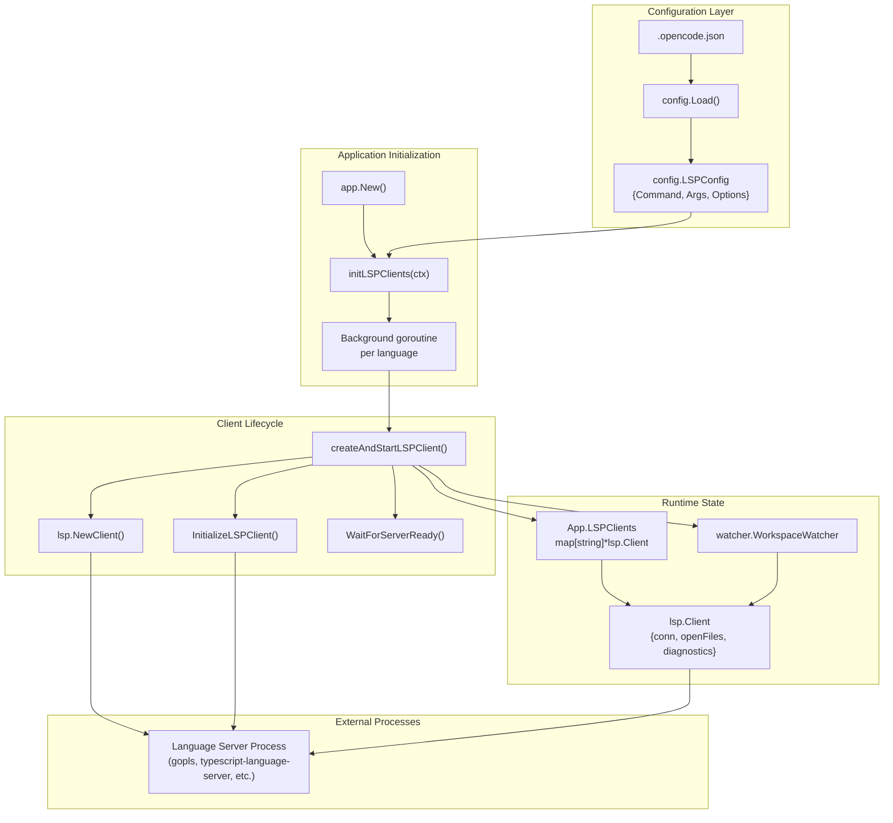
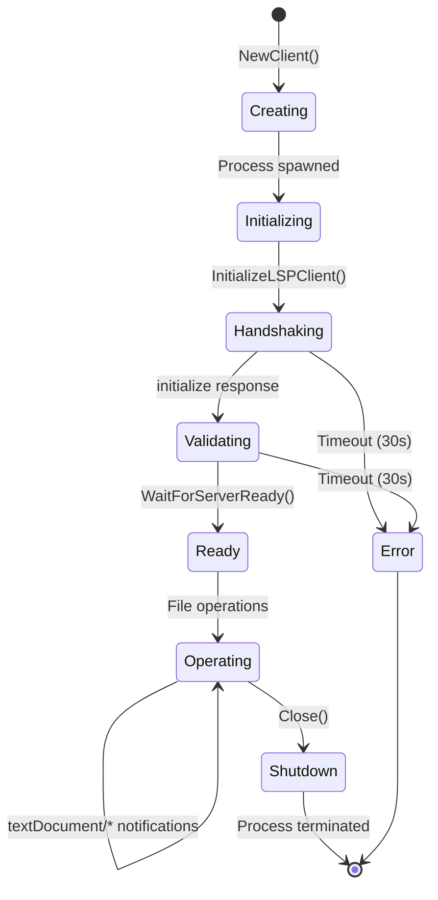
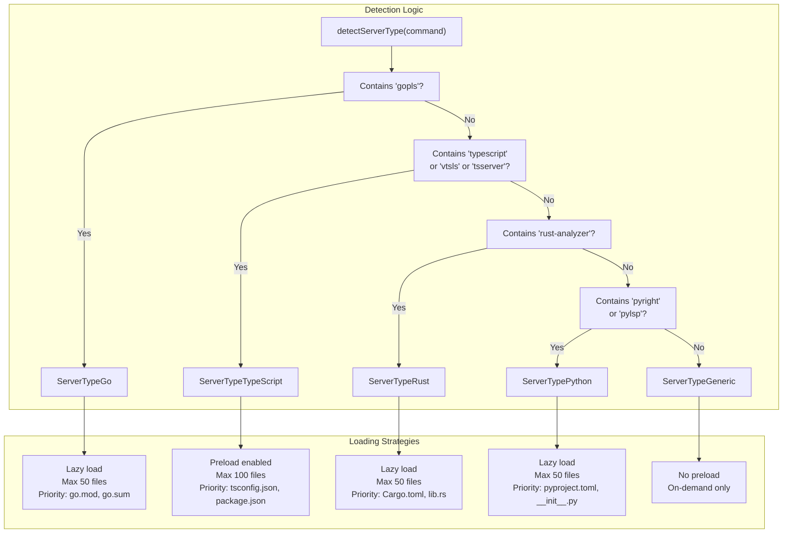
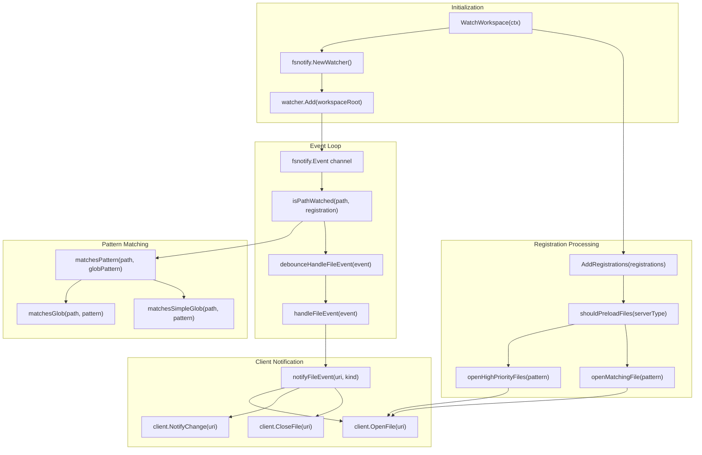
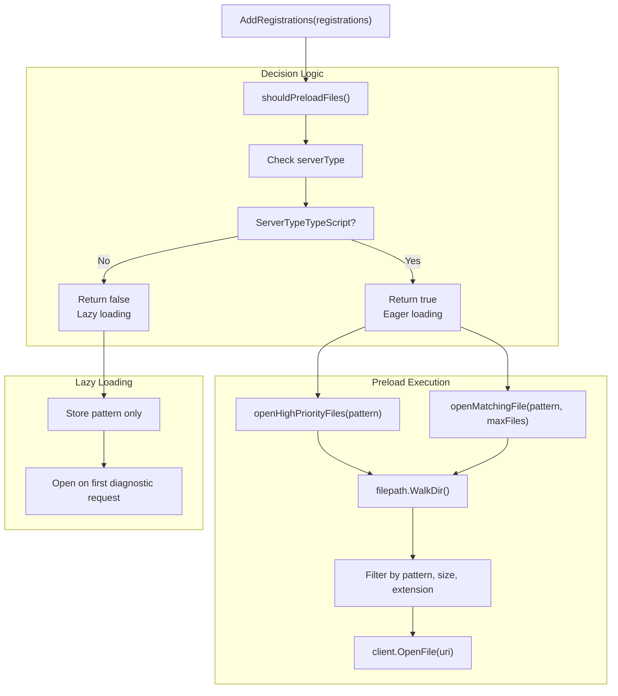
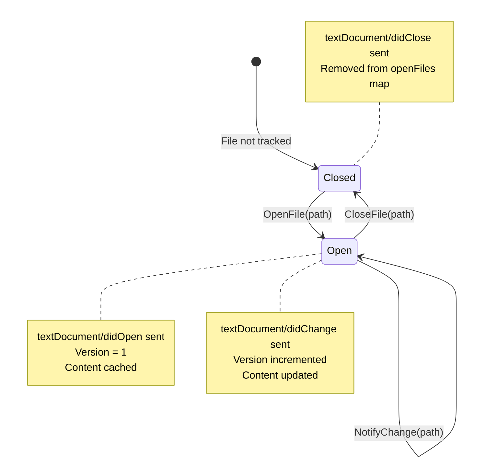
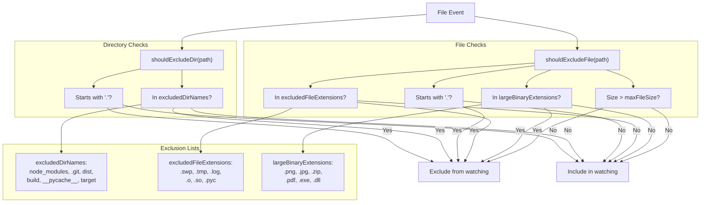
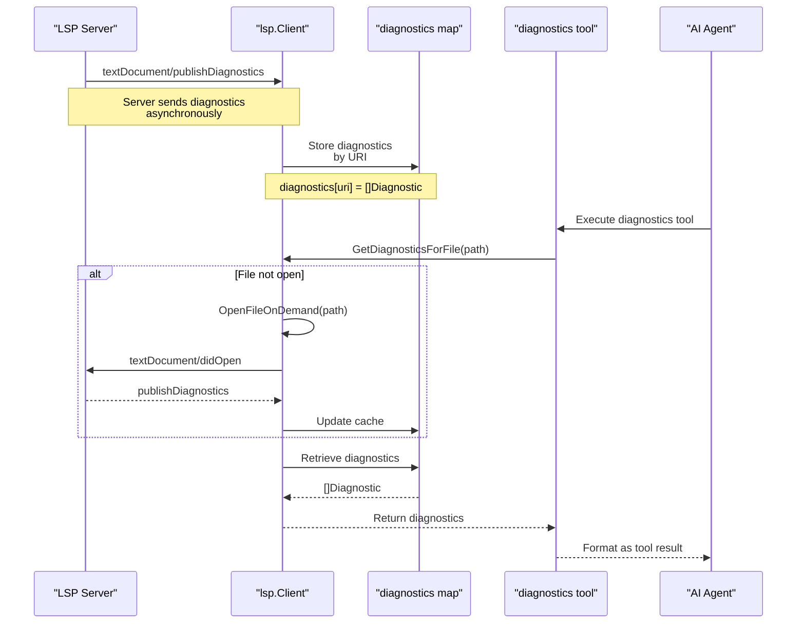
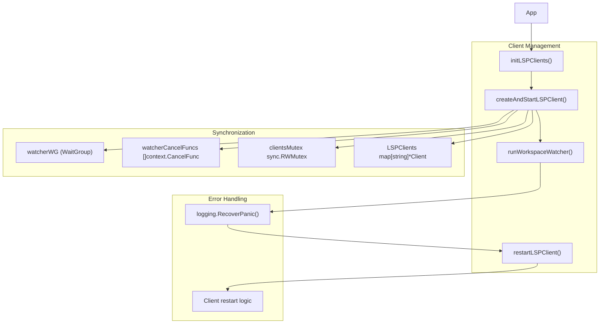

# Language Server Protocol

Relevant source files

The following files were used as context for generating this wiki page:

- [README.md](README.md)
- [cmd/root.go](cmd/root.go)
- [internal/app/app.go](internal/app/app.go)
- [internal/config/config.go](internal/config/config.go)

OpenCode integrates with Language Server Protocol (LSP) servers to provide code intelligence features to AI agents. The system manages multiple concurrent LSP clients, each connected to a different language server (e.g., `gopls` for Go, `typescript-language-server` for TypeScript). LSP diagnostics are exposed to the AI through the `diagnostics` tool, enabling context-aware code assistance.

For information about how AI agents access LSP data, see the `diagnostics` tool in [File System Tools](#6.1). For details about permission requirements for LSP operations, see [Security and Permissions](#7).

## System Overview

The LSP integration operates as a background service layer that starts during application initialization and runs throughout the session. The system architecture consists of three core subsystems:

1. **Configuration and Initialization** - LSP servers are configured in `.opencode.json` and initialized in background goroutines during app startup
2. **Client Management** - Each `lsp.Client` manages a single language server process with RPC communication
3. **Workspace Watching** - The `WorkspaceWatcher` monitors filesystem changes and maintains file synchronization with LSP servers

**Sources:** [README.md:570-608](), [internal/config/config.go:64-70](), [internal/app/app.go:33-60]()

### Configuration and Initialization Flow

The initialization process follows this sequence:

1. **Configuration Loading** - `config.Load()` reads `lsp` section from `.opencode.json`, creating `LSPConfig` entries for each language
2. **Background Initialization** - `app.New()` calls `initLSPClients()` which spawns a goroutine for each configured language server
3. **Client Creation** - Each goroutine calls `createAndStartLSPClient()` to spawn the LSP server process and establish communication
4. **Handshake** - `InitializeLSPClient()` performs the LSP initialization handshake with 30-second timeout
5. **Ready Validation** - `WaitForServerReady()` verifies server responsiveness with ping requests
6. **Storage** - Successfully initialized clients are stored in `App.LSPClients` map, keyed by language name

**Sources:** [internal/config/config.go:64-70](), [internal/app/app.go:42-80](), [cmd/root.go:100-105]()

## Client Management

The `lsp.Client` struct manages bidirectional communication with a single language server process. Each client maintains its own connection, file state, and diagnostic cache.

### Client Structure and State

The `lsp.Client` maintains several concurrent-safe data structures:

| Field | Type | Purpose |
|-------|------|---------|
| `openFiles` | `map[string]*OpenFileInfo` | Tracks open files with version numbers for change notifications |
| `diagnostics` | `map[protocol.DocumentUri][]protocol.Diagnostic` | Caches diagnostic messages received from server |
| `handlers` | `map[int32]chan *Message` | Correlates LSP responses to pending requests |
| `nextID` | `atomic.Int32` | Generates unique request IDs for RPC calls |
| `serverState` | `atomic.Value` | Tracks lifecycle state (Starting, Ready, Error) |
| `conn` | `*jsonrpc2.Conn` | JSON-RPC connection over stdin/stdout pipes |

The `OpenFileInfo` struct tracks per-file state:
- `URI` - Document URI in LSP format (`file:///path/to/file`)
- `Version` - Monotonically increasing version number for change notifications
- `Content` - Last known file content
- `LanguageID` - Language identifier (e.g., "go", "typescript")

**Sources:** [internal/lsp/client.go:22-53]()

### Lifecycle Phases

| Phase | Function | Operations | Timeout |
|-------|----------|------------|---------|
| **Creating** | `NewClient()` | Spawns server process via `exec.Command()`, establishes stdin/stdout pipes | None |
| **Initializing** | `InitializeLSPClient()` | Sends `initialize` request with workspace root, receives server capabilities | 30s |
| **Validating** | `WaitForServerReady()` | Sends ping requests to verify server responsiveness | 30s |
| **Operating** | File operations | `OpenFile()`, `NotifyChange()`, `CloseFile()`, `GetDiagnostics()` | None |
| **Shutdown** | `Close()` | Sends `shutdown` and `exit` requests, terminates process | 2s |

**Sources:** [internal/lsp/client.go:55-115](), [internal/lsp/client.go:129-231](), [internal/lsp/client.go:287-341]()

### Server-Specific Optimizations

The system detects server types through `detectServerType()` which examines the command path to identify the language server. Different servers have different performance characteristics and benefit from different file loading strategies:

| Server Type | Preload Strategy | Max Files | Key Config Files |
|-------------|------------------|-----------|------------------|
| `ServerTypeGo` | Lazy | 50 | `go.mod`, `go.sum`, `main.go` |
| `ServerTypeTypeScript` | Eager | 100 | `tsconfig.json`, `package.json`, `index.ts` |
| `ServerTypeRust` | Lazy | 50 | `Cargo.toml`, `Cargo.lock`, `lib.rs`, `main.rs` |
| `ServerTypePython` | Lazy | 50 | `pyproject.toml`, `setup.py`, `__init__.py` |
| `ServerTypeGeneric` | None | 0 | None |

TypeScript's eager preloading helps with project-wide type checking, while Go and Rust perform better with lazy loading due to their different analysis models.

**Sources:** [internal/lsp/client.go:344-418]()

## Workspace Watching

The `watcher.WorkspaceWatcher` monitors filesystem changes and maintains file synchronization with LSP servers. It implements pattern-based filtering, debounced event handling, and server-specific file loading strategies.

### Watcher Architecture

The watcher implements a debouncing mechanism with 300ms delay to prevent excessive notifications during rapid file changes (e.g., during git operations or builds). The `debounceMap` stores pending timers indexed by file URI.

**Sources:** [internal/lsp/watcher/watcher.go:44-195](), [internal/lsp/watcher/watcher.go:306-450]()

### File Registration and Preloading

When LSP servers request file watching through `workspace/didChangeWatchedFiles` capability negotiation, the watcher receives glob patterns and decides whether to proactively open matching files:

The preloading system enforces limits to prevent memory issues:
- Maximum file size: 5MB for watcher operations, 1MB for preloaded files
- Maximum files per pattern: 50-100 depending on server type
- Excluded directories: `node_modules`, `.git`, `dist`, `build`, `__pycache__`
- Excluded extensions: `.swp`, `.tmp`, `.log`, `.o`, `.so`, binary formats

**Sources:** [internal/lsp/watcher/watcher.go:197-304](), [internal/lsp/watcher/watcher.go:718-733](), [internal/lsp/watcher/watcher.go:933-987]()

## File State Synchronization

The `lsp.Client` provides methods for managing file lifecycle and content synchronization with language servers.

### File Lifecycle Operations

| Method | LSP Notification | Purpose | Version Handling |
|--------|------------------|---------|------------------|
| `OpenFile(path)` | `textDocument/didOpen` | Reads file content, adds to `openFiles` map, notifies server | Sets version to 1 |
| `NotifyChange(path)` | `textDocument/didChange` | Detects content changes, updates `openFiles`, notifies server | Increments version |
| `CloseFile(path)` | `textDocument/didClose` | Removes from `openFiles` map, notifies server | N/A |
| `OpenFileOnDemand(path)` | Same as `OpenFile` | Opens file only if not already open | Checks `openFiles` first |

The version number in `OpenFileInfo` is critical for LSP protocol compliance - servers use it to validate that change notifications correspond to the expected document state.

**Sources:** [internal/lsp/client.go:583-625](), [internal/lsp/client.go:627-664](), [internal/lsp/client.go:666-695](), [internal/lsp/client.go:744-754]()

### File Filtering

The watcher implements exclusion rules to prevent opening inappropriate files:

Size limits prevent memory exhaustion:
- `maxFileSize` constant: 5MB for watcher file operations
- Preload file size limit: 1MB (enforced in `openMatchingFile()`)
- No limit on files opened by AI tools (those use on-demand loading)

**Sources:** [internal/lsp/watcher/watcher.go:737-854]()

## Diagnostic System

LSP servers publish diagnostics (errors, warnings, hints) through the `textDocument/publishDiagnostics` notification. The client caches these diagnostics and exposes them to AI tools through the `diagnostics` tool.

### Diagnostic Flow

The diagnostic cache structure:
- Key: `protocol.DocumentUri` (e.g., `file:///path/to/file.go`)
- Value: `[]protocol.Diagnostic` containing severity, message, range, source, and code

Each `protocol.Diagnostic` includes:
- `Range` - Start/end line and character positions
- `Severity` - Error (1), Warning (2), Information (3), Hint (4)
- `Message` - Human-readable diagnostic message
- `Source` - Language server name (e.g., "gopls", "eslint")
- `Code` - Optional error code

**Sources:** [internal/lsp/client.go:732-785]()

### Diagnostic Access Methods

| Method | Behavior | Use Case |
|--------|----------|----------|
| `GetFileDiagnostics(uri)` | Returns cached diagnostics for URI, empty slice if not found | Quick lookup without side effects |
| `GetDiagnosticsForFile(path)` | Ensures file is open, waits briefly for diagnostics, returns results | AI tool queries needing guaranteed diagnostics |
| `ClearDiagnosticsForURI(uri)` | Removes diagnostics from cache | File deletion or major changes |

The `GetDiagnosticsForFile()` method implements a brief wait after opening files to allow servers to publish initial diagnostics, improving AI agent experience.

**Sources:** [internal/lsp/client.go:732-785]()

## Integration Points

The LSP system integrates with other OpenCode components through several key interfaces:

### Application Integration

The `App` manages LSP clients through coordinated lifecycle management with panic recovery and restart capabilities:

Key functions and their responsibilities:
- `initLSPClients()` - Iterates through configuration and starts all LSP clients in parallel goroutines
- `createAndStartLSPClient()` - Handles individual client lifecycle with 30-second initialization timeout
- `runWorkspaceWatcher()` - Manages workspace watching with panic recovery and automatic restart
- `restartLSPClient()` - Handles client failures, cleanup, and restart with 5-second shutdown timeout

**Sources:** [internal/app/lsp.go:13-126]()

### Configuration Integration

LSP clients are configured through the main configuration system with entries defining:
- Command path and arguments
- Server-specific settings
- Debug options (`DebugLSP` flag enables detailed logging)

The system supports multiple concurrent LSP servers, each with independent configuration and lifecycle management.

**Sources:** [internal/lsp/watcher/watcher.go:46-47](), [internal/app/lsp.go:14]()